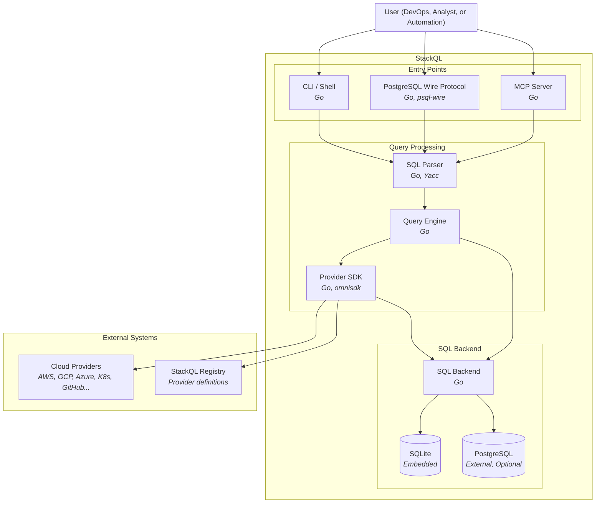

راجع أيضًا:
[[ استخدام StackQL ]](/getting-started/using-stackql) [[ استخدام المتغيرات ]](/getting-started/variables) [[ استخدام القوالب ]](/getting-started/templating)

## نظرة عامة {#overview}

يعد StackQL واجهة SQL موحدة للاستعلام عن البنية التحتية السحابية وإدارتها عبر موفرين متعددين. يوضح الرسم التخطيطي التالي للحاويات المكونات الرئيسية لنظام StackQL والتفاعلات بينها.

## المكونات الأساسية {#core-components}

### نقاط الدخول {#entry-points}

يدعم StackQL نقاط دخول متعددة لتنفيذ استعلامات SQL:

- **CLI / واجهة الأوامر**: واجهة أوامر تفاعلية وواجهة سطر أوامر لتنفيذ استعلامات SQL مباشرة من الوحدة الطرفية. يمكن للمستخدمين تشغيل استعلامات مخصصة أو برامج نصية، أو استخدام واجهة الأوامر التفاعلية للاستكشاف.

- **بروتوكول الاتصال الخاص بـ PostgreSQL**: يتيح الاتصالات من عملاء PostgreSQL القياسيين مثل `psql` وDBeaver أو أي أداة أخرى متوافقة مع PostgreSQL. ويتيح ذلك التكامل السلس مع سير عمل قواعد البيانات الحالي وأدوات BI.

- **خادم MCP**: خادم Model Context Protocol يتيح التكامل مع مساعدي الذكاء الاصطناعي، مما يسمح لنماذج اللغة الكبيرة بالاستعلام عن البنية التحتية وإدارتها باستخدام اللغة الطبيعية.

### خط أنابيب معالجة الاستعلامات {#query-processing-pipeline}

1. **محلل SQL**: يحلل إدخال SQL إلى شجرة بناء الجملة المجردة (AST) باستخدام قواعد نحوية مخصصة تستند إلى Yacc. يتحقق المحلل (الذي تم تنفيذه باسم `stackql-parser`) من صحة بناء جملة SQL ويجهزه لتخطيط الاستعلام.

2. **محرك الاستعلامات**: طبقة التنسيق المركزية التي تخطط للاستعلامات وتنفذها. يحدد المحرك العمليات التي يمكن دفعها إلى طبقة API مقابل العمليات التي تتطلب معالجة SQL محلية. يتولى محرك الاستعلامات ما يلي:
   - تخطيط الاستعلامات وتحسينها
   - التنسيق بين استدعاءات API وتنفيذ SQL المحلي
   - تجميع النتائج وتحويلها

### حزمة SDK للموفرين (omnisdk) {#provider-sdk-omnisdk}

تدير حزمة SDK للموفرين، [omnisdk](https://github.com/stackql-labs/omnisdk)، جميع التفاعلات مع مزودي الخدمات السحابية. وقد حلت محل `any-sdk` في StackQL `v1.0`. تشمل المسؤوليات الرئيسية ما يلي:

- **اكتشاف الموفرين**: تسترد مواصفات الموفرين من StackQL Registry، الذي يحتوي على تعريفات تستند إلى OpenAPI لكل مزود خدمات سحابية مدعوم، وتتحقق اختياريًا من توقيع ML-DSA-65 على كل مستند قبل استخدامه.

- **المصادقة**: تتولى المصادقة لكل موفر، مع دعم أساليب مصادقة متنوعة تشمل مفاتيح API والرموز المميزة لـ OAuth وبيانات اعتماد حساب الخدمة وغيرها. يحدد تعريف كل موفر متطلبات المصادقة الخاصة به؛ ويمكن للجلسة ربط الموفر نفسه تحت عدة أسماء مستعارة ببيانات اعتماد منفصلة (راجع [جلسات الموفر](/getting-started/provider-sessions)).

- **تخطيط الرسم البياني**: تخطط لكل جملة كرسم بياني لعمليات التبادل مع الموفرين ترتبط بحواف البيانات والتحكم. تمر عمليات الربط والاستعلامات الفرعية وتعبيرات CTE وطرق العرض عبر أداة التخطيط نفسها، وتعمل الطلبات الموزعة من الخطة بالتوازي ضمن حدود لكل موفر ولكل مضيف.

- **بناء طلبات API**: تحول استعلامات SQL إلى استدعاءات REST API المناسبة لكل موفر، مع التعامل مع بناء نقاط النهاية وتعيين المعلمات وتنسيق الطلبات.

- **التقسيم إلى صفحات**: تتعامل تلقائيًا مع استجابات API المقسمة إلى صفحات، وتخفي تعقيد أنظمة التقسيم إلى صفحات المختلفة التي يستخدمها مختلف الموفرين (المعتمدة على المؤشر أو الإزاحة أو الرمز المميز، وغيرها).

- **دفع الشروط إلى المصدر (predicate pushdown)**: تدفع الشروط التي تقابل معلمات الطلب، و`LIMIT` حيث لا يلزم ترتيب، إلى طلبات الموفر لتقليل عدد الطلبات المرسلة وحجم البيانات المنقولة.

- **تحويل الاستجابات**: تحول استجابات API إلى صفوف فور وصولها، لتخزينها مرحليًا في واجهة SQL الخلفية أو بثها إلى العميل.

تبقى اتصالات SQL والتخزين المرحلي والتنفيذ في الواجهة الخلفية ضمن StackQL. لا تحتوي omnisdk على أي تخزين مرحلي لـ SQL ولا تتلقى أي اتصال بقاعدة البيانات أبدًا؛ إذ يمرر لها StackQL مقابض العلاقات ويتلقى منها مؤشرات الصفوف.

### واجهة SQL الخلفية {#sql-backend}

تنفذ واجهة SQL الخلفية العمليات العلائقية على بيانات API المجسدة:

- **SQLite**: قاعدة بيانات مضمنة تستخدم لتخزين الجداول المؤقتة والمعالجة العلائقية. مثالية للاستعلامات المخصصة ومجموعات البيانات الأصغر.

- **PostgreSQL**: قاعدة بيانات خارجية اختيارية للتخزين الدائم ومجموعات البيانات الأكبر وأحمال عمل التحليلات المتقدمة.

تتعامل واجهة SQL الخلفية مع عمليات مثل:
- عمليات الربط JOIN عبر موفرين متعددين أو موارد متعددة
- الدوال التجميعية (COUNT وSUM وAVG وغيرها)
- الفرز والتصفية على البيانات المجسدة
- تعبيرات SQL المعقدة والاستعلامات الفرعية

## الأنظمة الخارجية {#external-systems}

### مزودو الخدمات السحابية {#cloud-providers}

يتصل StackQL بمزودي الخدمات السحابية (AWS وGCP وAzure وKubernetes وGitHub وغيرها الكثير) عبر واجهات REST API الخاصة بهم. تتم جميع الاتصالات عبر HTTPS، وتتولى حزمة SDK للموفرين تفاصيل اصطلاحات API لكل مزود.

### StackQL Registry {#stackql-registry}

يستضيف StackQL Registry تعريفات الموفرين - وهي مواصفات تستند إلى OpenAPI تصف الموارد والأساليب المتاحة وتعييناتها. للموفرين إصدارات، ويمكن سحبهم عند الطلب باستخدام الأمر `REGISTRY PULL`.

## تدفق تنفيذ الاستعلام {#query-execution-flow}

1. يرسل المستخدم استعلام SQL عبر إحدى نقاط الدخول (CLI أو بروتوكول PostgreSQL أو MCP)
2. يتحقق محلل SQL من صحة الاستعلام ويحوله إلى AST
3. يفحص محرك الاستعلامات شجرة AST وينشئ خطة تنفيذ
4. بالنسبة إلى عمليات الموفرين، تقوم حزمة SDK للموفرين بما يلي:
   - تسترد مواصفات الموفر ذات الصلة من السجل (إذا لم تكن مخزنة مؤقتًا)
   - تجري المصادقة مع مزود الخدمات السحابية
   - تبني طلبات API وتنفذها، مع التعامل مع التقسيم إلى صفحات تلقائيًا
   - تدفع الشروط إلى واجهة API حيثما أمكن
   - تجسد النتائج في واجهة SQL الخلفية
5. تنفذ واجهة SQL الخلفية أي عمليات علائقية متبقية
6. تعاد النتائج إلى المستخدم بالتنسيق المطلوب
