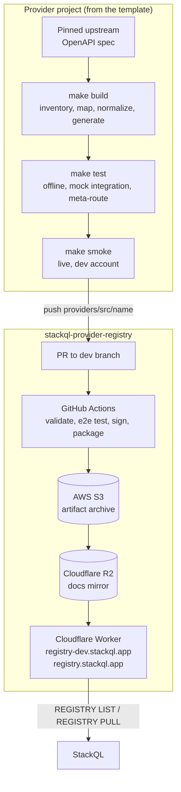

راجع أيضًا:
[[ StackQL Provider Registry ]](/providers) [[ استخدام موفر ]](/getting-started/using-a-provider) [[ REGISTRY ]](/language-spec/registry) [[ البنية المعمارية ]](/developers/architecture)

## نظرة عامة {#overview}

موفر StackQL هو مجموعة ذات إصدارات من مستندات OpenAPI بالإضافة إلى ملحقات `x-stackQL-*`، يحولها المحرك [omnisdk](https://github.com/stackql-labs/omnisdk) إلى جداول SQL: `SELECT` لعمليات القراءة، و`INSERT` و`UPDATE` و`REPLACE` و`DELETE` لعمليات دورة الحياة، و`EXEC` للإجراءات. تخبر مستندات الموفر StackQL بما يمكن لواجهة API الخاصة بالموفر القيام به وكيفية استدعائها بدلالات SQL. وهي مستندات YAML عادية، لذا يمكن بناء الموفر واختباره وإدارة إصداراته مثل أي تعليمات برمجية أخرى.

يتكون النظام البيئي للموفرين من ثلاثة مستودعات وطبقة توزيع واحدة:

| المكون | الدور |
| --- | --- |
| [__`stackql-provider-TEMPLATE`__](https://github.com/stackql-registry/stackql-provider-TEMPLATE) | نقطة البداية لمشروع موفر جديد: خط أنابيب `make` حتمي يبدأ من مواصفات أصلية مقفلة الإصدار وينتهي بموفر يتم إنشاؤه، وطبقات اختبار لا تتطلب بيانات اعتماد، ومجموعة اختبارات دخان مباشرة، وموقع مصغر للوثائق، وCI. يتضمن مهارة تطوير الموفرين الخاصة بـ Claude Code. |
| [__`omnisdk`__](https://github.com/stackql-labs/omnisdk) | المحرك الذي يقرأ مستندات الموفرين وينفذ الطلبات، بدءًا من StackQL `v1.0`. ولا يزال سابقه، [`any-sdk`](https://github.com/stackql/any-sdk)، يستضيف المرجع الخاص بعقد مستند الموفر وملحقات `x-stackQL-*` والمصادقة والتقسيم إلى صفحات والتحويلات ودفع الشروط إلى المصدر، ومخططات JSON المرتبطة أدناه. |
| [__`stackql-provider-registry`__](https://github.com/stackql/stackql-provider-registry) | المصدر الموثوق للموفرين المنشورين. تتم إدارة إصدارات المستندات ضمن `providers/src/<provider>/<version>/`، ثم يوقعها GitHub Actions رقميًا ويحزمها وينشرها. |
| __طبقة التوزيع عبر Cloudflare__ | يقدم Cloudflare Worker الملفات الناتجة المحزمة للموفرين على الحافة من Cloudflare R2 على `registry.stackql.app` (بيئة الإنتاج) و`registry-dev.stackql.app` (بيئة التطوير). وهذا هو ما تتصل به الجملتان `REGISTRY LIST` و`REGISTRY PULL`. |
<br/>
يوضح الرسم التخطيطي التالي المسار من مشروع موفر إلى تثبيت StackQL:



## بنية مستند الموفر {#provider-document-structure}

تتبع كائنات StackQL التسلسل الهرمي `provider.service.resource.method`، على سبيل المثال `google.compute.instances.list`. وتعكس المستندات هذا التسلسل الهرمي:

```
provider.yaml                          # provider metadata, providerServices, provider-level config
services/
  <service>.yaml                       # an OpenAPI 3 document per service, plus
    components.x-stackQL-resources
      <resource>                       # id, name, methods, sqlVerbs, optional config
        methods.<method>               # operation $ref, response, request, optional config
```

- __مستند الموفر__ (`provider.yaml`): `id` و`name` و`title` و`version` و`providerServices` (لكل منها `service.$ref` يشير إلى مستند الخدمة الخاص بها وعلامة `preferred` اختيارية)، والحقول الاختيارية `description` و`protocolType` (القيمة الافتراضية هي `http`) و`config`.
- __مستند الخدمة__: مستند OpenAPI 3 قياسي. الإضافة المطلوبة الوحيدة هي `components.x-stackQL-resources`، التي تعلن عن الموارد المعروضة كجداول.
- __المورد__: `id` و`name` و`methods` و`sqlVerbs`. كل مورد هو جدول؛ وتأتي أعمدته من مخطط الاستجابة للأسلوب `select` الأساسي الخاص به.
- __الأسلوب__: حقل `operation` وهو مؤشر JSON إلى `paths` (على سبيل المثال `$ref: '#/paths/~1orgs~1{org}~1repos/get'`)، وكتلة `response` (`mediaType` و`openAPIDocKey` و`objectKey`) تخبر المحرك بموضع الصفوف، وكتلة `request` و`config` اختياريتان.
- __تعيين أفعال SQL__: `sqlVerbs.select` و`insert` و`update` و`replace` و`delete` هي قوائم مرتبة من مراجع الأساليب. يأخذ StackQL في الاعتبار الأساليب المشار إليها التي توفر عبارة `WHERE` جميع معلماتها المطلوبة، ويختار الأسلوب الذي يحتوي على أكبر عدد من المعلمات المطلوبة، بصرف النظر عن ترتيب القائمة: يتم توجيه الاستعلام الذي يوفر المعرف الذي يتطلبه `get` إلى `get`، والاستعلام الذي لا يوفره إلى `list`، ويتم الإبلاغ عن الأسلوبين المتعادلين كخطأ بدلًا من الاختيار بينهما. ويمكن استدعاء أي أسلوب لا تشير إليه قائمة أفعال عبر `EXEC`.

يبدو المورد في أبسط صوره على النحو التالي:

```yaml
components:
  x-stackQL-resources:
    repos:
      id: github.repos.repos
      name: repos
      title: Repos
      methods:
        list_for_org:
          operation:
            $ref: '#/paths/~1orgs~1{org}~1repos/get'
          response:
            mediaType: application/json
            openAPIDocKey: '200'
        create_in_org:
          operation:
            $ref: '#/paths/~1orgs~1{org}~1repos/post'
          response:
            mediaType: application/json
            openAPIDocKey: '201'
          config:
            requestBodyTranslate:
              algorithm: naive
      sqlVerbs:
        select:
          - $ref: '#/components/x-stackQL-resources/repos/methods/list_for_org'
        insert:
          - $ref: '#/components/x-stackQL-resources/repos/methods/create_in_org'
```

يوجد العقد الكامل، بما في ذلك كل مفتاح ومعناه، في [مواصفات الموفر](https://github.com/stackql/any-sdk/blob/main/docs/provider_spec.md) ضمن any-sdk. توجد مخططات JSON لكل من `provider.yaml` ومستندات الخدمات وكتلة التكوين في [`any-sdk/cicd/schema-definitions`](https://github.com/stackql/any-sdk/tree/main/cicd/schema-definitions)؛ ويرفض مخطط التكوين المفاتيح غير المعروفة، لذا يفشل التحقق من صحة المفتاح المكتوب بشكل خاطئ بدلًا من تجاهله بصمت.

### ملحقات OpenAPI {#openapi-extensions}

| الملحق | الموضع | الغرض |
| --- | --- | --- |
| `x-stackQL-resources` | `components` | قاموس الموارد لمستند الخدمة (مطلوب) |
| `x-stackQL-config` | الخدمة أو المورد أو الأسلوب أو العملية | كتلة تكوين (راجع أدناه) تطبق على ذلك المستوى |
| `x-stackQL-envVar` | متغير الخادم | يحدد اسم متغير البيئة الذي يوفر قيمة متغير الخادم عندما لا يتم توفيرها في عبارة `WHERE`. الغرض منه تحديد نطاق واجهة API حسب المستأجر أو المؤسسة أو المشروع أو النشر |
| `x-stackQL-alias` | معلمة أو خاصية مخطط | اسم بديل مقبول في SQL لاسم على مستوى الاتصال |
| `x-stackQL-stringOnly` | خاصية مخطط | إجراء تسلسل للخاصية كسلسلة نصية بغض النظر عن نوعها المعلن |
| `x-stackQL-graphQL` | العملية | يبني الأسلوب على استعلام GraphQL عندما تفتقر واجهة REST API إلى البيانات |
| `x-alwaysRequired` | معلمة | يميز المعلمة على أنها مطلوبة دائمًا |
| `x-protocol` | `info` | تلميح بروتوكول الاتصال (`query` و`ec2` و`rest-xml`) لمعالجة استجابات XML المستندة إلى المخطط |

### كتلة التكوين {#the-config-block}

يشترك المفتاح `config` في `provider.yaml` والملحق `x-stackQL-config` في مستندات الخدمات في مخطط واحد. المفاتيح المسموح بها هي `auth` و`pagination` و`queryParamPushdown` و`queryParamTranspose` و`requestTranslate` و`requestBodyTranslate` و`variations` و`views` و`sqlExternalTables` و`retry` و`minStackQLVersion` و`snake_case_aliases`. يُحل التكوين من المستوى الأخص إلى المستويات الأعم، الأسلوب -> المورد -> الخدمة -> خدمة الموفر -> الموفر، لذا يمكن تجاوز القيمة الافتراضية على مستوى الموفر لمورد واحد أو أسلوب واحد.

## ما يتولاه الموفرون {#what-providers-handle}

يتولى الموفرون المهام التي تخفي تعقيد واجهات API، ليحصل المستخدمون على واجهة SQL متسقة دون إدارة محادثة HTTP الأساسية.

### المصادقة {#authentication}

يأتي كل موفر بكتلة `auth` افتراضية تحدد أسماء متغيرات البيئة التي تحمل بيانات الاعتماد الخاصة به، لذا لا تحتاج البيئة التي تم تعيين هذه المتغيرات فيها إلى أي تكوين للمصادقة في وقت التشغيل. لا يقبل مستند الموفر إلا الإشارات غير المباشرة (أسماء متغيرات البيئة ومسارات الملفات)؛ أما القيم الحرفية لبيانات الاعتماد فمكانها حصريًا سياق `--auth` في وقت التشغيل. يجب أن تتبع أسماء متغيرات البيئة موفر Terraform الخاص بالجهة المزودة حيثما وجد.

| `auth.type` | الحقول المعتادة |
| --- | --- |
| `bearer` | `credentialsenvvar` |
| `api_key` | `credentialsenvvar` و`valuePrefix`، والحقلان الاختياريان `location` (`header` أو `query`) و`name` |
| `basic` | `username_var` و`password_var` |
| `custom` | `location` و`name` و`credentialsenvvar`، و`valuePrefix` الاختياري؛ اربط بيانات اعتماد ثانية بالأولى باستخدام `successor` |
| `oauth2` | `client_id_env_var` و`client_secret_env_var` و`grant_type: client_credentials` و`token_url` و`scopes` |
| `service_account` | `credentialsenvvar` أو `credentialsfilepathenvvar`، و`scopes` |
| `aws_signing_v4`، `aws_assume_role` | `keyIDenvvar` و`credentialsenvvar` |
| `azure_default` | لا يوجد |
| `oci_signing_v1` | `tenancy_ocid_envvar` و`user_ocid_envvar` و`oci_fingerprint_envvar` و`oci_private_key_envvar` و`oci_region_envvar` |
| `interactive` | لا يوجد |
| `null_auth` | لا يوجد (بدون مصادقة بشكل صريح) |
<br/>
على سبيل المثال:

```yaml
config:
  auth:
    type: api_key
    credentialsenvvar: OKTA_API_TOKEN
    valuePrefix: 'SSWS '
```

يمكن للمستخدمين تجاوز المصادقة الخاصة بالموفر في وقت التشغيل باستخدام `--auth='{"<provider>": {...}}'`.

### التقسيم إلى صفحات {#pagination}

يعلن الموفرون عن نظام التقسيم إلى صفحات الخاص بالجهة المزودة، ويمر المحرك على كل صفحة، ليحصل المستخدمون على مجموعات نتائج كاملة. الأنظمة المدعومة:

- __رمز مميز أو مؤشر في نص الاستجابة__: `requestToken: {key: cursor, location: query}` و`responseToken: {key: $.cursor, location: body}`؛ يتوقف عند غياب الرمز المميز أو خلوه من أي قيمة.
- __عنوان URL للصفحة التالية في نص الاستجابة__: `requestToken: {key: '', location: request}` و`responseToken: {key: $.next, location: body}`؛ و`algorithm: odata_next_link` لحقل `@odata.nextLink` في OData.
- __رأس `Link` وفق RFC 5988__: `responseToken: {key: Link, location: header}`.
- __رقم الصفحة مع عدد الصفحات__: `algorithm: page_number` مع `responseToken` (الصفحة الحالية) و`responseTerminator` (إجمالي الصفحات).

واجهات API التي تعتمد على الإزاحة والحد دون مؤشر للصفحة التالية لا تعد من أنظمة التقسيم إلى صفحات؛ اعرض `offset` و`limit` كمعلمات `WHERE` بدلًا من ذلك. تحدد العلامة العامة `--http.response.pageLimit` مدى التنقل بين الصفحات.

### دفع الشروط إلى المصدر {#predicate-pushdown}

تتم مطابقة مفاتيح `WHERE` مع المعلمات المعلنة للعملية حسب الاسم (المسار، ثم الاستعلام والرأس وملف تعريف الارتباط) وإرسالها إلى واجهة API، لذا تتم التصفية عند المصدر. وأي مفتاح `WHERE` يتبقى دون معلمة مطابقة تتم إضافته كمعلمة استعلام.

إلى جانب المعلمات العادية، يعيد المفتاح `queryParamPushdown` كتابة أعمدة `SELECT` و`WHERE` و`ORDER BY` و`LIMIT` و`OFFSET` و`COUNT` في صورة معلمات API. يملأ `dialect: odata` القيم الافتراضية `$select` و`$filter` و`$orderby` و`$top` و`$skip` و`$count` التي تستخدمها Microsoft Graph وواجهات API على نمط Azure؛ ويستخدم `dialect: custom` قيمة `paramName` حرفيًا، وفي الغالب يكون ذلك `top: {paramName: limit, maxValue: 1000}` بحيث تصبح `LIMIT n` هي `?limit=n`. أما الشروط التي لا يمكن دفعها فلا يزال يتم تقييمها على جانب العميل.

### تحويل الاستجابات والطلبات {#response-and-request-transformation}

- المفتاح `response.objectKey` هو تعبير JSONPath (أو XPath لواجهات API بتنسيق XML) يحدد العناصر الحاملة للصفوف من المغلف، على سبيل المثال `$.data[*]` أو `$.value`.
- يطبق المفتاح `response.transform` قالب نصوص بلغة Go على نص الاستجابة قبل تخزينه مرحليًا كصفوف؛ وتشمل أنواع التحويل JSON وXML والنص العادي، وهكذا تصبح واجهات AWS API بتنسيق XML وإخراج CLI جداول.
- يتيح `requestBodyTranslate: {algorithm: naive}` لجملة `INSERT` قبول حقول نص الطلب كأسماء أعمدة عادية بدلًا من الشكل المسبوق بالبادئة `data__`.
- يعرض `snake_case_aliases: true` على مستوى الموفر أسماء camelCase على مستوى الاتصال كأعمدة ومعلمات بصيغة snake_case.
- يعين المفتاح `retry` سياسة تراجع أسي (`max_attempts` و`initial_delay_ms` و`max_delay_ms` و`multiplier` و`jitter_fraction` و`retryable_methods` و`retryable_conditions.status_codes`). يسري أول مستوى يعلن عنها؛ راجع [سياسة إعادة المحاولة](https://github.com/stackql/any-sdk/blob/main/docs/retry_policy.md) في any-sdk.

تتبع أنواع الأعمدة مخطط OpenAPI: `string` -> text، و`integer` -> integer، و`number` -> numeric، و`boolean` -> boolean. يتم تخزين خصائص `object` و`array` كنص JSON، ولهذا تتم قراءة الحقول المتداخلة باستخدام الدالة `json_extract` في الاستعلامات، ولهذا أيضًا غالبًا ما يقدم الموفرون طرق عرض (`config.views`، مع `ddl` لكل لهجة و`fallback`) للإسقاطات المتداخلة الشائعة.

### الموفرون غير المعتمدين على HTTP {#non-http-providers}

يجعل `protocolType: local_templated` في `provider.yaml` الموفر يعتمد على أوامر محلية بدلًا من HTTP: تحمل الأساليب مصفوفة `inline` من أجزاء argv بقوالب Go، وتستخدم المعلمات `in: inline`، ويحول المفتاح `response.transform` إخراج الأوامر إلى صفوف. يوضح الموفر المرجعي [`local_openssl`](https://github.com/stackql/any-sdk/tree/main/test/registry/src/local_openssl/v0.1.0) في any-sdk هذا الشكل. وهذا خارج نطاق خط أنابيب القالب، الذي يستهدف واجهات HTTP API.

## بدء مشروع موفر {#starting-a-provider-project}

ابدأ كل موفر جديد من [__`stackql-provider-TEMPLATE`__](https://github.com/stackql-registry/stackql-provider-TEMPLATE). وهو مستودع قوالب على GitHub يجسد المعيار الحالي للموفر: مواصفات أصلية مقفلة الإصدار، وخط أنابيب بناء حتمي يكون فيه كل قرار يدوي قاعدة في برنامج نصي بدلًا من تعديل يدوي على YAML الذي تم إنشاؤه، وثلاث طبقات اختبار لا تتطلب بيانات اعتماد، ومجموعة اختبارات دخان مباشرة بميزانية محددة، وموقع وثائق مبني على Docusaurus، وCI. يوجد الموفرون المنشورون الذين تم بناؤهم بهذه الطريقة في مؤسسة GitHub [stackql-registry](https://github.com/orgs/stackql-registry/repositories)، وهم مادة مرجعية مفيدة إلى جانب القالب.

المتطلبات الأساسية: Node.js 20 أو إصدار أحدث، وGNU make وbash (Linux أو macOS أو WSL)، وPython 3 لمجموعة اختبارات الدخان، والملف الثنائي `stackql` (يقوم `bin/start-server.sh` بتنزيله إذا لم يتم العثور عليه).

1. أنشئ المستودع من القالب (من خلال "Use this template" في GitHub) وشغّل `npm install`.
2. شغّل `bin/init-provider.sh <name> "<Title>" [https://api.vendor.com]` لاستبدال العناصر النائبة في جميع أنحاء المستودع.
3. املأ الثوابت في `provider-dev/scripts/lib/spec_helpers.mjs` (عنوان URL للمواصفات، وبادئة إصدار المسار، وبادئة النطاق لواجهة API محددة النطاق حسب المستأجر أو المشروع) والتكوين ضمن `provider-dev/config/` (`servers.json` و`provider_config.json` و`service_names.json`).
4. نفّذ خط الأنابيب، إما يدويًا من خلال أهداف `make` أو بفتح جلسة Claude Code في المستودع (راجع أدناه).
5. يسرد الأمر `grep -rn "TODO(template)"` ما لم يكتمل بعد.

يعتمد خط الأنابيب على `make` (يسرد `make help` كل الأهداف):

```bash
make fetch-spec        # verify the upstream spec against the recorded pin (fails on drift)
make inventory         # one CSV row per operation with the proposed service, resource, method and verb
make split             # write provider-dev/source/<service>.yaml from the ordered path rules
make mappings-report   # print every derived operation -> resource.method mapping without writing
make mappings          # regenerate provider-dev/config/all_services.csv and validate it
make normalize         # flatten allOf, lower oneOf/anyOf, wrap bare arrays
make generate          # generate provider.yaml + services/*.yaml, then post-process and merge GraphQL/views
make test              # offline SHOW/DESCRIBE, mock API integration tests, meta-route walk (no credentials)
make smoke             # live smoke suite against a dedicated dev account (sources .env)
make docs              # generate the provider documentation site content
make all               # everything above except the live suites
```

يستخدم خط الأنابيب داخليًا [__`@stackql/provider-utils`__](https://github.com/stackql-registry/stackql-provider-utils) (`split` و`normalize` و`analyze` و`generate` و`docgen`) مع قواعد خاصة بالموفر في `provider-dev/scripts/`. ينتهي الموفر الذي تم إنشاؤه في `provider-dev/openapi/src/<name>/v00.00.00000/`، وهو الدليل الذي يتم نشره في النهاية في السجل.

الملف `provider-dev/config/all_services.csv` هو العقد المودع لتعيين كل عملية إلى مورد وأسلوب. أي فرق يظهر عند إعادة الإنشاء هو مراجعة لتغيير جذري، وليس مجرد ضوضاء. يفشل CI عند وجود انحراف في الإنشاء غير مودع، لذا يجب أن تعيد عملية إعادة الإنشاء إنتاج الملفات الناتجة المودعة بشكل مطابق على مستوى كل بايت.

بالنسبة إلى مستودع موفر موجود يسبق القالب، انسخ الدليل `.claude/skills` إليه وابدأ من الملف `references/uplift-checklist.md` الخاص بالمهارة.

### استخدام Claude Code لتطوير الموفرين {#using-claude-code-for-provider-development}

يتضمن القالب [__مهارة تطوير موفري StackQL__](https://github.com/stackql-registry/stackql-provider-TEMPLATE/blob/main/.claude/skills/stackql-provider-development/SKILL.md) لـ [Claude Code](https://docs.anthropic.com/en/docs/claude-code). افتح جلسة Claude Code في مستودع تم إنشاؤه من القالب واطلب منه بناء الموفر؛ فهو يقرأ `CLAUDE.md` والمهارة وينفذ الخطوات بالترتيب. والمهارة هي أيضًا الإجراء المكتوب لتنفيذ العمل يدويًا.

تغطي المهارة ما يلي:

- اختيار النمط الأساسي: مستند OpenAPI أو Swagger أو مستند اكتشاف تنشره الجهة المزودة (مباشر)، أو مواصفات مشتقة من SDK الخاصة بالجهة المزودة حيث تكون SDK هي المصدر الموثوق (مشتق)
- استرداد المواصفات الأصلية وإصلاحها والتحقق من صحتها وقفل إصدارها، بحيث يظهر كل تحديث كفرق قابل للمراجعة
- جرد نقاط النهاية وتقسيم الخدمات وقواعد التعيين التي تنتج `all_services.csv`
- كل عنصر أساسي في مستند الموفر ومتى تستخدمه: تحديد النطاق باستخدام `x-stackQL-envVar`، و`objectKey`، وتحويلات الطلبات والاستجابات، والتقسيم إلى صفحات، ودفع معلمات الاستعلام إلى المصدر، وأساليب `EXEC` لدورة الحياة، ودمج GraphQL، وطرق عرض الموفر
- طبقات الاختبار الثلاث التي لا تتطلب بيانات اعتماد ومجموعة اختبارات الدخان المباشرة
- موقع الوثائق وسير عمل CI وملاحظات التسليم

يحتوي الدليل `references/` الخاص بالمهارة على تفاصيل كل خطوة، ويطبع البرنامج النصي `scripts/find_extension_examples.sh` محتوى YAML المنشور لأي مفتاح ملحق من نسخة مستنسخة من سجل الموفرين، بحيث يمكن رؤية العنصر الأساسي قيد الاستخدام قبل كتابته.

## اختبار موفر محليًا {#testing-a-provider-locally}

يقرأ StackQL الموفرين من سجل تصفه العلامة العامة `--registry`. أثناء التطوير، وجّهه إلى دليل الموفر الذي تم إنشاؤه على نظام الملفات المحلي مع تعطيل التحقق من التوقيع (لا يتم توقيع المستندات إلا عند نشرها):

```bash
export LOCAL_REG='{ "url": "file:///path/to/provider-dev/openapi", "localDocRoot": "/path/to/provider-dev/openapi", "verifyConfig": { "nopVerify": true } }'
stackql --registry="${LOCAL_REG}" shell
```

يجب أن يحتوي الدليل الموجود ضمن `localDocRoot` على `src/<provider>/<version>/provider.yaml` و`src/<provider>/<version>/services/*.yaml`، وهذا بالضبط ما ينشئه القالب. من واجهة الأوامر، تؤكد الجمل `SHOW SERVICES IN <provider>` و`SHOW RESOURCES IN <provider>.<service>` و`SHOW METHODS IN <provider>.<service>.<resource>` و`DESCRIBE EXTENDED <provider>.<service>.<resource>` السطح المتاح قبل تشغيل أي استعلام. ويؤتمت الملف `tests/offline_validation.mjs` في القالب هذه التأكيدات، ويشغل `npm run probe -- "SELECT ..."` استعلامات SQL مخصصة على واجهة API الوهمية ويطبع الاستدعاءات على مستوى الاتصال.

يتم تخزين الموفرين الذين تم سحبهم من سجل بعيد في ذاكرة التخزين المؤقت ضمن `<cwd>/.stackql` افتراضيًا؛ استخدم العلامة `--approot` لتغيير الموقع.

تفيد [واجهة CLI الخاصة بـ any-sdk](https://github.com/stackql/any-sdk/blob/main/docs/cli.md) في فحص مستند دون إشراك StackQL: يشغل الأمر `anysdk aot <registry> <provider.yaml>` التحليل الثابت على موفر (`objectKey` غير قابل للتوجيه، ومخططات استجابة مفقودة، وتقسيم إلى صفحات غير مكتمل، ومعلمات مسار متجاورة وما إلى ذلك)، ويتيح الأمر `anysdk query` تنفيذ أسلوب واحد مباشرة من مستندات الموفر والخدمة. ينشئ [اختبار Automock](https://github.com/stackql/any-sdk/blob/main/docs/automock_testing.md) واجهة API وهمية ونتائج متوقعة من المخططات الموجودة في الموفر لإجراء دورة كاملة دون المساس بواجهة API الفعلية.

### اختبار الموفر الخاص بك باستخدام السجل `dev` {#testing-your-provider-using-the-dev-registry}

بعد دمج الموفر في الفرع `dev` من السجل، تتم إتاحته من سجل التطوير. وجّه StackQL إليه للتحقق من الملف الناتج المنشور:

```bash
export DEV_REG='{ "url": "https://registry-dev.stackql.app/providers" }'
stackql --registry="${DEV_REG}" shell
```

```sql
REGISTRY PULL myprovider;
```

يشغل الهدف `make smoke-live` في القالب مجموعة اختبارات الدخان على الموفر المنشور للتحقق بعد النشر.

## نشر موفر {#publishing-a-provider}

النشر خطوة منفصلة يشارك فيها الإنسان، ولا تدخل ضمن خط أنابيب القالب.

1. أنشئ نسخة متفرعة من [stackql-provider-registry](https://github.com/stackql/stackql-provider-registry) وانسخ الدليل `provider-dev/openapi/src/<name>` الذي تم إنشاؤه إلى `providers/src/<name>` في فرع ميزة.
2. افتح طلب سحب إلى الفرع `dev` مع وصف للموفر والتغييرات (راجع [دليل المساهمة](https://github.com/stackql/stackql-provider-registry/blob/main/.github/CONTRIBUTING.md) الخاص بالسجل).
3. يتحقق GitHub Actions من صحة الموفر ويختبره باستخدام [stackql-provider-tests](https://github.com/stackql/stackql-provider-tests). القواعد التي يتم تقييمها هي: يجب أن يكون المستند مواصفات OpenAPI صالحة، ويجب أن تكون جميع الخدمات قابلة لسرد مواردها، ويجب أن تكون جميع الموارد قابلة لسرد أساليبها، ويجب أن يكون للأساليب القابلة للاستدعاء عبر `SELECT` مخطط استجابة صالح، ويجب أن يكون للأساليب القابلة للاستدعاء عبر `INSERT` مخطط طلب صالح.
4. عند الدمج، يخصص سير العمل رقم إصدار، ويوقع المستندات رقميًا (ML-DSA-65)، ويحزمها، وينشر الملف الناتج في مخزن الحفظ على AWS S3. ثم يتم نسخ شجرة المستندات إلى Cloudflare R2 ونشر Cloudflare Worker الذي يقدم `registry-dev.stackql.app`. ويتاح الموفر فورًا لعمليات التثبيت التي تم تكوينها لاستخدام السجل `dev`.
5. بعد فترة من المراقبة، تتم ترقية `dev` إلى `main`، مما يكرر النشر لـ `registry.stackql.app`. وهذا هو النشر لمثيلات StackQL ذات التكوين الافتراضي.

يمكن تشغيل أداة الاختبار `stackql-provider-tests` نفسها محليًا على دليل سجل قبل فتح طلب سحب:

```bash
test-provider.sh <provider_name> false /path/to/provider-dev/openapi
```

راجع [البناء والنشر](https://github.com/stackql/stackql-provider-registry/blob/main/docs/build-and-deployment.md) في مستودع السجل للاطلاع على سير العمل بالتفصيل، بما في ذلك آلية الحماية من حذف الموفرين التي تحمي `providers/src`.
