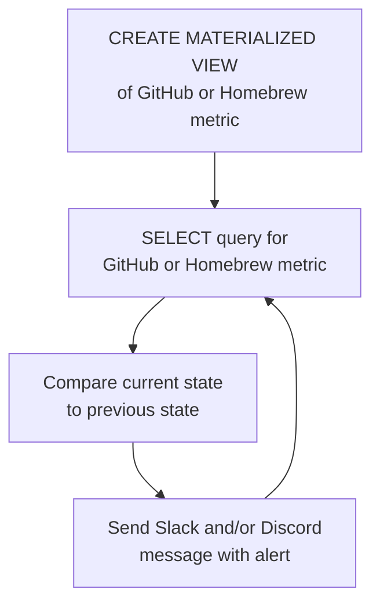

# أداة مراقبة نشاط المشاريع مفتوحة المصدر تعمل بواسطة StackQL

في هذا الدليل، سنوضح كيفية الاستضافة الذاتية لنظام مراقبة وتنبيه في الوقت الفعلي للقائمين على صيانة البرمجيات مفتوحة المصدر على GitHub.

> [__stackql__](https://github.com/stackql/stackql) أداة مفتوحة المصدر تتيح للمستخدمين الاستعلام عن الموارد السحابية وموارد SaaS والتفاعل معها باستخدام لغة SQL ومكتبات وأدوات تصور البيانات وتحليلها. امنحنا [⭐](https://github.com/stackql/stackql) إذا أعجبك هذا المشروع!

احصل على تنبيهات مثل هذه في Slack وDiscord في الوقت الفعلي:


تم الاختبار باستخدام <span class="tutorial_tested_on">واجهة SQL الخلفية المضمنة</span> <span class="tutorial_tested_on">docker</span> <span class="tutorial_tested_on">linux</span>

## نظرة عامة {#overview}

عندما بحثت عن أدوات لمراقبة مشروعنا مفتوح المصدر، وجدت أن معظمها لا يعمل كما هو معلن عنه أو لا يعمل على الإطلاق (في حالة تطبيقات الجهات الخارجية في GitHub)، لذلك أنشأت أداتنا الخاصة التي يمكنك تشغيلها واستخدامها في مشروع GitHub مفتوح المصدر الخاص بك...

يستخدم المشروع [__oss-activity-monitor__](https://github.com/stackql/oss-activity-monitor) الأداة [__stackql__](https://github.com/stackql/stackql) لمراقبة نشاط المشاريع مفتوحة المصدر في الوقت الفعلي، ويشمل ذلك الإعلام في الوقت الفعلي بما يلي:

- ⭐ stargazers جدد في مستودع GitHub
- 👀 watchers جدد في مستودع GitHub
- 🍴 نسخ متفرعة جديدة من مستودع GitHub
- 📊 مشكلات (issues) جديدة في مستودع GitHub
- 🙋 متابعون جدد لمؤسسة GitHub
- 📦 تنزيلات جديدة لملفات إصدارات GitHub
- 🍺 تنزيلات homebrew جديدة

## آلية العمل {#how-it-works}

يتم نشر المشروع في حاوية (باستخدام `docker` أو منصة أخرى لنشر الحاويات)، وهو مبني باستخدام `python` والحزمة [`pystackql`](https://pystackql.readthedocs.io/en/latest/intro.html)، ويستخدم الموفرين [`github`](https://github-provider.stackql.io/) و[`homebrew`](https://homebrew-provider.stackql.io/) لـ `stackql`. يستخدم المشروع طرق العرض المجسدة وجمل `SELECT` لالتقاط الحالة ومقارنتها بين المقاييس الحالية والسابقة لنقاط النهاية الخاضعة للمراقبة في GitHub وHomebrew، وهذا موضح في الرسم التخطيطي هنا:


على سبيل المثال، بافتراض وجود طريقة العرض المجسدة هذه التي تم إنشاؤها وملؤها باستخدام `stackql`:

```sql
CREATE OR REPLACE MATERIALIZED VIEW mvw_github_repo_stargazers AS 
SELECT login FROM github.activity.repo_stargazers
WHERE owner = 'your-org' and repo = 'your-repo'
```

يستطلع استعلام `stackql` التالي GitHub دوريًا للعثور على stargazers جدد...

```sql
SELECT c.login
FROM github.activity.repo_stargazers c
LEFT JOIN mvw_github_repo_stargazers mvw
ON c.login = mvw.login
WHERE mvw.login IS NULL
AND c.owner = 'your-org' AND c.repo = 'your-repo'
```

ثم يتم تحديث الحالة باستخدام...

```sql
REFRESH MATERIALIZED VIEW mvw_github_repo_stargazers
```

تتكرر أنماط مماثلة لكل من watchers في المستودع والمشكلات ومتابعي المؤسسة وتنزيلات ملفات الإصدار وتنزيلات homebrew.

## تشغيل المشروع {#running-the-project}

اتبع الخطوات أدناه لتشغيل المشروع محليًا أو على منصتك السحابية المفضلة.

### 1. استنساخ المستودع {#1-clone-the-repo}

```bash
git clone https://github.com/stackql/oss-activity-monitor.git
# or 
git clone git@github.com:stackql/oss-activity-monitor.git
```

### 2. تكوين متغيرات البيئة {#2-configure-environment-variables}

متغيرات البيئة التالية مطلوبة لتكوين المشروع (يتم توفيرها كمتغيرات بيئة، باستخدام ملف `.env` في المثال أدناه):

| المتغير | الوصف | قيمة المثال |
|----------------------------|-----------------------------------------------------------------------------------|--------------------------------------------------|
| `LOG_LEVEL` | مستوى السجل (INFO للسجلات العامة؛ DEBUG للتسجيل المفصل) | INFO |
| `SLEEP_INTERVAL` | مدة التأخير بالثواني بين حلقات الطلبات | 5 |
| `GITHUB_REPO` | اسم مستودع GitHub | stackql |
| `GITHUB_REPO_OWNER` | اسم مؤسسة GitHub أو اسم المالك | stackql |
| `HOMEBREW_FORMULA_NAME` | اسم formula في Homebrew، إن وجد | stackql |
| `STACKQL_GITHUB_USERNAME` | اسم المستخدم الخاص بك في GitHub | jeffreyaven |
| `STACKQL_GITHUB_PASSWORD` | الرمز المميز للوصول الشخصي الخاص بك في GitHub | ghp_yourpersonalaccesstoken |
| `SLACK_WEBHOOK_URL` | عنوان URL لخطاف الويب في Slack لإرسال الإعلامات | https://hooks.slack.com/services/... |
| `DISCORD_WEBHOOK_URL` | عنوان URL لخطاف الويب في Discord لإرسال الإعلامات | https://discord.com/api/webhooks/... |

### 3. بناء الحاوية {#3-build-the-container}

```bash
docker build --no-cache -t oss-activity-monitor .
```

### 4. تشغيل الحاوية {#4-run-the-container}

```bash
docker run --env-file .env oss-activity-monitor
```

هذا كل شيء! ستتلقى الآن تنبيهات في الوقت الفعلي عند حدوث نشاط في مشروعك مفتوح المصدر. لإيقاف الحاوية، استخدم:

```bash
docker stop $(docker ps -a -q --filter ancestor=oss-activity-monitor)
```

امنحنا ⭐ على [__GitHub__](https://github.com/stackql/stackql)
