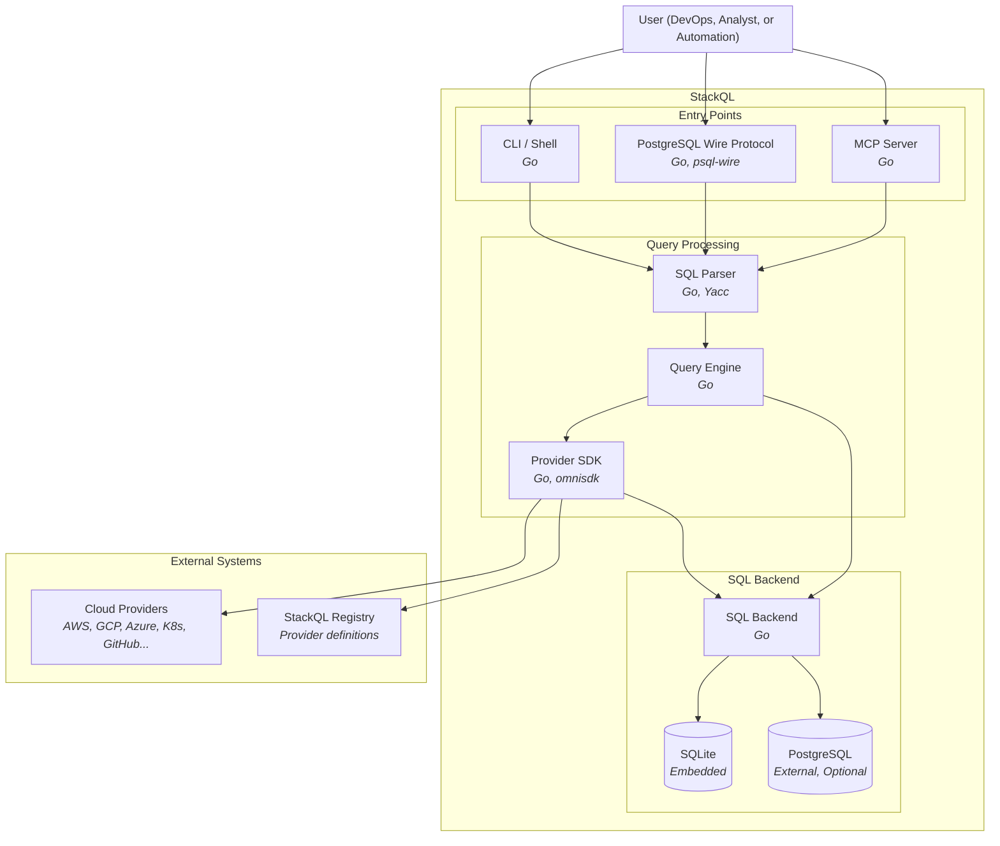

Siehe auch:
[[ StackQL verwenden ]](/getting-started/using-stackql) [[ Variablen verwenden ]](/getting-started/variables) [[ Templating ]](/getting-started/templating)

## Überblick {#overview}

StackQL ist eine einheitliche SQL-Schnittstelle zum Abfragen und Verwalten von Cloud-Infrastruktur über mehrere Provider hinweg. Das folgende Container-Diagramm veranschaulicht die Hauptkomponenten des StackQL-Systems und ihr Zusammenspiel.

## Kernkomponenten {#core-components}

### Einstiegspunkte {#entry-points}

StackQL unterstützt mehrere Einstiegspunkte zum Ausführen von SQL-Abfragen:

- **CLI / Shell**: Eine interaktive Shell und Kommandozeilenschnittstelle zum Ausführen von SQL-Abfragen direkt aus dem Terminal. Benutzer können Ad-hoc-Abfragen oder Skripte ausführen oder die interaktive Shell zur Erkundung verwenden.

- **PostgreSQL-Wire-Protokoll**: Ermöglicht Verbindungen von Standard-PostgreSQL-Clients wie `psql`, DBeaver oder jedem anderen PostgreSQL-kompatiblen Werkzeug. Das erlaubt eine nahtlose Integration in bestehende Datenbank-Workflows und BI-Tools.

- **MCP-Server**: Ein Model-Context-Protocol-Server, der die Integration von KI-Assistenten ermöglicht, sodass große Sprachmodelle Infrastruktur in natürlicher Sprache abfragen und verwalten können.

### Pipeline der Abfrageverarbeitung {#query-processing-pipeline}

1. **SQL-Parser**: Parst SQL-Eingaben mit einer eigenen, auf Yacc basierenden Grammatik in einen abstrakten Syntaxbaum (AST). Der Parser (implementiert als `stackql-parser`) validiert die SQL-Syntax und bereitet sie für die Abfrageplanung vor.

2. **Abfrage-Engine**: Die zentrale Orchestrierungsschicht, die Abfragen plant und ausführt. Sie bestimmt, welche Operationen an die API-Schicht weitergereicht werden können und welche eine lokale SQL-Verarbeitung erfordern. Die Abfrage-Engine übernimmt:
   - Abfrageplanung und -optimierung
   - Koordination zwischen API-Aufrufen und lokaler SQL-Ausführung
   - Aggregation und Transformation der Ergebnisse

### Provider-SDK (omnisdk) {#provider-sdk-omnisdk}

Das Provider-SDK, [omnisdk](https://github.com/stackql-labs/omnisdk), verwaltet alle Interaktionen mit Cloud-Anbietern. Es hat `any-sdk` in StackQL `v1.0` abgelöst. Zu den Hauptaufgaben gehören:

- **Provider-Discovery**: Ruft Provider-Spezifikationen aus der StackQL Registry ab, die OpenAPI-basierte Definitionen für jeden unterstützten Cloud-Anbieter enthält, und prüft optional die ML-DSA-65-Signatur jedes Dokuments, bevor es verwendet wird.

- **Authentifizierung**: Übernimmt die Authentifizierung für jeden Provider und unterstützt verschiedene Auth-Methoden, darunter API-Schlüssel, OAuth-Tokens, Service-Account-Anmeldedaten und mehr. Jede Provider-Definition legt ihre Authentifizierungsanforderungen fest; eine Sitzung kann denselben Provider unter mehreren Aliassen mit getrennten Anmeldedaten binden (siehe [Provider-Sitzungen](/getting-started/provider-sessions)).

- **Graphplanung**: Plant jede Anweisung als Graph von Provider-Austauschen, die durch Daten- und Steuerkanten verbunden sind. Joins, Unterabfragen, CTEs und Views laufen durch denselben Planer, und Anfragen, die sich aus einem Plan auffächern, laufen nebenläufig innerhalb von Grenzen pro Provider und pro Host.

- **Aufbau von API-Anfragen**: Wandelt SQL-Abfragen in passende REST-API-Aufrufe für jeden Provider um und übernimmt dabei die Konstruktion der Endpunkte, die Zuordnung der Parameter und die Formatierung der Anfragen.

- **Paginierung**: Verarbeitet paginierte API-Antworten automatisch und abstrahiert die Komplexität der verschiedenen Paginierungsschemata unterschiedlicher Provider (cursorbasiert, offsetbasiert, tokenbasiert usw.).

- **Prädikat-Pushdown**: Reicht Bedingungen, die auf Anfrageparameter abgebildet werden, sowie `LIMIT`, wo keine Sortierung erforderlich ist, in die Provider-Anfragen weiter, um die Zahl der Anfragen und die übertragene Datenmenge zu verringern.

- **Antworttransformation**: Wandelt API-Antworten beim Eintreffen in Zeilen um, für das Staging im SQL-Backend oder das Streaming an den Client.

SQL-Verbindungen, Staging und Backend-Ausführung verbleiben in StackQL. omnisdk enthält kein SQL-Staging und erhält nie eine Datenbankverbindung; StackQL übergibt ihm Relations-Handles und erhält Zeilen-Cursor.

### SQL-Backend {#sql-backend}

Das SQL-Backend führt relationale Operationen auf materialisierten API-Daten aus:

- **SQLite**: Eine eingebettete Datenbank für die temporäre Tabellenspeicherung und relationale Verarbeitung. Ideal für Ad-hoc-Abfragen und kleinere Datenmengen.

- **PostgreSQL**: Eine optionale externe Datenbank für persistente Speicherung, größere Datenmengen und anspruchsvolle Analyse-Workloads.

Das SQL-Backend übernimmt Operationen wie:
- JOIN-Operationen über mehrere Provider oder Ressourcen hinweg
- Aggregatfunktionen (COUNT, SUM, AVG usw.)
- Sortieren und Filtern materialisierter Daten
- Komplexe SQL-Ausdrücke und Unterabfragen

## Externe Systeme {#external-systems}

### Cloud-Anbieter {#cloud-providers}

StackQL verbindet sich über deren REST-APIs mit Cloud-Anbietern (AWS, GCP, Azure, Kubernetes, GitHub und vielen mehr). Die gesamte Kommunikation läuft über HTTPS, und das Provider-SDK kümmert sich um die Besonderheiten der API-Konventionen jedes Providers.

### StackQL Registry {#stackql-registry}

Die StackQL Registry hostet Provider-Definitionen - OpenAPI-basierte Spezifikationen, die verfügbare Ressourcen, Methoden und ihre Zuordnungen beschreiben. Provider sind versioniert und können bei Bedarf mit dem Befehl `REGISTRY PULL` abgerufen werden.

## Ablauf der Abfrageausführung {#query-execution-flow}

1. Der Benutzer sendet eine SQL-Abfrage über einen der Einstiegspunkte (CLI, PostgreSQL-Protokoll oder MCP)
2. Der SQL-Parser validiert die Abfrage und wandelt sie in einen AST um
3. Die Abfrage-Engine analysiert den AST und erstellt einen Ausführungsplan
4. Bei Provider-Operationen übernimmt das Provider-SDK folgende Schritte:
   - Ruft die passende Provider-Spezifikation aus der Registry ab (falls nicht zwischengespeichert)
   - Authentifiziert sich beim Cloud-Anbieter
   - Baut API-Anfragen auf und führt sie aus, wobei die Paginierung automatisch behandelt wird
   - Reicht Prädikate nach Möglichkeit an die API weiter
   - Materialisiert die Ergebnisse im SQL-Backend
5. Das SQL-Backend führt alle verbleibenden relationalen Operationen aus
6. Die Ergebnisse werden dem Benutzer im angeforderten Format zurückgegeben
