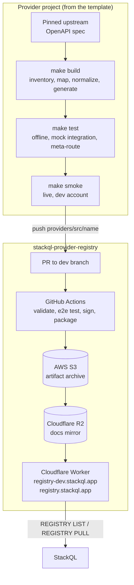

Siehe auch:
[[ StackQL Provider Registry ]](/providers) [[ Einen Provider verwenden ]](/getting-started/using-a-provider) [[ REGISTRY ]](/language-spec/registry) [[ Architektur ]](/developers/architecture)

## Überblick {#overview}

Ein StackQL-Provider ist ein versionierter Satz von OpenAPI-Dokumenten plus `x-stackQL-*`-Erweiterungen, den die [omnisdk](https://github.com/stackql-labs/omnisdk)-Engine in SQL-Tabellen umsetzt: `SELECT` für Lesezugriffe, `INSERT`, `UPDATE`, `REPLACE` und `DELETE` für Lebenszyklusoperationen und `EXEC` für Aktionen. Provider-Dokumente teilen StackQL mit, was die API eines Providers kann und wie sie mit SQL-Semantik aufgerufen wird. Sie sind reines YAML, sodass ein Provider wie jeder andere Code erstellt, getestet und versioniert werden kann.

Drei Repositories und eine Distributionsschicht bilden das Provider-Ökosystem:

| Komponente | Rolle |
| --- | --- |
| [__`stackql-provider-TEMPLATE`__](https://github.com/stackql-registry/stackql-provider-TEMPLATE) | Der Ausgangspunkt für ein neues Provider-Projekt: eine deterministische `make`-Pipeline von einer gepinnten Upstream-Spezifikation zu einem generierten Provider, Testebenen ohne Anmeldedaten, eine Live-Smoke-Suite, eine Dokumentations-Microsite und CI. Enthält den Claude-Code-Skill für die Provider-Entwicklung. |
| [__`omnisdk`__](https://github.com/stackql-labs/omnisdk) | Die Engine, die Provider-Dokumente liest und Anfragen ausführt, ab StackQL `v1.0`. Ihr Vorgänger, [`any-sdk`](https://github.com/stackql/any-sdk), beherbergt weiterhin die Referenz für den Vertrag des Provider-Dokuments, die `x-stackQL-*`-Erweiterungen, Authentifizierung, Paginierung, Transformationen und Pushdown sowie die unten verlinkten JSON-Schemas. |
| [__`stackql-provider-registry`__](https://github.com/stackql/stackql-provider-registry) | Die maßgebliche Quelle für veröffentlichte Provider. Dokumente werden unter `providers/src/<provider>/<version>/` versioniert und anschließend von GitHub Actions signiert, paketiert und veröffentlicht. |
| __Cloudflare-Distributionsschicht__ | Paketierte Provider-Artefakte werden von einem Cloudflare Worker unter `registry.stackql.app` (Produktion) und `registry-dev.stackql.app` (Entwicklung) am Edge aus Cloudflare R2 ausgeliefert. Damit kommunizieren `REGISTRY LIST` und `REGISTRY PULL`. |
<br/>
Das folgende Diagramm zeigt den Weg von einem Provider-Projekt zu einer StackQL-Installation:



## Struktur des Provider-Dokuments {#provider-document-structure}

StackQL-Objekte folgen der Hierarchie `provider.service.resource.method`, zum Beispiel `google.compute.instances.list`. Die Dokumente spiegeln diese Hierarchie wider:

```
provider.yaml                          # provider metadata, providerServices, provider-level config
services/
  <service>.yaml                       # an OpenAPI 3 document per service, plus
    components.x-stackQL-resources
      <resource>                       # id, name, methods, sqlVerbs, optional config
        methods.<method>               # operation $ref, response, request, optional config
```

- __Provider-Dokument__ (`provider.yaml`): `id`, `name`, `title`, `version`, `providerServices` (jeweils mit einer `service.$ref` auf das zugehörige Service-Dokument und einem optionalen `preferred`-Flag), optional `description`, `protocolType` (`http` ist der Standard) und `config`.
- __Service-Dokument__: ein Standard-OpenAPI-3-Dokument. Die einzige erforderliche Ergänzung ist `components.x-stackQL-resources`, das die als Tabellen bereitgestellten Ressourcen deklariert.
- __Ressource__: `id`, `name`, `methods` und `sqlVerbs`. Jede Ressource ist eine Tabelle; ihre Spalten stammen aus dem Antwortschema ihrer primären `select`-Methode.
- __Methode__: eine `operation`, die ein JSON-Pointer in `paths` ist (zum Beispiel `$ref: '#/paths/~1orgs~1{org}~1repos/get'`), ein `response`-Block (`mediaType`, `openAPIDocKey`, `objectKey`), der der Engine mitteilt, wo die Zeilen liegen, sowie ein optionaler `request`-Block und `config`.
- __SQL-Verb-Zuordnung__: `sqlVerbs.select`, `insert`, `update`, `replace` und `delete` sind geordnete Listen von Methodenreferenzen. Die Referenzen werden in der geschriebenen Reihenfolge ausprobiert, und die erste, deren erforderliche Parameter durch die `WHERE`-Klausel erfüllt sind, gewinnt; führen Sie daher `list` vor `get` auf. Jede Methode, die von keiner Verbliste referenziert wird, ist über `EXEC` aufrufbar.

Eine minimale Ressource sieht so aus:

```yaml
components:
  x-stackQL-resources:
    repos:
      id: github.repos.repos
      name: repos
      title: Repos
      methods:
        list_for_org:
          operation:
            $ref: '#/paths/~1orgs~1{org}~1repos/get'
          response:
            mediaType: application/json
            openAPIDocKey: '200'
        create_in_org:
          operation:
            $ref: '#/paths/~1orgs~1{org}~1repos/post'
          response:
            mediaType: application/json
            openAPIDocKey: '201'
          config:
            requestBodyTranslate:
              algorithm: naive
      sqlVerbs:
        select:
          - $ref: '#/components/x-stackQL-resources/repos/methods/list_for_org'
        insert:
          - $ref: '#/components/x-stackQL-resources/repos/methods/create_in_org'
```

Der vollständige Vertrag, einschließlich jedes Schlüssels und seiner Bedeutung, steht in der any-sdk-[Provider-Spezifikation](https://github.com/stackql/any-sdk/blob/main/docs/provider_spec.md). JSON-Schemas für `provider.yaml`, Service-Dokumente und den Config-Block liegen in [`any-sdk/cicd/schema-definitions`](https://github.com/stackql/any-sdk/tree/main/cicd/schema-definitions); das Config-Schema lehnt unbekannte Schlüssel ab, sodass ein falsch geschriebener Schlüssel die Validierung nicht besteht, statt stillschweigend ignoriert zu werden.

### OpenAPI-Erweiterungen {#openapi-extensions}

| Erweiterung | Wo | Zweck |
| --- | --- | --- |
| `x-stackQL-resources` | `components` | Das Ressourcenverzeichnis eines Service-Dokuments (erforderlich) |
| `x-stackQL-config` | Service, Ressource, Methode oder Operation | Ein Config-Block (siehe unten), der auf dieser Ebene angewendet wird |
| `x-stackQL-envVar` | Servervariable | Benennt eine Umgebungsvariable, die die Servervariable liefert, wenn sie nicht in der `WHERE`-Klausel angegeben ist. Dient dazu, eine API auf Tenant, Organisation, Projekt oder Deployment einzugrenzen |
| `x-stackQL-alias` | Parameter oder Schema-Eigenschaft | Ein alternativer Name, der in SQL für einen Namen auf Wire-Ebene akzeptiert wird |
| `x-stackQL-stringOnly` | Schema-Eigenschaft | Serialisiert die Eigenschaft als Zeichenkette, unabhängig vom deklarierten Typ |
| `x-stackQL-graphQL` | Operation | Hinterlegt eine Methode mit einer GraphQL-Abfrage, wo der REST-API die Daten fehlen |
| `x-alwaysRequired` | Parameter | Markiert einen Parameter als immer erforderlich |
| `x-protocol` | `info` | Hinweis auf das Wire-Protokoll (`query`, `ec2`, `rest-xml`) für die schemagesteuerte Verarbeitung von XML-Antworten |

### Der Config-Block {#the-config-block}

`config` in `provider.yaml` und `x-stackQL-config` in Service-Dokumenten teilen sich ein Schema. Die zulässigen Schlüssel sind `auth`, `pagination`, `queryParamPushdown`, `queryParamTranspose`, `requestTranslate`, `requestBodyTranslate`, `variations`, `views`, `sqlExternalTables`, `retry`, `minStackQLVersion` und `snake_case_aliases`. Die Config wird von der spezifischsten Ebene nach außen aufgelöst, Methode -> Ressource -> Service -> Provider-Service -> Provider, sodass ein providerweiter Standardwert für eine einzelne Ressource oder Methode überschrieben werden kann.

## Was Provider übernehmen {#what-providers-handle}

Provider sind für die Funktionen zuständig, die die Komplexität der API abstrahieren, sodass Benutzer eine einheitliche SQL-Schnittstelle erhalten, ohne die zugrunde liegende HTTP-Kommunikation selbst zu verwalten.

### Authentifizierung {#authentication}

Jeder Provider liefert einen Standard-`auth`-Block mit, der die Umgebungsvariablen benennt, die seine Anmeldedaten enthalten, sodass eine befüllte Umgebung keine Auth-Konfiguration zur Laufzeit benötigt. In einem Provider-Dokument sind nur Indirektionen (Namen von Umgebungsvariablen, Dateipfade) zulässig; literale Anmeldedaten gehören ausschließlich in den `--auth`-Kontext zur Laufzeit. Die Namen der Umgebungsvariablen sollten dem Terraform-Provider des Anbieters folgen, sofern einer existiert.

| `auth.type` | Typische Felder |
| --- | --- |
| `bearer` | `credentialsenvvar` |
| `api_key` | `credentialsenvvar`, `valuePrefix`, optional `location` (`header` oder `query`) und `name` |
| `basic` | `username_var`, `password_var` |
| `custom` | `location`, `name`, `credentialsenvvar`, optional `valuePrefix`; weitere Anmeldedaten werden mit `successor` verkettet |
| `oauth2` | `client_id_env_var`, `client_secret_env_var`, `grant_type: client_credentials`, `token_url`, `scopes` |
| `service_account` | `credentialsenvvar` oder `credentialsfilepathenvvar`, `scopes` |
| `aws_signing_v4`, `aws_assume_role` | `keyIDenvvar`, `credentialsenvvar` |
| `azure_default` | keine |
| `oci_signing_v1` | `tenancy_ocid_envvar`, `user_ocid_envvar`, `oci_fingerprint_envvar`, `oci_private_key_envvar`, `oci_region_envvar` |
| `interactive` | keine |
| `null_auth` | keine (explizit nicht authentifiziert) |
<br/>
Zum Beispiel:

```yaml
config:
  auth:
    type: api_key
    credentialsenvvar: OKTA_API_TOKEN
    valuePrefix: 'SSWS '
```

Benutzer können die Authentifizierung eines Providers zur Laufzeit mit `--auth='{"<provider>": {...}}'` überschreiben.

### Paginierung {#pagination}

Provider deklarieren das Paginierungsschema des Anbieters, und die Engine durchläuft jede Seite, sodass Benutzer vollständige Ergebnismengen erhalten. Unterstützte Schemata:

- __Token oder Cursor im Body__: `requestToken: {key: cursor, location: query}`, `responseToken: {key: $.cursor, location: body}`; endet, wenn das Token fehlt oder leer ist.
- __URL der nächsten Seite im Body__: `requestToken: {key: '', location: request}`, `responseToken: {key: $.next, location: body}`; `algorithm: odata_next_link` für OData `@odata.nextLink`.
- __`Link`-Header nach RFC 5988__: `responseToken: {key: Link, location: header}`.
- __Seitennummer mit Seitenanzahl__: `algorithm: page_number` mit `responseToken` (aktuelle Seite) und `responseTerminator` (Gesamtzahl der Seiten).

Offset-und-Limit-APIs ohne Next-Marker sind kein Paginierungsschema; stellen Sie stattdessen `offset` und `limit` als `WHERE`-Parameter bereit. Das globale Flag `--http.response.pageLimit` begrenzt den Durchlauf.

### Prädikat-Pushdown {#predicate-pushdown}

`WHERE`-Schlüssel werden anhand des Namens den deklarierten Parametern der Operation zugeordnet (Pfad, dann Query, Header und Cookie) und an die API gesendet, sodass die Filterung an der Quelle stattfindet. Jeder verbleibende `WHERE`-Schlüssel ohne passenden Parameter wird als Query-Parameter angehängt.

Über einfache Parameter hinaus schreibt `queryParamPushdown` `SELECT`-Spalten, `WHERE`, `ORDER BY`, `LIMIT`, `OFFSET` und `COUNT` in API-Parameter um. `dialect: odata` setzt die Standardwerte `$select`, `$filter`, `$orderby`, `$top`, `$skip` und `$count`, die von Microsoft Graph und APIs im Azure-Stil verwendet werden; `dialect: custom` verwendet `paramName` unverändert, meist `top: {paramName: limit, maxValue: 1000}`, sodass aus `LIMIT n` `?limit=n` wird. Prädikate, die nicht weitergereicht werden können, werden weiterhin clientseitig ausgewertet.

### Antwort- und Anfragetransformation {#response-and-request-transformation}

- `response.objectKey` ist ein JSONPath (oder XPath bei XML-APIs), der die zeilentragenden Elemente aus einem Envelope auswählt, zum Beispiel `$.data[*]` oder `$.value`.
- `response.transform` wendet eine Go-Textvorlage auf einen Body an, bevor er als Zeilen bereitgestellt wird; die Transformationstypen decken JSON, XML und reinen Text ab, wodurch AWS-XML-APIs und CLI-Ausgaben zu Tabellen werden.
- `requestBodyTranslate: {algorithm: naive}` erlaubt es `INSERT`, Felder des Request-Bodys als einfache Spaltennamen statt in der Form mit `data__`-Präfix entgegenzunehmen.
- `snake_case_aliases: true` auf Provider-Ebene stellt camelCase-Wire-Namen als snake_case-Spalten und -Parameter bereit.
- `retry` legt eine Richtlinie für exponentielles Backoff fest (`max_attempts`, `initial_delay_ms`, `max_delay_ms`, `multiplier`, `jitter_fraction`, `retryable_methods`, `retryable_conditions.status_codes`). Die erste Ebene, die eine deklariert, gewinnt; siehe die any-sdk-[Retry-Richtlinie](https://github.com/stackql/any-sdk/blob/main/docs/retry_policy.md).

Spaltentypen folgen dem OpenAPI-Schema: `string` -> text, `integer` -> integer, `number` -> numeric, `boolean` -> boolean. `object`- und `array`-Eigenschaften werden als JSON-Text gespeichert, weshalb verschachtelte Felder in Abfragen mit `json_extract` gelesen werden und Provider häufig Views (`config.views`, mit `ddl` je Dialekt und einem `fallback`) für gängige verschachtelte Projektionen mitliefern.

### Nicht-HTTP-Provider {#non-http-providers}

`protocolType: local_templated` in `provider.yaml` hinterlegt einen Provider mit lokalen Befehlen statt HTTP: Methoden tragen ein `inline`-Array von argv-Fragmenten als Go-Vorlagen, Parameter verwenden `in: inline`, und ein `response.transform` wandelt die Befehlsausgabe in Zeilen um. Der Referenz-Provider [`local_openssl`](https://github.com/stackql/any-sdk/tree/main/test/registry/src/local_openssl/v0.1.0) in any-sdk zeigt die Form. Dies liegt außerhalb des Umfangs der Vorlagen-Pipeline, die auf HTTP-APIs ausgerichtet ist.

## Ein Provider-Projekt starten {#starting-a-provider-project}

Beginnen Sie jeden neuen Provider mit [__`stackql-provider-TEMPLATE`__](https://github.com/stackql-registry/stackql-provider-TEMPLATE). Es ist ein GitHub-Vorlagen-Repository, das den aktuellen Standard für einen Provider festschreibt: eine gepinnte Upstream-Spezifikation, eine deterministische Build-Pipeline, in der jede manuelle Entscheidung eine Regel in einem Skript ist statt einer Handänderung an generiertem YAML, drei Testebenen ohne Anmeldedaten, eine budgetierte Live-Smoke-Suite, eine Docusaurus-Dokumentationsseite und CI. Auf diese Weise erstellte, veröffentlichte Provider liegen in der GitHub-Organisation [stackql-registry](https://github.com/orgs/stackql-registry/repositories) und sind neben der Vorlage nützliches Referenzmaterial.

Voraussetzungen: Node.js 20 oder neuer, GNU make und bash (Linux, macOS oder WSL), Python 3 für die Smoke-Suite und eine `stackql`-Binärdatei (`bin/start-server.sh` lädt eine herunter, wenn keine gefunden wird).

1. Erstellen Sie das Repository aus der Vorlage (GitHub "Use this template") und führen Sie `npm install` aus.
2. Führen Sie `bin/init-provider.sh <name> "<Title>" [https://api.vendor.com]` aus, um die Platzhalter im gesamten Repository zu ersetzen.
3. Tragen Sie die Konstanten in `provider-dev/scripts/lib/spec_helpers.mjs` ein (Spec-URL, Versionspräfix im Pfad, Scope-Präfix für eine auf Tenant oder Projekt eingegrenzte API) sowie die Konfiguration unter `provider-dev/config/` (`servers.json`, `provider_config.json`, `service_names.json`).
4. Arbeiten Sie die Pipeline ab, entweder von Hand über die `make`-Targets oder indem Sie eine Claude-Code-Sitzung im Repository öffnen (siehe unten).
5. `grep -rn "TODO(template)"` listet auf, was noch offen ist.

Die Pipeline wird über `make` gesteuert (`make help` listet jedes Target auf):

```bash
make fetch-spec        # verify the upstream spec against the recorded pin (fails on drift)
make inventory         # one CSV row per operation with the proposed service, resource, method and verb
make split             # write provider-dev/source/<service>.yaml from the ordered path rules
make mappings-report   # print every derived operation -> resource.method mapping without writing
make mappings          # regenerate provider-dev/config/all_services.csv and validate it
make normalize         # flatten allOf, lower oneOf/anyOf, wrap bare arrays
make generate          # generate provider.yaml + services/*.yaml, then post-process and merge GraphQL/views
make test              # offline SHOW/DESCRIBE, mock API integration tests, meta-route walk (no credentials)
make smoke             # live smoke suite against a dedicated dev account (sources .env)
make docs              # generate the provider documentation site content
make all               # everything above except the live suites
```

Im Hintergrund verwendet die Pipeline [__`@stackql/provider-utils`__](https://github.com/stackql-registry/stackql-provider-utils) (`split`, `normalize`, `analyze`, `generate` und `docgen`) mit providerspezifischen Regeln in `provider-dev/scripts/`. Der generierte Provider landet in `provider-dev/openapi/src/<name>/v00.00.00000/`, dem Verzeichnis, das schließlich in der Registry veröffentlicht wird.

`provider-dev/config/all_services.csv` ist der committete Vertrag jeder Zuordnung von Operation zu Ressource und Methode. Ein Diff bei der Neugenerierung ist ein Review einer Breaking Change, kein Rauschen. CI schlägt bei nicht committetem Generierungs-Drift fehl, daher muss eine Neugenerierung die committeten Artefakte Byte für Byte reproduzieren.

Für ein bestehendes Provider-Repository, das älter ist als die Vorlage, kopieren Sie das Verzeichnis `.claude/skills` hinein und beginnen Sie mit der `references/uplift-checklist.md` des Skills.

### Claude Code für die Provider-Entwicklung verwenden {#using-claude-code-for-provider-development}

Die Vorlage enthält den [__Skill für die StackQL-Provider-Entwicklung__](https://github.com/stackql-registry/stackql-provider-TEMPLATE/blob/main/.claude/skills/stackql-provider-development/SKILL.md) für [Claude Code](https://docs.anthropic.com/en/docs/claude-code). Öffnen Sie eine Claude-Code-Sitzung in einem aus der Vorlage erstellten Repository und bitten Sie es, den Provider zu erstellen; es übernimmt `CLAUDE.md` und den Skill und arbeitet die Schritte der Reihe nach ab. Der Skill ist zugleich die schriftliche Anleitung, um die Arbeit von Hand zu erledigen.

Der Skill behandelt:

- Die Wahl des Archetyps: ein vom Anbieter veröffentlichtes OpenAPI-, Swagger- oder Discovery-Dokument (direkt) oder eine aus einem Anbieter-SDK abgeleitete Spezifikation, bei der das SDK die maßgebliche Quelle ist (abgeleitet)
- Das Abrufen, Korrigieren, Validieren und Pinnen der Upstream-Spezifikation, sodass jede Aktualisierung ein überprüfbarer Diff ist
- Das Endpunkt-Inventar, die Aufteilung in Services und die Zuordnungsregeln, die `all_services.csv` erzeugen
- Jedes Primitiv des Provider-Dokuments und wann es einzusetzen ist: Eingrenzung mit `x-stackQL-envVar`, `objectKey`, Anfrage- und Antworttransformationen, Paginierung, Query-Parameter-Pushdown, `EXEC`-Lebenszyklusmethoden, das Zusammenführen von GraphQL und Provider-Views
- Die drei Testebenen ohne Anmeldedaten und die Live-Smoke-Suite
- Die Dokumentationsseite, CI-Workflows und Übergabenotizen

Das Verzeichnis `references/` des Skills enthält die Details zu jedem Schritt, und `scripts/find_extension_examples.sh` gibt aus einem Klon der Provider-Registry ausgeliefertes YAML für jeden Erweiterungsschlüssel aus, sodass ein Primitiv im Einsatz betrachtet werden kann, bevor es geschrieben wird.

## Einen Provider lokal testen {#testing-a-provider-locally}

StackQL liest Provider aus einer Registry, die durch das globale Flag `--registry` beschrieben wird. Richten Sie es während der Entwicklung mit deaktivierter Signaturprüfung auf das generierte Provider-Verzeichnis im lokalen Dateisystem (Dokumente werden erst bei der Veröffentlichung signiert):

```bash
export LOCAL_REG='{ "url": "file:///path/to/provider-dev/openapi", "localDocRoot": "/path/to/provider-dev/openapi", "verifyConfig": { "nopVerify": true } }'
stackql --registry="${LOCAL_REG}" shell
```

Das Verzeichnis unter `localDocRoot` muss `src/<provider>/<version>/provider.yaml` und `src/<provider>/<version>/services/*.yaml` enthalten, was genau dem entspricht, was die Vorlage generiert. In der Shell bestätigen `SHOW SERVICES IN <provider>`, `SHOW RESOURCES IN <provider>.<service>`, `SHOW METHODS IN <provider>.<service>.<resource>` und `DESCRIBE EXTENDED <provider>.<service>.<resource>` die Oberfläche, bevor eine Abfrage ausgeführt wird. Die `tests/offline_validation.mjs` der Vorlage automatisiert diese Prüfungen, und `npm run probe -- "SELECT ..."` führt Ad-hoc-SQL gegen die Mock-API aus und gibt die Wire-Aufrufe aus.

Aus einer entfernten Registry gezogene Provider werden standardmäßig unter `<cwd>/.stackql` zwischengespeichert; verwenden Sie `--approot`, um den Speicherort zu ändern.

Die [any-sdk-CLI](https://github.com/stackql/any-sdk/blob/main/docs/cli.md) ist nützlich, um ein Dokument ohne StackQL zu prüfen: `anysdk aot <registry> <provider.yaml>` führt eine statische Analyse über einen Provider aus (nicht auflösbarer `objectKey`, fehlende Antwortschemata, unvollständige Paginierung, benachbarte Pfadparameter und so weiter), und `anysdk query` führt eine einzelne Methode direkt aus den Provider- und Service-Dokumenten aus. [Automock-Tests](https://github.com/stackql/any-sdk/blob/main/docs/automock_testing.md) generieren aus den Schemata eines Providers eine Mock-API und erwartete Ergebnisse für einen vollständigen Durchlauf, ohne die Live-API zu berühren.

### Ihren Provider mit der `dev`-Registry testen {#testing-your-provider-using-the-dev-registry}

Sobald ein Provider in den `dev`-Branch der Registry gemergt wurde, ist er über die Entwicklungs-Registry verfügbar. Richten Sie StackQL darauf, um das veröffentlichte Artefakt zu prüfen:

```bash
export DEV_REG='{ "url": "https://registry-dev.stackql.app/providers" }'
stackql --registry="${DEV_REG}" shell
```

```sql
REGISTRY PULL myprovider;
```

Das Target `make smoke-live` der Vorlage führt die Smoke-Suite gegen den veröffentlichten Provider aus, um ihn nach der Veröffentlichung zu prüfen.

## Einen Provider veröffentlichen {#publishing-a-provider}

Die Veröffentlichung ist ein separater Schritt mit menschlicher Beteiligung und nicht Teil der Vorlagen-Pipeline.

1. Forken Sie [stackql-provider-registry](https://github.com/stackql/stackql-provider-registry) und kopieren Sie das generierte Verzeichnis `provider-dev/openapi/src/<name>` in einem Feature-Branch nach `providers/src/<name>`.
2. Stellen Sie einen Pull Request gegen den `dev`-Branch mit einer Beschreibung des Providers und der Änderungen (siehe den [Leitfaden für Beiträge](https://github.com/stackql/stackql-provider-registry/blob/main/.github/CONTRIBUTING.md) der Registry).
3. GitHub Actions validiert und testet den Provider mit [stackql-provider-tests](https://github.com/stackql/stackql-provider-tests). Die geprüften Regeln sind: Das Dokument muss eine gültige OpenAPI-Spezifikation sein, alle Services müssen nach Ressourcen aufzählbar sein, alle Ressourcen müssen nach Methoden aufzählbar sein, über `SELECT` aufrufbare Methoden müssen ein gültiges Antwortschema haben, und über `INSERT` aufrufbare Methoden müssen ein gültiges Anfrageschema haben.
4. Beim Merge vergibt der Workflow eine Version, signiert die Dokumente (Ed25519), paketiert sie und veröffentlicht das Artefakt im AWS-S3-Archiv. Der Dokumentenbaum wird anschließend nach Cloudflare R2 gespiegelt, und der Cloudflare Worker, der `registry-dev.stackql.app` bedient, wird bereitgestellt. Der Provider ist sofort für Installationen verfügbar, die für die `dev`-Registry konfiguriert sind.
5. Nach einer Beobachtungsphase wird `dev` nach `main` befördert, was die Veröffentlichung für `registry.stackql.app` wiederholt. Das ist die Veröffentlichung für standardmäßig konfigurierte StackQL-Instanzen.

Dasselbe `stackql-provider-tests`-Harness kann vor dem Stellen eines PR lokal gegen ein Registry-Verzeichnis ausgeführt werden:

```bash
test-provider.sh <provider_name> false /path/to/provider-dev/openapi
```

Siehe [Build und Deployment](https://github.com/stackql/stackql-provider-registry/blob/main/docs/build-and-deployment.md) im Registry-Repository für den Workflow im Detail, einschließlich des Löschschutzes für Provider, der `providers/src` schützt.
