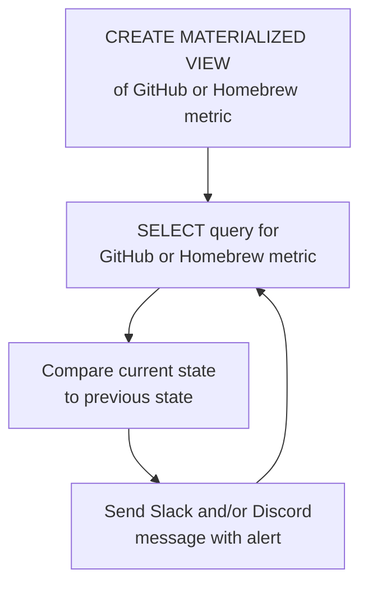

# Aktivitätsmonitor für Open-Source-Projekte auf Basis von StackQL

In dieser Anleitung zeigen wir, wie Sie ein Echtzeit-Überwachungs- und Benachrichtigungssystem für Maintainer von Open-Source-Software auf GitHub selbst hosten.  

> [__stackql__](https://github.com/stackql/stackql) ist ein Open-Source-Tool, mit dem Benutzer Cloud- und SaaS-Ressourcen über eine SQL-Sprache sowie Bibliotheken und Tools zur Datenvisualisierung und -analyse abfragen und mit ihnen interagieren können. Geben Sie uns einen [⭐](https://github.com/stackql/stackql), wenn Ihnen das gefällt!

Erhalten Sie solche Benachrichtigungen in Echtzeit in Slack und Discord:


Getestet mit <span class="tutorial_tested_on">eingebettetes SQL-Backend</span> <span class="tutorial_tested_on">docker</span> <span class="tutorial_tested_on">linux</span> 

## Überblick {#overview}

Als ich nach Tools zur Überwachung unseres Open-Source-Projekts gesucht habe, stellte ich fest, dass die meisten nicht wie beworben oder gar nicht funktionierten (im Fall von Drittanbieter-Apps in GitHub), also habe ich unser eigenes gebaut, das Sie für Ihr Open-Source-Projekt auf GitHub starten und verwenden können...  

Das Projekt [__oss-activity-monitor__](https://github.com/stackql/oss-activity-monitor) verwendet [__stackql__](https://github.com/stackql/stackql), um die Aktivität von Open-Source-Projekten in Echtzeit zu überwachen, einschließlich Echtzeit-Benachrichtigungen über:

- ⭐ neue Stargazer des GitHub-Repos
- 👀 neue Watcher des GitHub-Repos
- 🍴 neue Forks des GitHub-Repos
- 📊 neue Issues im GitHub-Repo
- 🙋 neue Follower der GitHub-Organisation
- 📦 neue Downloads von GitHub-Release-Assets
- 🍺 neue Homebrew-Downloads

## Funktionsweise {#how-it-works}

Das Projekt wird in einem Container bereitgestellt (mit `docker` oder einer anderen Container-Plattform), es ist mit `python` und dem Paket [`pystackql`](https://pystackql.readthedocs.io/en/latest/intro.html) gebaut und verwendet die Provider [`github`](https://github.stackql.io/providers/github/) und [`homebrew`](https://homebrew.stackql.io/providers/homebrew) für `stackql`.  Materialized Views und `SELECT`-Anweisungen werden verwendet, um den Zustand der aktuellen und der vorherigen Metriken der überwachten GitHub- und Homebrew-Endpunkte zu erfassen und zu vergleichen, wie im folgenden Diagramm beschrieben:  


zum Beispiel, gegeben diese mit `stackql` erstellte und befüllte Materialized View:  

```sql
CREATE OR REPLACE MATERIALIZED VIEW mvw_github_repo_stargazers AS 
SELECT login FROM github.activity.repo_stargazers
WHERE owner = 'your-org' and repo = 'your-repo'
```

fragt die folgende `stackql`-Abfrage GitHub nach neuen Stargazern ab...

```sql
SELECT c.login
FROM github.activity.repo_stargazers c
LEFT JOIN mvw_github_repo_stargazers mvw
ON c.login = mvw.login
WHERE mvw.login IS NULL
AND c.owner = 'your-org' AND c.repo = 'your-repo'
```

anschließend wird der Zustand aktualisiert mit...

```sql
REFRESH MATERIALIZED VIEW mvw_github_repo_stargazers
```

ähnliche Muster wiederholen sich für Repo-Watcher, Issues, Organisations-Follower, Release-Asset-Downloads und Homebrew-Downloads.

## Das Projekt ausführen {#running-the-project}

Folgen Sie den nachstehenden Schritten, um das Projekt lokal oder auf der Cloud-Plattform Ihrer Wahl in Betrieb zu nehmen.  

### 1. Das Repo klonen {#1-clone-the-repo}

```bash
git clone https://github.com/stackql/oss-activity-monitor.git
# or 
git clone git@github.com:stackql/oss-activity-monitor.git
```

### 2. Umgebungsvariablen konfigurieren {#2-configure-environment-variables}

Die folgenden Umgebungsvariablen werden zur Konfiguration des Projekts benötigt (bereitgestellt als Umgebungsvariablen, im folgenden Beispiel über eine `.env`-Datei):  

| Variable                   | Beschreibung                                                                      | Beispielwert                                     |
|----------------------------|-----------------------------------------------------------------------------------|--------------------------------------------------|
| `LOG_LEVEL`                | Log-Level (INFO für allgemeine Logs; DEBUG für detaillierte Protokollierung)      | INFO                                             |
| `SLEEP_INTERVAL`           | Wartezeit in Sekunden zwischen den Abfrageschleifen                               | 5                                                |
| `GITHUB_REPO`              | Name des GitHub-Repositorys                                                       | stackql                                          |
| `GITHUB_REPO_OWNER`        | Name der GitHub-Organisation oder des Besitzers                                   | stackql                                          |
| `HOMEBREW_FORMULA_NAME`    | Name der Homebrew-Formula, falls vorhanden                                        | stackql                                          |
| `STACKQL_GITHUB_USERNAME`  | Ihr GitHub-Benutzername                                                           | jeffreyaven                                      |
| `STACKQL_GITHUB_PASSWORD`  | Ihr persönliches GitHub-Zugriffstoken                                             | ghp_yourpersonalaccesstoken                      |
| `SLACK_WEBHOOK_URL`        | Slack-Webhook-URL zum Senden von Benachrichtigungen                               | https://hooks.slack.com/services/...             |
| `DISCORD_WEBHOOK_URL`      | Discord-Webhook-URL zum Senden von Benachrichtigungen                             | https://discord.com/api/webhooks/...             |

### 3. Den Container bauen {#3-build-the-container}

```bash
docker build --no-cache -t oss-activity-monitor .
```

### 4. Den Container ausführen {#4-run-the-container}

```bash
docker run --env-file .env oss-activity-monitor
```

das war's!  Sie erhalten jetzt Echtzeit-Benachrichtigungen, sobald es Aktivität in Ihrem Open-Source-Projekt gibt.  Um den Container zu stoppen, verwenden Sie:  

```bash
docker stop $(docker ps -a -q --filter ancestor=oss-activity-monitor)
```

Geben Sie uns einen ⭐ auf [__GitHub__](https://github.com/stackql/stackql)
