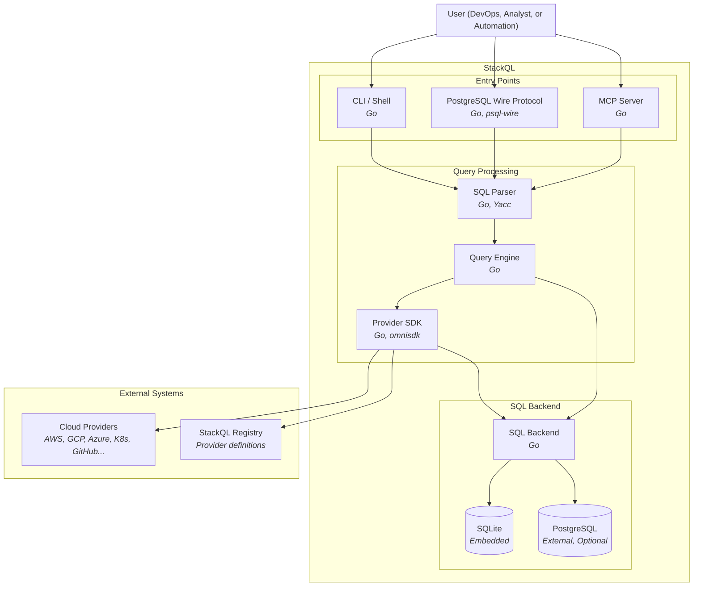

Consulte también:
[[ Usar StackQL ]](/getting-started/using-stackql) [[ Usar variables ]](/getting-started/variables) [[ Uso de plantillas ]](/getting-started/templating)

## Descripción general {#overview}

StackQL es una interfaz SQL unificada para consultar y gestionar infraestructura en la nube en varios providers. El siguiente diagrama de contenedores ilustra los componentes principales del sistema StackQL y sus interacciones.

## Componentes principales {#core-components}

### Puntos de entrada {#entry-points}

StackQL admite varios puntos de entrada para ejecutar consultas SQL:

- **CLI / Shell**: un shell interactivo y una interfaz de línea de comandos para ejecutar consultas SQL directamente desde el terminal. Los usuarios pueden ejecutar consultas ad hoc y scripts, o usar el shell interactivo para explorar.

- **Protocolo de red de PostgreSQL**: permite conexiones desde clientes estándar de PostgreSQL como `psql`, DBeaver o cualquier otra herramienta compatible con PostgreSQL. Esto permite una integración fluida con los workflows de bases de datos y las herramientas de BI existentes.

- **Servidor MCP**: un servidor de Model Context Protocol que permite la integración con asistentes de IA, de modo que los modelos de lenguaje de gran tamaño puedan consultar y gestionar la infraestructura mediante lenguaje natural.

### Pipeline de procesamiento de consultas {#query-processing-pipeline}

1. **Analizador sintáctico de SQL**: analiza la entrada SQL y la convierte en un árbol de sintaxis abstracta (AST) mediante una gramática propia basada en Yacc. El analizador sintáctico (implementado como `stackql-parser`) valida la sintaxis SQL y la prepara para la planificación de la consulta.

2. **Motor de consultas**: la capa central de orquestación que planifica y ejecuta las consultas. Determina qué operaciones se pueden trasladar a la capa de API y cuáles requieren procesamiento SQL local. El motor de consultas se encarga de:
   - Planificación y optimización de consultas
   - Coordinación entre las llamadas a la API y la ejecución SQL local
   - Agregación y transformación de resultados

### SDK de providers (omnisdk) {#provider-sdk-omnisdk}

El SDK de providers, [omnisdk](https://github.com/stackql-labs/omnisdk), gestiona todas las interacciones con los proveedores de nube. Sustituyó a `any-sdk` en StackQL `v1.0`. Sus responsabilidades principales incluyen:

- **Descubrimiento de providers**: obtiene las especificaciones de los providers del StackQL Registry, que contiene definiciones basadas en OpenAPI para cada proveedor de nube admitido, y opcionalmente verifica la firma ML-DSA-65 de cada documento antes de usarlo.

- **Autenticación**: gestiona la autenticación de cada provider y admite varios métodos de autenticación, entre ellos claves de API, tokens de OAuth, credenciales de cuenta de servicio y otros. Cada definición de provider especifica sus requisitos de autenticación; una sesión puede vincular el mismo provider con varios alias y credenciales independientes (consulte [Sesiones de provider](/getting-started/provider-sessions)).

- **Planificación de grafos**: planifica cada instrucción como un grafo de intercambios con providers unidos por aristas de datos y de control. Los joins, las subconsultas, las CTE y las vistas pasan por el mismo planificador, y las solicitudes que un plan genera en fan-out se ejecutan de forma concurrente dentro de los límites por provider y por host.

- **Construcción de solicitudes de API**: transforma las consultas SQL en las llamadas de API REST adecuadas para cada provider, y se ocupa de la construcción del endpoint, el mapeo de parámetros y el formato de la solicitud.

- **Paginación**: gestiona automáticamente las respuestas paginadas de las API y abstrae la complejidad de los distintos esquemas de paginación que usan los providers (tokens de página siguiente, números de página, enlaces a la página siguiente, encabezados `Link` y cursores de GraphQL).

- **Pushdown de predicados**: traslada a las solicitudes del provider las condiciones que corresponden a parámetros de la solicitud, y `LIMIT` cuando no se requiere ordenación, para reducir el número de solicitudes realizadas y los datos transferidos.

- **Transformación de respuestas**: convierte las respuestas de la API en filas a medida que llegan, para almacenarlas temporalmente en el backend SQL o transmitirlas al cliente.

Las conexiones SQL, el almacenamiento temporal y la ejecución en el backend permanecen en StackQL. omnisdk no contiene almacenamiento temporal SQL y nunca recibe una conexión de base de datos; StackQL le pasa manejadores de relación y recibe cursores de filas.

### Backend SQL {#sql-backend}

El backend SQL ejecuta operaciones relacionales sobre los datos materializados de las API:

- **SQLite**: una base de datos integrada que se usa para el almacenamiento temporal de tablas y el procesamiento relacional. Ideal para consultas ad hoc y conjuntos de datos pequeños.

- **PostgreSQL**: una base de datos externa opcional para almacenamiento persistente, conjuntos de datos más grandes y cargas de trabajo de análisis avanzado.

El backend SQL se encarga de operaciones como:
- Operaciones JOIN entre varios providers o recursos
- Funciones de agregación (COUNT, SUM, AVG, etc.)
- Ordenación y filtrado de datos materializados
- Expresiones SQL complejas y subconsultas

## Sistemas externos {#external-systems}

### Proveedores de nube {#cloud-providers}

StackQL se conecta a los proveedores de nube (AWS, GCP, Azure, Kubernetes, GitHub y muchos más) a través de sus API REST. Toda la comunicación se realiza mediante HTTPS, y el SDK de providers se ocupa de las particularidades de las convenciones de API de cada proveedor.

### StackQL Registry {#stackql-registry}

El StackQL Registry aloja las definiciones de los providers - especificaciones basadas en OpenAPI que describen los recursos disponibles, los métodos y sus mapeos. Los providers están versionados y se pueden descargar bajo demanda con el comando `REGISTRY PULL`.

## Flujo de ejecución de una consulta {#query-execution-flow}

1. El usuario envía una consulta SQL a través de uno de los puntos de entrada (CLI, protocolo de PostgreSQL o MCP)
2. El analizador sintáctico de SQL valida la consulta y la convierte en un AST
3. El motor de consultas analiza el AST y crea un plan de ejecución
4. Para las operaciones de provider, el SDK de providers:
   - Obtiene del registro la especificación del provider correspondiente (si no está en caché)
   - Se autentica ante el proveedor de nube
   - Construye y ejecuta las solicitudes de API, y gestiona la paginación automáticamente
   - Traslada los predicados a la API cuando es posible
   - Materializa los resultados en el backend SQL
5. El backend SQL ejecuta las operaciones relacionales restantes
6. Los resultados se devuelven al usuario en el formato solicitado
