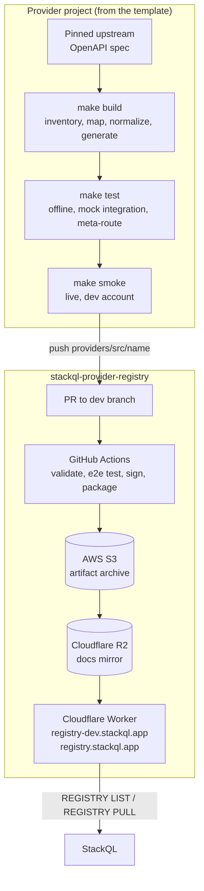

Consulte también:
[[ StackQL Provider Registry ]](/providers) [[ Usar un provider ]](/getting-started/using-a-provider) [[ REGISTRY ]](/language-spec/registry) [[ Arquitectura ]](/developers/architecture)

## Descripción general {#overview}

Un provider de StackQL es un conjunto versionado de documentos OpenAPI más extensiones `x-stackQL-*` que el motor [omnisdk](https://github.com/stackql-labs/omnisdk) convierte en tablas SQL: `SELECT` para las lecturas, `INSERT`, `UPDATE`, `REPLACE` y `DELETE` para las operaciones de ciclo de vida, y `EXEC` para las acciones. Los documentos de provider indican a StackQL qué puede hacer la API de un provider y cómo invocarla con semántica SQL. Son simplemente YAML, por lo que un provider se puede crear, probar y versionar como cualquier otro código.

Tres repositorios y una capa de distribución forman el ecosistema de providers:

| Componente | Función |
| --- | --- |
| [__`stackql-provider-TEMPLATE`__](https://github.com/stackql-registry/stackql-provider-TEMPLATE) | El punto de partida de un nuevo proyecto de provider: un pipeline determinista de `make` desde una especificación de origen fijada hasta un provider generado, capas de pruebas sin credenciales, una suite de pruebas de humo en vivo, un micrositio de documentación y CI. Incluye la skill de desarrollo de providers para Claude Code. |
| [__`omnisdk`__](https://github.com/stackql-labs/omnisdk) | El motor que lee los documentos de provider y ejecuta las solicitudes, a partir de StackQL `v1.0`. Su predecesor, [`any-sdk`](https://github.com/stackql/any-sdk), sigue alojando la referencia del contrato de los documentos de provider, las extensiones `x-stackQL-*`, la autenticación, la paginación, las transformaciones y el pushdown, así como los JSON Schema enlazados más abajo. |
| [__`stackql-provider-registry`__](https://github.com/stackql/stackql-provider-registry) | La fuente de verdad de los providers publicados. Los documentos se versionan en `providers/src/<provider>/<version>/` y después GitHub Actions los firma, los empaqueta y los publica. |
| __Capa de distribución de Cloudflare__ | Un Cloudflare Worker sirve en el borde, desde Cloudflare R2, los artefactos de provider empaquetados en `registry.stackql.app` (producción) y `registry-dev.stackql.app` (desarrollo). Es con lo que se comunican `REGISTRY LIST` y `REGISTRY PULL`. |
<br/>
El siguiente diagrama muestra el recorrido desde un proyecto de provider hasta una instalación de StackQL:



## Estructura de los documentos de provider {#provider-document-structure}

Los objetos de StackQL siguen la jerarquía `provider.service.resource.method`, por ejemplo `google.compute.instances.list`. Los documentos reflejan esa jerarquía:

```
provider.yaml                          # provider metadata, providerServices, provider-level config
services/
  <service>.yaml                       # an OpenAPI 3 document per service, plus
    components.x-stackQL-resources
      <resource>                       # id, name, methods, sqlVerbs, optional config
        methods.<method>               # operation $ref, response, request, optional config
```

- __Documento de provider__ (`provider.yaml`): `id`, `name`, `title`, `version`, `providerServices` (cada uno con un `service.$ref` a su documento de servicio y un campo `preferred` opcional), `description` opcional, `protocolType` (`http` es el valor predeterminado) y `config`.
- __Documento de servicio__: un documento OpenAPI 3 estándar. La única adición obligatoria es `components.x-stackQL-resources`, que declara los recursos expuestos como tablas.
- __Recurso__: `id`, `name`, `methods` y `sqlVerbs`. Cada recurso es una tabla; sus columnas provienen del esquema de respuesta de su método `select` principal.
- __Método__: una `operation` que es un puntero JSON a `paths` (por ejemplo `$ref: '#/paths/~1orgs~1{org}~1repos/get'`), un bloque `response` (`mediaType`, `openAPIDocKey`, `objectKey`) que indica al motor dónde están las filas, y un bloque `request` y un `config` opcionales.
- __Mapeo de verbos SQL__: `sqlVerbs.select`, `insert`, `update`, `replace` y `delete` son listas ordenadas de referencias a métodos. Las referencias se prueban en el orden en que están escritas y gana la primera cuyos parámetros obligatorios satisface la cláusula `WHERE`, así que coloque `list` antes de `get`. Cualquier método al que no haga referencia una lista de verbos se puede invocar mediante `EXEC`.

Un recurso mínimo tiene este aspecto:

```yaml
components:
  x-stackQL-resources:
    repos:
      id: github.repos.repos
      name: repos
      title: Repos
      methods:
        list_for_org:
          operation:
            $ref: '#/paths/~1orgs~1{org}~1repos/get'
          response:
            mediaType: application/json
            openAPIDocKey: '200'
        create_in_org:
          operation:
            $ref: '#/paths/~1orgs~1{org}~1repos/post'
          response:
            mediaType: application/json
            openAPIDocKey: '201'
          config:
            requestBodyTranslate:
              algorithm: naive
      sqlVerbs:
        select:
          - $ref: '#/components/x-stackQL-resources/repos/methods/list_for_org'
        insert:
          - $ref: '#/components/x-stackQL-resources/repos/methods/create_in_org'
```

El contrato completo, con cada clave y su significado, está en la [especificación de providers](https://github.com/stackql/any-sdk/blob/main/docs/provider_spec.md) de any-sdk. Los JSON Schema de `provider.yaml`, de los documentos de servicio y del bloque de configuración están en [`any-sdk/cicd/schema-definitions`](https://github.com/stackql/any-sdk/tree/main/cicd/schema-definitions); el esquema de configuración rechaza las claves desconocidas, de modo que una clave mal escrita no supera la validación en lugar de ignorarse en silencio.

### Extensiones de OpenAPI {#openapi-extensions}

| Extensión | Dónde | Propósito |
| --- | --- | --- |
| `x-stackQL-resources` | `components` | El diccionario de recursos de un documento de servicio (obligatorio) |
| `x-stackQL-config` | servicio, recurso, método u operación | Un bloque de configuración (consulte más abajo) que se aplica en ese nivel |
| `x-stackQL-envVar` | variable de servidor | Nombra una variable de entorno que proporciona la variable de servidor cuando no se indica en la cláusula `WHERE`. Se usa para delimitar una API por tenant, organización, proyecto o despliegue |
| `x-stackQL-alias` | parámetro o propiedad de esquema | Un nombre alternativo aceptado en SQL para un nombre del nivel de red |
| `x-stackQL-stringOnly` | propiedad de esquema | Serializa la propiedad como cadena con independencia de su tipo declarado |
| `x-stackQL-graphQL` | operación | Respalda un método con una consulta GraphQL cuando la API REST no ofrece los datos |
| `x-alwaysRequired` | parámetro | Marca un parámetro como siempre obligatorio |
| `x-protocol` | `info` | Indicación del protocolo de red (`query`, `ec2`, `rest-xml`) para el tratamiento de respuestas XML guiado por el esquema |

### El bloque de configuración {#the-config-block}

`config` en `provider.yaml` y `x-stackQL-config` en los documentos de servicio comparten un mismo esquema. Las claves permitidas son `auth`, `pagination`, `queryParamPushdown`, `queryParamTranspose`, `requestTranslate`, `requestBodyTranslate`, `variations`, `views`, `sqlExternalTables`, `retry`, `minStackQLVersion` y `snake_case_aliases`. La configuración se resuelve desde el nivel más específico hacia fuera, método -> recurso -> servicio -> servicio de provider -> provider, de modo que un valor predeterminado para todo el provider se puede sobrescribir para un recurso o un método.

## De qué se encargan los providers {#what-providers-handle}

Los providers son responsables de las funciones que abstraen la complejidad de las API, de modo que los usuarios obtienen una interfaz SQL coherente sin gestionar la conversación HTTP subyacente.

### Autenticación {#authentication}

Cada provider incluye un bloque `auth` predeterminado que nombra las variables de entorno que contienen sus credenciales, de modo que un entorno con esas variables ya definidas no necesita configuración de autenticación en tiempo de ejecución. En un documento de provider solo se aceptan indirecciones (nombres de variables de entorno, rutas de archivos); los valores literales de las credenciales corresponden exclusivamente al contexto `--auth` en tiempo de ejecución. Los nombres de las variables de entorno deben seguir los del provider de Terraform del proveedor, cuando exista uno.

| `auth.type` | Campos habituales |
| --- | --- |
| `bearer` | `credentialsenvvar` |
| `api_key` | `credentialsenvvar`, `valuePrefix`, `location` (`header` o `query`) y `name` opcionales |
| `basic` | `username_var`, `password_var` |
| `custom` | `location`, `name`, `credentialsenvvar`, `valuePrefix` opcional; encadene una segunda credencial con `successor` |
| `oauth2` | `client_id_env_var`, `client_secret_env_var`, `grant_type: client_credentials`, `token_url`, `scopes` |
| `service_account` | `credentialsenvvar` o `credentialsfilepathenvvar`, `scopes` |
| `aws_signing_v4`, `aws_assume_role` | `keyIDenvvar`, `credentialsenvvar` |
| `azure_default` | ninguno |
| `oci_signing_v1` | `tenancy_ocid_envvar`, `user_ocid_envvar`, `oci_fingerprint_envvar`, `oci_private_key_envvar`, `oci_region_envvar` |
| `interactive` | ninguno |
| `null_auth` | ninguno (explícitamente sin autenticación) |
<br/>
Por ejemplo:

```yaml
config:
  auth:
    type: api_key
    credentialsenvvar: OKTA_API_TOKEN
    valuePrefix: 'SSWS '
```

Los usuarios pueden sobrescribir la autenticación de un provider en tiempo de ejecución con `--auth='{"<provider>": {...}}'`.

### Paginación {#pagination}

Los providers declaran el esquema de paginación del proveedor y el motor recorre todas las páginas, de modo que los usuarios reciben conjuntos de resultados completos. Esquemas admitidos:

- __Token o cursor en el cuerpo__: `requestToken: {key: cursor, location: query}`, `responseToken: {key: $.cursor, location: body}`; se detiene cuando el token falta o está vacío.
- __URL de la página siguiente en el cuerpo__: `requestToken: {key: '', location: request}`, `responseToken: {key: $.next, location: body}`; `algorithm: odata_next_link` para `@odata.nextLink` de OData.
- __Encabezado `Link` de RFC 5988__: `responseToken: {key: Link, location: header}`.
- __Número de página con un recuento de páginas__: `algorithm: page_number` con `responseToken` (página actual) y `responseTerminator` (total de páginas).

Las API de desplazamiento y límite sin marcador de página siguiente no son un esquema de paginación; en su lugar, exponga `offset` y `limit` como parámetros de `WHERE`. La opción global `--http.response.pageLimit` limita el recorrido.

### Pushdown de predicados {#predicate-pushdown}

Las claves de `WHERE` se comparan por nombre con los parámetros declarados de la operación (de ruta, después de consulta, de encabezado y de cookie) y se envían a la API, de modo que el filtrado se realiza en el origen. Cualquier clave de `WHERE` restante sin parámetro coincidente se añade como parámetro de consulta.

Más allá de los parámetros simples, `queryParamPushdown` reescribe las columnas de `SELECT`, `WHERE`, `ORDER BY`, `LIMIT`, `OFFSET` y `COUNT` como parámetros de API. `dialect: odata` rellena los valores predeterminados `$select`, `$filter`, `$orderby`, `$top`, `$skip` y `$count` que usan las API del estilo de Microsoft Graph y Azure; `dialect: custom` usa `paramName` literalmente, lo más habitual es `top: {paramName: limit, maxValue: 1000}` para que `LIMIT n` se convierta en `?limit=n`. Los predicados que no se pueden trasladar a la API se siguen evaluando en el lado del cliente.

### Transformación de respuestas y solicitudes {#response-and-request-transformation}

- `response.objectKey` es una expresión JSONPath (o XPath en las API XML) que selecciona de un envoltorio los elementos que contienen las filas, por ejemplo `$.data[*]` o `$.value`.
- `response.transform` aplica una plantilla de texto de Go a un cuerpo antes de almacenarlo temporalmente como filas; los tipos de transformación abarcan JSON, XML y texto sin formato, y así es como las API XML de AWS y la salida de las CLI se convierten en tablas.
- `requestBodyTranslate: {algorithm: naive}` permite que `INSERT` acepte los campos del cuerpo de la solicitud como nombres de columna simples en lugar de la forma con el prefijo `data__`.
- `snake_case_aliases: true` en el nivel del provider expone los nombres de red en camelCase como columnas y parámetros en snake_case.
- `retry` establece una política de retroceso exponencial (`max_attempts`, `initial_delay_ms`, `max_delay_ms`, `multiplier`, `jitter_fraction`, `retryable_methods`, `retryable_conditions.status_codes`). Gana el primer nivel que declara una; consulte la [política de reintentos](https://github.com/stackql/any-sdk/blob/main/docs/retry_policy.md) de any-sdk.

Los tipos de las columnas siguen el esquema OpenAPI: `string` -> texto, `integer` -> entero, `number` -> numérico, `boolean` -> booleano. Las propiedades `object` y `array` se almacenan como texto JSON, por lo que los campos anidados se leen con `json_extract` en las consultas y los providers suelen incluir vistas (`config.views`, con un `ddl` por dialecto y un `fallback`) para las proyecciones anidadas habituales.

### Providers que no usan HTTP {#non-http-providers}

`protocolType: local_templated` en `provider.yaml` respalda un provider con comandos locales en lugar de HTTP: los métodos llevan un array `inline` de fragmentos de argv en plantillas de Go, los parámetros usan `in: inline` y un `response.transform` convierte la salida del comando en filas. El provider de referencia [`local_openssl`](https://github.com/stackql/any-sdk/tree/main/test/registry/src/local_openssl/v0.1.0) de any-sdk muestra la forma. Esto queda fuera del ámbito del pipeline de la plantilla, que está orientado a las API HTTP.

## Iniciar un proyecto de provider {#starting-a-provider-project}

Inicie cada nuevo provider a partir de [__`stackql-provider-TEMPLATE`__](https://github.com/stackql-registry/stackql-provider-TEMPLATE). Es un repositorio de plantilla de GitHub que recoge el estándar actual de un provider: una especificación de origen fijada, un pipeline de build determinista en el que cada decisión manual es una regla en un script y no una edición a mano del YAML generado, tres capas de pruebas sin credenciales, una suite de pruebas de humo en vivo con presupuesto, un sitio de documentación de Docusaurus y CI. Los providers publicados que se han creado de esta forma están en la organización de GitHub [stackql-registry](https://github.com/orgs/stackql-registry/repositories) y son un material de referencia útil junto con la plantilla.

Requisitos previos: Node.js 20 o posterior, GNU make y bash (Linux, macOS o WSL), Python 3 para la suite de pruebas de humo y un binario de `stackql` (`bin/start-server.sh` descarga uno si no se encuentra ninguno).

1. Cree el repositorio a partir de la plantilla ("Use this template" en GitHub) y ejecute `npm install`.
2. Ejecute `bin/init-provider.sh <name> "<Title>" [https://api.vendor.com]` para reemplazar los marcadores de posición en todo el repositorio.
3. Complete las constantes de `provider-dev/scripts/lib/spec_helpers.mjs` (URL de la especificación, prefijo de versión de la ruta, prefijo de ámbito para una API delimitada por tenant o por proyecto) y la configuración de `provider-dev/config/` (`servers.json`, `provider_config.json`, `service_names.json`).
4. Recorra el pipeline, ya sea a mano con los objetivos de `make` o abriendo una sesión de Claude Code en el repositorio (consulte más abajo).
5. `grep -rn "TODO(template)"` enumera lo que sigue pendiente.

El pipeline se controla con `make` (`make help` enumera todos los objetivos):

```bash
make fetch-spec        # verify the upstream spec against the recorded pin (fails on drift)
make inventory         # one CSV row per operation with the proposed service, resource, method and verb
make split             # write provider-dev/source/<service>.yaml from the ordered path rules
make mappings-report   # print every derived operation -> resource.method mapping without writing
make mappings          # regenerate provider-dev/config/all_services.csv and validate it
make normalize         # flatten allOf, lower oneOf/anyOf, wrap bare arrays
make generate          # generate provider.yaml + services/*.yaml, then post-process and merge GraphQL/views
make test              # offline SHOW/DESCRIBE, mock API integration tests, meta-route walk (no credentials)
make smoke             # live smoke suite against a dedicated dev account (sources .env)
make docs              # generate the provider documentation site content
make all               # everything above except the live suites
```

Internamente, el pipeline usa [__`@stackql/provider-utils`__](https://github.com/stackql-registry/stackql-provider-utils) (`split`, `normalize`, `analyze`, `generate` y `docgen`) con reglas específicas del provider en `provider-dev/scripts/`. El provider generado queda en `provider-dev/openapi/src/<name>/v00.00.00000/`, que es el directorio que finalmente se publica en el registro.

`provider-dev/config/all_services.csv` es el contrato, confirmado en el repositorio, del mapeo de cada operación a un recurso y un método. Un diff al regenerar es una revisión de cambios incompatibles, no ruido. La CI falla ante una desviación de la generación sin confirmar, de modo que una regeneración debe reproducir byte a byte los artefactos confirmados.

Para un repositorio de provider existente anterior a la plantilla, copie en él el directorio `.claude/skills` y empiece por el archivo `references/uplift-checklist.md` de la skill.

### Usar Claude Code para el desarrollo de providers {#using-claude-code-for-provider-development}

La plantilla incluye la [__skill StackQL Provider Development__](https://github.com/stackql-registry/stackql-provider-TEMPLATE/blob/main/.claude/skills/stackql-provider-development/SKILL.md) para [Claude Code](https://docs.anthropic.com/en/docs/claude-code). Abra una sesión de Claude Code en un repositorio creado a partir de la plantilla y pídale que cree el provider; Claude Code lee `CLAUDE.md` y la skill, y sigue los pasos en orden. La skill es también el procedimiento escrito para hacer el trabajo a mano.

La skill abarca:

- La elección del arquetipo: un documento OpenAPI, Swagger o de descubrimiento publicado por el proveedor (directo), o una especificación derivada de un SDK del proveedor en la que el SDK es la fuente de verdad (derivado)
- La obtención, corrección, validación y fijación de la especificación de origen para que cada actualización sea un diff revisable
- El inventario de endpoints, la división en servicios y las reglas de mapeo que producen `all_services.csv`
- Cada primitiva de los documentos de provider y cuándo usarla: la delimitación con `x-stackQL-envVar`, `objectKey`, las transformaciones de solicitudes y respuestas, la paginación, el pushdown de parámetros de consulta, los métodos `EXEC` de ciclo de vida, la fusión de GraphQL y las vistas de provider
- Las tres capas de pruebas sin credenciales y la suite de pruebas de humo en vivo
- El sitio de documentación, los workflows de CI y las notas de traspaso

El directorio `references/` de la skill contiene el detalle de cada paso, y `scripts/find_extension_examples.sh` imprime YAML publicado para cualquier clave de extensión a partir de un clon del registro de providers, de modo que una primitiva se puede ver en uso antes de escribirla.

## Probar un provider localmente {#testing-a-provider-locally}

StackQL lee los providers de un registro descrito por la opción global `--registry`. Durante el desarrollo, haga que apunte al directorio del provider generado en el sistema de archivos local con la verificación de firmas deshabilitada (los documentos solo se firman cuando se publican):

```bash
export LOCAL_REG='{ "url": "file:///path/to/provider-dev/openapi", "localDocRoot": "/path/to/provider-dev/openapi", "verifyConfig": { "nopVerify": true } }'
stackql --registry="${LOCAL_REG}" shell
```

El directorio de `localDocRoot` debe contener `src/<provider>/<version>/provider.yaml` y `src/<provider>/<version>/services/*.yaml`, que es exactamente lo que genera la plantilla. Desde el shell, `SHOW SERVICES IN <provider>`, `SHOW RESOURCES IN <provider>.<service>`, `SHOW METHODS IN <provider>.<service>.<resource>` y `DESCRIBE EXTENDED <provider>.<service>.<resource>` confirman la superficie antes de ejecutar ninguna consulta. El archivo `tests/offline_validation.mjs` de la plantilla automatiza estas comprobaciones, y `npm run probe -- "SELECT ..."` ejecuta SQL ad hoc contra la API simulada e imprime las llamadas de red.

Los providers descargados de un registro remoto se guardan en caché en `<cwd>/.stackql` de forma predeterminada; use `--approot` para cambiar la ubicación.

La [CLI de any-sdk](https://github.com/stackql/any-sdk/blob/main/docs/cli.md) es útil para comprobar un documento sin que intervenga StackQL: `anysdk aot <registry> <provider.yaml>` ejecuta un análisis estático sobre un provider (`objectKey` no enrutable, esquemas de respuesta ausentes, paginación incompleta, parámetros de ruta adyacentes, etc.), y `anysdk query` ejecuta un único método directamente a partir de los documentos de provider y de servicio. [Las pruebas con automock](https://github.com/stackql/any-sdk/blob/main/docs/automock_testing.md) generan una API simulada y los resultados esperados a partir de los esquemas de un provider, para un recorrido completo de ida y vuelta sin tocar la API real.

### Probar su provider con el registro `dev` {#testing-your-provider-using-the-dev-registry}

Una vez que un provider se ha fusionado en la rama `dev` del registro, está disponible en el registro de desarrollo. Haga que StackQL apunte a él para verificar el artefacto publicado:

```bash
export DEV_REG='{ "url": "https://registry-dev.stackql.app/providers" }'
stackql --registry="${DEV_REG}" shell
```

```sql
REGISTRY PULL myprovider;
```

El objetivo `make smoke-live` de la plantilla ejecuta la suite de pruebas de humo contra el provider publicado para la verificación posterior a la publicación.

## Publicar un provider {#publishing-a-provider}

La publicación es un paso independiente, con intervención humana, y no forma parte del pipeline de la plantilla.

1. Haga un fork de [stackql-provider-registry](https://github.com/stackql/stackql-provider-registry) y copie el directorio generado `provider-dev/openapi/src/<name>` en `providers/src/<name>` en una rama de funcionalidad.
2. Abra un pull request contra la rama `dev` con una descripción del provider y de los cambios (consulte la [guía de contribución](https://github.com/stackql/stackql-provider-registry/blob/main/.github/CONTRIBUTING.md) del registro).
3. GitHub Actions valida y prueba el provider con [stackql-provider-tests](https://github.com/stackql/stackql-provider-tests). Las reglas evaluadas son: el documento debe ser una especificación OpenAPI válida, se deben poder enumerar los recursos de todos los servicios, se deben poder enumerar los métodos de todos los recursos, los métodos invocables mediante `SELECT` deben tener un esquema de respuesta válido y los métodos invocables mediante `INSERT` deben tener un esquema de solicitud válido.
4. Al fusionar, el workflow asigna una versión, firma los documentos (Ed25519), los empaqueta y publica el artefacto en el archivo histórico de AWS S3. A continuación, el árbol de documentos se replica en Cloudflare R2 y se despliega el Cloudflare Worker que sirve `registry-dev.stackql.app`. El provider queda disponible de inmediato para las instalaciones configuradas para usar el registro `dev`.
5. Tras un periodo de supervisión, `dev` se promueve a `main`, lo que repite la publicación para `registry.stackql.app`. Esta es la publicación para las instancias de StackQL con la configuración predeterminada.

El mismo arnés de pruebas `stackql-provider-tests` se puede ejecutar localmente contra un directorio de registro antes de abrir un PR:

```bash
test-provider.sh <provider_name> false /path/to/provider-dev/openapi
```

Consulte [build y despliegue](https://github.com/stackql/stackql-provider-registry/blob/main/docs/build-and-deployment.md) en el repositorio del registro para conocer el workflow en detalle, incluida la protección contra la eliminación de providers que resguarda `providers/src`.
