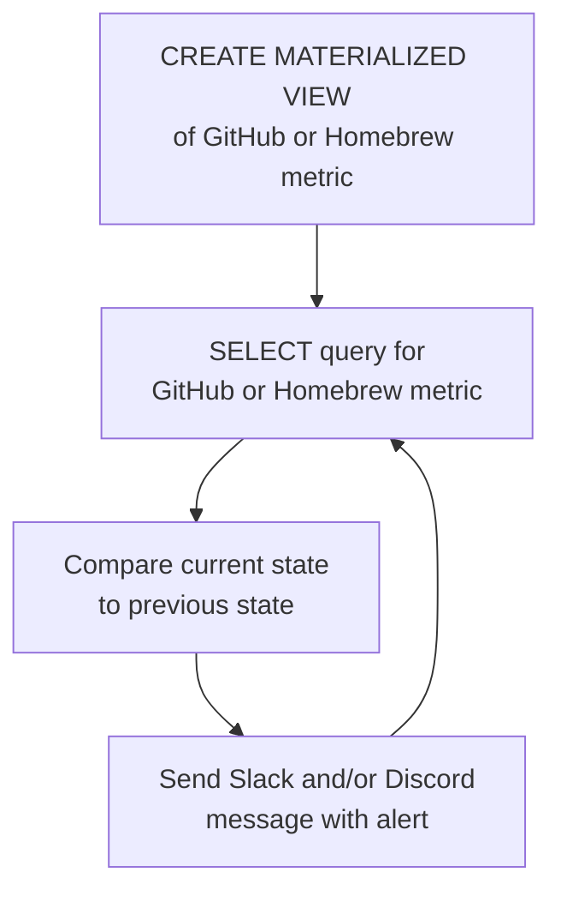

# Monitor de actividad de proyectos de código abierto con StackQL

En esta guía mostraremos cómo alojar por su cuenta un sistema de supervisión y alertas en tiempo real para los mantenedores de software de código abierto en GitHub.  

> [__stackql__](https://github.com/stackql/stackql) es una herramienta de código abierto que permite a los usuarios consultar recursos en la nube y de SaaS e interactuar con ellos mediante el lenguaje SQL y bibliotecas y herramientas de visualización y análisis de datos. ¡Denos una [⭐](https://github.com/stackql/stackql) si le gusta!

Reciba alertas como esta en Slack y Discord en tiempo real:


Probado con <span class="tutorial_tested_on">backend SQL integrado</span> <span class="tutorial_tested_on">docker</span> <span class="tutorial_tested_on">linux</span> 

## Descripción general {#overview}

Cuando busqué herramientas para supervisar nuestro proyecto de código abierto, descubrí que la mayoría no funcionaban como prometían o no funcionaban en absoluto (en el caso de las aplicaciones de terceros en GitHub), así que creé la nuestra, que usted puede poner en marcha y usar en su proyecto de código abierto de GitHub...  

El proyecto [__oss-activity-monitor__](https://github.com/stackql/oss-activity-monitor) usa [__stackql__](https://github.com/stackql/stackql) para supervisar en tiempo real la actividad de proyectos de código abierto, lo que incluye notificaciones en tiempo real de:

- ⭐ nuevos stargazers de repositorios de GitHub
- 👀 nuevos watchers de repositorios de GitHub
- 🍴 nuevos forks de repositorios de GitHub
- 📊 nuevos issues de repositorios de GitHub
- 🙋 nuevos seguidores de organizaciones de GitHub
- 📦 nuevas descargas de archivos de versiones de GitHub
- 🍺 nuevas descargas de homebrew

## Funcionamiento {#how-it-works}

El proyecto se despliega en un contenedor (con `docker` u otra plataforma de despliegue de contenedores) y está creado con `python` y el paquete [`pystackql`](https://pystackql.readthedocs.io/en/latest/intro.html), con los providers [`github`](https://github.stackql.io/providers/github/) y [`homebrew`](https://homebrew.stackql.io/providers/homebrew) de `stackql`.  Se usan vistas materializadas e instrucciones `SELECT` para capturar y comparar el estado entre las métricas actuales y las anteriores de los endpoints supervisados de GitHub y Homebrew, como se describe en el siguiente diagrama:  


por ejemplo, dada esta vista materializada, creada y rellenada con `stackql`:  

```sql
CREATE OR REPLACE MATERIALIZED VIEW mvw_github_repo_stargazers AS 
SELECT login FROM github.activity.repo_stargazers
WHERE owner = 'your-org' and repo = 'your-repo'
```

la siguiente consulta de `stackql` sondea GitHub en busca de nuevos stargazers...

```sql
SELECT c.login
FROM github.activity.repo_stargazers c
LEFT JOIN mvw_github_repo_stargazers mvw
ON c.login = mvw.login
WHERE mvw.login IS NULL
AND c.owner = 'your-org' AND c.repo = 'your-repo'
```

después, el estado se actualiza con...

```sql
REFRESH MATERIALIZED VIEW mvw_github_repo_stargazers
```

se repiten patrones similares para los watchers de repositorios, los issues, los seguidores de organizaciones, las descargas de archivos de versiones y las descargas de homebrew.

## Ejecutar el proyecto {#running-the-project}

Siga los pasos que se indican a continuación para poner en marcha el proyecto en local o en su plataforma en la nube preferida.  

### 1. Clonar el repositorio {#1-clone-the-repo}

```bash
git clone https://github.com/stackql/oss-activity-monitor.git
# or 
git clone git@github.com:stackql/oss-activity-monitor.git
```

### 2. Configurar las variables de entorno {#2-configure-environment-variables}

Para configurar el proyecto se necesitan las siguientes variables de entorno (se proporcionan como variables de entorno; en el ejemplo siguiente, en un archivo `.env`):  

| Variable                   | Descripción                                                                       | Valor de ejemplo                                 |
|----------------------------|-----------------------------------------------------------------------------------|--------------------------------------------------|
| `LOG_LEVEL`                | Nivel de log (INFO para logs generales; DEBUG para logs detallados)               | INFO                                             |
| `SLEEP_INTERVAL`           | Tiempo de espera en segundos entre ciclos de solicitudes                          | 5                                                |
| `GITHUB_REPO`              | Nombre del repositorio de GitHub                                                  | stackql                                          |
| `GITHUB_REPO_OWNER`        | Nombre de la organización o del propietario de GitHub                             | stackql                                          |
| `HOMEBREW_FORMULA_NAME`    | Nombre de la fórmula de Homebrew, si existe                                       | stackql                                          |
| `STACKQL_GITHUB_USERNAME`  | Su nombre de usuario de GitHub                                                    | jeffreyaven                                      |
| `STACKQL_GITHUB_PASSWORD`  | Su token de acceso personal de GitHub                                             | ghp_yourpersonalaccesstoken                      |
| `SLACK_WEBHOOK_URL`        | URL del webhook de Slack para enviar notificaciones                               | https://hooks.slack.com/services/...             |
| `DISCORD_WEBHOOK_URL`      | URL del webhook de Discord para enviar notificaciones                             | https://discord.com/api/webhooks/...             |

### 3. Construir el contenedor {#3-build-the-container}

```bash
docker build --no-cache -t oss-activity-monitor .
```

### 4. Ejecutar el contenedor {#4-run-the-container}

```bash
docker run --env-file .env oss-activity-monitor
```

¡Eso es todo!  Ahora recibirá alertas en tiempo real cuando haya actividad en su proyecto de código abierto.  Para detener el contenedor, use:  

```bash
docker stop $(docker ps -a -q --filter ancestor=oss-activity-monitor)
```

Denos una ⭐ en [__GitHub__](https://github.com/stackql/stackql)
