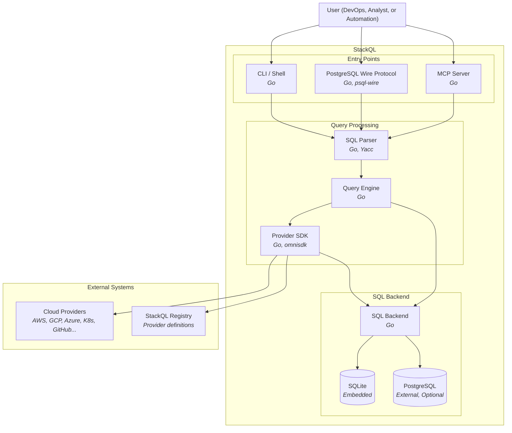

Voir aussi :
[[ Utiliser StackQL ]](/getting-started/using-stackql) [[ Utiliser des variables ]](/getting-started/variables) [[ Templating ]](/getting-started/templating)

## Vue d'ensemble {#overview}

StackQL est une interface SQL unifiée pour interroger et gérer l'infrastructure cloud à travers plusieurs providers. Le diagramme de conteneurs suivant illustre les principaux composants du système StackQL et leurs interactions.

## Composants principaux {#core-components}

### Points d'entrée {#entry-points}

StackQL prend en charge plusieurs points d'entrée pour exécuter des requêtes SQL :

- **CLI / Shell** : un shell interactif et une interface en ligne de commande pour exécuter des requêtes SQL directement depuis le terminal. Les utilisateurs peuvent exécuter des requêtes ad hoc ou des scripts, ou utiliser le shell interactif pour l'exploration.

- **Protocole filaire PostgreSQL** : accepte les connexions de clients PostgreSQL standard tels que `psql`, DBeaver ou tout autre outil compatible avec PostgreSQL. Cela permet une intégration transparente avec les workflows de bases de données existants et les outils de BI.

- **Serveur MCP** : un serveur Model Context Protocol qui permet l'intégration d'assistants IA, grâce auquel les grands modèles de langage peuvent interroger et gérer l'infrastructure en langage naturel.

### Pipeline de traitement des requêtes {#query-processing-pipeline}

1. **Analyseur syntaxique SQL** : analyse l'entrée SQL pour produire un arbre de syntaxe abstraite (AST) à l'aide d'une grammaire personnalisée basée sur Yacc. L'analyseur syntaxique (implémenté sous le nom `stackql-parser`) valide la syntaxe SQL et la prépare pour la planification des requêtes.

2. **Moteur de requêtes** : la couche d'orchestration centrale qui planifie et exécute les requêtes. Il détermine quelles opérations peuvent être poussées vers la couche API et lesquelles nécessitent un traitement SQL local. Le moteur de requêtes gère :
   - La planification et l'optimisation des requêtes
   - La coordination entre les appels d'API et l'exécution SQL locale
   - L'agrégation et la transformation des résultats

### SDK de providers (omnisdk) {#provider-sdk-omnisdk}

Le SDK de providers, [omnisdk](https://github.com/stackql-labs/omnisdk), gère toutes les interactions avec les fournisseurs cloud. Il a remplacé `any-sdk` dans StackQL `v1.0`. Ses principales responsabilités sont les suivantes :

- **Découverte des providers** : récupère les spécifications de provider depuis le StackQL Registry, qui contient des définitions basées sur OpenAPI pour chaque fournisseur cloud pris en charge, et, en option, vérifie la signature ML-DSA-65 de chaque document avant son utilisation.

- **Authentification** : gère l'authentification de chaque provider et prend en charge divers modes d'authentification, notamment les clés d'API, les jetons OAuth, les identifiants de compte de service, etc. Chaque définition de provider précise ses exigences d'authentification ; une session peut lier le même provider sous plusieurs alias avec des identifiants distincts (voir [Sessions de provider](/getting-started/provider-sessions)).

- **Planification en graphe** : planifie chaque instruction sous la forme d'un graphe d'échanges avec les providers, reliés par des arêtes de données et de contrôle. Les jointures, les sous-requêtes, les CTE et les vues passent par le même planificateur, et les appels d'API issus du fan-out d'un plan s'exécutent simultanément, dans des limites fixées par provider et par hôte.

- **Construction des requêtes d'API** : transforme les requêtes SQL en appels d'API REST adaptés à chaque provider, en gérant la construction des points de terminaison, la correspondance des paramètres et la mise en forme des requêtes HTTP.

- **Pagination** : gère automatiquement les réponses d'API paginées et masque la complexité des différents mécanismes de pagination utilisés par les fournisseurs (par curseur, par offset, par jeton, etc.).

- **Pushdown de prédicats** : pousse dans les requêtes HTTP envoyées aux providers les conditions qui correspondent à des paramètres de requête, ainsi que `LIMIT` lorsqu'aucun tri n'est requis, afin de réduire le nombre de requêtes HTTP effectuées et le volume de données transférées.

- **Transformation des réponses** : convertit les réponses d'API en lignes au fur et à mesure de leur arrivée, pour un stockage intermédiaire dans le backend SQL ou une diffusion en continu vers le client.

Les connexions SQL, le stockage intermédiaire et l'exécution dans le backend restent dans StackQL. omnisdk ne contient aucun stockage intermédiaire SQL et ne reçoit jamais de connexion à une base de données ; StackQL lui transmet des handles de relation et reçoit des curseurs de lignes.

### Backend SQL {#sql-backend}

Le backend SQL exécute les opérations relationnelles sur les données d'API matérialisées :

- **SQLite** : une base de données embarquée utilisée pour le stockage des tables temporaires et le traitement relationnel. Idéale pour les requêtes ad hoc et les petits jeux de données.

- **PostgreSQL** : une base de données externe facultative pour le stockage persistant, les jeux de données plus volumineux et les charges de travail d'analyse avancée.

Le backend SQL gère des opérations telles que :
- Les opérations JOIN entre plusieurs providers ou ressources
- Les fonctions d'agrégation (COUNT, SUM, AVG, etc.)
- Le tri et le filtrage sur les données matérialisées
- Les expressions SQL complexes et les sous-requêtes

## Systèmes externes {#external-systems}

### Fournisseurs cloud {#cloud-providers}

StackQL se connecte aux fournisseurs cloud (AWS, GCP, Azure, Kubernetes, GitHub et bien d'autres) via leurs API REST. Toutes les communications passent par HTTPS, et le SDK de providers gère les particularités des conventions d'API de chaque fournisseur.

### StackQL Registry {#stackql-registry}

Le StackQL Registry héberge les définitions de providers - des spécifications basées sur OpenAPI qui décrivent les ressources et les méthodes disponibles, ainsi que leurs correspondances. Les providers sont versionnés et peuvent être téléchargés à la demande avec la commande `REGISTRY PULL`.

## Flux d'exécution d'une requête {#query-execution-flow}

1. L'utilisateur soumet une requête SQL par l'un des points d'entrée (CLI, protocole PostgreSQL ou MCP)
2. L'analyseur syntaxique SQL valide la requête et la convertit en AST
3. Le moteur de requêtes analyse l'AST et crée un plan d'exécution
4. Pour les opérations de provider, le SDK de providers :
   - Récupère la spécification du provider concerné depuis le registre (si elle n'est pas en cache)
   - S'authentifie auprès du fournisseur cloud
   - Construit et exécute les requêtes d'API, en gérant automatiquement la pagination
   - Pousse les prédicats vers l'API lorsque c'est possible
   - Matérialise les résultats dans le backend SQL
5. Le backend SQL exécute les opérations relationnelles restantes
6. Les résultats sont renvoyés à l'utilisateur dans le format demandé
