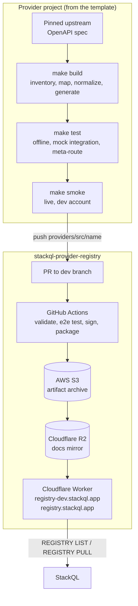

Voir aussi :
[[ StackQL Provider Registry ]](/providers) [[ Utiliser un provider ]](/getting-started/using-a-provider) [[ REGISTRY ]](/language-spec/registry) [[ Architecture ]](/developers/architecture)

## Vue d'ensemble {#overview}

Un provider StackQL est un ensemble versionné de documents OpenAPI complétés par des extensions `x-stackQL-*`, que le moteur [omnisdk](https://github.com/stackql-labs/omnisdk) transforme en tables SQL : `SELECT` pour les lectures, `INSERT`, `UPDATE`, `REPLACE` et `DELETE` pour les opérations de cycle de vie, et `EXEC` pour les actions. Les documents de provider indiquent à StackQL ce que l'API d'un provider peut faire et comment l'invoquer avec une sémantique SQL. Ce sont de simples fichiers YAML : un provider peut donc être construit, testé et versionné comme n'importe quel autre code.

Trois dépôts et une couche de distribution composent l'écosystème des providers :

| Composant | Rôle |
| --- | --- |
| [__`stackql-provider-TEMPLATE`__](https://github.com/stackql-registry/stackql-provider-TEMPLATE) | Le point de départ d'un nouveau projet de provider : un pipeline `make` déterministe qui va d'une spécification amont épinglée à un provider généré, des couches de test sans identifiants, une suite de smoke tests en conditions réelles, un microsite de documentation et la CI. Inclut le skill Claude Code de développement de providers. |
| [__`omnisdk`__](https://github.com/stackql-labs/omnisdk) | Le moteur qui lit les documents de provider et exécute les appels d'API, à partir de StackQL `v1.0`. Son prédécesseur, [`any-sdk`](https://github.com/stackql/any-sdk), héberge toujours la référence du contrat des documents de provider, des extensions `x-stackQL-*`, de l'authentification, de la pagination, des transformations et du pushdown, ainsi que les schémas JSON liés ci-dessous. |
| [__`stackql-provider-registry`__](https://github.com/stackql/stackql-provider-registry) | La source de vérité des providers publiés. Les documents sont versionnés sous `providers/src/<provider>/<version>/`, puis signés, empaquetés et publiés par GitHub Actions. |
| __Couche de distribution Cloudflare__ | Les artefacts de provider empaquetés sont servis en périphérie du réseau depuis Cloudflare R2 par un Cloudflare Worker à `registry.stackql.app` (production) et `registry-dev.stackql.app` (développement). C'est à cette couche que s'adressent `REGISTRY LIST` et `REGISTRY PULL`. |
<br/>
Le diagramme suivant montre le chemin d'un projet de provider jusqu'à une installation StackQL :



## Structure des documents de provider {#provider-document-structure}

Les objets StackQL suivent la hiérarchie `provider.service.resource.method`, par exemple `google.compute.instances.list`. Les documents reflètent cette hiérarchie :

```
provider.yaml                          # provider metadata, providerServices, provider-level config
services/
  <service>.yaml                       # an OpenAPI 3 document per service, plus
    components.x-stackQL-resources
      <resource>                       # id, name, methods, sqlVerbs, optional config
        methods.<method>               # operation $ref, response, request, optional config
```

- __Document de provider__ (`provider.yaml`) : `id`, `name`, `title`, `version`, `providerServices` (chacun avec un `service.$ref` vers son document de service et un champ `preferred` facultatif), `description` facultatif, `protocolType` (`http` est la valeur par défaut) et `config`.
- __Document de service__ : un document OpenAPI 3 standard. Le seul ajout obligatoire est `components.x-stackQL-resources`, qui déclare les ressources exposées sous forme de tables.
- __Ressource__ : `id`, `name`, `methods` et `sqlVerbs`. Chaque ressource est une table ; ses colonnes proviennent du schéma de réponse de sa méthode `select` principale.
- __Méthode__ : une `operation` qui est un pointeur JSON vers `paths` (par exemple `$ref: '#/paths/~1orgs~1{org}~1repos/get'`), un bloc `response` (`mediaType`, `openAPIDocKey`, `objectKey`) qui indique au moteur où se trouvent les lignes, ainsi qu'un bloc `request` et un `config` facultatifs.
- __Correspondance avec les verbes SQL__ : `sqlVerbs.select`, `insert`, `update`, `replace` et `delete` sont des listes ordonnées de références de méthodes. Les références sont essayées dans l'ordre d'écriture et la première dont les paramètres obligatoires sont satisfaits par la clause `WHERE` l'emporte ; placez donc `list` avant `get`. Toute méthode qui n'est référencée par aucune liste de verbes peut être appelée via `EXEC`.

Une ressource minimale se présente ainsi :

```yaml
components:
  x-stackQL-resources:
    repos:
      id: github.repos.repos
      name: repos
      title: Repos
      methods:
        list_for_org:
          operation:
            $ref: '#/paths/~1orgs~1{org}~1repos/get'
          response:
            mediaType: application/json
            openAPIDocKey: '200'
        create_in_org:
          operation:
            $ref: '#/paths/~1orgs~1{org}~1repos/post'
          response:
            mediaType: application/json
            openAPIDocKey: '201'
          config:
            requestBodyTranslate:
              algorithm: naive
      sqlVerbs:
        select:
          - $ref: '#/components/x-stackQL-resources/repos/methods/list_for_org'
        insert:
          - $ref: '#/components/x-stackQL-resources/repos/methods/create_in_org'
```

Le contrat complet, avec chaque clé et sa signification, figure dans la [spécification des providers](https://github.com/stackql/any-sdk/blob/main/docs/provider_spec.md) d'any-sdk. Les schémas JSON de `provider.yaml`, des documents de service et du bloc config se trouvent dans [`any-sdk/cicd/schema-definitions`](https://github.com/stackql/any-sdk/tree/main/cicd/schema-definitions) ; le schéma de config rejette les clés inconnues, de sorte qu'une clé mal orthographiée fait échouer la validation au lieu d'être ignorée silencieusement.

### Extensions OpenAPI {#openapi-extensions}

| Extension | Emplacement | Rôle |
| --- | --- | --- |
| `x-stackQL-resources` | `components` | Le dictionnaire de ressources d'un document de service (obligatoire) |
| `x-stackQL-config` | service, ressource, méthode ou opération | Un bloc config (voir ci-dessous) appliqué à ce niveau |
| `x-stackQL-envVar` | variable de serveur | Nomme une variable d'environnement qui fournit la variable de serveur lorsqu'elle n'est pas donnée dans la clause `WHERE`. Sert à restreindre une API à un tenant, une organisation, un projet ou un déploiement |
| `x-stackQL-alias` | paramètre ou propriété de schéma | Un nom alternatif accepté en SQL à la place du nom utilisé par l'API |
| `x-stackQL-stringOnly` | propriété de schéma | Sérialise la propriété en chaîne de caractères quel que soit son type déclaré |
| `x-stackQL-graphQL` | opération | Adosse une méthode à une requête GraphQL lorsque l'API REST ne fournit pas les données |
| `x-alwaysRequired` | paramètre | Marque un paramètre comme toujours obligatoire |
| `x-protocol` | `info` | Indication de protocole filaire (`query`, `ec2`, `rest-xml`) pour le traitement des réponses XML piloté par le schéma |

### Le bloc config {#the-config-block}

`config` dans `provider.yaml` et `x-stackQL-config` dans les documents de service partagent un même schéma. Les clés autorisées sont `auth`, `pagination`, `queryParamPushdown`, `queryParamTranspose`, `requestTranslate`, `requestBodyTranslate`, `variations`, `views`, `sqlExternalTables`, `retry`, `minStackQLVersion` et `snake_case_aliases`. La configuration est résolue du niveau le plus spécifique vers le plus général, méthode -> ressource -> service -> service de provider -> provider, de sorte qu'une valeur par défaut définie pour tout le provider peut être remplacée pour une ressource ou une méthode.

## Ce que les providers prennent en charge {#what-providers-handle}

Les providers sont responsables des fonctions qui masquent la complexité des API, afin que les utilisateurs disposent d'une interface SQL cohérente sans gérer les échanges HTTP sous-jacents.

### Authentification {#authentication}

Chaque provider est livré avec un bloc `auth` par défaut qui nomme les variables d'environnement contenant ses identifiants ; un environnement renseigné ne nécessite donc aucune configuration d'authentification à l'exécution. Seules les indirections (noms de variables d'environnement, chemins de fichiers) sont acceptées dans un document de provider ; les valeurs littérales des identifiants ont leur place exclusivement dans le contexte `--auth` fourni à l'exécution. Les noms des variables d'environnement doivent reprendre ceux du provider Terraform du fournisseur, lorsqu'il en existe un.

| `auth.type` | Champs habituels |
| --- | --- |
| `bearer` | `credentialsenvvar` |
| `api_key` | `credentialsenvvar`, `valuePrefix`, `location` (`header` ou `query`) et `name` facultatifs |
| `basic` | `username_var`, `password_var` |
| `custom` | `location`, `name`, `credentialsenvvar`, `valuePrefix` facultatif ; chaînez un second identifiant avec `successor` |
| `oauth2` | `client_id_env_var`, `client_secret_env_var`, `grant_type: client_credentials`, `token_url`, `scopes` |
| `service_account` | `credentialsenvvar` ou `credentialsfilepathenvvar`, `scopes` |
| `aws_signing_v4`, `aws_assume_role` | `keyIDenvvar`, `credentialsenvvar` |
| `azure_default` | aucun |
| `oci_signing_v1` | `tenancy_ocid_envvar`, `user_ocid_envvar`, `oci_fingerprint_envvar`, `oci_private_key_envvar`, `oci_region_envvar` |
| `interactive` | aucun |
| `null_auth` | aucun (explicitement non authentifié) |
<br/>
Par exemple :

```yaml
config:
  auth:
    type: api_key
    credentialsenvvar: OKTA_API_TOKEN
    valuePrefix: 'SSWS '
```

Les utilisateurs peuvent remplacer l'authentification d'un provider à l'exécution avec `--auth='{"<provider>": {...}}'`.

### Pagination {#pagination}

Les providers déclarent le mécanisme de pagination du fournisseur et le moteur parcourt chaque page, de sorte que les utilisateurs reçoivent des jeux de résultats complets. Mécanismes pris en charge :

- __Jeton ou curseur dans le corps__ : `requestToken: {key: cursor, location: query}`, `responseToken: {key: $.cursor, location: body}` ; s'arrête lorsque le jeton est absent ou vide.
- __URL de la page suivante dans le corps__ : `requestToken: {key: '', location: request}`, `responseToken: {key: $.next, location: body}` ; `algorithm: odata_next_link` pour le `@odata.nextLink` d'OData.
- __En-tête `Link` de la RFC 5988__ : `responseToken: {key: Link, location: header}`.
- __Numéro de page avec un nombre de pages__ : `algorithm: page_number` avec `responseToken` (page courante) et `responseTerminator` (nombre total de pages).

Les API à offset et limite sans marqueur de page suivante ne constituent pas un mécanisme de pagination ; exposez plutôt `offset` et `limit` comme paramètres `WHERE`. L'option globale `--http.response.pageLimit` borne le parcours.

### Pushdown de prédicats {#predicate-pushdown}

Les clés de `WHERE` sont mises en correspondance par nom avec les paramètres déclarés de l'opération (chemin, puis requête, en-tête et cookie) et envoyées à l'API, de sorte que le filtrage a lieu à la source. Toute clé de `WHERE` restante sans paramètre correspondant est ajoutée comme paramètre de requête.

Au-delà des paramètres simples, `queryParamPushdown` réécrit les colonnes de `SELECT`, `WHERE`, `ORDER BY`, `LIMIT`, `OFFSET` et `COUNT` en paramètres d'API. `dialect: odata` renseigne les valeurs par défaut `$select`, `$filter`, `$orderby`, `$top`, `$skip` et `$count` utilisées par Microsoft Graph et les API de type Azure ; `dialect: custom` utilise `paramName` tel quel, le plus souvent `top: {paramName: limit, maxValue: 1000}` pour que `LIMIT n` devienne `?limit=n`. Les prédicats qui ne peuvent pas être poussés vers l'API sont tout de même évalués côté client.

### Transformation des réponses et des requêtes {#response-and-request-transformation}

- `response.objectKey` est une expression JSONPath (ou XPath pour les API XML) qui sélectionne, dans une enveloppe, les éléments contenant les lignes, par exemple `$.data[*]` ou `$.value`.
- `response.transform` applique un modèle de texte Go à un corps avant son stockage intermédiaire sous forme de lignes ; les types de transformation couvrent JSON, XML et le texte brut, et c'est ainsi que les API XML d'AWS et la sortie de CLI deviennent des tables.
- `requestBodyTranslate: {algorithm: naive}` permet à `INSERT` de recevoir les champs du corps de la requête sous forme de simples noms de colonnes plutôt que sous la forme préfixée par `data__`.
- `snake_case_aliases: true` au niveau du provider expose les noms camelCase utilisés par l'API sous forme de colonnes et de paramètres snake_case.
- `retry` définit une politique de backoff exponentiel (`max_attempts`, `initial_delay_ms`, `max_delay_ms`, `multiplier`, `jitter_fraction`, `retryable_methods`, `retryable_conditions.status_codes`). Le premier niveau qui en déclare une l'emporte ; consultez la [politique de nouvelles tentatives](https://github.com/stackql/any-sdk/blob/main/docs/retry_policy.md) d'any-sdk.

Les types de colonnes suivent le schéma OpenAPI : `string` -> text, `integer` -> integer, `number` -> numeric, `boolean` -> boolean. Les propriétés `object` et `array` sont stockées sous forme de texte JSON ; c'est pourquoi les champs imbriqués sont lus avec `json_extract` dans les requêtes et pourquoi les providers fournissent souvent des vues (`config.views`, avec un `ddl` par dialecte et un `fallback`) pour les projections imbriquées courantes.

### Providers non HTTP {#non-http-providers}

`protocolType: local_templated` dans `provider.yaml` adosse un provider à des commandes locales plutôt qu'à HTTP : les méthodes portent un tableau `inline` de fragments argv écrits en modèles Go, les paramètres utilisent `in: inline` et un `response.transform` transforme la sortie des commandes en lignes. Le provider de référence [`local_openssl`](https://github.com/stackql/any-sdk/tree/main/test/registry/src/local_openssl/v0.1.0) d'any-sdk en montre la forme. Ce cas sort du périmètre du pipeline du modèle de provider, qui cible les API HTTP.

## Démarrer un projet de provider {#starting-a-provider-project}

Démarrez chaque nouveau provider à partir de [__`stackql-provider-TEMPLATE`__](https://github.com/stackql-registry/stackql-provider-TEMPLATE). C'est un dépôt modèle GitHub qui encode le standard actuel d'un provider : une spécification amont épinglée, un pipeline de build déterministe où chaque décision manuelle est une règle dans un script plutôt qu'une modification manuelle du YAML généré, trois couches de test sans identifiants, une suite de smoke tests en conditions réelles à budget limité, un site de documentation Docusaurus et la CI. Les providers publiés construits de cette façon se trouvent dans l'organisation GitHub [stackql-registry](https://github.com/orgs/stackql-registry/repositories) et constituent des références utiles en complément du modèle.

Prérequis : Node.js 20 ou version ultérieure, GNU make et bash (Linux, macOS ou WSL), Python 3 pour la suite de smoke tests et un binaire `stackql` (`bin/start-server.sh` en télécharge un si aucun n'est trouvé).

1. Créez le dépôt à partir du modèle ("Use this template" sur GitHub) et exécutez `npm install`.
2. Exécutez `bin/init-provider.sh <name> "<Title>" [https://api.vendor.com]` pour remplacer les espaces réservés dans l'ensemble du dépôt.
3. Renseignez les constantes dans `provider-dev/scripts/lib/spec_helpers.mjs` (URL de la spécification, préfixe de version des chemins, préfixe de périmètre pour une API limitée à un tenant ou à un projet) et la configuration sous `provider-dev/config/` (`servers.json`, `provider_config.json`, `service_names.json`).
4. Déroulez le pipeline, soit à la main avec les cibles `make`, soit en ouvrant une session Claude Code dans le dépôt (voir ci-dessous).
5. `grep -rn "TODO(template)"` liste ce qui reste à faire.

Le pipeline est piloté par `make` (`make help` liste toutes les cibles) :

```bash
make fetch-spec        # verify the upstream spec against the recorded pin (fails on drift)
make inventory         # one CSV row per operation with the proposed service, resource, method and verb
make split             # write provider-dev/source/<service>.yaml from the ordered path rules
make mappings-report   # print every derived operation -> resource.method mapping without writing
make mappings          # regenerate provider-dev/config/all_services.csv and validate it
make normalize         # flatten allOf, lower oneOf/anyOf, wrap bare arrays
make generate          # generate provider.yaml + services/*.yaml, then post-process and merge GraphQL/views
make test              # offline SHOW/DESCRIBE, mock API integration tests, meta-route walk (no credentials)
make smoke             # live smoke suite against a dedicated dev account (sources .env)
make docs              # generate the provider documentation site content
make all               # everything above except the live suites
```

En interne, le pipeline utilise [__`@stackql/provider-utils`__](https://github.com/stackql-registry/stackql-provider-utils) (`split`, `normalize`, `analyze`, `generate` et `docgen`) avec des règles propres au provider dans `provider-dev/scripts/`. Le provider généré est écrit dans `provider-dev/openapi/src/<name>/v00.00.00000/`, le répertoire qui est finalement publié dans le registre.

`provider-dev/config/all_services.csv` est le contrat, commité dans le dépôt, de chaque correspondance entre une opération et une ressource et une méthode. Un diff lors d'une régénération est à examiner comme un changement cassant, pas comme du bruit. La CI échoue en cas de dérive de génération non commitée ; une régénération doit donc reproduire les artefacts commités à l'octet près.

Pour un dépôt de provider existant, antérieur au modèle, copiez-y le répertoire `.claude/skills` et partez du fichier `references/uplift-checklist.md` du skill.

### Utiliser Claude Code pour développer des providers {#using-claude-code-for-provider-development}

Le modèle inclut le [__skill de développement de providers StackQL__](https://github.com/stackql-registry/stackql-provider-TEMPLATE/blob/main/.claude/skills/stackql-provider-development/SKILL.md) pour [Claude Code](https://docs.anthropic.com/en/docs/claude-code). Ouvrez une session Claude Code dans un dépôt créé à partir du modèle et demandez-lui de construire le provider ; il prend en compte `CLAUDE.md` et le skill, puis déroule les étapes dans l'ordre. Le skill est aussi la procédure écrite pour effectuer le travail à la main.

Le skill couvre :

- Le choix de l'archétype : un document OpenAPI, Swagger ou de découverte publié par le fournisseur (direct), ou une spécification dérivée d'un SDK du fournisseur lorsque le SDK est la source de vérité (dérivé)
- La récupération, la correction, la validation et l'épinglage de la spécification amont, afin que chaque actualisation produise un diff que l'on peut relire
- L'inventaire des points de terminaison, le découpage en services et les règles de correspondance qui produisent `all_services.csv`
- Chaque primitive des documents de provider et quand l'utiliser : la délimitation du périmètre par `x-stackQL-envVar`, `objectKey`, les transformations de requêtes et de réponses, la pagination, le pushdown des paramètres de requête, les méthodes `EXEC` de cycle de vie, la fusion GraphQL et les vues de provider
- Les trois couches de test sans identifiants et la suite de smoke tests en conditions réelles
- Le site de documentation, les workflows de CI et les notes de passation

Le répertoire `references/` du skill contient le détail de chaque étape, et `scripts/find_extension_examples.sh` affiche, à partir d'un clone du registre de providers, du YAML publié pour n'importe quelle clé d'extension, ce qui permet de voir une primitive en usage avant de l'écrire.

## Tester un provider en local {#testing-a-provider-locally}

StackQL lit les providers depuis un registre décrit par l'option globale `--registry`. Pendant le développement, faites-la pointer vers le répertoire du provider généré sur le système de fichiers local, en désactivant la vérification des signatures (les documents ne sont signés qu'à leur publication) :

```bash
export LOCAL_REG='{ "url": "file:///path/to/provider-dev/openapi", "localDocRoot": "/path/to/provider-dev/openapi", "verifyConfig": { "nopVerify": true } }'
stackql --registry="${LOCAL_REG}" shell
```

Le répertoire sous `localDocRoot` doit contenir `src/<provider>/<version>/provider.yaml` et `src/<provider>/<version>/services/*.yaml`, ce qui correspond exactement à ce que le modèle génère. Depuis le shell, `SHOW SERVICES IN <provider>`, `SHOW RESOURCES IN <provider>.<service>`, `SHOW METHODS IN <provider>.<service>.<resource>` et `DESCRIBE EXTENDED <provider>.<service>.<resource>` confirment la surface exposée avant l'exécution de toute requête. Le fichier `tests/offline_validation.mjs` du modèle automatise ces assertions, et `npm run probe -- "SELECT ..."` exécute du SQL ad hoc sur l'API simulée et affiche les appels HTTP émis.

Les providers téléchargés depuis un registre distant sont mis en cache sous `<cwd>/.stackql` par défaut ; utilisez `--approot` pour changer l'emplacement.

La [CLI any-sdk](https://github.com/stackql/any-sdk/blob/main/docs/cli.md) est utile pour vérifier un document sans faire intervenir StackQL : `anysdk aot <registry> <provider.yaml>` exécute une analyse statique d'un provider (`objectKey` non routable, schémas de réponse manquants, pagination incomplète, paramètres de chemin adjacents, etc.), et `anysdk query` exécute une seule méthode directement à partir des documents de provider et de service. Les [tests automock](https://github.com/stackql/any-sdk/blob/main/docs/automock_testing.md) génèrent une API simulée et les résultats attendus à partir des schémas d'un provider, pour un aller-retour complet sans toucher à l'API réelle.

### Tester votre provider avec le registre `dev` {#testing-your-provider-using-the-dev-registry}

Une fois qu'un provider a été fusionné dans la branche `dev` du registre, il est disponible depuis le registre de développement. Faites pointer StackQL vers ce registre pour vérifier l'artefact publié :

```bash
export DEV_REG='{ "url": "https://registry-dev.stackql.app/providers" }'
stackql --registry="${DEV_REG}" shell
```

```sql
REGISTRY PULL myprovider;
```

La cible `make smoke-live` du modèle exécute la suite de smoke tests sur le provider publié, pour une vérification après publication.

## Publier un provider {#publishing-a-provider}

La publication est une étape distincte, avec intervention humaine, qui ne fait pas partie du pipeline du modèle.

1. Créez un fork de [stackql-provider-registry](https://github.com/stackql/stackql-provider-registry) et copiez le répertoire généré `provider-dev/openapi/src/<name>` vers `providers/src/<name>` dans une branche de fonctionnalité.
2. Ouvrez une pull request sur la branche `dev` avec une description du provider et des modifications (voir le [guide de contribution](https://github.com/stackql/stackql-provider-registry/blob/main/.github/CONTRIBUTING.md) du registre).
3. GitHub Actions valide et teste le provider à l'aide de [stackql-provider-tests](https://github.com/stackql/stackql-provider-tests). Les règles évaluées sont les suivantes : le document doit être une spécification OpenAPI valide, les ressources de chaque service doivent pouvoir être énumérées, les méthodes de chaque ressource doivent pouvoir être énumérées, les méthodes appelables via `SELECT` doivent avoir un schéma de réponse valide et les méthodes appelables via `INSERT` doivent avoir un schéma de requête valide.
4. Lors de la fusion, le workflow attribue une version, signe les documents (Ed25519), les empaquette et publie l'artefact dans l'archive AWS S3. L'arborescence des documents est ensuite mise en miroir sur Cloudflare R2 et le Cloudflare Worker qui sert `registry-dev.stackql.app` est déployé. Le provider est immédiatement disponible pour les installations configurées pour utiliser le registre `dev`.
5. Après une période de surveillance, `dev` est promue vers `main`, ce qui répète la publication pour `registry.stackql.app`. Il s'agit de la publication destinée aux instances de StackQL configurées par défaut.

Le même harnais de test `stackql-provider-tests` peut être exécuté en local sur un répertoire de registre avant d'ouvrir une PR :

```bash
test-provider.sh <provider_name> false /path/to/provider-dev/openapi
```

Consultez [build et déploiement](https://github.com/stackql/stackql-provider-registry/blob/main/docs/build-and-deployment.md) dans le dépôt du registre pour le détail du workflow, y compris le garde-fou contre la suppression de providers qui protège `providers/src`.
