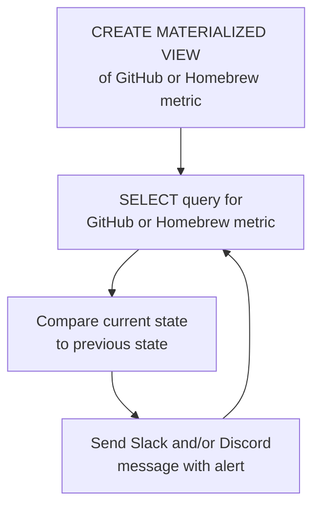

# Moniteur d'activité de projet open source propulsé par StackQL

Dans ce guide, nous montrons comment auto-héberger un système de surveillance et d'alerte en temps réel destiné aux mainteneurs de logiciels open source sur GitHub.  

> [__stackql__](https://github.com/stackql/stackql) est un outil open source qui permet d'interroger des ressources cloud et SaaS et d'interagir avec elles à l'aide d'un langage SQL et de bibliothèques et d'outils de visualisation et d'analyse de données. Si cela vous plaît, donnez-nous une [⭐](https://github.com/stackql/stackql) !

Recevez des alertes comme celle-ci dans Slack et Discord en temps réel :


Testé avec <span class="tutorial_tested_on">backend SQL embarqué</span> <span class="tutorial_tested_on">docker</span> <span class="tutorial_tested_on">linux</span> 

## Vue d'ensemble {#overview}

Lorsque j'ai cherché des outils pour surveiller notre projet open source, j'ai constaté que la plupart ne fonctionnaient pas comme annoncé, voire pas du tout (dans le cas des applications tierces dans GitHub), alors j'ai créé le nôtre, que vous pouvez lancer et utiliser sur votre projet open source GitHub...  

Le projet [__oss-activity-monitor__](https://github.com/stackql/oss-activity-monitor) utilise [__stackql__](https://github.com/stackql/stackql) pour surveiller en temps réel l'activité d'un projet open source, ce qui comprend la notification en temps réel des éléments suivants :

- ⭐ nouveaux stargazers du dépôt GitHub
- 👀 nouveaux watchers du dépôt GitHub
- 🍴 nouveaux forks du dépôt GitHub
- 📊 nouvelles issues du dépôt GitHub
- 🙋 nouveaux followers de l'organisation GitHub
- 📦 nouveaux téléchargements de fichiers de version GitHub
- 🍺 nouveaux téléchargements homebrew

## Fonctionnement {#how-it-works}

Le projet est déployé dans un conteneur (avec `docker` ou une autre plateforme de déploiement de conteneurs) ; il est écrit en `python` avec le paquet [`pystackql`](https://pystackql.readthedocs.io/en/latest/intro.html) et utilise les providers [`github`](https://github.stackql.io/providers/github/) et [`homebrew`](https://homebrew.stackql.io/providers/homebrew) pour `stackql`.  Des vues matérialisées et des instructions `SELECT` servent à capturer et à comparer l'état entre les métriques actuelles et précédentes des points de terminaison GitHub et Homebrew surveillés, comme le décrit le diagramme ci-dessous :  


par exemple, étant donné cette vue matérialisée créée et alimentée avec `stackql` :  

```sql
CREATE OR REPLACE MATERIALIZED VIEW mvw_github_repo_stargazers AS 
SELECT login FROM github.activity.repo_stargazers
WHERE owner = 'your-org' and repo = 'your-repo'
```

la requête `stackql` suivante interroge GitHub pour détecter les nouveaux stargazers...

```sql
SELECT c.login
FROM github.activity.repo_stargazers c
LEFT JOIN mvw_github_repo_stargazers mvw
ON c.login = mvw.login
WHERE mvw.login IS NULL
AND c.owner = 'your-org' AND c.repo = 'your-repo'
```

puis l'état est actualisé avec...

```sql
REFRESH MATERIALIZED VIEW mvw_github_repo_stargazers
```

des schémas similaires sont répétés pour les watchers du dépôt, les issues, les followers de l'organisation, les téléchargements de fichiers de version et les téléchargements homebrew.

## Exécuter le projet {#running-the-project}

Suivez les étapes ci-dessous pour mettre le projet en service localement ou sur la plateforme cloud de votre choix.  

### 1. Cloner le dépôt {#1-clone-the-repo}

```bash
git clone https://github.com/stackql/oss-activity-monitor.git
# or 
git clone git@github.com:stackql/oss-activity-monitor.git
```

### 2. Configurer les variables d'environnement {#2-configure-environment-variables}

Les variables d'environnement suivantes sont nécessaires pour configurer le projet (fournies sous forme de variables d'environnement, dans un fichier `.env` dans l'exemple ci-dessous) :  

| Variable                   | Description                                                                                          | Exemple de valeur                                |
|----------------------------|------------------------------------------------------------------------------------------------------|--------------------------------------------------|
| `LOG_LEVEL`                | Niveau de journalisation (INFO pour les journaux généraux ; DEBUG pour une journalisation détaillée) | INFO                                             |
| `SLEEP_INTERVAL`           | Délai en secondes entre les boucles d'appels                                                         | 5                                                |
| `GITHUB_REPO`              | Nom du dépôt GitHub                                                                                  | stackql                                          |
| `GITHUB_REPO_OWNER`        | Nom de l'organisation ou du propriétaire GitHub                                                      | stackql                                          |
| `HOMEBREW_FORMULA_NAME`    | Nom de la formule Homebrew, le cas échéant                                                           | stackql                                          |
| `STACKQL_GITHUB_USERNAME`  | Votre nom d'utilisateur GitHub                                                                       | jeffreyaven                                      |
| `STACKQL_GITHUB_PASSWORD`  | Votre jeton d'accès personnel GitHub                                                                 | ghp_yourpersonalaccesstoken                      |
| `SLACK_WEBHOOK_URL`        | URL du webhook Slack pour l'envoi des notifications                                                  | https://hooks.slack.com/services/...             |
| `DISCORD_WEBHOOK_URL`      | URL du webhook Discord pour l'envoi des notifications                                                | https://discord.com/api/webhooks/...             |

### 3. Construire le conteneur {#3-build-the-container}

```bash
docker build --no-cache -t oss-activity-monitor .
```

### 4. Exécuter le conteneur {#4-run-the-container}

```bash
docker run --env-file .env oss-activity-monitor
```

C'est tout !  Vous recevrez désormais des alertes en temps réel dès qu'il y a de l'activité sur votre projet open source.  Pour arrêter le conteneur, utilisez :  

```bash
docker stop $(docker ps -a -q --filter ancestor=oss-activity-monitor)
```

Donnez-nous une ⭐ sur [__GitHub__](https://github.com/stackql/stackql)
