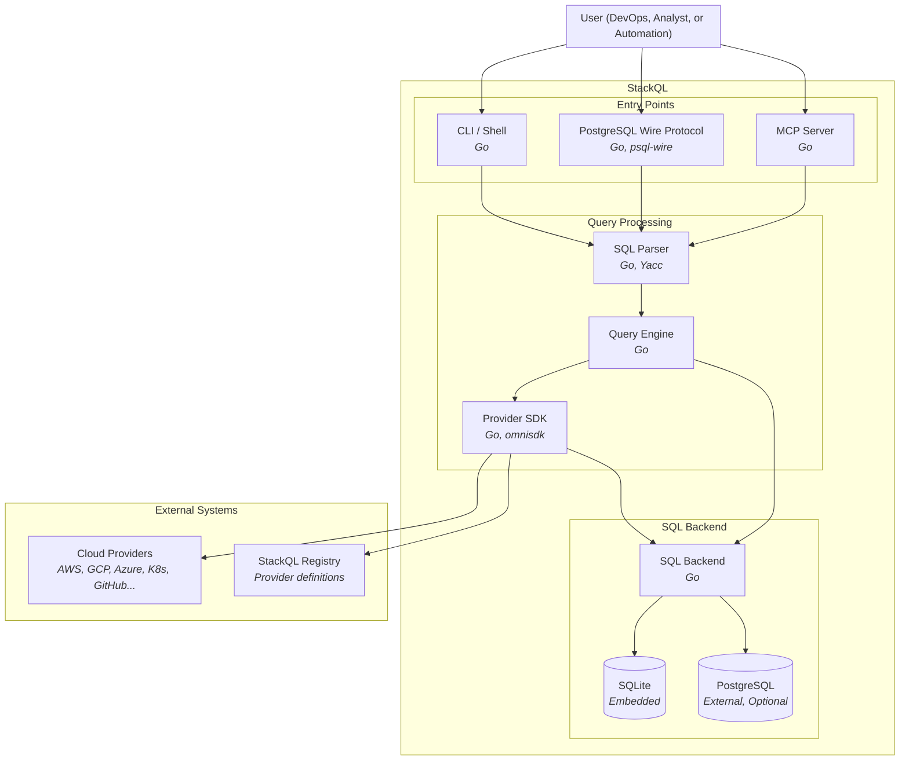

Lihat juga:
[[ Menggunakan StackQL ]](/getting-started/using-stackql) [[ Menggunakan variabel ]](/getting-started/variables) [[ Penggunaan template ]](/getting-started/templating)

## Ringkasan {#overview}

StackQL adalah antarmuka SQL terpadu untuk mengkueri dan mengelola infrastruktur cloud di berbagai provider. Diagram container berikut menggambarkan komponen utama sistem StackQL dan interaksinya.

## Komponen inti {#core-components}

### Titik masuk {#entry-points}

StackQL mendukung beberapa titik masuk untuk menjalankan kueri SQL:

- **CLI / Shell**: shell interaktif dan antarmuka baris perintah untuk menjalankan kueri SQL langsung dari terminal. Pengguna dapat menjalankan kueri ad-hoc, skrip, atau menggunakan shell interaktif untuk eksplorasi.

- **Protokol komunikasi PostgreSQL**: memungkinkan koneksi dari klien PostgreSQL standar seperti `psql`, DBeaver, atau alat lain yang kompatibel dengan PostgreSQL. Hal ini memungkinkan integrasi yang mulus dengan workflow database dan alat BI yang sudah ada.

- **Server MCP**: server Model Context Protocol yang memungkinkan integrasi dengan asisten AI, sehingga model bahasa besar dapat mengkueri dan mengelola infrastruktur melalui bahasa alami.

### Pipeline pemrosesan kueri {#query-processing-pipeline}

1. **Parser SQL**: mengurai input SQL menjadi pohon sintaksis abstrak (AST) menggunakan tata bahasa kustom berbasis Yacc. Parser (diimplementasikan sebagai `stackql-parser`) memvalidasi sintaksis SQL dan menyiapkannya untuk perencanaan kueri.

2. **Mesin kueri**: lapisan orkestrasi pusat yang merencanakan dan menjalankan kueri. Mesin ini menentukan operasi mana yang dapat didorong ke lapisan API dan operasi mana yang memerlukan pemrosesan SQL lokal. Mesin kueri menangani:
   - Perencanaan dan optimisasi kueri
   - Koordinasi antara panggilan API dan eksekusi SQL lokal
   - Agregasi dan transformasi hasil

### SDK provider (omnisdk) {#provider-sdk-omnisdk}

SDK provider, [omnisdk](https://github.com/stackql-labs/omnisdk), mengelola semua interaksi dengan penyedia cloud. SDK ini menggantikan `any-sdk` di StackQL `v1.0`. Tanggung jawab utamanya meliputi:

- **Penemuan provider**: mengambil spesifikasi provider dari StackQL Registry, yang berisi definisi berbasis OpenAPI untuk setiap penyedia cloud yang didukung, dan secara opsional memverifikasi tanda tangan ML-DSA-65 pada setiap dokumen sebelum dokumen tersebut digunakan.

- **Autentikasi**: menangani autentikasi untuk setiap provider, dengan dukungan berbagai metode autentikasi, termasuk kunci API, token OAuth, kredensial akun layanan, dan lainnya. Setiap definisi provider menentukan persyaratan autentikasinya; satu sesi dapat mengikat provider yang sama di bawah beberapa alias dengan kredensial terpisah (lihat [Sesi provider](/getting-started/provider-sessions)).

- **Perencanaan graf**: merencanakan setiap pernyataan sebagai graf pertukaran provider yang dihubungkan oleh sisi data dan sisi kontrol. Join, subkueri, CTE, dan tampilan diproses melalui perencana yang sama, dan permintaan fan-out dari suatu rencana berjalan secara bersamaan dalam batas per provider dan per host.

- **Pembuatan permintaan API**: mengubah kueri SQL menjadi panggilan REST API yang sesuai untuk setiap provider, termasuk penyusunan endpoint, pemetaan parameter, dan pemformatan permintaan.

- **Paginasi**: menangani respons API yang dipaginasi secara otomatis dan menyembunyikan kerumitan berbagai skema paginasi yang digunakan oleh berbagai provider (token halaman berikutnya, nomor halaman, tautan halaman berikutnya, header `Link`, dan kursor GraphQL).

- **Pushdown predikat**: mendorong kondisi yang dipetakan ke parameter permintaan, serta `LIMIT` jika tidak diperlukan pengurutan, ke dalam permintaan provider untuk mengurangi jumlah permintaan yang dibuat dan data yang ditransfer.

- **Transformasi respons**: mengubah respons API menjadi baris saat respons tiba, untuk staging di backend SQL atau streaming ke klien.

Koneksi SQL, staging, dan eksekusi backend tetap berada di StackQL. omnisdk tidak berisi staging SQL dan tidak pernah menerima koneksi database; StackQL meneruskan handle relasi kepada omnisdk dan menerima kursor baris.

### Backend SQL {#sql-backend}

Backend SQL menjalankan operasi relasional pada data API terwujud:

- **SQLite**: database tersemat yang digunakan untuk penyimpanan tabel sementara dan pemrosesan relasional. Ideal untuk kueri ad-hoc dan kumpulan data yang lebih kecil.

- **PostgreSQL**: database eksternal opsional untuk penyimpanan persisten, kumpulan data yang lebih besar, dan beban kerja analitik tingkat lanjut.

Backend SQL menangani operasi seperti:
- Operasi JOIN lintas beberapa provider atau sumber daya
- Fungsi agregat (COUNT, SUM, AVG, dan lain-lain)
- Pengurutan dan pemfilteran pada data terwujud
- Ekspresi SQL dan subkueri yang kompleks

## Sistem eksternal {#external-systems}

### Penyedia cloud {#cloud-providers}

StackQL terhubung ke penyedia cloud (AWS, GCP, Azure, Kubernetes, GitHub, dan banyak lagi) melalui REST API masing-masing. Semua komunikasi berlangsung melalui HTTPS, dan SDK provider menangani kekhususan konvensi API setiap penyedia.

### StackQL Registry {#stackql-registry}

StackQL Registry menyimpan definisi provider - spesifikasi berbasis OpenAPI yang menjelaskan sumber daya dan metode yang tersedia beserta pemetaannya. Provider diberi versi dan dapat diunduh sesuai kebutuhan menggunakan perintah `REGISTRY PULL`.

## Alur eksekusi kueri {#query-execution-flow}

1. Pengguna mengirimkan kueri SQL melalui salah satu titik masuk (CLI, protokol PostgreSQL, atau MCP)
2. Parser SQL memvalidasi kueri dan mengubahnya menjadi AST
3. Mesin kueri menganalisis AST dan membuat rencana eksekusi
4. Untuk operasi provider, SDK provider:
   - Mengambil spesifikasi provider yang relevan dari registri (jika belum ada di cache)
   - Melakukan autentikasi ke penyedia cloud
   - Membuat dan menjalankan permintaan API, dengan menangani paginasi secara otomatis
   - Mendorong predikat ke API jika memungkinkan
   - Mewujudkan hasil ke dalam backend SQL
5. Backend SQL menjalankan operasi relasional yang tersisa
6. Hasil dikembalikan kepada pengguna dalam format yang diminta
