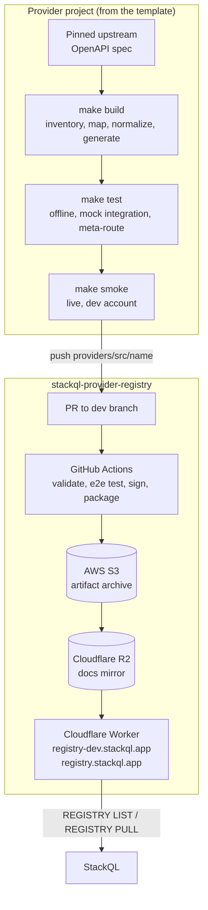

Lihat juga:
[[ StackQL Provider Registry ]](/providers) [[ Menggunakan provider ]](/getting-started/using-a-provider) [[ REGISTRY ]](/language-spec/registry) [[ Arsitektur ]](/developers/architecture)

## Ringkasan {#overview}

Provider StackQL adalah sekumpulan dokumen OpenAPI berversi beserta ekstensi `x-stackQL-*` yang diubah oleh mesin [omnisdk](https://github.com/stackql-labs/omnisdk) menjadi tabel SQL: `SELECT` untuk operasi baca, `INSERT`, `UPDATE`, `REPLACE`, dan `DELETE` untuk operasi siklus hidup, serta `EXEC` untuk aksi. Dokumen provider memberi tahu StackQL apa yang dapat dilakukan oleh API sebuah provider dan cara memanggilnya dengan semantik SQL. Dokumen ini berupa YAML biasa, sehingga provider dapat dibangun, diuji, dan diberi versi seperti kode lainnya.

Ekosistem provider terdiri atas tiga repositori dan satu lapisan distribusi:

| Komponen | Peran |
| --- | --- |
| [__`stackql-provider-TEMPLATE`__](https://github.com/stackql-registry/stackql-provider-TEMPLATE) | Titik awal untuk proyek provider baru: pipeline `make` deterministik dari spesifikasi upstream yang dikunci hingga provider yang dihasilkan, lapisan pengujian tanpa kredensial, rangkaian smoke test langsung, microsite dokumentasi, dan CI. Menyertakan skill pengembangan provider untuk Claude Code. |
| [__`omnisdk`__](https://github.com/stackql-labs/omnisdk) | Mesin yang membaca dokumen provider dan menjalankan permintaan, mulai StackQL `v1.0`. Pendahulunya, [`any-sdk`](https://github.com/stackql/any-sdk), masih menjadi tempat referensi untuk kontrak dokumen provider, ekstensi `x-stackQL-*`, autentikasi, paginasi, transformasi dan pushdown, serta JSON Schema yang ditautkan di bawah. |
| [__`stackql-provider-registry`__](https://github.com/stackql/stackql-provider-registry) | Sumber kebenaran untuk provider yang dipublikasikan. Dokumen diberi versi di bawah `providers/src/<provider>/<version>/`, lalu ditandatangani, dikemas, dan dipublikasikan oleh GitHub Actions. |
| __Lapisan distribusi Cloudflare__ | Artefak provider yang telah dikemas dilayani di edge dari Cloudflare R2 oleh Cloudflare Worker di `registry.stackql.app` (produksi) dan `registry-dev.stackql.app` (pengembangan). Inilah yang dihubungi oleh `REGISTRY LIST` dan `REGISTRY PULL`. |
<br/>
Diagram berikut menunjukkan jalur dari proyek provider hingga instalasi StackQL:



## Struktur dokumen provider {#provider-document-structure}

Objek StackQL mengikuti hierarki `provider.service.resource.method`, misalnya `google.compute.instances.list`. Dokumen provider mencerminkan hierarki tersebut:

```
provider.yaml                          # provider metadata, providerServices, provider-level config
services/
  <service>.yaml                       # an OpenAPI 3 document per service, plus
    components.x-stackQL-resources
      <resource>                       # id, name, methods, sqlVerbs, optional config
        methods.<method>               # operation $ref, response, request, optional config
```

- __Dokumen provider__ (`provider.yaml`): `id`, `name`, `title`, `version`, `providerServices` (masing-masing dengan `service.$ref` ke dokumen layanannya dan flag `preferred` opsional), serta `description`, `protocolType` (`http` adalah nilai default), dan `config` yang opsional.
- __Dokumen layanan__: dokumen OpenAPI 3 standar. Satu-satunya tambahan yang wajib adalah `components.x-stackQL-resources`, yang mendeklarasikan sumber daya yang diekspos sebagai tabel.
- __Sumber daya__: `id`, `name`, `methods`, dan `sqlVerbs`. Setiap sumber daya adalah tabel; kolomnya berasal dari skema respons metode `select` utamanya.
- __Metode__: `operation` yang berupa pointer JSON ke dalam `paths` (misalnya `$ref: '#/paths/~1orgs~1{org}~1repos/get'`), blok `response` (`mediaType`, `openAPIDocKey`, `objectKey`) yang memberi tahu mesin letak baris data, serta blok `request` dan `config` yang opsional.
- __Pemetaan kata kerja SQL__: `sqlVerbs.select`, `insert`, `update`, `replace`, dan `delete` adalah daftar referensi metode yang berurutan. StackQL mempertimbangkan metode yang direferensikan yang semua parameter wajibnya disediakan oleh klausa `WHERE`, lalu memilih metode dengan parameter wajib terbanyak, apa pun urutan daftarnya: kueri yang menyediakan pengidentifikasi yang diwajibkan oleh `get` diarahkan ke `get`, kueri yang tidak menyediakannya diarahkan ke `list`, dan dua metode yang seri dilaporkan sebagai error alih-alih dipilih salah satunya. Metode apa pun yang tidak direferensikan oleh daftar kata kerja dapat dipanggil melalui `EXEC`.

Sumber daya minimal terlihat seperti berikut:

```yaml
components:
  x-stackQL-resources:
    repos:
      id: github.repos.repos
      name: repos
      title: Repos
      methods:
        list_for_org:
          operation:
            $ref: '#/paths/~1orgs~1{org}~1repos/get'
          response:
            mediaType: application/json
            openAPIDocKey: '200'
        create_in_org:
          operation:
            $ref: '#/paths/~1orgs~1{org}~1repos/post'
          response:
            mediaType: application/json
            openAPIDocKey: '201'
          config:
            requestBodyTranslate:
              algorithm: naive
      sqlVerbs:
        select:
          - $ref: '#/components/x-stackQL-resources/repos/methods/list_for_org'
        insert:
          - $ref: '#/components/x-stackQL-resources/repos/methods/create_in_org'
```

Kontrak lengkapnya, termasuk setiap kunci dan maknanya, ada di [Spesifikasi provider](https://github.com/stackql/any-sdk/blob/main/docs/provider_spec.md) any-sdk. JSON Schema untuk `provider.yaml`, dokumen layanan, dan blok config ada di [`any-sdk/cicd/schema-definitions`](https://github.com/stackql/any-sdk/tree/main/cicd/schema-definitions); skema config menolak kunci yang tidak dikenal, sehingga kunci yang salah ketik akan gagal validasi alih-alih diabaikan tanpa pemberitahuan.

### Ekstensi OpenAPI {#openapi-extensions}

| Ekstensi | Lokasi | Tujuan |
| --- | --- | --- |
| `x-stackQL-resources` | `components` | Kamus sumber daya untuk dokumen layanan (wajib) |
| `x-stackQL-config` | layanan, sumber daya, metode, atau operasi | Blok config (lihat di bawah) yang diterapkan pada level tersebut |
| `x-stackQL-envVar` | variabel server | Menyebutkan variabel lingkungan yang menyediakan nilai variabel server jika nilai tersebut tidak diberikan di klausa `WHERE`. Digunakan untuk menetapkan cakupan API per tenant, organisasi, proyek, atau deployment |
| `x-stackQL-alias` | parameter atau properti skema | Nama alternatif yang diterima di SQL untuk nama di tingkat protokol |
| `x-stackQL-stringOnly` | properti skema | Menyerialisasi properti sebagai string, apa pun tipe yang dideklarasikan |
| `x-stackQL-graphQL` | operasi | Menggunakan kueri GraphQL sebagai dasar metode jika REST API tidak menyediakan data tersebut |
| `x-alwaysRequired` | parameter | Menandai parameter sebagai selalu wajib |
| `x-protocol` | `info` | Petunjuk protokol komunikasi (`query`, `ec2`, `rest-xml`) untuk penanganan respons XML berbasis skema |

### Blok config {#the-config-block}

`config` di `provider.yaml` dan `x-stackQL-config` di dokumen layanan menggunakan skema yang sama. Kunci yang diizinkan adalah `auth`, `pagination`, `queryParamPushdown`, `queryParamTranspose`, `requestTranslate`, `requestBodyTranslate`, `variations`, `views`, `sqlExternalTables`, `retry`, `minStackQLVersion`, dan `snake_case_aliases`. Nilai config ditentukan mulai dari level paling spesifik ke luar, metode -> sumber daya -> layanan -> layanan provider -> provider, sehingga default untuk seluruh provider dapat diganti untuk satu sumber daya atau metode.

## Yang ditangani provider {#what-providers-handle}

Provider bertanggung jawab atas fungsi yang menyembunyikan kerumitan API, sehingga pengguna mendapatkan antarmuka SQL yang konsisten tanpa harus mengelola interaksi HTTP yang mendasarinya.

### Autentikasi {#authentication}

Setiap provider menyertakan blok `auth` default yang menyebutkan variabel lingkungan yang menyimpan kredensialnya, sehingga lingkungan yang variabelnya sudah terisi tidak memerlukan konfigurasi autentikasi saat runtime. Hanya referensi tidak langsung (nama variabel lingkungan, path file) yang diterima di dokumen provider; nilai kredensial literal hanya boleh berada di konteks `--auth` saat runtime. Nama variabel lingkungan sebaiknya mengikuti provider Terraform milik vendor jika ada.

| `auth.type` | Field umum |
| --- | --- |
| `bearer` | `credentialsenvvar` |
| `api_key` | `credentialsenvvar`, `valuePrefix`, serta `location` (`header` atau `query`) dan `name` yang opsional |
| `basic` | `username_var`, `password_var` |
| `custom` | `location`, `name`, `credentialsenvvar`, `valuePrefix` yang opsional; rangkaikan kredensial kedua dengan `successor` |
| `oauth2` | `client_id_env_var`, `client_secret_env_var`, `grant_type: client_credentials`, `token_url`, `scopes` |
| `service_account` | `credentialsenvvar` atau `credentialsfilepathenvvar`, `scopes` |
| `aws_signing_v4`, `aws_assume_role` | `keyIDenvvar`, `credentialsenvvar` |
| `azure_default` | tidak ada |
| `oci_signing_v1` | `tenancy_ocid_envvar`, `user_ocid_envvar`, `oci_fingerprint_envvar`, `oci_private_key_envvar`, `oci_region_envvar` |
| `interactive` | tidak ada |
| `null_auth` | tidak ada (secara eksplisit tanpa autentikasi) |
<br/>
Misalnya:

```yaml
config:
  auth:
    type: api_key
    credentialsenvvar: OKTA_API_TOKEN
    valuePrefix: 'SSWS '
```

Pengguna dapat mengganti konfigurasi autentikasi provider saat runtime dengan `--auth='{"<provider>": {...}}'`.

### Paginasi {#pagination}

Provider mendeklarasikan skema paginasi vendor dan mesin menelusuri setiap halaman, sehingga pengguna menerima kumpulan hasil yang lengkap. Skema yang didukung:

- __Token atau kursor di isi respons__: `requestToken: {key: cursor, location: query}`, `responseToken: {key: $.cursor, location: body}`; berhenti jika token tidak ada atau kosong.
- __URL halaman berikutnya di isi respons__: `requestToken: {key: '', location: request}`, `responseToken: {key: $.next, location: body}`; `algorithm: odata_next_link` untuk `@odata.nextLink` OData.
- __Header `Link` RFC 5988__: `responseToken: {key: Link, location: header}`.
- __Nomor halaman dengan jumlah halaman__: `algorithm: page_number` dengan `responseToken` (halaman saat ini) dan `responseTerminator` (total halaman).

API offset dan limit tanpa penanda halaman berikutnya bukan skema paginasi; sebagai gantinya, ekspos `offset` dan `limit` sebagai parameter `WHERE`. Flag global `--http.response.pageLimit` membatasi penelusuran halaman.

### Pushdown predikat {#predicate-pushdown}

Kunci `WHERE` dicocokkan dengan parameter yang dideklarasikan operasi berdasarkan nama (path, lalu kueri, header, dan cookie) dan dikirim ke API, sehingga pemfilteran terjadi di sumber. Kunci `WHERE` sisa yang tidak memiliki parameter yang cocok ditambahkan sebagai parameter kueri.

Selain parameter biasa, `queryParamPushdown` menulis ulang kolom `SELECT`, `WHERE`, `ORDER BY`, `LIMIT`, `OFFSET`, dan `COUNT` menjadi parameter API. `dialect: odata` mengisi default `$select`, `$filter`, `$orderby`, `$top`, `$skip`, dan `$count` yang digunakan oleh API bergaya Microsoft Graph dan Azure; `dialect: custom` menggunakan `paramName` apa adanya, paling umum `top: {paramName: limit, maxValue: 1000}` sehingga `LIMIT n` menjadi `?limit=n`. Predikat yang tidak dapat didorong tetap dievaluasi di sisi klien.

### Transformasi respons dan permintaan {#response-and-request-transformation}

- `response.objectKey` adalah JSONPath (atau XPath untuk API XML) yang memilih item yang berisi baris dari wrapper respons, misalnya `$.data[*]` atau `$.value`.
- `response.transform` menerapkan template teks Go pada isi respons sebelum di-staging sebagai baris; tipe transformasi mencakup JSON, XML, dan teks biasa, dan dengan cara inilah API XML AWS dan output CLI menjadi tabel.
- `requestBodyTranslate: {algorithm: naive}` memungkinkan pernyataan `INSERT` menerima field isi permintaan sebagai nama kolom biasa, alih-alih dalam bentuk berawalan `data__`.
- `snake_case_aliases: true` di level provider mengekspos nama camelCase di tingkat protokol sebagai kolom dan parameter snake_case.
- `retry` menetapkan kebijakan backoff eksponensial (`max_attempts`, `initial_delay_ms`, `max_delay_ms`, `multiplier`, `jitter_fraction`, `retryable_methods`, `retryable_conditions.status_codes`). Level pertama yang mendeklarasikan kebijakan ini yang digunakan; lihat [kebijakan retry](https://github.com/stackql/any-sdk/blob/main/docs/retry_policy.md) any-sdk.

Tipe kolom mengikuti skema OpenAPI: `string` -> text, `integer` -> integer, `number` -> numeric, `boolean` -> boolean. Properti `object` dan `array` disimpan sebagai teks JSON, itulah sebabnya field bersarang dibaca dengan `json_extract` dalam kueri dan provider sering menyertakan tampilan (`config.views`, dengan `ddl` per dialek dan `fallback`) untuk proyeksi bersarang yang umum.

### Provider non-HTTP {#non-http-providers}

`protocolType: local_templated` di `provider.yaml` membuat provider menggunakan perintah lokal alih-alih HTTP: metode membawa array `inline` berisi fragmen argv template Go, parameter menggunakan `in: inline`, dan `response.transform` mengubah output perintah menjadi baris. Provider referensi [`local_openssl`](https://github.com/stackql/any-sdk/tree/main/test/registry/src/local_openssl/v0.1.0) di any-sdk menunjukkan bentuknya. Hal ini berada di luar cakupan pipeline template, yang menargetkan API HTTP.

## Memulai proyek provider {#starting-a-provider-project}

Mulai setiap provider baru dari [__`stackql-provider-TEMPLATE`__](https://github.com/stackql-registry/stackql-provider-TEMPLATE). Repositori ini adalah repositori template GitHub yang merangkum standar terkini untuk provider: spesifikasi upstream yang dikunci, pipeline build deterministik yang menjadikan setiap keputusan manual sebagai aturan dalam skrip alih-alih suntingan tangan pada YAML yang dihasilkan, tiga lapisan pengujian tanpa kredensial, rangkaian smoke test langsung yang dibatasi anggaran, situs dokumentasi Docusaurus, dan CI. Provider terpublikasi yang dibangun dengan cara ini berada di organisasi GitHub [stackql-registry](https://github.com/orgs/stackql-registry/repositories) dan merupakan bahan referensi yang berguna di samping template.

Prasyarat: Node.js 20 atau yang lebih baru, GNU make dan bash (Linux, macOS, atau WSL), Python 3 untuk rangkaian smoke test, dan biner `stackql` (skrip `bin/start-server.sh` mengunduh biner tersebut jika tidak ditemukan).

1. Buat repositori dari template (GitHub "Use this template") lalu jalankan `npm install`.
2. Jalankan `bin/init-provider.sh <name> "<Title>" [https://api.vendor.com]` untuk mengganti placeholder di seluruh repositori.
3. Isi konstanta di `provider-dev/scripts/lib/spec_helpers.mjs` (URL spesifikasi, prefiks versi path, prefiks cakupan untuk API yang dicakup per tenant atau proyek) dan konfigurasi di `provider-dev/config/` (`servers.json`, `provider_config.json`, `service_names.json`).
4. Jalankan pipeline, baik secara manual melalui target `make` maupun dengan membuka sesi Claude Code di repositori (lihat di bawah).
5. `grep -rn "TODO(template)"` mencantumkan hal yang masih belum selesai.

Pipeline dijalankan oleh `make` (`make help` mencantumkan setiap target):

```bash
make fetch-spec        # verify the upstream spec against the recorded pin (fails on drift)
make inventory         # one CSV row per operation with the proposed service, resource, method and verb
make split             # write provider-dev/source/<service>.yaml from the ordered path rules
make mappings-report   # print every derived operation -> resource.method mapping without writing
make mappings          # regenerate provider-dev/config/all_services.csv and validate it
make normalize         # flatten allOf, lower oneOf/anyOf, wrap bare arrays
make generate          # generate provider.yaml + services/*.yaml, then post-process and merge GraphQL/views
make test              # offline SHOW/DESCRIBE, mock API integration tests, meta-route walk (no credentials)
make smoke             # live smoke suite against a dedicated dev account (sources .env)
make docs              # generate the provider documentation site content
make all               # everything above except the live suites
```

Di balik layar, pipeline menggunakan [__`@stackql/provider-utils`__](https://github.com/stackql-registry/stackql-provider-utils) (`split`, `normalize`, `analyze`, `generate`, dan `docgen`) dengan aturan khusus provider di `provider-dev/scripts/`. Provider yang dihasilkan ditempatkan di `provider-dev/openapi/src/<name>/v00.00.00000/`, yaitu direktori yang pada akhirnya dipublikasikan ke registri.

`provider-dev/config/all_services.csv` adalah kontrak yang di-commit untuk setiap pemetaan operasi ke sumber daya dan metode. Diff yang muncul saat regenerasi harus ditinjau sebagai perubahan yang tidak kompatibel, bukan dianggap derau. CI gagal jika ada penyimpangan hasil generasi yang belum di-commit, sehingga regenerasi harus mereproduksi artefak yang telah di-commit byte demi byte.

Untuk repositori provider yang sudah ada sebelum template ini, salin direktori `.claude/skills` ke dalamnya dan mulai dari `references/uplift-checklist.md` milik skill tersebut.

### Menggunakan Claude Code untuk pengembangan provider {#using-claude-code-for-provider-development}

Template ini menyertakan [__skill pengembangan provider StackQL__](https://github.com/stackql-registry/stackql-provider-TEMPLATE/blob/main/.claude/skills/stackql-provider-development/SKILL.md) untuk [Claude Code](https://docs.anthropic.com/en/docs/claude-code). Buka sesi Claude Code di repositori yang dibuat dari template dan minta Claude Code membangun provider; Claude Code membaca `CLAUDE.md` dan skill tersebut lalu mengerjakan langkah-langkahnya secara berurutan. Skill ini juga merupakan prosedur tertulis untuk mengerjakannya secara manual.

Skill ini mencakup:

- Memilih arketipe: dokumen OpenAPI, Swagger, atau discovery yang dipublikasikan oleh vendor (direct), atau spesifikasi yang diturunkan dari SDK vendor jika SDK tersebut merupakan sumber kebenaran (derived)
- Mengambil, memperbaiki, memvalidasi, dan mengunci spesifikasi upstream sehingga setiap pembaruan menjadi diff yang dapat ditinjau
- Inventaris endpoint, pembagian layanan, dan aturan pemetaan yang menghasilkan `all_services.csv`
- Setiap primitif dokumen provider dan kapan menggunakannya: penetapan cakupan dengan `x-stackQL-envVar`, `objectKey`, transformasi permintaan dan respons, paginasi, pushdown parameter kueri, metode `EXEC` siklus hidup, penyatuan GraphQL, dan tampilan provider
- Tiga lapisan pengujian tanpa kredensial dan rangkaian smoke test langsung
- Situs dokumentasi, workflow CI, dan catatan serah terima

Direktori `references/` milik skill ini berisi detail untuk setiap langkah, dan `scripts/find_extension_examples.sh` mencetak YAML yang sudah dirilis untuk kunci ekstensi apa pun dari klon registri provider, sehingga penggunaan suatu primitif dapat dilihat sebelum primitif itu ditulis.

## Menguji provider secara lokal {#testing-a-provider-locally}

StackQL membaca provider dari registri yang dijelaskan oleh flag global `--registry`. Selama pengembangan, arahkan StackQL ke direktori provider yang dihasilkan di sistem file lokal dengan verifikasi tanda tangan dinonaktifkan (dokumen hanya ditandatangani saat dipublikasikan):

```bash
export LOCAL_REG='{ "url": "file:///path/to/provider-dev/openapi", "localDocRoot": "/path/to/provider-dev/openapi", "verifyConfig": { "nopVerify": true } }'
stackql --registry="${LOCAL_REG}" shell
```

Direktori di bawah `localDocRoot` harus berisi `src/<provider>/<version>/provider.yaml` dan `src/<provider>/<version>/services/*.yaml`, persis seperti yang dihasilkan oleh template. Dari shell, `SHOW SERVICES IN <provider>`, `SHOW RESOURCES IN <provider>.<service>`, `SHOW METHODS IN <provider>.<service>.<resource>`, dan `DESCRIBE EXTENDED <provider>.<service>.<resource>` mengonfirmasi permukaan provider sebelum kueri apa pun dijalankan. File `tests/offline_validation.mjs` dari template mengotomatiskan asersi ini, dan `npm run probe -- "SELECT ..."` menjalankan SQL ad-hoc terhadap API mock dan mencetak panggilan yang dikirim di tingkat protokol.

Provider yang diunduh dari registri jarak jauh disimpan di cache di bawah `<cwd>/.stackql` secara default; gunakan flag `--approot` untuk mengubah lokasinya.

[CLI any-sdk](https://github.com/stackql/any-sdk/blob/main/docs/cli.md) berguna untuk memeriksa dokumen tanpa melibatkan StackQL: `anysdk aot <registry> <provider.yaml>` menjalankan analisis statis atas provider (`objectKey` yang tidak dapat dirutekan, skema respons yang hilang, paginasi yang tidak lengkap, parameter path yang bersebelahan, dan sebagainya), dan `anysdk query` menjalankan satu metode langsung dari dokumen provider dan dokumen layanan. [Pengujian automock](https://github.com/stackql/any-sdk/blob/main/docs/automock_testing.md) menghasilkan API mock dan hasil yang diharapkan dari skema dalam provider untuk pengujian bolak-balik penuh tanpa menyentuh API yang sebenarnya.

### Menguji provider Anda menggunakan registri `dev` {#testing-your-provider-using-the-dev-registry}

Setelah provider di-merge ke branch `dev` registri, provider tersebut tersedia dari registri pengembangan. Arahkan StackQL ke registri ini untuk memverifikasi artefak yang dipublikasikan:

```bash
export DEV_REG='{ "url": "https://registry-dev.stackql.app/providers" }'
stackql --registry="${DEV_REG}" shell
```

```sql
REGISTRY PULL myprovider;
```

Target `make smoke-live` dari template menjalankan rangkaian smoke test terhadap provider yang dipublikasikan untuk verifikasi pascapublikasi.

## Memublikasikan provider {#publishing-a-provider}

Publikasi adalah langkah terpisah yang melibatkan manusia dan bukan bagian dari pipeline template.

1. Buat fork [stackql-provider-registry](https://github.com/stackql/stackql-provider-registry) dan salin direktori `provider-dev/openapi/src/<name>` yang dihasilkan ke `providers/src/<name>` di branch fitur.
2. Ajukan pull request ke branch `dev` dengan deskripsi provider dan perubahannya (lihat [panduan kontribusi](https://github.com/stackql/stackql-provider-registry/blob/main/.github/CONTRIBUTING.md) registri).
3. GitHub Actions memvalidasi dan menguji provider menggunakan [stackql-provider-tests](https://github.com/stackql/stackql-provider-tests). Aturan yang dievaluasi adalah: dokumen harus berupa spesifikasi OpenAPI yang valid, sumber daya di semua layanan harus dapat dienumerasi, metode di semua sumber daya harus dapat dienumerasi, metode yang dapat dipanggil melalui `SELECT` harus memiliki skema respons yang valid, dan metode yang dapat dipanggil melalui `INSERT` harus memiliki skema permintaan yang valid.
4. Saat di-merge, workflow mengalokasikan versi, menandatangani dokumen (ML-DSA-65), mengemasnya, dan memublikasikan artefak ke arsip AWS S3. Pohon dokumen kemudian dicerminkan ke Cloudflare R2, dan Cloudflare Worker yang melayani `registry-dev.stackql.app` di-deploy. Provider langsung tersedia bagi instalasi yang dikonfigurasi untuk menggunakan registri `dev`.
5. Setelah periode pemantauan, `dev` dipromosikan ke `main`, yang mengulangi publikasi untuk `registry.stackql.app`. Inilah publikasi untuk instance StackQL dengan konfigurasi default.

Harness `stackql-provider-tests` yang sama dapat dijalankan secara lokal terhadap direktori registri sebelum mengajukan PR:

```bash
test-provider.sh <provider_name> false /path/to/provider-dev/openapi
```

Lihat [build dan deployment](https://github.com/stackql/stackql-provider-registry/blob/main/docs/build-and-deployment.md) di repositori registri untuk detail workflow, termasuk pengaman penghapusan provider yang melindungi `providers/src`.
