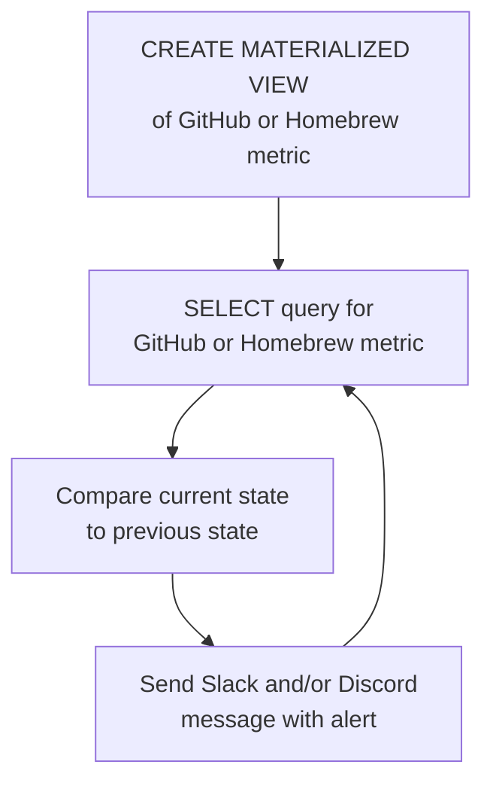

# Monitor aktivitas proyek sumber terbuka berbasis StackQL

Dalam panduan ini, kami akan menunjukkan cara meng-host sendiri sistem pemantauan dan peringatan waktu nyata untuk pengelola perangkat lunak sumber terbuka di GitHub.  

> [__stackql__](https://github.com/stackql/stackql) adalah alat sumber terbuka yang memungkinkan pengguna mengkueri dan berinteraksi dengan sumber daya cloud dan SaaS menggunakan bahasa SQL serta library dan alat visualisasi dan analisis data. Beri kami [⭐](https://github.com/stackql/stackql) jika Anda menyukai proyek ini!

Dapatkan peringatan seperti ini di Slack dan Discord dalam waktu nyata:


Diuji dengan <span class="tutorial_tested_on">backend SQL tersemat</span> <span class="tutorial_tested_on">docker</span> <span class="tutorial_tested_on">linux</span> 

## Ringkasan {#overview}

Saat saya mencari alat untuk memantau proyek sumber terbuka kami, saya mendapati sebagian besar alat tersebut tidak berfungsi seperti yang dijanjikan atau tidak berfungsi sama sekali (dalam kasus aplikasi pihak ketiga di GitHub), jadi saya membuat alat kami sendiri yang dapat Anda jalankan dan gunakan di proyek GitHub sumber terbuka Anda...  

Proyek [__oss-activity-monitor__](https://github.com/stackql/oss-activity-monitor) menggunakan [__stackql__](https://github.com/stackql/stackql) untuk melakukan pemantauan aktivitas proyek sumber terbuka dalam waktu nyata, termasuk notifikasi waktu nyata untuk:

- ⭐ stargazer baru di repositori GitHub
- 👀 watcher baru di repositori GitHub
- 🍴 fork baru di repositori GitHub
- 📊 issue baru di repositori GitHub
- 🙋 pengikut baru organisasi GitHub
- 📦 unduhan baru aset rilis GitHub
- 🍺 unduhan baru homebrew

## Cara kerja {#how-it-works}

Proyek ini di-deploy dalam container (menggunakan `docker` atau platform deployment container lainnya), dibangun menggunakan `python` dan paket [`pystackql`](https://pystackql.readthedocs.io/en/latest/intro.html), dengan provider [`github`](https://github-provider.stackql.io/) dan [`homebrew`](https://homebrew-provider.stackql.io/) untuk `stackql`.  Tampilan terwujud dan pernyataan `SELECT` digunakan untuk menangkap dan membandingkan status antara metrik saat ini dan metrik sebelumnya untuk endpoint GitHub dan Homebrew yang dipantau, seperti yang dijelaskan dalam diagram berikut:  


misalnya, dengan tampilan terwujud berikut yang dibuat dan diisi menggunakan `stackql`:  

```sql
CREATE OR REPLACE MATERIALIZED VIEW mvw_github_repo_stargazers AS 
SELECT login FROM github.activity.repo_stargazers
WHERE owner = 'your-org' and repo = 'your-repo'
```

kueri `stackql` berikut memeriksa GitHub secara berkala untuk mencari stargazer baru...

```sql
SELECT c.login
FROM github.activity.repo_stargazers c
LEFT JOIN mvw_github_repo_stargazers mvw
ON c.login = mvw.login
WHERE mvw.login IS NULL
AND c.owner = 'your-org' AND c.repo = 'your-repo'
```

kemudian status diperbarui menggunakan...

```sql
REFRESH MATERIALIZED VIEW mvw_github_repo_stargazers
```

pola serupa diulang untuk watcher repositori, issue, pengikut organisasi, unduhan aset rilis, dan unduhan homebrew.

## Menjalankan proyek {#running-the-project}

Ikuti langkah-langkah di bawah ini untuk menyiapkan dan menjalankan proyek secara lokal atau di platform cloud pilihan Anda.  

### 1. Mengkloning repositori {#1-clone-the-repo}

```bash
git clone https://github.com/stackql/oss-activity-monitor.git
# or 
git clone git@github.com:stackql/oss-activity-monitor.git
```

### 2. Mengonfigurasi variabel lingkungan {#2-configure-environment-variables}

Variabel lingkungan berikut diperlukan untuk mengonfigurasi proyek (diberikan melalui variabel lingkungan, yaitu file `.env` dalam contoh di bawah ini):  

| Variabel                   | Deskripsi                                                                         | Contoh nilai                                     |
|----------------------------|-----------------------------------------------------------------------------------|--------------------------------------------------|
| `LOG_LEVEL`                | Tingkat log (INFO untuk log umum; DEBUG untuk log terperinci)                     | INFO                                             |
| `SLEEP_INTERVAL`           | Jeda waktu dalam detik di antara putaran permintaan                               | 5                                                |
| `GITHUB_REPO`              | Nama repositori GitHub                                                            | stackql                                          |
| `GITHUB_REPO_OWNER`        | Nama organisasi atau pemilik GitHub                                               | stackql                                          |
| `HOMEBREW_FORMULA_NAME`    | Nama formula Homebrew, jika tersedia                                              | stackql                                          |
| `STACKQL_GITHUB_USERNAME`  | Nama pengguna GitHub Anda                                                         | jeffreyaven                                      |
| `STACKQL_GITHUB_PASSWORD`  | Token akses pribadi GitHub Anda                                                   | ghp_yourpersonalaccesstoken                      |
| `SLACK_WEBHOOK_URL`        | URL webhook Slack untuk mengirim notifikasi                                       | https://hooks.slack.com/services/...             |
| `DISCORD_WEBHOOK_URL`      | URL webhook Discord untuk mengirim notifikasi                                     | https://discord.com/api/webhooks/...             |

### 3. Membangun container {#3-build-the-container}

```bash
docker build --no-cache -t oss-activity-monitor .
```

### 4. Menjalankan container {#4-run-the-container}

```bash
docker run --env-file .env oss-activity-monitor
```

Selesai!  Sekarang Anda akan menerima peringatan waktu nyata saat ada aktivitas di proyek sumber terbuka Anda.  Untuk menghentikan container, gunakan:  

```bash
docker stop $(docker ps -a -q --filter ancestor=oss-activity-monitor)
```

Beri kami ⭐ di [__GitHub__](https://github.com/stackql/stackql)
