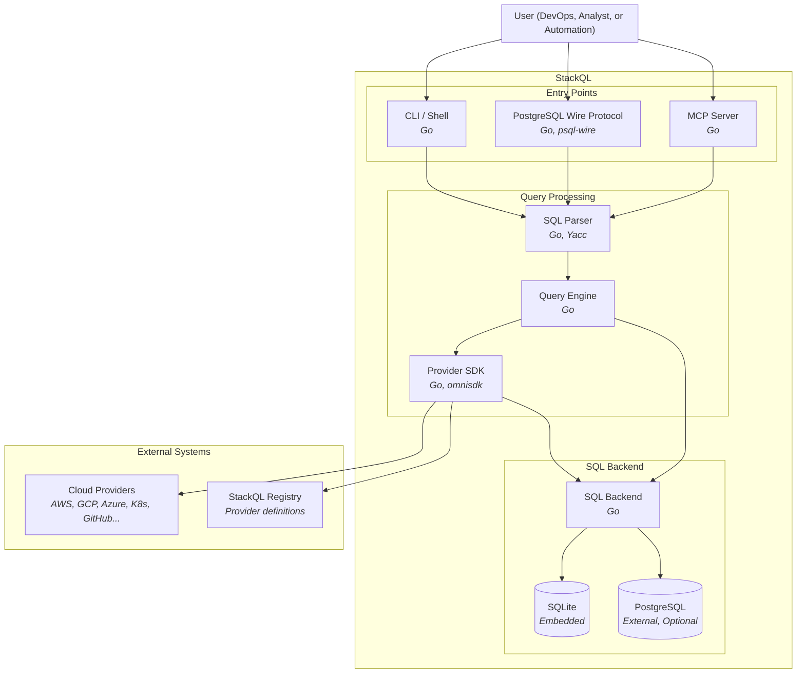

関連項目：
[[ StackQL の使用 ]](/getting-started/using-stackql) [[ 変数の使用 ]](/getting-started/variables) [[ テンプレート機能 ]](/getting-started/templating)

## 概要 {#overview}

StackQL は、複数のプロバイダーにまたがってクラウドインフラストラクチャをクエリおよび管理するための、統一された SQL インターフェイスです。次のコンテナー図は、StackQL システムの主要なコンポーネントとそれらの相互作用を示しています。

## コアコンポーネント {#core-components}

### エントリポイント {#entry-points}

StackQL は、SQL クエリを実行するための複数のエントリポイントをサポートしています。

- **CLI / シェル**：ターミナルから直接 SQL クエリを実行するための対話型シェルとコマンドラインインターフェイスです。ユーザーは、アドホッククエリやスクリプトを実行したり、対話型シェルを使用して探索したりできます。

- **PostgreSQL ワイヤプロトコル**：`psql`、DBeaver、その他の PostgreSQL 互換ツールなど、標準的な PostgreSQL クライアントからの接続を可能にします。これにより、既存のデータベースワークフローや BI ツールとシームレスに統合できます。

- **MCP サーバー**：AI アシスタントとの統合を可能にする Model Context Protocol サーバーです。大規模言語モデルが自然言語を通じてインフラストラクチャをクエリおよび管理できるようにします。

### クエリ処理パイプライン {#query-processing-pipeline}

1. **SQL パーサー**：Yacc ベースのカスタム文法を使用して、SQL 入力を解析し、抽象構文木（AST）に変換します。パーサー（`stackql-parser` として実装）は SQL 構文を検証し、クエリ計画の作成に備えます。

2. **クエリエンジン**：クエリの計画を作成して実行する、中心的なオーケストレーション層です。どの操作を API 層にプッシュダウンでき、どの操作にローカルでの SQL 処理が必要かを判断します。クエリエンジンは次の処理を担当します。
   - クエリ計画の作成と最適化
   - API 呼び出しとローカルでの SQL 実行の調整
   - 結果の集約と変換

### プロバイダー SDK（omnisdk） {#provider-sdk-omnisdk}

プロバイダー SDK である [omnisdk](https://github.com/stackql-labs/omnisdk) は、クラウドベンダーとのすべてのやり取りを管理します。StackQL `v1.0` で `any-sdk` に代わって導入されました。主な役割は次のとおりです。

- **プロバイダー検出**：StackQL Registry からプロバイダー仕様を取得します。StackQL Registry には、サポートされている各クラウドベンダーの OpenAPI ベースの定義が含まれています。また、各ドキュメントを使用する前に、その ML-DSA-65 署名を検証することもできます。

- **認証**：各プロバイダーの認証を処理し、API キー、OAuth トークン、サービスアカウントの認証情報など、さまざまな認証方式をサポートします。各プロバイダー定義には、その認証要件が指定されています。セッションでは、同じプロバイダーを、それぞれ別の認証情報を持つ複数のエイリアスでバインドできます（[プロバイダーセッション](/getting-started/provider-sessions)を参照）。

- **グラフ計画**：各文について、データエッジと制御エッジで結ばれたプロバイダーとのやり取りのグラフとして計画を作成します。結合、サブクエリ、CTE、ビューは同じプランナーを通じて実行されます。計画からファンアウトするリクエストは、プロバイダーごとおよびホストごとの制限の範囲内で並行して実行されます。

- **API リクエストの構築**：SQL クエリを各プロバイダーに適した REST API 呼び出しに変換し、エンドポイントの構築、パラメーターのマッピング、リクエストの整形を処理します。

- **ページネーション**：ページネーションされた API レスポンスを自動的に処理し、プロバイダーごとに異なるページネーション方式（カーソルベース、オフセットベース、トークンベースなど）の複雑さを抽象化します。

- **述語プッシュダウン**：リクエストパラメーターに対応する条件と、順序付けが不要な場合の `LIMIT` をプロバイダーへのリクエストにプッシュダウンし、送信するリクエストの数と転送するデータ量を削減します。

- **レスポンス変換**：API レスポンスを到着した時点で行に変換し、SQL バックエンドでのステージングやクライアントへのストリーミングに渡します。

SQL 接続、ステージング、バックエンドでの実行は StackQL 側に残ります。omnisdk には SQL ステージングが含まれず、データベース接続を受け取ることもありません。StackQL は omnisdk にリレーションハンドルを渡し、行カーソルを受け取ります。

### SQL バックエンド {#sql-backend}

SQL バックエンドは、マテリアライズされた API データに対してリレーショナル操作を実行します。

- **SQLite**：一時テーブルの保存とリレーショナル処理に使用される組み込みデータベースです。アドホッククエリや小規模なデータセットに最適です。

- **PostgreSQL**：永続ストレージ、大規模なデータセット、高度な分析ワークロード向けの、オプションの外部データベースです。

SQL バックエンドは、次のような操作を処理します。
- 複数のプロバイダーまたはリソースにまたがる JOIN 操作
- 集約関数（COUNT、SUM、AVG など）
- マテリアライズされたデータに対する並べ替えとフィルタリング
- 複雑な SQL 式とサブクエリ

## 外部システム {#external-systems}

### クラウドベンダー {#cloud-providers}

StackQL は、クラウドベンダー（AWS、GCP、Azure、Kubernetes、GitHub など多数）の REST API を介して接続します。すべての通信は HTTPS 経由で行われ、各ベンダーの API 規約の詳細はプロバイダー SDK が処理します。

### StackQL Registry {#stackql-registry}

StackQL Registry は、プロバイダー定義をホストします。プロバイダー定義とは、利用可能なリソース、メソッド、およびそれらのマッピングを記述する OpenAPI ベースの仕様です。プロバイダーはバージョン管理されており、`REGISTRY PULL` コマンドを使用してオンデマンドでプルできます。

## クエリ実行フロー {#query-execution-flow}

1. ユーザーが、いずれかのエントリポイント（CLI、PostgreSQL プロトコル、または MCP）を通じて SQL クエリを送信します
2. SQL パーサーがクエリを検証し、AST に変換します
3. クエリエンジンが AST を分析し、実行計画を作成します
4. プロバイダー操作の場合、プロバイダー SDK は次の処理を行います：
   - 該当するプロバイダー仕様をレジストリから取得する（キャッシュされていない場合）
   - クラウドベンダーで認証する
   - API リクエストを構築して実行し、ページネーションを自動的に処理する
   - 可能な場合は述語を API にプッシュする
   - 結果を SQL バックエンドにマテリアライズする
5. SQL バックエンドが残りのリレーショナル操作を実行します
6. 結果が、要求された形式でユーザーに返されます
