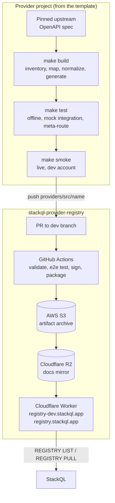

関連項目：
[[ StackQL Provider Registry ]](/providers) [[ プロバイダーの使用 ]](/getting-started/using-a-provider) [[ REGISTRY ]](/language-spec/registry) [[ アーキテクチャ ]](/developers/architecture)

## 概要 {#overview}

StackQL プロバイダーは、バージョン管理された OpenAPI ドキュメントと `x-stackQL-*` 拡張のセットです。[omnisdk](https://github.com/stackql-labs/omnisdk) エンジンがこれを SQL テーブルに変換します。読み取りには `SELECT`、ライフサイクル操作には `INSERT`、`UPDATE`、`REPLACE`、`DELETE`、アクションには `EXEC` を使用します。プロバイダードキュメントは、プロバイダーの API で何ができるか、それを SQL のセマンティクスでどのように呼び出すかを StackQL に伝えます。プロバイダードキュメントはプレーンな YAML なので、プロバイダーはほかのコードと同じようにビルド、テスト、バージョン管理できます。

プロバイダーのエコシステムは、3 つのリポジトリと 1 つの配信レイヤーで構成されます。

| コンポーネント | 役割 |
| --- | --- |
| [__`stackql-provider-TEMPLATE`__](https://github.com/stackql-registry/stackql-provider-TEMPLATE) | 新しいプロバイダープロジェクトの出発点です。固定されたアップストリームの仕様から生成されたプロバイダーまでの決定論的な `make` パイプライン、認証情報不要のテストレイヤー、ライブのスモークテストスイート、ドキュメントのマイクロサイト、CI を備えています。Claude Code のプロバイダー開発スキルを同梱しています。 |
| [__`omnisdk`__](https://github.com/stackql-labs/omnisdk) | StackQL `v1.0` 以降で、プロバイダードキュメントを読み込んでリクエストを実行するエンジンです。前身の [`any-sdk`](https://github.com/stackql/any-sdk) には、プロバイダードキュメントのコントラクト、`x-stackQL-*` 拡張、認証、ページネーション、変換、プッシュダウンのリファレンスと、下記からリンクされている JSON Schema が引き続き置かれています。 |
| [__`stackql-provider-registry`__](https://github.com/stackql/stackql-provider-registry) | 公開済みプロバイダーの信頼できる唯一の情報源です。ドキュメントは `providers/src/<provider>/<version>/` の下でバージョン管理され、GitHub Actions によって署名、パッケージ化、公開されます。 |
| __Cloudflare 配信レイヤー__ | パッケージ化されたプロバイダーのアーティファクトは、Cloudflare Worker によって Cloudflare R2 からエッジで配信されます。配信先は `registry.stackql.app`（本番環境）と `registry-dev.stackql.app`（開発環境）です。`REGISTRY LIST` と `REGISTRY PULL` はここと通信します。 |
<br/>
次の図は、プロバイダープロジェクトから StackQL のインストール環境までの経路を示しています。



## プロバイダードキュメントの構造 {#provider-document-structure}

StackQL のオブジェクトは `provider.service.resource.method` という階層に従います。たとえば `google.compute.instances.list` です。ドキュメントもこの階層を反映しています。

```
provider.yaml                          # provider metadata, providerServices, provider-level config
services/
  <service>.yaml                       # an OpenAPI 3 document per service, plus
    components.x-stackQL-resources
      <resource>                       # id, name, methods, sqlVerbs, optional config
        methods.<method>               # operation $ref, response, request, optional config
```

- __プロバイダードキュメント__（`provider.yaml`）：`id`、`name`、`title`、`version`、`providerServices`（それぞれにサービスドキュメントを指す `service.$ref` と、省略可能な `preferred` フラグを持つ）、省略可能な `description`、`protocolType`（デフォルトは `http`）、`config`。
- __サービスドキュメント__：標準的な OpenAPI 3 ドキュメントです。必須の追加は `components.x-stackQL-resources` だけで、テーブルとして公開するリソースを宣言します。
- __リソース__：`id`、`name`、`methods`、`sqlVerbs`。各リソースは 1 つのテーブルです。その列は、プライマリの `select` メソッドのレスポンススキーマから得られます。
- __メソッド__：`paths` 内を指す JSON ポインターである `operation`（たとえば `$ref: '#/paths/~1orgs~1{org}~1repos/get'`）、行の場所をエンジンに伝える `response` ブロック（`mediaType`、`openAPIDocKey`、`objectKey`）、省略可能な `request` ブロックと `config`。
- __SQL 動詞のマッピング__：`sqlVerbs.select`、`insert`、`update`、`replace`、`delete` は、メソッド参照の順序付きリストです。StackQL は、参照されているメソッドのうち必須パラメーターがすべて `WHERE` 句で指定されているものを候補とし、リストの順序にかかわらず、必須パラメーターが最も多いメソッドを選びます。`get` が必要とする識別子を指定したクエリは `get` にルーティングされ、指定しないクエリは `list` にルーティングされます。必須パラメーターの数が同じ 2 つのメソッドは、一方が選ばれるのではなく、エラーとして報告されます。どの動詞リストからも参照されていないメソッドは、`EXEC` で呼び出せます。

最小限のリソースは次のようになります。

```yaml
components:
  x-stackQL-resources:
    repos:
      id: github.repos.repos
      name: repos
      title: Repos
      methods:
        list_for_org:
          operation:
            $ref: '#/paths/~1orgs~1{org}~1repos/get'
          response:
            mediaType: application/json
            openAPIDocKey: '200'
        create_in_org:
          operation:
            $ref: '#/paths/~1orgs~1{org}~1repos/post'
          response:
            mediaType: application/json
            openAPIDocKey: '201'
          config:
            requestBodyTranslate:
              algorithm: naive
      sqlVerbs:
        select:
          - $ref: '#/components/x-stackQL-resources/repos/methods/list_for_org'
        insert:
          - $ref: '#/components/x-stackQL-resources/repos/methods/create_in_org'
```

すべてのキーとその意味を含む完全なコントラクトは、any-sdk の[プロバイダー仕様](https://github.com/stackql/any-sdk/blob/main/docs/provider_spec.md)に記載されています。`provider.yaml`、サービスドキュメント、config ブロックの JSON Schema は [`any-sdk/cicd/schema-definitions`](https://github.com/stackql/any-sdk/tree/main/cicd/schema-definitions) にあります。config スキーマは未知のキーを拒否します。そのため、キーの入力を誤ると、黙って無視されるのではなく検証エラーになります。

### OpenAPI 拡張 {#openapi-extensions}

| 拡張 | 場所 | 目的 |
| --- | --- | --- |
| `x-stackQL-resources` | `components` | サービスドキュメントのリソースディクショナリ（必須） |
| `x-stackQL-config` | サービス、リソース、メソッド、または操作 | そのレベルで適用される config ブロック（下記を参照） |
| `x-stackQL-envVar` | サーバー変数 | `WHERE` 句で指定されない場合にサーバー変数の値を提供する環境変数を指定する。テナント、組織、プロジェクト、デプロイの単位で API のスコープを設定するために使用する |
| `x-stackQL-alias` | パラメーターまたはスキーマプロパティ | ワイヤレベルの名前に対して SQL で受け付けられるエイリアス |
| `x-stackQL-stringOnly` | スキーマプロパティ | 宣言された型にかかわらず、プロパティを文字列としてシリアル化する |
| `x-stackQL-graphQL` | 操作 | REST API にデータがない場合に、メソッドを GraphQL クエリで実装する |
| `x-alwaysRequired` | パラメーター | パラメーターを常に必須としてマークする |
| `x-protocol` | `info` | スキーマ駆動の XML レスポンス処理のためのワイヤプロトコルのヒント（`query`、`ec2`、`rest-xml`） |

### config ブロック {#the-config-block}

`provider.yaml` の `config` と、サービスドキュメントの `x-stackQL-config` は、同じスキーマを共有します。使用できるキーは `auth`、`pagination`、`queryParamPushdown`、`queryParamTranspose`、`requestTranslate`、`requestBodyTranslate`、`variations`、`views`、`sqlExternalTables`、`retry`、`minStackQLVersion`、`snake_case_aliases` です。config は最も具体的なレベルから外側に向かって解決されます（メソッド -> リソース -> サービス -> プロバイダーサービス -> プロバイダー）。そのため、プロバイダー全体のデフォルトを、特定のリソースやメソッドだけで上書きできます。

## プロバイダーが処理する内容 {#what-providers-handle}

プロバイダーは、API の複雑さを抽象化する機能を担います。そのため、ユーザーは基盤となる HTTP のやり取りを管理することなく、一貫した SQL インターフェイスを利用できます。

### 認証 {#authentication}

各プロバイダーには、認証情報を保持する環境変数を指定したデフォルトの `auth` ブロックが含まれています。そのため、環境変数が設定済みであれば、実行時の認証設定は不要です。プロバイダードキュメントで受け付けられるのは間接参照（環境変数名、ファイルパス）だけです。認証情報の値そのものは、実行時の `--auth` コンテキストでのみ指定します。環境変数名は、ベンダーの Terraform プロバイダーがある場合はそれに合わせてください。

| `auth.type` | 主なフィールド |
| --- | --- |
| `bearer` | `credentialsenvvar` |
| `api_key` | `credentialsenvvar`、`valuePrefix`、省略可能な `location`（`header` または `query`）と `name` |
| `basic` | `username_var`、`password_var` |
| `custom` | `location`、`name`、`credentialsenvvar`、省略可能な `valuePrefix`。`successor` で 2 つ目の認証情報を連結する |
| `oauth2` | `client_id_env_var`、`client_secret_env_var`、`grant_type: client_credentials`、`token_url`、`scopes` |
| `service_account` | `credentialsenvvar` または `credentialsfilepathenvvar`、`scopes` |
| `aws_signing_v4`、`aws_assume_role` | `keyIDenvvar`、`credentialsenvvar` |
| `azure_default` | なし |
| `oci_signing_v1` | `tenancy_ocid_envvar`、`user_ocid_envvar`、`oci_fingerprint_envvar`、`oci_private_key_envvar`、`oci_region_envvar` |
| `interactive` | なし |
| `null_auth` | なし（明示的に認証なし） |
<br/>
たとえば次のとおりです。

```yaml
config:
  auth:
    type: api_key
    credentialsenvvar: OKTA_API_TOKEN
    valuePrefix: 'SSWS '
```

ユーザーは、`--auth='{"<provider>": {...}}'` を使用して、実行時にプロバイダーの認証を上書きできます。

### ページネーション {#pagination}

プロバイダーがベンダーのページネーション方式を宣言し、エンジンがすべてのページを順にたどります。そのため、ユーザーは完全な結果セットを受け取れます。サポートされている方式は次のとおりです。

- __ボディ内のトークンまたはカーソル__：`requestToken: {key: cursor, location: query}`、`responseToken: {key: $.cursor, location: body}`。トークンが存在しないか空の場合に停止します。
- __ボディ内の次ページ URL__：`requestToken: {key: '', location: request}`、`responseToken: {key: $.next, location: body}`。OData の `@odata.nextLink` には `algorithm: odata_next_link` を使用します。
- __RFC 5988 の `Link` ヘッダー__：`responseToken: {key: Link, location: header}`。
- __ページ数付きのページ番号__：`algorithm: page_number` と、`responseToken`（現在のページ）および `responseTerminator`（総ページ数）。

次ページのマーカーがないオフセットとリミット方式の API は、ページネーション方式ではありません。代わりに、`offset` と `limit` を `WHERE` パラメーターとして公開します。グローバルフラグ `--http.response.pageLimit` で、たどるページ数の上限を設定できます。

### 述語のプッシュダウン {#predicate-pushdown}

`WHERE` のキーは、操作で宣言されたパラメーターと名前で照合され（パス、次にクエリ、ヘッダー、Cookie の順）、API に送信されます。そのため、フィルタリングはソース側で行われます。一致するパラメーターがない残りの `WHERE` キーは、クエリパラメーターとして追加されます。

通常のパラメーターに加えて、`queryParamPushdown` は `SELECT` の列、`WHERE`、`ORDER BY`、`LIMIT`、`OFFSET`、`COUNT` を API パラメーターに書き換えます。`dialect: odata` は、Microsoft Graph や Azure 形式の API で使われる `$select`、`$filter`、`$orderby`、`$top`、`$skip`、`$count` のデフォルトを設定します。`dialect: custom` は `paramName` をそのまま使用します。最も一般的なのは `top: {paramName: limit, maxValue: 1000}` で、これにより `LIMIT n` が `?limit=n` になります。プッシュダウンできない述語も、クライアント側で評価されます。

### レスポンスとリクエストの変換 {#response-and-request-transformation}

- `response.objectKey` は、エンベロープから行となる項目を選択する JSONPath（XML API の場合は XPath）です。たとえば `$.data[*]` や `$.value` です。
- `response.transform` は、ボディが行としてステージングされる前に、Go のテキストテンプレートをボディに適用します。変換の種類は JSON、XML、プレーンテキストに対応しています。AWS の XML API や CLI の出力は、これによってテーブルになります。
- `requestBodyTranslate: {algorithm: naive}` を使用すると、`INSERT` はリクエストボディのフィールドを、`data__` プレフィックス付きの形式ではなく通常の列名として受け取れます。
- プロバイダーレベルの `snake_case_aliases: true` は、camelCase のワイヤ名を snake_case の列とパラメーターとして公開します。
- `retry` は指数バックオフのポリシー（`max_attempts`、`initial_delay_ms`、`max_delay_ms`、`multiplier`、`jitter_fraction`、`retryable_methods`、`retryable_conditions.status_codes`）を設定します。最初にポリシーを宣言したレベルが優先されます。any-sdk の[リトライポリシー](https://github.com/stackql/any-sdk/blob/main/docs/retry_policy.md)を参照してください。

列の型は OpenAPI スキーマに従います（`string` -> text、`integer` -> integer、`number` -> numeric、`boolean` -> boolean）。`object` と `array` のプロパティは JSON テキストとして格納されます。そのため、クエリではネストされたフィールドを `json_extract` で読み取ります。また、よく使われるネストされた射影のために、プロバイダーがビュー（`config.views`、方言ごとの `ddl` と `fallback` を含む）を同梱していることがよくあります。

### HTTP 以外のプロバイダー {#non-http-providers}

`provider.yaml` で `protocolType: local_templated` を指定すると、プロバイダーは HTTP の代わりにローカルコマンドで動作します。メソッドは Go テンプレートの argv フラグメントからなる `inline` 配列を持ち、パラメーターは `in: inline` を使用し、`response.transform` がコマンドの出力を行に変換します。any-sdk のリファレンスプロバイダー [`local_openssl`](https://github.com/stackql/any-sdk/tree/main/test/registry/src/local_openssl/v0.1.0) がその形を示しています。これは、HTTP API を対象とするテンプレートパイプラインの範囲外です。

## プロバイダープロジェクトの開始 {#starting-a-provider-project}

新しいプロバイダーはすべて [__`stackql-provider-TEMPLATE`__](https://github.com/stackql-registry/stackql-provider-TEMPLATE) から始めてください。これは、プロバイダーの現在の標準を具体化した GitHub テンプレートリポジトリです。固定されたアップストリームの仕様、決定論的なビルドパイプライン（手作業による判断はすべて、生成された YAML の手動編集ではなくスクリプト内のルールとして表現される）、認証情報不要の 3 つのテストレイヤー、予算を設定したライブのスモークテストスイート、Docusaurus のドキュメントサイト、CI を含みます。この方法でビルドされた公開済みプロバイダーは GitHub 組織 [stackql-registry](https://github.com/orgs/stackql-registry/repositories) にあり、テンプレートと併せて参考資料として役立ちます。

前提条件：Node.js 20 以降、GNU make と bash（Linux、macOS、または WSL）、スモークテストスイート用の Python 3、`stackql` バイナリ（見つからない場合は `bin/start-server.sh` がダウンロードします）。

1. テンプレートからリポジトリを作成し（GitHub の「Use this template」）、`npm install` を実行します。
2. `bin/init-provider.sh <name> "<Title>" [https://api.vendor.com]` を実行して、リポジトリ全体のプレースホルダーを置き換えます。
3. `provider-dev/scripts/lib/spec_helpers.mjs` の定数（仕様の URL、パスのバージョンプレフィックス、テナント単位またはプロジェクト単位でスコープされる API のスコーププレフィックス）と、`provider-dev/config/` 配下の設定（`servers.json`、`provider_config.json`、`service_names.json`）を記入します。
4. `make` ターゲットを使って手作業で、またはリポジトリで Claude Code セッションを開いて（下記を参照）、パイプラインを進めます。
5. `grep -rn "TODO(template)"` で、未完了の項目を一覧表示できます。

パイプラインは `make` で実行します（`make help` ですべてのターゲットを一覧表示できます）。

```bash
make fetch-spec        # verify the upstream spec against the recorded pin (fails on drift)
make inventory         # one CSV row per operation with the proposed service, resource, method and verb
make split             # write provider-dev/source/<service>.yaml from the ordered path rules
make mappings-report   # print every derived operation -> resource.method mapping without writing
make mappings          # regenerate provider-dev/config/all_services.csv and validate it
make normalize         # flatten allOf, lower oneOf/anyOf, wrap bare arrays
make generate          # generate provider.yaml + services/*.yaml, then post-process and merge GraphQL/views
make test              # offline SHOW/DESCRIBE, mock API integration tests, meta-route walk (no credentials)
make smoke             # live smoke suite against a dedicated dev account (sources .env)
make docs              # generate the provider documentation site content
make all               # everything above except the live suites
```

内部では、パイプラインは [__`@stackql/provider-utils`__](https://github.com/stackql-registry/stackql-provider-utils)（`split`、`normalize`、`analyze`、`generate`、`docgen`）と、`provider-dev/scripts/` にあるプロバイダー固有のルールを使用します。生成されたプロバイダーは `provider-dev/openapi/src/<name>/v00.00.00000/` に出力されます。最終的にレジストリに公開されるのは、このディレクトリです。

`provider-dev/config/all_services.csv` は、すべての操作とリソースおよびメソッドの対応関係を示す、コミット済みのコントラクトです。再生成時の差分はノイズではなく、破壊的変更のレビュー対象です。コミットされていない生成結果のドリフトがあると CI は失敗します。そのため、再生成ではコミット済みのアーティファクトをバイト単位で正確に再現する必要があります。

テンプレートより前から存在するプロバイダーリポジトリでは、`.claude/skills` ディレクトリをそのリポジトリにコピーし、スキルの `references/uplift-checklist.md` から始めます。

### Claude Code を使用したプロバイダー開発 {#using-claude-code-for-provider-development}

テンプレートには、[Claude Code](https://docs.anthropic.com/en/docs/claude-code) 用の [__StackQL Provider Development スキル__](https://github.com/stackql-registry/stackql-provider-TEMPLATE/blob/main/.claude/skills/stackql-provider-development/SKILL.md) が同梱されています。テンプレートから作成したリポジトリで Claude Code セッションを開き、プロバイダーのビルドを依頼します。Claude Code は `CLAUDE.md` とスキルを読み込み、手順を順番に進めます。スキルは、作業を手作業で行うための手順書でもあります。

スキルでは次の内容を扱います。

- アーキタイプの選択：ベンダーが公開している OpenAPI、Swagger、またはディスカバリドキュメント（direct）、あるいは SDK が信頼できる唯一の情報源である場合にベンダーの SDK から導出した仕様（derived）
- すべての更新がレビュー可能な差分になるように、アップストリームの仕様を取得、修正、検証、固定する方法
- エンドポイントのインベントリ、サービスの分割、`all_services.csv` を生成するマッピングルール
- プロバイダードキュメントのすべてのプリミティブとその使いどころ：`x-stackQL-envVar` によるスコープ設定、`objectKey`、リクエストとレスポンスの変換、ページネーション、クエリパラメーターのプッシュダウン、ライフサイクルの `EXEC` メソッド、GraphQL のマージ、プロバイダーのビュー
- 認証情報不要の 3 つのテストレイヤーとライブのスモークテストスイート
- ドキュメントサイト、CI ワークフロー、引き継ぎメモ

スキルの `references/` ディレクトリには、各手順の詳細があります。また、`scripts/find_extension_examples.sh` は、プロバイダーレジストリのクローンから、任意の拡張キーについて実際に出荷されている YAML を出力します。そのため、プリミティブを記述する前に、それが使われている例を確認できます。

## プロバイダーのローカルテスト {#testing-a-provider-locally}

StackQL は、グローバルフラグ `--registry` で指定されたレジストリからプロバイダーを読み込みます。開発中は、署名の検証を無効にして、ローカルファイルシステム上の生成されたプロバイダーディレクトリを指定します（ドキュメントは公開時にのみ署名されます）。

```bash
export LOCAL_REG='{ "url": "file:///path/to/provider-dev/openapi", "localDocRoot": "/path/to/provider-dev/openapi", "verifyConfig": { "nopVerify": true } }'
stackql --registry="${LOCAL_REG}" shell
```

`localDocRoot` 配下のディレクトリには、`src/<provider>/<version>/provider.yaml` と `src/<provider>/<version>/services/*.yaml` が含まれている必要があります。これは、テンプレートが生成する構成そのものです。シェルから `SHOW SERVICES IN <provider>`、`SHOW RESOURCES IN <provider>.<service>`、`SHOW METHODS IN <provider>.<service>.<resource>`、`DESCRIBE EXTENDED <provider>.<service>.<resource>` を実行すると、クエリを実行する前に公開内容を確認できます。テンプレートの `tests/offline_validation.mjs` は、これらのアサーションを自動化します。また、`npm run probe -- "SELECT ..."` はモック API に対してアドホックな SQL を実行し、ワイヤ上の呼び出しを出力します。

リモートレジストリからプルしたプロバイダーは、デフォルトで `<cwd>/.stackql` の下にキャッシュされます。場所を変更するには `--approot` を使用します。

[any-sdk CLI](https://github.com/stackql/any-sdk/blob/main/docs/cli.md) は、StackQL を介さずにドキュメントをチェックするのに便利です。`anysdk aot <registry> <provider.yaml>` は、プロバイダーに対して静的解析を実行します（ルーティングできない `objectKey`、レスポンススキーマの欠落、不完全なページネーション、隣接するパスパラメーターなど）。`anysdk query` は、プロバイダードキュメントとサービスドキュメントから単一のメソッドを直接実行します。[Automock テスト](https://github.com/stackql/any-sdk/blob/main/docs/automock_testing.md)は、プロバイダー内のスキーマからモック API と期待される結果を生成します。これにより、ライブ API に触れずに完全なラウンドトリップを実行できます。

### `dev` レジストリを使用したプロバイダーのテスト {#testing-your-provider-using-the-dev-registry}

プロバイダーがレジストリの `dev` ブランチにマージされると、開発用レジストリから利用できるようになります。公開されたアーティファクトを検証するには、StackQL がそのレジストリを指すように設定します。

```bash
export DEV_REG='{ "url": "https://registry-dev.stackql.app/providers" }'
stackql --registry="${DEV_REG}" shell
```

```sql
REGISTRY PULL myprovider;
```

テンプレートの `make smoke-live` ターゲットは、公開後の検証として、公開済みのプロバイダーに対してスモークテストスイートを実行します。

## プロバイダーの公開 {#publishing-a-provider}

公開は人間が関与する独立した手順であり、テンプレートパイプラインには含まれません。

1. [stackql-provider-registry](https://github.com/stackql/stackql-provider-registry) をフォークし、機能ブランチで、生成された `provider-dev/openapi/src/<name>` ディレクトリを `providers/src/<name>` にコピーします。
2. プロバイダーと変更内容の説明を添えて、`dev` ブランチに対するプルリクエストを作成します（レジストリの[コントリビューションガイド](https://github.com/stackql/stackql-provider-registry/blob/main/.github/CONTRIBUTING.md)を参照）。
3. GitHub Actions が [stackql-provider-tests](https://github.com/stackql/stackql-provider-tests) を使用してプロバイダーを検証、テストします。評価されるルールは、ドキュメントが有効な OpenAPI 仕様であること、すべてのサービスでリソースを列挙できること、すべてのリソースでメソッドを列挙できること、`SELECT` で呼び出せるメソッドに有効なレスポンススキーマがあること、`INSERT` で呼び出せるメソッドに有効なリクエストスキーマがあることです。
4. マージされると、ワークフローがバージョンを割り当て、ドキュメントに署名し（ML-DSA-65）、パッケージ化して、アーティファクトを AWS S3 のアーカイブに公開します。続いて、ドキュメントツリーが Cloudflare R2 にミラーリングされ、`registry-dev.stackql.app` を配信する Cloudflare Worker がデプロイされます。プロバイダーは、`dev` レジストリを使用するように設定されたインストール環境ですぐに利用できるようになります。
5. 一定期間の監視の後、`dev` が `main` に昇格され、`registry.stackql.app` に対して同じ公開処理が繰り返されます。これが、デフォルト設定の StackQL インスタンス向けの公開となります。

同じ `stackql-provider-tests` ハーネスは、PR を作成する前に、ローカルのレジストリディレクトリに対して実行できます。

```bash
test-provider.sh <provider_name> false /path/to/provider-dev/openapi
```

`providers/src` を保護するプロバイダー削除ガードを含むワークフローの詳細については、レジストリリポジトリの[ビルドとデプロイ](https://github.com/stackql/stackql-provider-registry/blob/main/docs/build-and-deployment.md)を参照してください。
