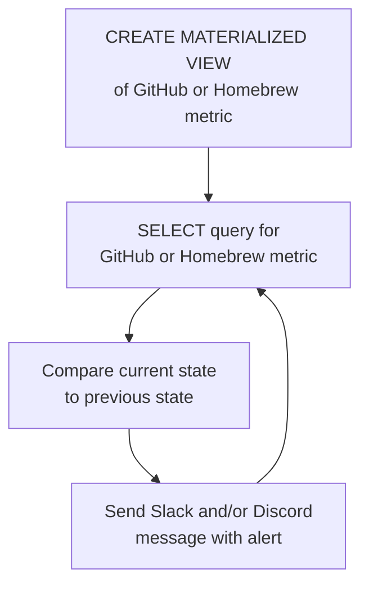

# StackQL によるオープンソースプロジェクトのアクティビティモニター

このガイドでは、GitHub のオープンソースソフトウェアのメンテナー向けに、リアルタイムの監視とアラートのシステムをセルフホストする方法を紹介します。  

> [__stackql__](https://github.com/stackql/stackql) は、SQL 言語、およびデータの可視化や分析のためのライブラリとツールを使用して、クラウドと SaaS のリソースをクエリし、操作できるオープンソースツールです。気に入ったら [⭐](https://github.com/stackql/stackql) を付けてください！

次のようなアラートを Slack と Discord でリアルタイムに受け取れます：


動作確認済み <span class="tutorial_tested_on">組み込み SQL バックエンド</span> <span class="tutorial_tested_on">docker</span> <span class="tutorial_tested_on">linux</span> 

## 概要 {#overview}

自分たちのオープンソースプロジェクトを監視するツールを探したところ、そのほとんどが宣伝どおりに動作しないか、まったく動作しませんでした（GitHub のサードパーティアプリの場合）。そこで独自に作成しました。GitHub 上のオープンソースプロジェクトで起動して使用できます。  

[__oss-activity-monitor__](https://github.com/stackql/oss-activity-monitor) プロジェクトは、[__stackql__](https://github.com/stackql/stackql) を使用してオープンソースプロジェクトのアクティビティをリアルタイムに監視します。次の項目をリアルタイムに通知します：

- ⭐ GitHub リポジトリの新しいスターゲイザー
- 👀 GitHub リポジトリの新しいウォッチャー
- 🍴 GitHub リポジトリの新しいフォーク
- 📊 GitHub リポジトリの新しい Issue
- 🙋 GitHub Organization の新しいフォロワー
- 📦 GitHub リリースアセットの新しいダウンロード
- 🍺 homebrew の新しいダウンロード

## 仕組み {#how-it-works}

このプロジェクトはコンテナー（`docker` またはその他のコンテナーデプロイプラットフォームを使用）にデプロイされます。`python` と [`pystackql`](https://pystackql.readthedocs.io/en/latest/intro.html) パッケージで構築されており、`stackql` の [`github`](https://github-provider.stackql.io/) プロバイダーと [`homebrew`](https://homebrew-provider.stackql.io/) プロバイダーを使用します。マテリアライズドビューと `SELECT` 文を使用して、監視対象の GitHub と Homebrew のエンドポイントについて、現在と前回のメトリクスの状態を取得して比較します。これを次の図に示します。  


たとえば、`stackql` を使用して次のマテリアライズドビューを作成し、データを投入したとします。  

```sql
CREATE OR REPLACE MATERIALIZED VIEW mvw_github_repo_stargazers AS 
SELECT login FROM github.activity.repo_stargazers
WHERE owner = 'your-org' and repo = 'your-repo'
```

次の `stackql` クエリは、GitHub をポーリングして新しいスターゲイザーを検出します。

```sql
SELECT c.login
FROM github.activity.repo_stargazers c
LEFT JOIN mvw_github_repo_stargazers mvw
ON c.login = mvw.login
WHERE mvw.login IS NULL
AND c.owner = 'your-org' AND c.repo = 'your-repo'
```

その後、次の文で状態を更新します。

```sql
REFRESH MATERIALIZED VIEW mvw_github_repo_stargazers
```

リポジトリのウォッチャー、Issue、Organization のフォロワー、リリースアセットのダウンロード、homebrew のダウンロードにも、同様のパターンを繰り返します。

## プロジェクトの実行 {#running-the-project}

以下の手順に従って、ローカル環境または任意のクラウドプラットフォームでプロジェクトを起動して実行します。  

### 1. リポジトリをクローンする {#1-clone-the-repo}

```bash
git clone https://github.com/stackql/oss-activity-monitor.git
# or 
git clone git@github.com:stackql/oss-activity-monitor.git
```

### 2. 環境変数を設定する {#2-configure-environment-variables}

プロジェクトの設定には、次の環境変数が必要です（環境変数として指定します。以下の例では `.env` ファイルを使用します）。  

| 変数                        | 説明                                                         | 値の例                                           |
|----------------------------|--------------------------------------------------------------|--------------------------------------------------|
| `LOG_LEVEL`                | ログレベル（一般的なログには INFO、詳細なログには DEBUG）      | INFO                                             |
| `SLEEP_INTERVAL`           | リクエストループ間の待機時間（秒）                             | 5                                                |
| `GITHUB_REPO`              | GitHub リポジトリ名                                           | stackql                                          |
| `GITHUB_REPO_OWNER`        | GitHub の Organization 名またはオーナー名                     | stackql                                          |
| `HOMEBREW_FORMULA_NAME`    | Homebrew の formula 名（存在する場合）                        | stackql                                          |
| `STACKQL_GITHUB_USERNAME`  | GitHub のユーザー名                                           | jeffreyaven                                      |
| `STACKQL_GITHUB_PASSWORD`  | GitHub の個人用アクセストークン                               | ghp_yourpersonalaccesstoken                      |
| `SLACK_WEBHOOK_URL`        | 通知の送信に使用する Slack の Webhook URL                     | https://hooks.slack.com/services/...             |
| `DISCORD_WEBHOOK_URL`      | 通知の送信に使用する Discord の Webhook URL                   | https://discord.com/api/webhooks/...             |

### 3. コンテナーをビルドする {#3-build-the-container}

```bash
docker build --no-cache -t oss-activity-monitor .
```

### 4. コンテナーを実行する {#4-run-the-container}

```bash
docker run --env-file .env oss-activity-monitor
```

以上です！これで、オープンソースプロジェクトでアクティビティがあると、リアルタイムにアラートを受け取れます。コンテナーを停止するには、次のコマンドを使用します。  

```bash
docker stop $(docker ps -a -q --filter ancestor=oss-activity-monitor)
```

[__GitHub__](https://github.com/stackql/stackql) で ⭐ を付けてください
