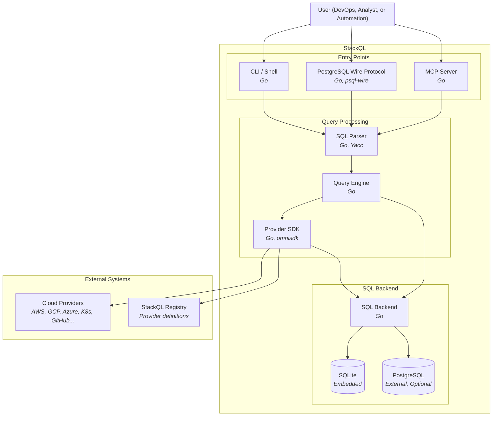

참고 항목:
[[ StackQL 사용 ]](/getting-started/using-stackql) [[ 변수 사용 ]](/getting-started/variables) [[ 템플릿 기능 ]](/getting-started/templating)

## 개요 {#overview}

StackQL은 여러 프로바이더에 걸쳐 클라우드 인프라를 쿼리하고 관리하기 위한 통합 SQL 인터페이스입니다. 다음 컨테이너 다이어그램은 StackQL 시스템의 주요 구성 요소와 그 상호 작용을 보여 줍니다.

## 핵심 구성 요소 {#core-components}

### 진입점 {#entry-points}

StackQL은 SQL 쿼리를 실행하기 위한 여러 진입점을 지원합니다:

- **CLI / 셸**: 터미널에서 직접 SQL 쿼리를 실행하기 위한 대화형 셸 및 명령줄 인터페이스입니다. 사용자는 애드혹 쿼리나 스크립트를 실행하거나, 대화형 셸을 사용하여 탐색할 수 있습니다.

- **PostgreSQL 와이어 프로토콜**: `psql`, DBeaver 또는 기타 PostgreSQL 호환 도구와 같은 표준 PostgreSQL 클라이언트의 연결을 지원합니다. 이를 통해 기존 데이터베이스 워크플로 및 BI 도구와 원활하게 통합할 수 있습니다.

- **MCP 서버**: AI 어시스턴트 통합을 지원하는 Model Context Protocol 서버로, 대규모 언어 모델이 자연어를 통해 인프라를 쿼리하고 관리할 수 있게 합니다.

### 쿼리 처리 파이프라인 {#query-processing-pipeline}

1. **SQL 파서**: Yacc 기반의 사용자 지정 문법을 사용하여 SQL 입력을 추상 구문 트리(AST)로 구문 분석합니다. 파서(`stackql-parser`로 구현됨)는 SQL 구문을 검증하고 쿼리 실행 계획 수립을 위해 준비합니다.

2. **쿼리 엔진**: 쿼리의 실행 계획을 수립하고 쿼리를 실행하는 중앙 오케스트레이션 계층입니다. 어떤 작업을 API 계층으로 푸시다운할 수 있고 어떤 작업에 로컬 SQL 처리가 필요한지 결정합니다. 쿼리 엔진은 다음을 처리합니다:
   - 쿼리 실행 계획 수립 및 최적화
   - API 호출과 로컬 SQL 실행 간의 조정
   - 결과 집계 및 변환

### 프로바이더 SDK(omnisdk) {#provider-sdk-omnisdk}

프로바이더 SDK인 [omnisdk](https://github.com/stackql-labs/omnisdk)는 클라우드 제공업체와의 모든 상호 작용을 관리합니다. omnisdk는 StackQL `v1.0`에서 `any-sdk`를 대체했습니다. 주요 역할은 다음과 같습니다:

- **프로바이더 탐색**: 지원되는 각 클라우드 제공업체에 대한 OpenAPI 기반 정의가 포함된 StackQL Registry에서 프로바이더 사양을 가져오고, 필요에 따라 각 문서를 사용하기 전에 ML-DSA-65 서명을 검증합니다.

- **인증**: 각 프로바이더의 인증을 처리하며, API 키, OAuth 토큰, 서비스 계정 자격 증명 등 다양한 인증 방법을 지원합니다. 각 프로바이더 정의는 해당 인증 요구 사항을 지정합니다. 하나의 세션에서 같은 프로바이더를 별도의 자격 증명을 가진 여러 별칭으로 바인딩할 수 있습니다([프로바이더 세션](/getting-started/provider-sessions) 참조).

- **그래프 계획 수립**: 각 문의 실행 계획을 데이터 에지와 제어 에지로 연결된 프로바이더 교환의 그래프로 수립합니다. 조인, 하위 쿼리, CTE, 뷰는 같은 플래너를 거치며, 계획에서 팬아웃되는 요청은 프로바이더별 및 호스트별 한도 내에서 동시에 실행됩니다.

- **API 요청 생성**: SQL 쿼리를 각 프로바이더에 적합한 REST API 호출로 변환하며, 엔드포인트 구성, 매개 변수 매핑, 요청 서식 지정을 처리합니다.

- **페이지네이션**: 페이지로 나뉜 API 응답을 자동으로 처리하여, 여러 프로바이더가 사용하는 다양한 페이지네이션 방식(커서 기반, 오프셋 기반, 토큰 기반 등)의 복잡성을 추상화합니다.

- **조건자 푸시다운**: 요청 매개 변수에 매핑되는 조건과, 정렬이 필요하지 않은 경우의 `LIMIT` 절을 프로바이더 요청으로 푸시다운하여 요청 횟수와 전송되는 데이터양을 줄입니다.

- **응답 변환**: API 응답이 도착하는 대로 행으로 변환하여 SQL 백엔드에 스테이징하거나 클라이언트로 스트리밍합니다.

SQL 연결, 스테이징, 백엔드 실행은 StackQL이 계속 담당합니다. omnisdk에는 SQL 스테이징이 포함되어 있지 않으며 데이터베이스 연결을 받지 않습니다. StackQL은 omnisdk에 관계 핸들을 전달하고 행 커서를 받습니다.

### SQL 백엔드 {#sql-backend}

SQL 백엔드는 구체화된 API 데이터에 대해 관계형 작업을 실행합니다:

- **SQLite**: 임시 테이블 저장과 관계형 처리에 사용되는 임베디드 데이터베이스입니다. 애드혹 쿼리와 소규모 데이터 세트에 적합합니다.

- **PostgreSQL**: 영구 저장, 대규모 데이터 세트, 고급 분석 워크로드를 위한 선택적 외부 데이터베이스입니다.

SQL 백엔드는 다음과 같은 작업을 처리합니다:
- 여러 프로바이더 또는 리소스에 걸친 JOIN 작업
- 집계 함수(COUNT, SUM, AVG 등)
- 구체화된 데이터에 대한 정렬 및 필터링
- 복잡한 SQL 식 및 하위 쿼리

## 외부 시스템 {#external-systems}

### 클라우드 제공업체 {#cloud-providers}

StackQL은 클라우드 제공업체(AWS, GCP, Azure, Kubernetes, GitHub 등 다수)의 REST API를 통해 해당 제공업체에 연결합니다. 모든 통신은 HTTPS를 통해 이루어지며, 프로바이더 SDK가 각 제공업체의 API 규칙에 따른 세부 사항을 처리합니다.

### StackQL Registry {#stackql-registry}

StackQL Registry는 프로바이더 정의를 호스팅합니다. 프로바이더 정의는 사용 가능한 리소스, 메서드 및 그 매핑을 설명하는 OpenAPI 기반 사양입니다. 프로바이더는 버전별로 관리되며 `REGISTRY PULL` 명령을 사용하여 필요할 때 가져올 수 있습니다.

## 쿼리 실행 흐름 {#query-execution-flow}

1. 사용자가 진입점 중 하나(CLI, PostgreSQL 프로토콜 또는 MCP)를 통해 SQL 쿼리를 제출합니다.
2. SQL 파서가 쿼리를 검증하고 AST로 변환합니다.
3. 쿼리 엔진이 AST를 분석하고 실행 계획을 생성합니다.
4. 프로바이더 작업의 경우 프로바이더 SDK는 다음을 수행합니다:
   - 레지스트리에서 관련 프로바이더 사양을 가져옵니다(캐시되지 않은 경우).
   - 클라우드 제공업체에 인증합니다.
   - API 요청을 생성하고 실행하며, 페이지네이션을 자동으로 처리합니다.
   - 가능한 경우 조건자를 API로 푸시다운합니다.
   - 결과를 SQL 백엔드에 구체화합니다.
5. SQL 백엔드가 나머지 관계형 작업을 실행합니다.
6. 결과가 요청된 형식으로 사용자에게 반환됩니다.
