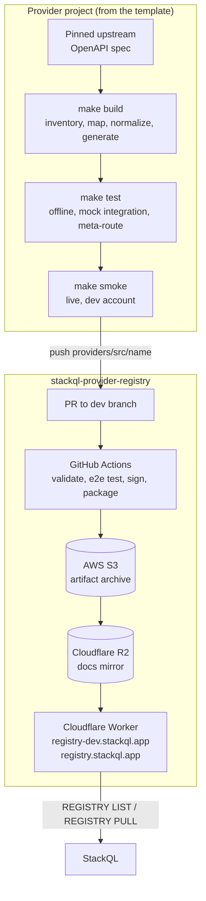

참고 항목:
[[ StackQL Provider Registry ]](/providers) [[ 프로바이더 사용 ]](/getting-started/using-a-provider) [[ REGISTRY ]](/language-spec/registry) [[ 아키텍처 ]](/developers/architecture)

## 개요 {#overview}

StackQL 프로바이더는 버전이 지정된 OpenAPI 문서와 `x-stackQL-*` 확장의 집합이며, [omnisdk](https://github.com/stackql-labs/omnisdk) 엔진이 이를 SQL 테이블로 변환합니다. 읽기에는 `SELECT` 문을, 수명 주기 작업에는 `INSERT`, `UPDATE`, `REPLACE`, `DELETE` 문을, 동작에는 `EXEC` 문을 사용합니다. 프로바이더 문서는 프로바이더의 API로 무엇을 할 수 있는지, 그리고 SQL 의미 체계로 이를 호출하는 방법을 StackQL에 알려 줍니다. 프로바이더 문서는 일반 YAML이므로 프로바이더를 다른 코드와 마찬가지로 빌드하고, 테스트하고, 버전을 관리할 수 있습니다.

프로바이더 생태계는 3개의 리포지토리와 1개의 배포 계층으로 구성됩니다:

| 구성 요소 | 역할 |
| --- | --- |
| [__`stackql-provider-TEMPLATE`__](https://github.com/stackql-registry/stackql-provider-TEMPLATE) | 새 프로바이더 프로젝트의 시작점입니다. 고정된 업스트림 사양에서 생성된 프로바이더까지 이어지는 결정적 `make` 파이프라인, 자격 증명이 필요 없는 테스트 계층, 라이브 스모크 테스트 모음, 문서 마이크로사이트와 CI를 포함합니다. Claude Code 프로바이더 개발 스킬이 번들로 포함되어 있습니다. |
| [__`omnisdk`__](https://github.com/stackql-labs/omnisdk) | StackQL `v1.0`부터 프로바이더 문서를 읽고 요청을 실행하는 엔진입니다. 이전 엔진인 [`any-sdk`](https://github.com/stackql/any-sdk)에는 프로바이더 문서 계약, `x-stackQL-*` 확장, 인증, 페이지네이션, 변환 및 푸시다운에 대한 참조 문서와 아래에 링크된 JSON 스키마가 여전히 있습니다. |
| [__`stackql-provider-registry`__](https://github.com/stackql/stackql-provider-registry) | 게시된 프로바이더의 단일 정보 출처입니다. 문서는 `providers/src/<provider>/<version>/` 디렉터리 아래에서 버전별로 관리된 후 GitHub Actions에 의해 서명, 패키징, 게시됩니다. |
| __Cloudflare 배포 계층__ | 패키징된 프로바이더 아티팩트는 `registry.stackql.app`(프로덕션)과 `registry-dev.stackql.app`(개발)의 Cloudflare Worker에 의해 Cloudflare R2에서 에지로 제공됩니다. `REGISTRY LIST` 및 `REGISTRY PULL` 문이 통신하는 대상이 바로 이 계층입니다. |
<br/>
다음 다이어그램은 프로바이더 프로젝트에서 StackQL 설치에 이르는 경로를 보여 줍니다:



## 프로바이더 문서 구조 {#provider-document-structure}

StackQL 객체는 `provider.service.resource.method` 계층 구조를 따릅니다(예: `google.compute.instances.list`). 문서는 이 계층 구조를 그대로 반영합니다:

```
provider.yaml                          # provider metadata, providerServices, provider-level config
services/
  <service>.yaml                       # an OpenAPI 3 document per service, plus
    components.x-stackQL-resources
      <resource>                       # id, name, methods, sqlVerbs, optional config
        methods.<method>               # operation $ref, response, request, optional config
```

- __프로바이더 문서__(`provider.yaml`): `id`, `name`, `title`, `version`, `providerServices`(각각 해당 서비스 문서를 가리키는 `service.$ref`와 선택적 `preferred` 플래그 포함), 선택적 `description`, `protocolType`(기본값은 `http`) 및 `config`.
- __서비스 문서__: 표준 OpenAPI 3 문서입니다. 유일하게 필요한 추가 항목은 테이블로 노출되는 리소스를 선언하는 `components.x-stackQL-resources` 키입니다.
- __리소스__: `id`, `name`, `methods`, `sqlVerbs`. 각 리소스는 하나의 테이블이며, 열은 기본 `select` 메서드의 응답 스키마에서 가져옵니다.
- __메서드__: `paths` 섹션을 가리키는 JSON 포인터인 `operation`(예: `$ref: '#/paths/~1orgs~1{org}~1repos/get'`), 엔진에 행의 위치를 알려 주는 `response` 블록(`mediaType`, `openAPIDocKey`, `objectKey`), 그리고 선택적 `request` 블록과 `config`.
- __SQL 동사 매핑__: `sqlVerbs.select`, `insert`, `update`, `replace`, `delete` 키는 메서드 참조의 순서 있는 목록입니다. StackQL은 참조된 메서드 중 필수 매개 변수가 모두 `WHERE` 절로 제공되는 메서드를 고려하여, 목록 순서와 관계없이 필수 매개 변수가 가장 많은 메서드를 선택합니다. `get` 메서드에 필요한 식별자를 제공하는 쿼리는 `get` 메서드로 라우팅되고, 제공하지 않는 쿼리는 `list` 메서드로 라우팅됩니다. 두 메서드가 동률이면 둘 중 하나를 선택하지 않고 오류로 보고합니다. 동사 목록에서 참조되지 않는 메서드는 `EXEC` 문으로 호출할 수 있습니다.

최소한의 리소스는 다음과 같습니다:

```yaml
components:
  x-stackQL-resources:
    repos:
      id: github.repos.repos
      name: repos
      title: Repos
      methods:
        list_for_org:
          operation:
            $ref: '#/paths/~1orgs~1{org}~1repos/get'
          response:
            mediaType: application/json
            openAPIDocKey: '200'
        create_in_org:
          operation:
            $ref: '#/paths/~1orgs~1{org}~1repos/post'
          response:
            mediaType: application/json
            openAPIDocKey: '201'
          config:
            requestBodyTranslate:
              algorithm: naive
      sqlVerbs:
        select:
          - $ref: '#/components/x-stackQL-resources/repos/methods/list_for_org'
        insert:
          - $ref: '#/components/x-stackQL-resources/repos/methods/create_in_org'
```

모든 키와 그 의미를 포함한 전체 계약은 any-sdk의 [프로바이더 사양](https://github.com/stackql/any-sdk/blob/main/docs/provider_spec.md)에 있습니다. `provider.yaml` 파일, 서비스 문서, config 블록의 JSON 스키마는 [`any-sdk/cicd/schema-definitions`](https://github.com/stackql/any-sdk/tree/main/cicd/schema-definitions)에 있습니다. config 스키마는 알 수 없는 키를 거부하므로, 잘못 입력한 키는 자동으로 무시되지 않고 유효성 검사에 실패합니다.

### OpenAPI 확장 {#openapi-extensions}

| 확장 | 위치 | 용도 |
| --- | --- | --- |
| `x-stackQL-resources` | `components` | 서비스 문서의 리소스 사전(필수) |
| `x-stackQL-config` | 서비스, 리소스, 메서드 또는 작업 | 해당 수준에 적용되는 config 블록(아래 참조) |
| `x-stackQL-envVar` | 서버 변수 | `WHERE` 절에 서버 변수가 지정되지 않은 경우 그 값을 제공하는 환경 변수의 이름을 지정합니다. 테넌트, 조직, 프로젝트 또는 배포별로 API의 범위를 지정하는 데 사용됩니다. |
| `x-stackQL-alias` | 매개 변수 또는 스키마 속성 | 와이어 수준 이름 대신 SQL에서 허용되는 대체 이름 |
| `x-stackQL-stringOnly` | 스키마 속성 | 선언된 형식과 관계없이 속성을 문자열로 직렬화 |
| `x-stackQL-graphQL` | 작업 | REST API에 필요한 데이터가 없는 경우 메서드를 GraphQL 쿼리로 구현합니다. |
| `x-alwaysRequired` | 매개 변수 | 매개 변수를 항상 필수로 표시합니다. |
| `x-protocol` | `info` | 스키마 기반 XML 응답 처리를 위한 와이어 프로토콜 힌트(`query`, `ec2`, `rest-xml`) |

### config 블록 {#the-config-block}

`provider.yaml` 파일의 `config` 키와 서비스 문서의 `x-stackQL-config` 확장은 하나의 스키마를 공유합니다. 허용되는 키는 `auth`, `pagination`, `queryParamPushdown`, `queryParamTranspose`, `requestTranslate`, `requestBodyTranslate`, `variations`, `views`, `sqlExternalTables`, `retry`, `minStackQLVersion`, `snake_case_aliases`입니다. config 값은 가장 구체적인 수준에서 바깥쪽으로, 즉 메서드 -> 리소스 -> 서비스 -> 프로바이더 서비스 -> 프로바이더 순서로 결정됩니다. 따라서 프로바이더 전체의 기본값을 하나의 리소스나 메서드에 대해 재정의할 수 있습니다.

## 프로바이더가 처리하는 기능 {#what-providers-handle}

프로바이더는 API의 복잡성을 추상화하는 기능을 담당하므로, 사용자는 기본 HTTP 통신을 관리하지 않고도 일관된 SQL 인터페이스를 사용할 수 있습니다.

### 인증 {#authentication}

각 프로바이더에는 자격 증명을 담은 환경 변수의 이름을 지정하는 기본 `auth` 블록이 포함되어 있으므로, 환경 변수가 설정된 환경에서는 런타임 인증 구성이 필요하지 않습니다. 프로바이더 문서에는 간접 참조(환경 변수 이름, 파일 경로)만 허용됩니다. 리터럴 자격 증명 값은 런타임 `--auth` 컨텍스트에만 넣어야 합니다. 공급업체의 Terraform 프로바이더가 있는 경우 환경 변수 이름은 그 프로바이더를 따라야 합니다.

| `auth.type` | 일반적인 필드 |
| --- | --- |
| `bearer` | `credentialsenvvar` |
| `api_key` | `credentialsenvvar`, `valuePrefix`, 선택적 `location`(`header` 또는 `query`) 및 `name` |
| `basic` | `username_var`, `password_var` |
| `custom` | `location`, `name`, `credentialsenvvar`, 선택적 `valuePrefix`; `successor` 필드로 두 번째 자격 증명 연결 |
| `oauth2` | `client_id_env_var`, `client_secret_env_var`, `grant_type: client_credentials`, `token_url`, `scopes` |
| `service_account` | `credentialsenvvar` 또는 `credentialsfilepathenvvar`, `scopes` |
| `aws_signing_v4`, `aws_assume_role` | `keyIDenvvar`, `credentialsenvvar` |
| `azure_default` | 없음 |
| `oci_signing_v1` | `tenancy_ocid_envvar`, `user_ocid_envvar`, `oci_fingerprint_envvar`, `oci_private_key_envvar`, `oci_region_envvar` |
| `interactive` | 없음 |
| `null_auth` | 없음(명시적으로 인증하지 않음) |
<br/>
예:

```yaml
config:
  auth:
    type: api_key
    credentialsenvvar: OKTA_API_TOKEN
    valuePrefix: 'SSWS '
```

사용자는 런타임에 `--auth='{"<provider>": {...}}'` 플래그로 프로바이더의 인증을 재정의할 수 있습니다.

### 페이지네이션 {#pagination}

프로바이더가 공급업체의 페이지네이션 방식을 선언하면 엔진이 모든 페이지를 순회하므로, 사용자는 완전한 결과 집합을 받습니다. 지원되는 방식:

- __본문의 토큰 또는 커서__: `requestToken: {key: cursor, location: query}`, `responseToken: {key: $.cursor, location: body}`. 토큰이 없거나 비어 있으면 중지합니다.
- __본문의 다음 페이지 URL__: `requestToken: {key: '', location: request}`, `responseToken: {key: $.next, location: body}`. OData `@odata.nextLink` 속성에는 `algorithm: odata_next_link` 설정을 사용합니다.
- __RFC 5988 `Link` 헤더__: `responseToken: {key: Link, location: header}`.
- __페이지 수가 있는 페이지 번호__: `algorithm: page_number` 설정에 `responseToken` 필드(현재 페이지)와 `responseTerminator` 필드(전체 페이지 수)를 함께 지정합니다.

다음 마커가 없는 오프셋 및 제한 방식의 API는 페이지네이션 방식이 아닙니다. 대신 `offset` 및 `limit` 매개 변수를 `WHERE` 절의 매개 변수로 노출하세요. `--http.response.pageLimit` 전역 플래그로 순회 범위를 제한합니다.

### 조건자 푸시다운 {#predicate-pushdown}

`WHERE` 절의 키는 작업에 선언된 매개 변수와 이름으로 비교되어(경로, 그다음 쿼리, 헤더, 쿠키 순) API로 전송되므로, 필터링이 소스에서 이루어집니다. 일치하는 매개 변수가 없는 나머지 `WHERE` 키는 쿼리 매개 변수로 추가됩니다.

일반 매개 변수 외에도 `queryParamPushdown` 설정은 `SELECT` 열, `WHERE`, `ORDER BY`, `LIMIT`, `OFFSET`, `COUNT`를 API 매개 변수로 다시 작성합니다. `dialect: odata` 설정은 Microsoft Graph 및 Azure 스타일 API에서 사용하는 `$select`, `$filter`, `$orderby`, `$top`, `$skip`, `$count` 기본값을 채웁니다. `dialect: custom` 설정은 `paramName` 값을 그대로 사용하며, 가장 일반적인 예는 `LIMIT n`을 `?limit=n`으로 바꾸는 `top: {paramName: limit, maxValue: 1000}`입니다. 푸시다운할 수 없는 조건자는 여전히 클라이언트 측에서 평가됩니다.

### 응답 및 요청 변환 {#response-and-request-transformation}

- `response.objectKey` 키는 엔벨로프에서 행을 담은 항목을 선택하는 JSONPath(XML API의 경우 XPath)입니다. 예를 들어 `$.data[*]` 또는 `$.value`입니다.
- `response.transform` 키는 본문이 행으로 스테이징되기 전에 Go 텍스트 템플릿을 적용합니다. 변환 형식은 JSON, XML, 일반 텍스트를 다루며, 이를 통해 AWS XML API와 CLI 출력이 테이블이 됩니다.
- `requestBodyTranslate: {algorithm: naive}` 설정을 사용하면 `INSERT` 문에서 요청 본문 필드를 `data__` 접두사가 붙은 형식 대신 일반 열 이름으로 받을 수 있습니다.
- 프로바이더 수준의 `snake_case_aliases: true` 설정은 camelCase 와이어 이름을 snake_case 열 및 매개 변수로 노출합니다.
- `retry` 키는 지수 백오프 정책(`max_attempts`, `initial_delay_ms`, `max_delay_ms`, `multiplier`, `jitter_fraction`, `retryable_methods`, `retryable_conditions.status_codes`)을 설정합니다. 정책을 선언한 첫 번째 수준이 우선합니다. any-sdk의 [재시도 정책](https://github.com/stackql/any-sdk/blob/main/docs/retry_policy.md)을 참조하세요.

열 형식은 OpenAPI 스키마를 따릅니다: `string` -> text, `integer` -> integer, `number` -> numeric, `boolean` -> boolean. `object` 및 `array` 속성은 JSON 텍스트로 저장됩니다. 이 때문에 쿼리에서 중첩 필드를 `json_extract` 함수로 읽으며, 프로바이더는 자주 쓰이는 중첩 프로젝션을 위해 뷰(`config.views`, 방언별 `ddl` 및 `fallback` 포함)를 함께 제공하는 경우가 많습니다.

### HTTP 이외의 프로바이더 {#non-http-providers}

`provider.yaml` 파일의 `protocolType: local_templated` 설정은 HTTP 대신 로컬 명령으로 프로바이더를 구현합니다. 메서드는 Go 템플릿 argv 조각의 `inline` 배열을 가지고, 매개 변수는 `in: inline` 설정을 사용하며, `response.transform` 키가 명령 출력을 행으로 변환합니다. any-sdk의 [`local_openssl`](https://github.com/stackql/any-sdk/tree/main/test/registry/src/local_openssl/v0.1.0) 참조 프로바이더에서 그 형태를 볼 수 있습니다. 이 방식은 HTTP API를 대상으로 하는 템플릿 파이프라인의 범위에 포함되지 않습니다.

## 프로바이더 프로젝트 시작 {#starting-a-provider-project}

모든 새 프로바이더는 [__`stackql-provider-TEMPLATE`__](https://github.com/stackql-registry/stackql-provider-TEMPLATE)에서 시작하세요. 이 리포지토리는 프로바이더의 현재 표준을 담은 GitHub 템플릿 리포지토리입니다. 고정된 업스트림 사양, 모든 수동 결정이 생성된 YAML의 직접 편집이 아니라 스크립트의 규칙으로 표현되는 결정적 빌드 파이프라인, 자격 증명이 필요 없는 3개의 테스트 계층, 예산이 정해진 라이브 스모크 테스트 모음, Docusaurus 문서 사이트, CI가 포함됩니다. 이 방식으로 빌드되어 게시된 프로바이더는 [stackql-registry](https://github.com/orgs/stackql-registry/repositories) GitHub 조직에 있으며, 템플릿과 함께 참고 자료로 유용합니다.

사전 요구 사항: Node.js 20 이상, GNU make 및 bash(Linux, macOS 또는 WSL), 스모크 테스트 모음용 Python 3, `stackql` 바이너리(없으면 `bin/start-server.sh` 스크립트가 다운로드합니다).

1. 템플릿에서 리포지토리를 만들고(GitHub "Use this template") `npm install` 명령을 실행합니다.
2. `bin/init-provider.sh <name> "<Title>" [https://api.vendor.com]` 명령을 실행하여 리포지토리 전체의 자리 표시자를 바꿉니다.
3. `provider-dev/scripts/lib/spec_helpers.mjs` 파일의 상수(사양 URL, 경로 버전 접두사, 테넌트 또는 프로젝트 범위 API의 범위 접두사)와 `provider-dev/config/` 디렉터리 아래의 구성(`servers.json`, `provider_config.json`, `service_names.json`)을 채웁니다.
4. `make` 대상을 통해 직접 진행하거나 리포지토리에서 Claude Code 세션을 열어 파이프라인을 진행합니다(아래 참조).
5. `grep -rn "TODO(template)"` 명령은 아직 남아 있는 작업을 나열합니다.

파이프라인은 `make`로 구동됩니다(`make help` 명령은 모든 대상을 나열합니다):

```bash
make fetch-spec        # verify the upstream spec against the recorded pin (fails on drift)
make inventory         # one CSV row per operation with the proposed service, resource, method and verb
make split             # write provider-dev/source/<service>.yaml from the ordered path rules
make mappings-report   # print every derived operation -> resource.method mapping without writing
make mappings          # regenerate provider-dev/config/all_services.csv and validate it
make normalize         # flatten allOf, lower oneOf/anyOf, wrap bare arrays
make generate          # generate provider.yaml + services/*.yaml, then post-process and merge GraphQL/views
make test              # offline SHOW/DESCRIBE, mock API integration tests, meta-route walk (no credentials)
make smoke             # live smoke suite against a dedicated dev account (sources .env)
make docs              # generate the provider documentation site content
make all               # everything above except the live suites
```

내부적으로 파이프라인은 `provider-dev/scripts/` 디렉터리의 프로바이더별 규칙과 함께 [__`@stackql/provider-utils`__](https://github.com/stackql-registry/stackql-provider-utils) 패키지(`split`, `normalize`, `analyze`, `generate`, `docgen`)를 사용합니다. 생성된 프로바이더는 `provider-dev/openapi/src/<name>/v00.00.00000/` 디렉터리에 저장되며, 이 디렉터리가 최종적으로 레지스트리에 게시됩니다.

`provider-dev/config/all_services.csv` 파일은 모든 작업과 리소스 및 메서드 간 매핑에 대해 커밋된 계약입니다. 재생성 시 생기는 diff는 노이즈가 아니라 호환성이 손상되는 변경으로 검토해야 할 대상입니다. 커밋되지 않은 생성 드리프트가 있으면 CI가 실패하므로, 재생성은 커밋된 아티팩트를 바이트 단위로 정확히 재현해야 합니다.

템플릿보다 먼저 만들어진 기존 프로바이더 리포지토리의 경우 `.claude/skills` 디렉터리를 해당 리포지토리에 복사하고 스킬의 `references/uplift-checklist.md` 파일부터 시작하세요.

### Claude Code를 사용한 프로바이더 개발 {#using-claude-code-for-provider-development}

템플릿에는 [Claude Code](https://docs.anthropic.com/en/docs/claude-code)용 [__StackQL 프로바이더 개발 스킬__](https://github.com/stackql-registry/stackql-provider-TEMPLATE/blob/main/.claude/skills/stackql-provider-development/SKILL.md)이 번들로 포함되어 있습니다. 템플릿에서 만든 리포지토리에서 Claude Code 세션을 열고 프로바이더를 빌드하도록 요청합니다. Claude Code는 `CLAUDE.md` 파일과 스킬을 읽어 들이고 단계를 순서대로 진행합니다. 이 스킬은 작업을 직접 수행하기 위한 문서화된 절차이기도 합니다.

이 스킬은 다음을 다룹니다:

- 아키타입 선택: 공급업체가 게시한 OpenAPI, Swagger 또는 디스커버리 문서(직접), 또는 SDK가 단일 정보 출처인 경우 공급업체 SDK에서 파생한 사양(파생)
- 모든 새로 고침이 검토 가능한 diff가 되도록 업스트림 사양을 가져오고, 수정하고, 검증하고, 고정하는 작업
- 엔드포인트 인벤토리, 서비스 분할, `all_services.csv` 파일을 생성하는 매핑 규칙
- 모든 프로바이더 문서 기본 요소와 그 사용 시기: `x-stackQL-envVar` 범위 지정, `objectKey`, 요청 및 응답 변환, 페이지네이션, 쿼리 매개 변수 푸시다운, 수명 주기 `EXEC` 메서드, GraphQL 병합, 프로바이더 뷰
- 자격 증명이 필요 없는 3개의 테스트 계층과 라이브 스모크 테스트 모음
- 문서 사이트, CI 워크플로, 인수인계 노트

스킬의 `references/` 디렉터리에는 각 단계의 세부 정보가 있습니다. `scripts/find_extension_examples.sh` 스크립트는 프로바이더 레지스트리의 클론에서 임의의 확장 키에 대해 게시된 YAML을 출력하므로, 기본 요소를 작성하기 전에 실제 사용 예를 확인할 수 있습니다.

## 로컬에서 프로바이더 테스트 {#testing-a-provider-locally}

StackQL은 `--registry` 전역 플래그로 지정된 레지스트리에서 프로바이더를 읽습니다. 개발 중에는 서명 검증을 비활성화한 상태로 로컬 파일 시스템의 생성된 프로바이더 디렉터리를 가리키도록 지정합니다(문서는 게시될 때만 서명됩니다):

```bash
export LOCAL_REG='{ "url": "file:///path/to/provider-dev/openapi", "localDocRoot": "/path/to/provider-dev/openapi", "verifyConfig": { "nopVerify": true } }'
stackql --registry="${LOCAL_REG}" shell
```

`localDocRoot` 아래의 디렉터리에는 `src/<provider>/<version>/provider.yaml` 파일과 `src/<provider>/<version>/services/*.yaml` 파일이 있어야 하며, 이는 템플릿이 생성하는 구조와 정확히 일치합니다. 셸에서 `SHOW SERVICES IN <provider>`, `SHOW RESOURCES IN <provider>.<service>`, `SHOW METHODS IN <provider>.<service>.<resource>`, `DESCRIBE EXTENDED <provider>.<service>.<resource>` 문을 실행하면 쿼리를 실행하기 전에 노출 범위를 확인할 수 있습니다. 템플릿의 `tests/offline_validation.mjs` 파일은 이러한 어설션을 자동화하며, `npm run probe -- "SELECT ..."` 명령은 모의 API에 대해 애드혹 SQL을 실행하고 와이어 호출을 출력합니다.

원격 레지스트리에서 가져온 프로바이더는 기본적으로 `<cwd>/.stackql` 디렉터리에 캐시됩니다. 위치를 변경하려면 `--approot` 플래그를 사용하세요.

[any-sdk CLI](https://github.com/stackql/any-sdk/blob/main/docs/cli.md)는 StackQL 없이 문서를 확인할 때 유용합니다. `anysdk aot <registry> <provider.yaml>` 명령은 프로바이더에 대해 정적 분석(라우팅할 수 없는 `objectKey`, 누락된 응답 스키마, 불완전한 페이지네이션, 인접한 경로 매개 변수 등)을 실행하고, `anysdk query` 명령은 프로바이더 문서와 서비스 문서에서 직접 단일 메서드를 실행합니다. [Automock 테스트](https://github.com/stackql/any-sdk/blob/main/docs/automock_testing.md)는 프로바이더의 스키마에서 모의 API와 예상 결과를 생성하므로, 라이브 API에 접근하지 않고도 전체 왕복 테스트를 수행할 수 있습니다.

### `dev` 레지스트리를 사용한 프로바이더 테스트 {#testing-your-provider-using-the-dev-registry}

프로바이더가 레지스트리의 `dev` 브랜치에 병합되면 개발 레지스트리에서 사용할 수 있습니다. 게시된 아티팩트를 검증하려면 StackQL이 개발 레지스트리를 가리키도록 지정합니다:

```bash
export DEV_REG='{ "url": "https://registry-dev.stackql.app/providers" }'
stackql --registry="${DEV_REG}" shell
```

```sql
REGISTRY PULL myprovider;
```

템플릿의 `make smoke-live` 대상은 게시 후 검증을 위해 게시된 프로바이더에 대해 스모크 테스트 모음을 실행합니다.

## 프로바이더 게시 {#publishing-a-provider}

게시는 사람이 직접 참여하는 별도의 단계이며 템플릿 파이프라인에 포함되지 않습니다.

1. [stackql-provider-registry](https://github.com/stackql/stackql-provider-registry)를 포크하고, 기능 브랜치에서 생성된 `provider-dev/openapi/src/<name>` 디렉터리를 `providers/src/<name>` 경로에 복사합니다.
2. 프로바이더와 변경 사항에 대한 설명을 포함하여 `dev` 브랜치를 대상으로 끌어오기 요청을 만듭니다(레지스트리의 [기여 가이드](https://github.com/stackql/stackql-provider-registry/blob/main/.github/CONTRIBUTING.md) 참조).
3. GitHub Actions는 [stackql-provider-tests](https://github.com/stackql/stackql-provider-tests)를 사용하여 프로바이더를 검증하고 테스트합니다. 평가되는 규칙은 다음과 같습니다. 문서는 유효한 OpenAPI 사양이어야 합니다. 모든 서비스에서 리소스를 열거할 수 있어야 하고, 모든 리소스에서 메서드를 열거할 수 있어야 합니다. `SELECT` 문으로 호출할 수 있는 메서드에는 유효한 응답 스키마가 있어야 하고, `INSERT` 문으로 호출할 수 있는 메서드에는 유효한 요청 스키마가 있어야 합니다.
4. 병합되면 워크플로가 버전을 할당하고, 문서에 서명(ML-DSA-65)하고, 패키징한 후 아티팩트를 AWS S3 아카이브에 게시합니다. 그런 다음 문서 트리가 Cloudflare R2로 미러링되고 `registry-dev.stackql.app`에서 서비스하는 Cloudflare Worker가 배포됩니다. 프로바이더는 `dev` 레지스트리를 사용하도록 구성된 설치에서 즉시 사용할 수 있습니다.
5. 일정 기간 모니터링한 후 `dev` 브랜치가 `main` 브랜치로 승격되며, 이때 `registry.stackql.app`에 대해 게시가 반복됩니다. 이것이 기본 구성된 StackQL 인스턴스에 대한 게시입니다.

PR을 만들기 전에 동일한 `stackql-provider-tests` 하네스를 레지스트리 디렉터리에 대해 로컬에서 실행할 수 있습니다:

```bash
test-provider.sh <provider_name> false /path/to/provider-dev/openapi
```

`providers/src` 디렉터리를 보호하는 프로바이더 삭제 가드를 포함한 워크플로의 자세한 내용은 레지스트리 리포지토리의 [빌드 및 배포](https://github.com/stackql/stackql-provider-registry/blob/main/docs/build-and-deployment.md)를 참조하세요.
