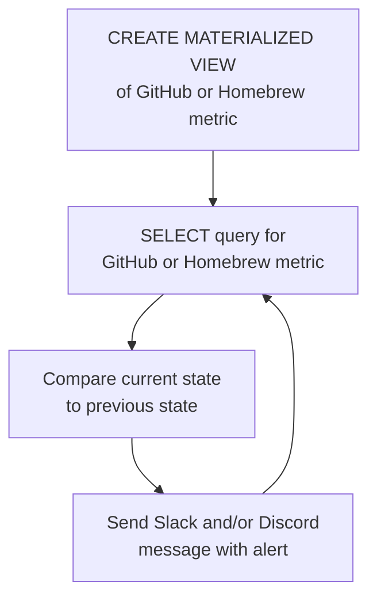

# StackQL 기반 오픈 소스 프로젝트 활동 모니터

이 가이드에서는 GitHub 오픈 소스 소프트웨어 메인테이너를 위한 실시간 모니터링 및 알림 시스템을 직접 호스팅하는 방법을 보여 줍니다.  

> [__stackql__](https://github.com/stackql/stackql)은 사용자가 SQL 언어와 데이터 시각화 및 분석 라이브러리와 도구를 사용하여 클라우드 및 SaaS 리소스를 쿼리하고 상호 작용할 수 있게 해 주는 오픈 소스 도구입니다. 마음에 든다면 [⭐](https://github.com/stackql/stackql) 별표를 남기세요!

Slack과 Discord에서 다음과 같은 알림을 실시간으로 받을 수 있습니다:


테스트 환경 <span class="tutorial_tested_on">임베디드 SQL 백엔드</span> <span class="tutorial_tested_on">docker</span> <span class="tutorial_tested_on">linux</span> 

## 개요 {#overview}

오픈 소스 프로젝트를 모니터링할 도구를 찾아보았지만, 대부분은 소개된 대로 작동하지 않거나 전혀 작동하지 않았습니다(GitHub의 서드 파티 앱의 경우). 그래서 직접 도구를 만들었으며, 이 도구는 사용자의 오픈 소스 GitHub 프로젝트에서도 실행하여 사용할 수 있습니다.  

[__oss-activity-monitor__](https://github.com/stackql/oss-activity-monitor) 프로젝트는 [__stackql__](https://github.com/stackql/stackql)을 사용하여 오픈 소스 프로젝트 활동을 실시간으로 모니터링합니다. 여기에는 다음 항목에 대한 실시간 알림이 포함됩니다:

- ⭐ 새 GitHub 리포지토리 스타게이저
- 👀 새 GitHub 리포지토리 워처
- 🍴 새 GitHub 리포지토리 포크
- 📊 새 GitHub 리포지토리 이슈
- 🙋 새 GitHub 조직 팔로워
- 📦 새 GitHub 릴리스 자산 다운로드
- 🍺 새 homebrew 다운로드

## 작동 방식 {#how-it-works}

이 프로젝트는 컨테이너(`docker` 또는 기타 컨테이너 배포 플랫폼 사용)에 배포됩니다. `python` 및 [`pystackql`](https://pystackql.readthedocs.io/en/latest/intro.html) 패키지를 사용하여 빌드되었으며, `stackql`용 [`github`](https://github-provider.stackql.io/) 및 [`homebrew`](https://homebrew-provider.stackql.io/) 프로바이더를 사용합니다. 구체화된 뷰와 `SELECT` 문을 사용하여 모니터링 대상인 GitHub 및 Homebrew 엔드포인트의 현재 지표와 이전 지표 사이의 상태를 캡처하고 비교합니다. 이 과정은 다음 다이어그램과 같습니다:  


예를 들어 `stackql`을 사용하여 다음과 같이 구체화된 뷰를 생성하고 데이터를 채웠다고 가정합니다:  

```sql
CREATE OR REPLACE MATERIALIZED VIEW mvw_github_repo_stargazers AS 
SELECT login FROM github.activity.repo_stargazers
WHERE owner = 'your-org' and repo = 'your-repo'
```

다음 `stackql` 쿼리는 GitHub에서 새 스타게이저를 폴링합니다...

```sql
SELECT c.login
FROM github.activity.repo_stargazers c
LEFT JOIN mvw_github_repo_stargazers mvw
ON c.login = mvw.login
WHERE mvw.login IS NULL
AND c.owner = 'your-org' AND c.repo = 'your-repo'
```

그런 후 다음 문으로 상태를 새로 고칩니다...

```sql
REFRESH MATERIALIZED VIEW mvw_github_repo_stargazers
```

리포지토리 워처, 이슈, 조직 팔로워, 릴리스 자산 다운로드, homebrew 다운로드에도 비슷한 패턴이 반복됩니다.

## 프로젝트 실행 {#running-the-project}

아래 단계에 따라 로컬 또는 원하는 클라우드 플랫폼에서 프로젝트를 설정하고 실행하세요.  

### 1. 리포지토리 복제 {#1-clone-the-repo}

```bash
git clone https://github.com/stackql/oss-activity-monitor.git
# or 
git clone git@github.com:stackql/oss-activity-monitor.git
```

### 2. 환경 변수 구성 {#2-configure-environment-variables}

프로젝트를 구성하려면 다음 환경 변수가 필요합니다(환경 변수로 제공하며, 아래 예제에서는 `.env` 파일을 사용합니다):  

| 변수                       | 설명                                                                              | 예제 값                                          |
|----------------------------|-----------------------------------------------------------------------------------|--------------------------------------------------|
| `LOG_LEVEL`                | 로그 수준(일반 로그는 INFO, 자세한 로깅은 DEBUG)                                  | INFO                                             |
| `SLEEP_INTERVAL`           | 요청 루프 사이의 지연 시간(초)                                                    | 5                                                |
| `GITHUB_REPO`              | GitHub 리포지토리 이름                                                            | stackql                                          |
| `GITHUB_REPO_OWNER`        | GitHub 조직 또는 소유자 이름                                                      | stackql                                          |
| `HOMEBREW_FORMULA_NAME`    | Homebrew 포뮬러 이름(있는 경우)                                                   | stackql                                          |
| `STACKQL_GITHUB_USERNAME`  | 사용자의 GitHub 사용자 이름                                                       | jeffreyaven                                      |
| `STACKQL_GITHUB_PASSWORD`  | 사용자의 GitHub 개인용 액세스 토큰                                                | ghp_yourpersonalaccesstoken                      |
| `SLACK_WEBHOOK_URL`        | 알림 전송용 Slack Webhook URL                                                     | https://hooks.slack.com/services/...             |
| `DISCORD_WEBHOOK_URL`      | 알림 전송용 Discord Webhook URL                                                   | https://discord.com/api/webhooks/...             |

### 3. 컨테이너 빌드 {#3-build-the-container}

```bash
docker build --no-cache -t oss-activity-monitor .
```

### 4. 컨테이너 실행 {#4-run-the-container}

```bash
docker run --env-file .env oss-activity-monitor
```

이것으로 끝입니다! 이제 오픈 소스 프로젝트에 활동이 있을 때 실시간 알림을 받게 됩니다. 컨테이너를 중지하려면 다음 명령을 사용하세요:  

```bash
docker stop $(docker ps -a -q --filter ancestor=oss-activity-monitor)
```

[__GitHub__](https://github.com/stackql/stackql)에서 ⭐ 별표를 남기세요
