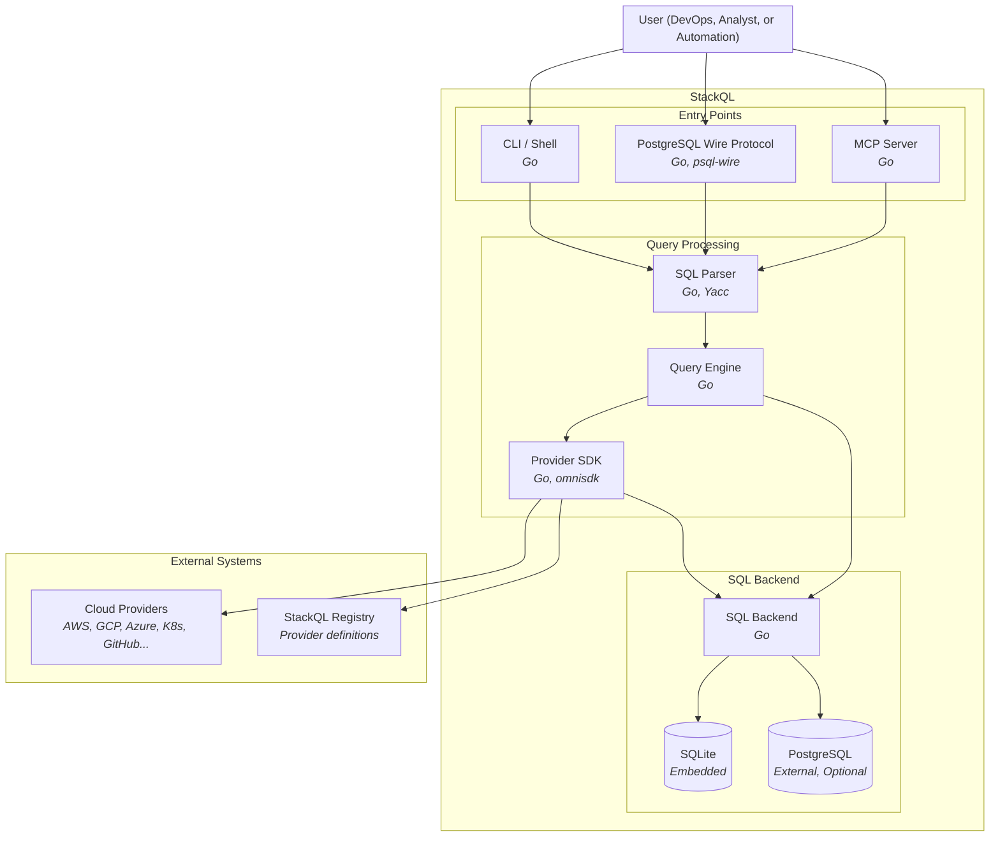

Veja também:
[[ Usar o StackQL ]](/getting-started/using-stackql) [[ Usar variáveis ]](/getting-started/variables) [[ Uso de templates ]](/getting-started/templating)

## Visão geral {#overview}

O StackQL é uma interface SQL unificada para consultar e gerenciar infraestrutura na nuvem em vários providers. O diagrama de contêineres a seguir ilustra os principais componentes do sistema StackQL e suas interações.

## Componentes principais {#core-components}

### Pontos de entrada {#entry-points}

O StackQL oferece vários pontos de entrada para executar consultas SQL:

- **CLI / Shell**: um shell interativo e uma interface de linha de comando para executar consultas SQL diretamente no terminal. Os usuários podem executar consultas ad hoc e scripts ou usar o shell interativo para explorar.

- **Protocolo de comunicação do PostgreSQL**: permite conexões de clientes PostgreSQL padrão, como `psql`, DBeaver ou qualquer outra ferramenta compatível com o PostgreSQL. Isso permite uma integração transparente com os workflows de banco de dados e as ferramentas de BI existentes.

- **Servidor MCP**: um servidor Model Context Protocol que permite a integração com assistentes de IA, para que grandes modelos de linguagem consultem e gerenciem a infraestrutura por meio de linguagem natural.

### Pipeline de processamento de consultas {#query-processing-pipeline}

1. **Analisador sintático SQL**: analisa a entrada SQL e a converte em uma árvore de sintaxe abstrata (AST) com uma gramática personalizada baseada em Yacc. O analisador sintático (implementado como `stackql-parser`) valida a sintaxe SQL e a prepara para o planejamento da consulta.

2. **Mecanismo de consulta**: a camada central de orquestração, que planeja e executa as consultas. Ele determina quais operações podem ser delegadas à camada de API e quais exigem processamento SQL local. O mecanismo de consulta cuida de:
   - Planejamento e otimização de consultas
   - Coordenação entre chamadas de API e execução SQL local
   - Agregação e transformação de resultados

### SDK de providers (omnisdk) {#provider-sdk-omnisdk}

O SDK de providers, [omnisdk](https://github.com/stackql-labs/omnisdk), gerencia todas as interações com os provedores de nuvem. Ele substituiu o `any-sdk` no StackQL `v1.0`. As principais responsabilidades incluem:

- **Descoberta de providers**: busca as especificações dos providers no StackQL Registry, que contém definições baseadas em OpenAPI para cada provedor de nuvem compatível, e, opcionalmente, verifica a assinatura ML-DSA-65 de cada documento antes de usá-lo.

- **Autenticação**: cuida da autenticação de cada provider, com suporte a vários métodos de autenticação, incluindo chaves de API, tokens OAuth, credenciais de conta de serviço e outros. Cada definição de provider especifica seus requisitos de autenticação; uma sessão pode vincular o mesmo provider a vários aliases, cada um com credenciais próprias (consulte [Sessões de provider](/getting-started/provider-sessions)).

- **Planejamento em grafo**: planeja cada instrução como um grafo de trocas com os providers, ligadas por arestas de dados e de controle. Joins, subconsultas, CTEs e views passam pelo mesmo planejador, e as solicitações que um plano distribui em fan-out são executadas simultaneamente, dentro de limites por provider e por host.

- **Construção de solicitações de API**: transforma consultas SQL nas chamadas de API REST adequadas para cada provider, cuidando da construção de endpoints, do mapeamento de parâmetros e da formatação das solicitações.

- **Paginação**: trata automaticamente as respostas paginadas das APIs e abstrai a complexidade dos diferentes esquemas de paginação usados pelos diversos providers (tokens de próxima página, números de página, links de próxima página, cabeçalhos `Link` e cursores do GraphQL).

- **Pushdown de predicados**: envia as condições que correspondem a parâmetros de solicitação, e o `LIMIT` quando nenhuma ordenação é necessária, nas solicitações ao provider, para reduzir o número de solicitações feitas e o volume de dados transferidos.

- **Transformação de respostas**: converte as respostas das APIs em linhas à medida que elas chegam, para staging no backend SQL ou streaming para o cliente.

As conexões SQL, o staging e a execução no backend permanecem no StackQL. O omnisdk não contém nenhum staging SQL e nunca recebe uma conexão de banco de dados; o StackQL passa a ele handles de relações e recebe cursores de linhas.

### Backend SQL {#sql-backend}

O backend SQL executa operações relacionais sobre os dados de API materializados:

- **SQLite**: um banco de dados incorporado usado para armazenamento temporário de tabelas e processamento relacional. Ideal para consultas ad hoc e conjuntos de dados menores.

- **PostgreSQL**: um banco de dados externo opcional para armazenamento persistente, conjuntos de dados maiores e cargas de trabalho de análise avançada.

O backend SQL cuida de operações como:
- Operações JOIN entre vários providers ou recursos
- Funções de agregação (COUNT, SUM, AVG etc.)
- Ordenação e filtragem de dados materializados
- Expressões SQL complexas e subconsultas

## Sistemas externos {#external-systems}

### Provedores de nuvem {#cloud-providers}

O StackQL se conecta aos provedores de nuvem (AWS, GCP, Azure, Kubernetes, GitHub e muitos outros) por meio das APIs REST deles. Toda a comunicação é feita por HTTPS, e o SDK de providers cuida das particularidades das convenções de API de cada provedor.

### StackQL Registry {#stackql-registry}

O StackQL Registry hospeda as definições de providers - especificações baseadas em OpenAPI que descrevem os recursos e métodos disponíveis e seus mapeamentos. Os providers são versionados e podem ser baixados sob demanda com o comando `REGISTRY PULL`.

## Fluxo de execução de consultas {#query-execution-flow}

1. O usuário envia uma consulta SQL por um dos pontos de entrada (CLI, protocolo PostgreSQL ou MCP)
2. O analisador sintático SQL valida a consulta e a converte em uma AST
3. O mecanismo de consulta analisa a AST e cria um plano de execução
4. Para as operações de provider, o SDK de providers:
   - Busca a especificação do provider correspondente no Registry (se ela não estiver em cache)
   - Faz a autenticação no provedor de nuvem
   - Cria e executa as solicitações de API, tratando a paginação automaticamente
   - Envia os predicados para a API sempre que possível
   - Materializa os resultados no backend SQL
5. O backend SQL executa as operações relacionais restantes
6. Os resultados são retornados ao usuário no formato solicitado
