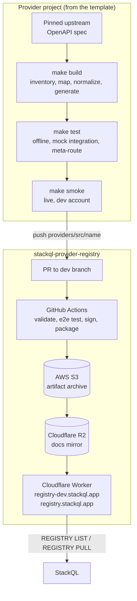

Veja também:
[[ StackQL Provider Registry ]](/providers) [[ Usar um provider ]](/getting-started/using-a-provider) [[ REGISTRY ]](/language-spec/registry) [[ Arquitetura ]](/developers/architecture)

## Visão geral {#overview}

Um provider do StackQL é um conjunto versionado de documentos OpenAPI mais extensões `x-stackQL-*` que o mecanismo [omnisdk](https://github.com/stackql-labs/omnisdk) transforma em tabelas SQL: `SELECT` para leituras, `INSERT`, `UPDATE`, `REPLACE` e `DELETE` para operações de ciclo de vida e `EXEC` para ações. Os documentos de provider informam ao StackQL o que a API de um provider pode fazer e como invocá-la com a semântica do SQL. Eles são YAML simples, então um provider pode ser criado, testado e versionado como qualquer outro código.

Três repositórios e uma camada de distribuição compõem o ecossistema de providers:

| Componente | Finalidade |
| --- | --- |
| [__`stackql-provider-TEMPLATE`__](https://github.com/stackql-registry/stackql-provider-TEMPLATE) | O ponto de partida para um novo projeto de provider: um pipeline `make` determinístico que vai de uma especificação upstream fixada até um provider gerado, camadas de teste sem credenciais, uma suíte de smoke tests contra a API real, um microsite de documentação e CI. Inclui a skill de desenvolvimento de providers para o Claude Code. |
| [__`omnisdk`__](https://github.com/stackql-labs/omnisdk) | O mecanismo que lê os documentos de provider e executa as solicitações, a partir do StackQL `v1.0`. Seu antecessor, o [`any-sdk`](https://github.com/stackql/any-sdk), ainda hospeda a referência do contrato dos documentos de provider, das extensões `x-stackQL-*`, da autenticação, da paginação, das transformações e do pushdown, além dos JSON Schemas indicados abaixo. |
| [__`stackql-provider-registry`__](https://github.com/stackql/stackql-provider-registry) | A fonte da verdade dos providers publicados. Os documentos são versionados em `providers/src/<provider>/<version>/` e depois assinados, empacotados e publicados pelo GitHub Actions. |
| __Camada de distribuição da Cloudflare__ | Os artefatos de providers empacotados são servidos na borda a partir do Cloudflare R2 por um Cloudflare Worker em `registry.stackql.app` (produção) e `registry-dev.stackql.app` (desenvolvimento). É com ele que `REGISTRY LIST` e `REGISTRY PULL` se comunicam. |
<br/>
O diagrama a seguir mostra o caminho de um projeto de provider até uma instalação do StackQL:



## Estrutura dos documentos de provider {#provider-document-structure}

Os objetos do StackQL seguem a hierarquia `provider.service.resource.method`, por exemplo, `google.compute.instances.list`. Os documentos espelham essa hierarquia:

```
provider.yaml                          # provider metadata, providerServices, provider-level config
services/
  <service>.yaml                       # an OpenAPI 3 document per service, plus
    components.x-stackQL-resources
      <resource>                       # id, name, methods, sqlVerbs, optional config
        methods.<method>               # operation $ref, response, request, optional config
```

- __Documento de provider__ (`provider.yaml`): `id`, `name`, `title`, `version`, `providerServices` (cada um com um `service.$ref` para o seu documento de serviço e um indicador `preferred` opcional) e, opcionalmente, `description`, `protocolType` (`http` é o padrão) e `config`.
- __Documento de serviço__: um documento OpenAPI 3 padrão. O único acréscimo obrigatório é `components.x-stackQL-resources`, que declara os recursos expostos como tabelas.
- __Recurso__: `id`, `name`, `methods` e `sqlVerbs`. Cada recurso é uma tabela; as colunas dele vêm do esquema de resposta do seu método `select` principal.
- __Método__: uma `operation`, que é um ponteiro JSON para `paths` (por exemplo, `$ref: '#/paths/~1orgs~1{org}~1repos/get'`), um bloco `response` (`mediaType`, `openAPIDocKey`, `objectKey`) que informa ao mecanismo onde estão as linhas, e um bloco `request` e um `config` opcionais.
- __Mapeamento de verbos SQL__: `sqlVerbs.select`, `insert`, `update`, `replace` e `delete` são listas ordenadas de referências a métodos. O StackQL considera os métodos referenciados cujos parâmetros obrigatórios são todos fornecidos pela cláusula `WHERE` e escolhe aquele com mais parâmetros obrigatórios, independentemente da ordem da lista: uma consulta que fornece o identificador exigido por `get` é direcionada para `get`, uma que não o fornece é direcionada para `list`, e dois métodos empatados são reportados como erro em vez de um deles ser escolhido. Qualquer método que não seja referenciado por uma lista de verbos pode ser chamado via `EXEC`.

Um recurso mínimo fica assim:

```yaml
components:
  x-stackQL-resources:
    repos:
      id: github.repos.repos
      name: repos
      title: Repos
      methods:
        list_for_org:
          operation:
            $ref: '#/paths/~1orgs~1{org}~1repos/get'
          response:
            mediaType: application/json
            openAPIDocKey: '200'
        create_in_org:
          operation:
            $ref: '#/paths/~1orgs~1{org}~1repos/post'
          response:
            mediaType: application/json
            openAPIDocKey: '201'
          config:
            requestBodyTranslate:
              algorithm: naive
      sqlVerbs:
        select:
          - $ref: '#/components/x-stackQL-resources/repos/methods/list_for_org'
        insert:
          - $ref: '#/components/x-stackQL-resources/repos/methods/create_in_org'
```

O contrato completo, incluindo cada chave e o seu significado, está na [especificação de providers](https://github.com/stackql/any-sdk/blob/main/docs/provider_spec.md) do any-sdk. Os JSON Schemas de `provider.yaml`, dos documentos de serviço e do bloco config ficam em [`any-sdk/cicd/schema-definitions`](https://github.com/stackql/any-sdk/tree/main/cicd/schema-definitions); o esquema de config rejeita chaves desconhecidas, então uma chave digitada errado falha na validação em vez de ser ignorada silenciosamente.

### Extensões do OpenAPI {#openapi-extensions}

| Extensão | Onde | Finalidade |
| --- | --- | --- |
| `x-stackQL-resources` | `components` | O dicionário de recursos de um documento de serviço (obrigatório) |
| `x-stackQL-config` | serviço, recurso, método ou operação | Um bloco de config (veja abaixo) aplicado nesse nível |
| `x-stackQL-envVar` | variável de servidor | Indica uma variável de ambiente que fornece a variável de servidor quando ela não é informada na cláusula `WHERE`. Usada para definir o escopo de uma API por tenant, organização, projeto ou implantação |
| `x-stackQL-alias` | parâmetro ou propriedade de esquema | Um nome alternativo aceito no SQL para um nome usado na API |
| `x-stackQL-stringOnly` | propriedade de esquema | Serializa a propriedade como string, independentemente do tipo declarado |
| `x-stackQL-graphQL` | operação | Baseia um método em uma consulta GraphQL quando a API REST não tem os dados |
| `x-alwaysRequired` | parâmetro | Marca um parâmetro como sempre obrigatório |
| `x-protocol` | `info` | Indicação do protocolo de comunicação (`query`, `ec2`, `rest-xml`) para o tratamento de respostas XML orientado pelo esquema |

### O bloco config {#the-config-block}

`config` em `provider.yaml` e `x-stackQL-config` nos documentos de serviço compartilham um mesmo esquema. As chaves permitidas são `auth`, `pagination`, `queryParamPushdown`, `queryParamTranspose`, `requestTranslate`, `requestBodyTranslate`, `variations`, `views`, `sqlExternalTables`, `retry`, `minStackQLVersion` e `snake_case_aliases`. A config é resolvida do nível mais específico para fora, método -> recurso -> serviço -> serviço do provider -> provider, de modo que um valor padrão para todo o provider pode ser substituído em um único recurso ou método.

## Do que os providers cuidam {#what-providers-handle}

Os providers são responsáveis pelas funções que abstraem a complexidade das APIs, para que os usuários tenham uma interface SQL consistente sem precisar gerenciar a conversa HTTP subjacente.

### Autenticação {#authentication}

Cada provider inclui um bloco `auth` padrão que indica as variáveis de ambiente que contêm as suas credenciais, de modo que um ambiente com essas variáveis definidas não precisa de nenhuma configuração de autenticação em runtime. Um documento de provider só aceita indireções (nomes de variáveis de ambiente, caminhos de arquivo); valores literais de credenciais pertencem exclusivamente ao contexto `--auth` em runtime. Os nomes das variáveis de ambiente devem seguir os do provider do Terraform do fornecedor, quando houver um.

| `auth.type` | Campos típicos |
| --- | --- |
| `bearer` | `credentialsenvvar` |
| `api_key` | `credentialsenvvar`, `valuePrefix` e, opcionalmente, `location` (`header` ou `query`) e `name` |
| `basic` | `username_var`, `password_var` |
| `custom` | `location`, `name`, `credentialsenvvar`, `valuePrefix` opcional; encadeie uma segunda credencial com `successor` |
| `oauth2` | `client_id_env_var`, `client_secret_env_var`, `grant_type: client_credentials`, `token_url`, `scopes` |
| `service_account` | `credentialsenvvar` ou `credentialsfilepathenvvar`, `scopes` |
| `aws_signing_v4`, `aws_assume_role` | `keyIDenvvar`, `credentialsenvvar` |
| `azure_default` | nenhum |
| `oci_signing_v1` | `tenancy_ocid_envvar`, `user_ocid_envvar`, `oci_fingerprint_envvar`, `oci_private_key_envvar`, `oci_region_envvar` |
| `interactive` | nenhum |
| `null_auth` | nenhum (explicitamente sem autenticação) |
<br/>
Por exemplo:

```yaml
config:
  auth:
    type: api_key
    credentialsenvvar: OKTA_API_TOKEN
    valuePrefix: 'SSWS '
```

Os usuários podem substituir a autenticação de um provider em runtime com `--auth='{"<provider>": {...}}'`.

### Paginação {#pagination}

Os providers declaram o esquema de paginação do fornecedor e o mecanismo percorre todas as páginas, para que os usuários recebam conjuntos de resultados completos. Esquemas compatíveis:

- __Token ou cursor no corpo__: `requestToken: {key: cursor, location: query}`, `responseToken: {key: $.cursor, location: body}`; para quando o token está ausente ou vazio.
- __URL da próxima página no corpo__: `requestToken: {key: '', location: request}`, `responseToken: {key: $.next, location: body}`; `algorithm: odata_next_link` para o `@odata.nextLink` do OData.
- __Cabeçalho `Link` da RFC 5988__: `responseToken: {key: Link, location: header}`.
- __Número de página com contagem de páginas__: `algorithm: page_number` com `responseToken` (página atual) e `responseTerminator` (total de páginas).

APIs de offset e limit sem marcador de próxima página não são um esquema de paginação; nesse caso, exponha `offset` e `limit` como parâmetros de `WHERE`. A opção global `--http.response.pageLimit` limita o percurso pelas páginas.

### Pushdown de predicados {#predicate-pushdown}

As chaves do `WHERE` são comparadas pelo nome com os parâmetros declarados da operação (de caminho, depois de consulta, de cabeçalho e de cookie) e enviadas à API, para que a filtragem aconteça na origem. Qualquer chave restante do `WHERE` sem parâmetro correspondente é acrescentada como parâmetro de consulta.

Além dos parâmetros simples, `queryParamPushdown` reescreve as colunas do `SELECT`, `WHERE`, `ORDER BY`, `LIMIT`, `OFFSET` e `COUNT` como parâmetros da API. `dialect: odata` preenche os valores padrão `$select`, `$filter`, `$orderby`, `$top`, `$skip` e `$count` usados pelo Microsoft Graph e por APIs no estilo do Azure; `dialect: custom` usa `paramName` literalmente, mais comumente `top: {paramName: limit, maxValue: 1000}`, para que `LIMIT n` se torne `?limit=n`. Os predicados que não podem ser enviados à API continuam sendo avaliados no lado do cliente.

### Transformação de respostas e solicitações {#response-and-request-transformation}

- `response.objectKey` é um JSONPath (ou XPath, para APIs XML) que seleciona em um envelope os itens que contêm as linhas, por exemplo, `$.data[*]` ou `$.value`.
- `response.transform` aplica um template de texto Go a um corpo antes que ele seja armazenado como linhas; os tipos de transformação abrangem JSON, XML e texto simples, e é assim que as APIs XML da AWS e a saída de CLIs se tornam tabelas.
- `requestBodyTranslate: {algorithm: naive}` permite que o `INSERT` receba os campos do corpo da solicitação como nomes de coluna simples, em vez da forma com o prefixo `data__`.
- `snake_case_aliases: true` no nível do provider expõe os nomes em camelCase da API como colunas e parâmetros em snake_case.
- `retry` define uma política de backoff exponencial (`max_attempts`, `initial_delay_ms`, `max_delay_ms`, `multiplier`, `jitter_fraction`, `retryable_methods`, `retryable_conditions.status_codes`). Vence o primeiro nível que declarar uma; consulte a [política de novas tentativas](https://github.com/stackql/any-sdk/blob/main/docs/retry_policy.md) do any-sdk.

Os tipos de coluna seguem o esquema OpenAPI: `string` -> text, `integer` -> integer, `number` -> numeric, `boolean` -> boolean. As propriedades `object` e `array` são armazenadas como texto JSON; por isso, os campos aninhados são lidos com `json_extract` nas consultas e os providers costumam incluir views (`config.views`, com `ddl` por dialeto e um `fallback`) para projeções aninhadas comuns.

### Providers não HTTP {#non-http-providers}

`protocolType: local_templated` em `provider.yaml` baseia um provider em comandos locais em vez de HTTP: os métodos têm um array `inline` de fragmentos de argv em template Go, os parâmetros usam `in: inline` e um `response.transform` converte a saída do comando em linhas. O provider de referência [`local_openssl`](https://github.com/stackql/any-sdk/tree/main/test/registry/src/local_openssl/v0.1.0) do any-sdk mostra o formato. Isso está fora do escopo do pipeline do template, que é voltado para APIs HTTP.

## Iniciar um projeto de provider {#starting-a-provider-project}

Comece todo novo provider a partir do [__`stackql-provider-TEMPLATE`__](https://github.com/stackql-registry/stackql-provider-TEMPLATE). Ele é um repositório de template do GitHub que codifica o padrão atual de um provider: uma especificação upstream fixada, um pipeline de build determinístico em que toda decisão manual é uma regra em um script, e não uma edição manual do YAML gerado, três camadas de teste sem credenciais, uma suíte de smoke tests contra a API real com orçamento limitado, um site de documentação Docusaurus e CI. Os providers publicados criados dessa forma ficam na organização [stackql-registry](https://github.com/orgs/stackql-registry/repositories) do GitHub e são um material de referência útil junto com o template.

Pré-requisitos: Node.js 20 ou posterior, GNU make e bash (Linux, macOS ou WSL), Python 3 para a suíte de smoke tests e um binário `stackql` (`bin/start-server.sh` baixa um se nenhum for encontrado).

1. Crie o repositório a partir do template ("Use this template" no GitHub) e execute `npm install`.
2. Execute `bin/init-provider.sh <name> "<Title>" [https://api.vendor.com]` para substituir os placeholders em todo o repositório.
3. Preencha as constantes em `provider-dev/scripts/lib/spec_helpers.mjs` (URL da especificação, prefixo de versão do caminho, prefixo de escopo para uma API com escopo de tenant ou de projeto) e a configuração em `provider-dev/config/` (`servers.json`, `provider_config.json`, `service_names.json`).
4. Avance pelo pipeline, seja manualmente pelos targets do `make`, seja abrindo uma sessão do Claude Code no repositório (veja abaixo).
5. `grep -rn "TODO(template)"` lista o que ainda está pendente.

O pipeline é conduzido pelo `make` (`make help` lista todos os targets):

```bash
make fetch-spec        # verify the upstream spec against the recorded pin (fails on drift)
make inventory         # one CSV row per operation with the proposed service, resource, method and verb
make split             # write provider-dev/source/<service>.yaml from the ordered path rules
make mappings-report   # print every derived operation -> resource.method mapping without writing
make mappings          # regenerate provider-dev/config/all_services.csv and validate it
make normalize         # flatten allOf, lower oneOf/anyOf, wrap bare arrays
make generate          # generate provider.yaml + services/*.yaml, then post-process and merge GraphQL/views
make test              # offline SHOW/DESCRIBE, mock API integration tests, meta-route walk (no credentials)
make smoke             # live smoke suite against a dedicated dev account (sources .env)
make docs              # generate the provider documentation site content
make all               # everything above except the live suites
```

Internamente, o pipeline usa o [__`@stackql/provider-utils`__](https://github.com/stackql-registry/stackql-provider-utils) (`split`, `normalize`, `analyze`, `generate` e `docgen`) com regras específicas do provider em `provider-dev/scripts/`. O provider gerado fica em `provider-dev/openapi/src/<name>/v00.00.00000/`, que é o diretório publicado no registro ao final.

`provider-dev/config/all_services.csv` é o contrato versionado de todos os mapeamentos de operação para recurso e método. Um diff após a regeneração é uma revisão de alteração incompatível, não ruído. O CI falha quando há desvio de geração sem commit, então uma regeneração precisa reproduzir os artefatos versionados byte a byte.

Para um repositório de provider existente anterior ao template, copie o diretório `.claude/skills` para ele e comece pelo `references/uplift-checklist.md` da skill.

### Usar o Claude Code no desenvolvimento de providers {#using-claude-code-for-provider-development}

O template inclui a [__skill de desenvolvimento de providers do StackQL__](https://github.com/stackql-registry/stackql-provider-TEMPLATE/blob/main/.claude/skills/stackql-provider-development/SKILL.md) para o [Claude Code](https://docs.anthropic.com/en/docs/claude-code). Abra uma sessão do Claude Code em um repositório criado a partir do template e peça que ele crie o provider; ele lê o `CLAUDE.md` e a skill e executa as etapas na ordem. A skill também é o procedimento escrito para fazer o trabalho manualmente.

A skill abrange:

- Escolher o arquétipo: um documento OpenAPI, Swagger ou de discovery publicado pelo fornecedor (direto) ou uma especificação derivada de um SDK do fornecedor, quando o SDK é a fonte da verdade (derivado)
- Buscar, corrigir, validar e fixar a especificação upstream para que cada atualização seja um diff revisável
- O inventário de endpoints, a divisão em serviços e as regras de mapeamento que produzem o `all_services.csv`
- Cada primitiva dos documentos de provider e quando usá-la: escopo com `x-stackQL-envVar`, `objectKey`, transformações de solicitação e de resposta, paginação, pushdown de parâmetros de consulta, métodos `EXEC` de ciclo de vida, a mesclagem de GraphQL e as views de provider
- As três camadas de teste sem credenciais e a suíte de smoke tests contra a API real
- O site de documentação, os workflows de CI e as notas de repasse

O diretório `references/` da skill contém os detalhes de cada etapa, e `scripts/find_extension_examples.sh` imprime o YAML já publicado de qualquer chave de extensão a partir de um clone do registro de providers, para que você veja uma primitiva em uso antes de escrevê-la.

## Testar um provider localmente {#testing-a-provider-locally}

O StackQL lê os providers de um registro descrito pela opção global `--registry`. Durante o desenvolvimento, aponte o StackQL para o diretório do provider gerado no sistema de arquivos local, com a verificação de assinaturas desabilitada (os documentos só são assinados quando são publicados):

```bash
export LOCAL_REG='{ "url": "file:///path/to/provider-dev/openapi", "localDocRoot": "/path/to/provider-dev/openapi", "verifyConfig": { "nopVerify": true } }'
stackql --registry="${LOCAL_REG}" shell
```

O diretório em `localDocRoot` deve conter `src/<provider>/<version>/provider.yaml` e `src/<provider>/<version>/services/*.yaml`, que é exatamente o que o template gera. No shell, `SHOW SERVICES IN <provider>`, `SHOW RESOURCES IN <provider>.<service>`, `SHOW METHODS IN <provider>.<service>.<resource>` e `DESCRIBE EXTENDED <provider>.<service>.<resource>` confirmam a superfície antes de qualquer consulta ser executada. O `tests/offline_validation.mjs` do template automatiza essas verificações, e `npm run probe -- "SELECT ..."` executa SQL ad hoc na API simulada e imprime as chamadas feitas à API.

Os providers baixados de um registro remoto ficam em cache em `<cwd>/.stackql` por padrão; use `--approot` para alterar o local.

A [CLI do any-sdk](https://github.com/stackql/any-sdk/blob/main/docs/cli.md) é útil para verificar um documento sem envolver o StackQL: `anysdk aot <registry> <provider.yaml>` executa uma análise estática de um provider (`objectKey` não roteável, esquemas de resposta ausentes, paginação incompleta, parâmetros de caminho adjacentes etc.), e `anysdk query` executa um único método diretamente a partir dos documentos de provider e de serviço. O [teste com automock](https://github.com/stackql/any-sdk/blob/main/docs/automock_testing.md) gera uma API simulada e os resultados esperados a partir dos esquemas de um provider, para um ciclo completo sem tocar na API real.

### Testar o seu provider com o registro `dev` {#testing-your-provider-using-the-dev-registry}

Depois que um provider é mesclado na branch `dev` do registro, ele fica disponível no registro de desenvolvimento. Aponte o StackQL para ele para verificar o artefato publicado:

```bash
export DEV_REG='{ "url": "https://registry-dev.stackql.app/providers" }'
stackql --registry="${DEV_REG}" shell
```

```sql
REGISTRY PULL myprovider;
```

O target `make smoke-live` do template executa a suíte de smoke tests no provider publicado, para verificação pós-publicação.

## Publicar um provider {#publishing-a-provider}

A publicação é uma etapa separada, com participação humana, e não faz parte do pipeline do template.

1. Faça um fork do [stackql-provider-registry](https://github.com/stackql/stackql-provider-registry) e copie o diretório gerado `provider-dev/openapi/src/<name>` para `providers/src/<name>` em uma branch de funcionalidade.
2. Abra um pull request para a branch `dev` com uma descrição do provider e das alterações (consulte o [guia de contribuição](https://github.com/stackql/stackql-provider-registry/blob/main/.github/CONTRIBUTING.md) do registro).
3. O GitHub Actions valida e testa o provider com o [stackql-provider-tests](https://github.com/stackql/stackql-provider-tests). As regras avaliadas são: o documento deve ser uma especificação OpenAPI válida, todos os serviços devem ser enumeráveis para recursos, todos os recursos devem ser enumeráveis para métodos, os métodos que podem ser chamados via `SELECT` devem ter um esquema de resposta válido e os métodos que podem ser chamados via `INSERT` devem ter um esquema de solicitação válido.
4. Após a mesclagem, o workflow aloca uma versão, assina os documentos (ML-DSA-65), empacota-os e publica o artefato no acervo do AWS S3. Em seguida, a árvore de documentos é espelhada no Cloudflare R2 e o Cloudflare Worker que serve `registry-dev.stackql.app` é implantado. O provider fica imediatamente disponível para as instalações configuradas para usar o registro `dev`.
5. Após um período de monitoramento, a `dev` é promovida para a `main`, o que repete a publicação para `registry.stackql.app`. Esta é a publicação para as instâncias do StackQL com a configuração padrão.

O mesmo harness `stackql-provider-tests` pode ser executado localmente em um diretório de registro antes de abrir um PR:

```bash
test-provider.sh <provider_name> false /path/to/provider-dev/openapi
```

Consulte [build e implantação](https://github.com/stackql/stackql-provider-registry/blob/main/docs/build-and-deployment.md) no repositório do registro para ver o workflow em detalhes, incluindo a proteção contra exclusão de providers que resguarda `providers/src`.
