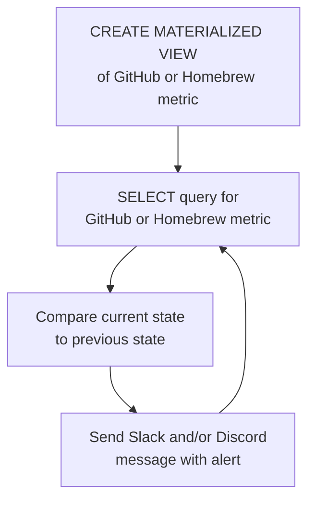

# Monitor de atividade de projetos de código aberto baseado no StackQL

Neste guia, mostramos como hospedar por conta própria um sistema de monitoramento e alertas em tempo real para mantenedores de software de código aberto no GitHub.  

> [__stackql__](https://github.com/stackql/stackql) é uma ferramenta de código aberto que permite aos usuários consultar e interagir com recursos na nuvem e de SaaS usando a linguagem SQL e bibliotecas e ferramentas de visualização e análise de dados. Dê uma [⭐](https://github.com/stackql/stackql) para nós se você gostou!

Receba alertas como este no Slack e no Discord em tempo real:


Testado com <span class="tutorial_tested_on">backend SQL incorporado</span> <span class="tutorial_tested_on">docker</span> <span class="tutorial_tested_on">linux</span> 

## Visão geral {#overview}

Quando procurei ferramentas para monitorar o nosso projeto de código aberto, descobri que a maioria não funcionava como anunciado ou simplesmente não funcionava (no caso de aplicativos de terceiros no GitHub), então criei a nossa própria ferramenta, que você pode iniciar e usar no seu projeto de código aberto do GitHub...  

O projeto [__oss-activity-monitor__](https://github.com/stackql/oss-activity-monitor) usa o [__stackql__](https://github.com/stackql/stackql) para monitorar em tempo real a atividade de projetos de código aberto, o que inclui notificações em tempo real de:

- ⭐ novos stargazers de repositórios do GitHub
- 👀 novos watchers de repositórios do GitHub
- 🍴 novos forks de repositórios do GitHub
- 📊 novas issues de repositórios do GitHub
- 🙋 novos seguidores de organizações do GitHub
- 📦 novos downloads de arquivos de versões do GitHub
- 🍺 novos downloads do homebrew

## Como funciona {#how-it-works}

O projeto é implantado em um contêiner (com `docker` ou outra plataforma de implantação de contêineres) e é desenvolvido em `python` com o pacote [`pystackql`](https://pystackql.readthedocs.io/en/latest/intro.html), usando os providers [`github`](https://github-provider.stackql.io/) e [`homebrew`](https://homebrew-provider.stackql.io/) do `stackql`.  O projeto usa views materializadas e instruções `SELECT` para capturar e comparar o estado entre as métricas atuais e anteriores dos endpoints monitorados do GitHub e do Homebrew, como descreve o diagrama a seguir:  


por exemplo, dada esta view materializada, criada e preenchida com o `stackql`:  

```sql
CREATE OR REPLACE MATERIALIZED VIEW mvw_github_repo_stargazers AS 
SELECT login FROM github.activity.repo_stargazers
WHERE owner = 'your-org' and repo = 'your-repo'
```

a consulta do `stackql` a seguir verifica periodicamente o GitHub em busca de novos stargazers...

```sql
SELECT c.login
FROM github.activity.repo_stargazers c
LEFT JOIN mvw_github_repo_stargazers mvw
ON c.login = mvw.login
WHERE mvw.login IS NULL
AND c.owner = 'your-org' AND c.repo = 'your-repo'
```

em seguida, o estado é atualizado com...

```sql
REFRESH MATERIALIZED VIEW mvw_github_repo_stargazers
```

padrões semelhantes se repetem para watchers de repositórios, issues, seguidores de organizações, downloads de arquivos de versões e downloads do homebrew.

## Executar o projeto {#running-the-project}

Siga as etapas abaixo para colocar o projeto em execução localmente ou na sua plataforma de nuvem preferida.  

### 1. Clonar o repositório {#1-clone-the-repo}

```bash
git clone https://github.com/stackql/oss-activity-monitor.git
# or 
git clone git@github.com:stackql/oss-activity-monitor.git
```

### 2. Configurar as variáveis de ambiente {#2-configure-environment-variables}

As seguintes variáveis de ambiente são necessárias para configurar o projeto (fornecidas como variáveis de ambiente; no exemplo abaixo, em um arquivo `.env`):  

| Variável                   | Descrição                                                                         | Valor de exemplo                                 |
|----------------------------|-----------------------------------------------------------------------------------|--------------------------------------------------|
| `LOG_LEVEL`                | Nível de log (INFO para logs gerais; DEBUG para logs detalhados)                  | INFO                                             |
| `SLEEP_INTERVAL`           | Intervalo em segundos entre os ciclos de solicitações                             | 5                                                |
| `GITHUB_REPO`              | Nome do repositório do GitHub                                                     | stackql                                          |
| `GITHUB_REPO_OWNER`        | Nome da organização ou do proprietário no GitHub                                  | stackql                                          |
| `HOMEBREW_FORMULA_NAME`    | Nome da fórmula do Homebrew, se houver                                            | stackql                                          |
| `STACKQL_GITHUB_USERNAME`  | Seu nome de usuário do GitHub                                                     | jeffreyaven                                      |
| `STACKQL_GITHUB_PASSWORD`  | Seu token de acesso pessoal do GitHub                                             | ghp_yourpersonalaccesstoken                      |
| `SLACK_WEBHOOK_URL`        | URL do webhook do Slack para enviar notificações                                  | https://hooks.slack.com/services/...             |
| `DISCORD_WEBHOOK_URL`      | URL do webhook do Discord para enviar notificações                                | https://discord.com/api/webhooks/...             |

### 3. Criar o contêiner {#3-build-the-container}

```bash
docker build --no-cache -t oss-activity-monitor .
```

### 4. Executar o contêiner {#4-run-the-container}

```bash
docker run --env-file .env oss-activity-monitor
```

Pronto!  Agora você vai receber alertas em tempo real quando houver atividade no seu projeto de código aberto.  Para parar o contêiner, use:  

```bash
docker stop $(docker ps -a -q --filter ancestor=oss-activity-monitor)
```

Dê uma ⭐ para nós no [__GitHub__](https://github.com/stackql/stackql)
