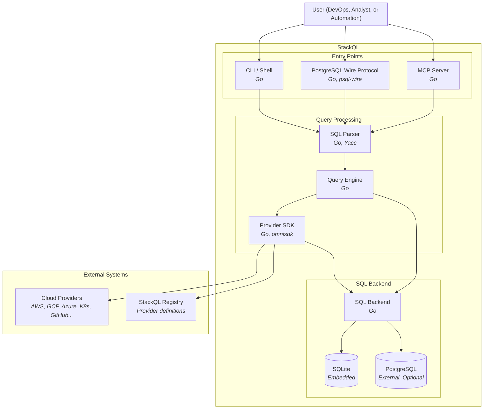

См. также:
[[ Использование StackQL ]](/getting-started/using-stackql) [[ Использование переменных ]](/getting-started/variables) [[ Шаблонизация ]](/getting-started/templating)

## Обзор {#overview}

StackQL - это единый SQL-интерфейс для выполнения запросов к облачной инфраструктуре нескольких провайдеров и управления ею. Следующая диаграмма контейнеров показывает основные компоненты системы StackQL и их взаимодействие.

## Основные компоненты {#core-components}

### Точки входа {#entry-points}

StackQL поддерживает несколько точек входа для выполнения SQL-запросов:

- **CLI / оболочка**: интерактивная оболочка и интерфейс командной строки для выполнения SQL-запросов прямо из терминала. Пользователи могут выполнять произвольные запросы и скрипты или исследовать данные в интерактивной оболочке.

- **Сетевой протокол PostgreSQL**: позволяет подключаться из стандартных клиентов PostgreSQL, таких как `psql`, DBeaver или любой другой инструмент, совместимый с PostgreSQL. Это обеспечивает бесшовную интеграцию с существующими рабочими процессами баз данных и инструментами BI.

- **MCP-сервер**: сервер Model Context Protocol для интеграции с ИИ-ассистентами, который позволяет большим языковым моделям выполнять запросы к инфраструктуре и управлять ею на естественном языке.

### Конвейер обработки запросов {#query-processing-pipeline}

1. **Синтаксический анализатор SQL**: преобразует входной SQL в абстрактное синтаксическое дерево (AST) с помощью собственной грамматики на основе Yacc. Синтаксический анализатор (реализован как `stackql-parser`) проверяет синтаксис SQL и подготавливает запрос к планированию.

2. **Движок запросов**: центральный уровень оркестрации, который планирует и выполняет запросы. Он определяет, какие операции можно передать на уровень API, а какие требуют локальной обработки SQL. Движок запросов выполняет следующие задачи:
   - Планирование и оптимизация запросов
   - Координация между вызовами API и локальным выполнением SQL
   - Агрегирование и преобразование результатов

### SDK провайдеров (omnisdk) {#provider-sdk-omnisdk}

SDK провайдеров, [omnisdk](https://github.com/stackql-labs/omnisdk), управляет всем взаимодействием с поставщиками облачных услуг. В StackQL `v1.0` он заменил `any-sdk`. Основные задачи:

- **Обнаружение провайдеров**: получает спецификации провайдеров из StackQL Registry, где хранятся определения на основе OpenAPI для каждого поддерживаемого поставщика облачных услуг, и при необходимости проверяет подпись ML-DSA-65 каждого документа перед его использованием.

- **Аутентификация**: выполняет аутентификацию для каждого провайдера и поддерживает различные методы аутентификации, включая API-ключи, токены OAuth, учетные данные сервисных аккаунтов и другие. Определение каждого провайдера задает его требования к аутентификации; сеанс может привязать один и тот же провайдер к нескольким псевдонимам с отдельными учетными данными (см. [Сеансы провайдеров](/getting-started/provider-sessions)).

- **Планирование графа**: планирует каждую инструкцию как граф обменов с провайдерами, связанных ребрами данных и управления. Соединения, вложенные запросы, CTE и представления проходят через тот же планировщик, а запросы к API, на которые разветвляется план, выполняются параллельно в пределах ограничений для каждого провайдера и каждого хоста.

- **Построение запросов к API**: преобразует SQL-запросы в соответствующие вызовы REST API для каждого провайдера, выполняя построение конечных точек, сопоставление параметров и форматирование запросов.

- **Разбиение на страницы**: автоматически обрабатывает ответы API, разбитые на страницы, скрывая сложность различных схем разбиения на страницы, которые используют разные провайдеры (токены следующей страницы, номера страниц, ссылки на следующую страницу, заголовки `Link` и курсоры GraphQL).

- **Передача предикатов (predicate pushdown)**: передает в запросы к провайдерам условия, которые соответствуют параметрам запроса, а также `LIMIT`, если упорядочение не требуется, чтобы сократить число запросов и объем передаваемых данных.

- **Преобразование ответов**: преобразует ответы API в строки по мере их поступления для промежуточного хранения в SQL-бэкенде или потоковой передачи клиенту.

SQL-подключения, промежуточное хранение и выполнение в бэкенде остаются в StackQL. omnisdk не содержит промежуточного хранения SQL и никогда не получает подключение к базе данных; StackQL передает ему дескрипторы отношений и получает курсоры строк.

### SQL-бэкенд {#sql-backend}

SQL-бэкенд выполняет реляционные операции над материализованными данными API:

- **SQLite**: встроенная база данных для временного хранения таблиц и реляционной обработки. Идеально подходит для произвольных запросов и небольших наборов данных.

- **PostgreSQL**: необязательная внешняя база данных для постоянного хранения, больших наборов данных и сложных аналитических нагрузок.

SQL-бэкенд выполняет, например, следующие операции:
- Операции JOIN между несколькими провайдерами или ресурсами
- Агрегатные функции (COUNT, SUM, AVG и т. д.)
- Сортировка и фильтрация материализованных данных
- Сложные SQL-выражения и вложенные запросы

## Внешние системы {#external-systems}

### Поставщики облачных услуг {#cloud-providers}

StackQL подключается к поставщикам облачных услуг (AWS, GCP, Azure, Kubernetes, GitHub и многим другим) через их REST API. Обмен данными всегда идет по HTTPS, а SDK провайдеров учитывает особенности соглашений API каждого поставщика.

### StackQL Registry {#stackql-registry}

StackQL Registry хранит определения провайдеров - спецификации на основе OpenAPI, которые описывают доступные ресурсы, методы и их сопоставления. Провайдеры версионируются, и их можно загружать по требованию командой `REGISTRY PULL`.

## Ход выполнения запроса {#query-execution-flow}

1. Пользователь отправляет SQL-запрос через одну из точек входа (CLI, протокол PostgreSQL или MCP)
2. Синтаксический анализатор SQL проверяет запрос и преобразует его в AST
3. Движок запросов анализирует AST и создает план выполнения
4. Для операций с провайдерами SDK провайдеров:
   - получает нужную спецификацию провайдера из реестра (если ее нет в кэше)
   - проходит аутентификацию у поставщика облачных услуг
   - формирует и выполняет запросы к API, автоматически обрабатывая разбиение на страницы
   - по возможности передает предикаты в API
   - материализует результаты в SQL-бэкенде
5. SQL-бэкенд выполняет оставшиеся реляционные операции
6. Результаты возвращаются пользователю в запрошенном формате
