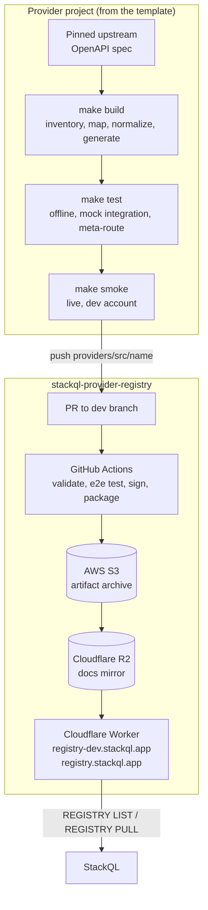

См. также:
[[ StackQL Provider Registry ]](/providers) [[ Использование провайдера ]](/getting-started/using-a-provider) [[ REGISTRY ]](/language-spec/registry) [[ Архитектура ]](/developers/architecture)

## Обзор {#overview}

Провайдер StackQL - это версионируемый набор документов OpenAPI с расширениями `x-stackQL-*`, который движок [omnisdk](https://github.com/stackql-labs/omnisdk) превращает в SQL-таблицы: `SELECT` для чтения, `INSERT`, `UPDATE`, `REPLACE` и `DELETE` для операций жизненного цикла и `EXEC` для действий. Документы провайдера сообщают StackQL, что умеет API провайдера и как вызывать его с семантикой SQL. Это обычный YAML, поэтому провайдер можно собирать, тестировать и версионировать, как любой другой код.

Экосистему провайдеров составляют три репозитория и один уровень распространения:

| Компонент | Роль |
| --- | --- |
| [__`stackql-provider-TEMPLATE`__](https://github.com/stackql-registry/stackql-provider-TEMPLATE) | Отправная точка для нового проекта провайдера: детерминированный конвейер `make` от закрепленной спецификации upstream до сгенерированного провайдера, уровни тестов без учетных данных, набор smoke test на реальном API, микросайт документации и CI. Включает skill Claude Code для разработки провайдеров. |
| [__`omnisdk`__](https://github.com/stackql-labs/omnisdk) | Движок, который читает документы провайдеров и выполняет запросы к API, начиная с StackQL `v1.0`. Его предшественник, [`any-sdk`](https://github.com/stackql/any-sdk), по-прежнему содержит справочник по контракту документа провайдера, расширениям `x-stackQL-*`, аутентификации, разбиению на страницы, преобразованиям и передаче предикатов, а также JSON-схемы, ссылки на которые приведены ниже. |
| [__`stackql-provider-registry`__](https://github.com/stackql/stackql-provider-registry) | Источник истины для опубликованных провайдеров. Документы хранятся по версиям в `providers/src/<provider>/<version>/`, затем GitHub Actions подписывает, упаковывает и публикует их. |
| __Уровень распространения Cloudflare__ | Упакованные артефакты провайдеров раздаются на периферии сети из Cloudflare R2 с помощью Cloudflare Worker по адресам `registry.stackql.app` (рабочая среда) и `registry-dev.stackql.app` (среда разработки). Именно к нему обращаются `REGISTRY LIST` и `REGISTRY PULL`. |
<br/>
На следующей диаграмме показан путь от проекта провайдера до установленного экземпляра StackQL:



## Структура документов провайдера {#provider-document-structure}

Объекты StackQL следуют иерархии `provider.service.resource.method`, например `google.compute.instances.list`. Документы повторяют эту иерархию:

```
provider.yaml                          # provider metadata, providerServices, provider-level config
services/
  <service>.yaml                       # an OpenAPI 3 document per service, plus
    components.x-stackQL-resources
      <resource>                       # id, name, methods, sqlVerbs, optional config
        methods.<method>               # operation $ref, response, request, optional config
```

- __Документ провайдера__ (`provider.yaml`): `id`, `name`, `title`, `version`, `providerServices` (каждый со ссылкой `service.$ref` на свой документ сервиса и необязательным флагом `preferred`), необязательные `description`, `protocolType` (по умолчанию `http`) и `config`.
- __Документ сервиса__: стандартный документ OpenAPI 3. Единственное обязательное дополнение - `components.x-stackQL-resources`, где объявляются ресурсы, доступные как таблицы.
- __Ресурс__: `id`, `name`, `methods` и `sqlVerbs`. Каждый ресурс - это таблица; ее столбцы берутся из схемы ответа его основного метода `select`.
- __Метод__: `operation`, то есть JSON-указатель на `paths` (например, `$ref: '#/paths/~1orgs~1{org}~1repos/get'`), блок `response` (`mediaType`, `openAPIDocKey`, `objectKey`), который сообщает движку, где находятся строки, а также необязательные блок `request` и `config`.
- __Сопоставление глаголов SQL__: `sqlVerbs.select`, `insert`, `update`, `replace` и `delete` - это упорядоченные списки ссылок на методы. StackQL рассматривает те методы из списка, все обязательные параметры которых передаются в предложении `WHERE`, и выбирает метод с наибольшим числом обязательных параметров независимо от порядка в списке: запрос, который передает идентификатор, требуемый методом `get`, направляется в `get`, запрос без него - в `list`, а при равенстве двух методов возвращается ошибка, и выбор между ними не делается. Любой метод, на который нет ссылки ни в одном списке глаголов, можно вызвать через `EXEC`.

Минимальный ресурс выглядит так:

```yaml
components:
  x-stackQL-resources:
    repos:
      id: github.repos.repos
      name: repos
      title: Repos
      methods:
        list_for_org:
          operation:
            $ref: '#/paths/~1orgs~1{org}~1repos/get'
          response:
            mediaType: application/json
            openAPIDocKey: '200'
        create_in_org:
          operation:
            $ref: '#/paths/~1orgs~1{org}~1repos/post'
          response:
            mediaType: application/json
            openAPIDocKey: '201'
          config:
            requestBodyTranslate:
              algorithm: naive
      sqlVerbs:
        select:
          - $ref: '#/components/x-stackQL-resources/repos/methods/list_for_org'
        insert:
          - $ref: '#/components/x-stackQL-resources/repos/methods/create_in_org'
```

Полный контракт, включая каждый ключ и его назначение, описан в [спецификации провайдера](https://github.com/stackql/any-sdk/blob/main/docs/provider_spec.md) в any-sdk. JSON-схемы для `provider.yaml`, документов сервисов и блока конфигурации находятся в [`any-sdk/cicd/schema-definitions`](https://github.com/stackql/any-sdk/tree/main/cicd/schema-definitions); схема конфигурации отклоняет неизвестные ключи, поэтому ключ с опечаткой не проходит проверку, а не игнорируется молча.

### Расширения OpenAPI {#openapi-extensions}

| Расширение | Где | Назначение |
| --- | --- | --- |
| `x-stackQL-resources` | `components` | Словарь ресурсов документа сервиса (обязательный) |
| `x-stackQL-config` | сервис, ресурс, метод или операция | Блок конфигурации (см. ниже), применяемый на этом уровне |
| `x-stackQL-envVar` | переменная сервера | Задает имя переменной среды, которая передает значение переменной сервера, если оно не указано в предложении `WHERE`. Используется, чтобы ограничить область API тенантом, организацией, проектом или развертыванием |
| `x-stackQL-alias` | параметр или свойство схемы | Альтернативное имя, которое принимается в SQL вместо имени, используемого в протоколе |
| `x-stackQL-stringOnly` | свойство схемы | Сериализует свойство как строковое значение независимо от объявленного типа |
| `x-stackQL-graphQL` | операция | Реализует метод через запрос GraphQL, если в REST API нет нужных данных |
| `x-alwaysRequired` | параметр | Помечает параметр как всегда обязательный |
| `x-protocol` | `info` | Подсказка о сетевом протоколе (`query`, `ec2`, `rest-xml`) для обработки ответов в формате XML на основе схемы |

### Блок конфигурации {#the-config-block}

Ключ `config` в `provider.yaml` и расширение `x-stackQL-config` в документах сервисов используют одну схему. Допустимые ключи: `auth`, `pagination`, `queryParamPushdown`, `queryParamTranspose`, `requestTranslate`, `requestBodyTranslate`, `variations`, `views`, `sqlExternalTables`, `retry`, `minStackQLVersion` и `snake_case_aliases`. Конфигурация определяется от самого конкретного уровня к общему, метод -> ресурс -> сервис -> сервис провайдера -> провайдер, поэтому значение по умолчанию для всего провайдера можно переопределить для отдельного ресурса или метода.

## Что обеспечивают провайдеры {#what-providers-handle}

Провайдеры берут на себя задачи, которые скрывают сложность API, поэтому пользователи получают единообразный SQL-интерфейс и не управляют обменом HTTP на нижнем уровне.

### Аутентификация {#authentication}

Каждый провайдер поставляется с блоком `auth` по умолчанию, который называет переменные среды с его учетными данными, поэтому при заполненной среде настраивать аутентификацию во время выполнения не нужно. В документе провайдера допускаются только косвенные ссылки (имена переменных среды, пути к файлам); литеральные значения учетных данных допустимы исключительно в контексте `--auth` во время выполнения. Имена переменных среды должны соответствовать провайдеру Terraform от поставщика, если такой существует.

| `auth.type` | Типичные поля |
| --- | --- |
| `bearer` | `credentialsenvvar` |
| `api_key` | `credentialsenvvar`, `valuePrefix`, необязательные `location` (`header` или `query`) и `name` |
| `basic` | `username_var`, `password_var` |
| `custom` | `location`, `name`, `credentialsenvvar`, необязательный `valuePrefix`; вторые учетные данные добавляются цепочкой через `successor` |
| `oauth2` | `client_id_env_var`, `client_secret_env_var`, `grant_type: client_credentials`, `token_url`, `scopes` |
| `service_account` | `credentialsenvvar` или `credentialsfilepathenvvar`, `scopes` |
| `aws_signing_v4`, `aws_assume_role` | `keyIDenvvar`, `credentialsenvvar` |
| `azure_default` | нет |
| `oci_signing_v1` | `tenancy_ocid_envvar`, `user_ocid_envvar`, `oci_fingerprint_envvar`, `oci_private_key_envvar`, `oci_region_envvar` |
| `interactive` | нет |
| `null_auth` | нет (явно без аутентификации) |
<br/>
Например:

```yaml
config:
  auth:
    type: api_key
    credentialsenvvar: OKTA_API_TOKEN
    valuePrefix: 'SSWS '
```

Пользователи могут переопределить аутентификацию провайдера во время выполнения с помощью `--auth='{"<provider>": {...}}'`.

### Разбиение на страницы {#pagination}

Провайдеры объявляют схему разбиения на страницы, которую использует поставщик, а движок проходит все страницы, поэтому пользователи получают полные результирующие наборы. Поддерживаемые схемы:

- __Токен или курсор в теле__: `requestToken: {key: cursor, location: query}`, `responseToken: {key: $.cursor, location: body}`; обход останавливается, когда токен отсутствует или пуст.
- __URL-адрес следующей страницы в теле__: `requestToken: {key: '', location: request}`, `responseToken: {key: $.next, location: body}`; `algorithm: odata_next_link` для OData `@odata.nextLink`.
- __Заголовок `Link` по RFC 5988__: `responseToken: {key: Link, location: header}`.
- __Номер страницы с числом страниц__: `algorithm: page_number` с `responseToken` (текущая страница) и `responseTerminator` (общее число страниц).

API со смещением и лимитом без маркера следующей страницы - это не схема разбиения на страницы; вместо этого предоставьте `offset` и `limit` как параметры `WHERE`. Глобальный флаг `--http.response.pageLimit` ограничивает обход страниц.

### Передача предикатов (predicate pushdown) {#predicate-pushdown}

Ключи `WHERE` сопоставляются с объявленными параметрами операции по имени (сначала параметры пути, затем параметры запроса, заголовка и cookie) и отправляются в API, поэтому фильтрация выполняется на источнике. Любой оставшийся ключ `WHERE` без соответствующего параметра добавляется как параметр запроса.

Помимо обычных параметров, `queryParamPushdown` переписывает столбцы `SELECT`, `WHERE`, `ORDER BY`, `LIMIT`, `OFFSET` и `COUNT` в параметры API. `dialect: odata` заполняет значения по умолчанию `$select`, `$filter`, `$orderby`, `$top`, `$skip` и `$count`, которые используют Microsoft Graph и API в стиле Azure; `dialect: custom` использует `paramName` дословно, чаще всего `top: {paramName: limit, maxValue: 1000}`, чтобы `LIMIT n` превращался в `?limit=n`. Предикаты, которые нельзя передать, тем не менее вычисляются на стороне клиента.

### Преобразование ответов и запросов {#response-and-request-transformation}

- `response.objectKey` - это выражение JSONPath (или XPath для API на основе XML), которое выбирает из конверта ответа элементы, содержащие строки, например `$.data[*]` или `$.value`.
- `response.transform` применяет текстовый шаблон Go к телу ответа, прежде чем оно будет сохранено в виде строк; типы преобразований охватывают JSON, XML и обычный текст, и именно так API AWS на основе XML и вывод CLI становятся таблицами.
- `requestBodyTranslate: {algorithm: naive}` позволяет инструкции `INSERT` принимать поля тела запроса как обычные имена столбцов, а не в форме с префиксом `data__`.
- `snake_case_aliases: true` на уровне провайдера делает имена протокола в camelCase доступными как столбцы и параметры в snake_case.
- `retry` задает политику повторных попыток с экспоненциальной задержкой (`max_attempts`, `initial_delay_ms`, `max_delay_ms`, `multiplier`, `jitter_fraction`, `retryable_methods`, `retryable_conditions.status_codes`). Действует политика первого уровня, на котором она объявлена; см. [политику повторных попыток](https://github.com/stackql/any-sdk/blob/main/docs/retry_policy.md) в any-sdk.

Типы столбцов следуют схеме OpenAPI: `string` -> text, `integer` -> integer, `number` -> numeric, `boolean` -> boolean. Свойства `object` и `array` хранятся как текст JSON, поэтому вложенные поля в запросах читают с помощью `json_extract`, а провайдеры часто поставляют представления (`config.views` с `ddl` для каждого диалекта и `fallback`) для типичных вложенных проекций.

### Провайдеры без HTTP {#non-http-providers}

`protocolType: local_templated` в `provider.yaml` реализует провайдер на основе локальных команд вместо HTTP: методы содержат массив `inline` с фрагментами argv в виде шаблонов Go, параметры используют `in: inline`, а `response.transform` превращает вывод команды в строки. Эталонный провайдер [`local_openssl`](https://github.com/stackql/any-sdk/tree/main/test/registry/src/local_openssl/v0.1.0) в any-sdk показывает эту структуру. Конвейер шаблона, предназначенный для HTTP API, этот вариант не охватывает.

## Создание проекта провайдера {#starting-a-provider-project}

Начинайте каждый новый провайдер с [__`stackql-provider-TEMPLATE`__](https://github.com/stackql-registry/stackql-provider-TEMPLATE). Это шаблонный репозиторий GitHub, который воплощает текущий стандарт провайдера: закрепленную спецификацию upstream, детерминированный конвейер сборки, где каждое ручное решение - это правило в скрипте, а не ручная правка сгенерированного YAML, три уровня тестов без учетных данных, набор smoke test на реальном API с ограниченным бюджетом, сайт документации на Docusaurus и CI. Опубликованные провайдеры, созданные таким образом, находятся в организации GitHub [stackql-registry](https://github.com/orgs/stackql-registry/repositories) и служат полезным справочным материалом наряду с шаблоном.

Предварительные требования: Node.js 20 или более поздней версии, GNU make и bash (Linux, macOS или WSL), Python 3 для набора smoke test и двоичный файл `stackql` (`bin/start-server.sh` скачивает его, если он не найден).

1. Создайте репозиторий из шаблона (GitHub "Use this template") и выполните `npm install`.
2. Выполните `bin/init-provider.sh <name> "<Title>" [https://api.vendor.com]`, чтобы заменить заполнители во всем репозитории.
3. Заполните константы в `provider-dev/scripts/lib/spec_helpers.mjs` (URL-адрес спецификации, префикс версии в пути, префикс области для API, привязанного к тенанту или проекту) и конфигурацию в `provider-dev/config/` (`servers.json`, `provider_config.json`, `service_names.json`).
4. Пройдите конвейер вручную через цели `make` или откройте сеанс Claude Code в репозитории (см. ниже).
5. `grep -rn "TODO(template)"` выводит список того, что еще не сделано.

Конвейером управляет `make` (`make help` выводит список всех целей):

```bash
make fetch-spec        # verify the upstream spec against the recorded pin (fails on drift)
make inventory         # one CSV row per operation with the proposed service, resource, method and verb
make split             # write provider-dev/source/<service>.yaml from the ordered path rules
make mappings-report   # print every derived operation -> resource.method mapping without writing
make mappings          # regenerate provider-dev/config/all_services.csv and validate it
make normalize         # flatten allOf, lower oneOf/anyOf, wrap bare arrays
make generate          # generate provider.yaml + services/*.yaml, then post-process and merge GraphQL/views
make test              # offline SHOW/DESCRIBE, mock API integration tests, meta-route walk (no credentials)
make smoke             # live smoke suite against a dedicated dev account (sources .env)
make docs              # generate the provider documentation site content
make all               # everything above except the live suites
```

Внутри конвейер использует [__`@stackql/provider-utils`__](https://github.com/stackql-registry/stackql-provider-utils) (`split`, `normalize`, `analyze`, `generate` и `docgen`) с правилами для конкретного провайдера в `provider-dev/scripts/`. Сгенерированный провайдер попадает в `provider-dev/openapi/src/<name>/v00.00.00000/` - именно этот каталог в итоге публикуется в реестре.

Файл `provider-dev/config/all_services.csv` - это зафиксированный в коммите контракт сопоставления каждой операции с ресурсом и методом. Различия после повторной генерации - это повод проверить, нет ли критических изменений, а не шум. CI завершается с ошибкой при дрейфе генерации, не зафиксированном в коммите, поэтому повторная генерация должна воспроизводить зафиксированные артефакты байт в байт.

Для существующего репозитория провайдера, созданного до появления шаблона, скопируйте в него каталог `.claude/skills` и начните с файла `references/uplift-checklist.md` из этого skill.

### Использование Claude Code для разработки провайдеров {#using-claude-code-for-provider-development}

Шаблон включает [__skill StackQL Provider Development__](https://github.com/stackql-registry/stackql-provider-TEMPLATE/blob/main/.claude/skills/stackql-provider-development/SKILL.md) для [Claude Code](https://docs.anthropic.com/en/docs/claude-code). Откройте сеанс Claude Code в репозитории, созданном из шаблона, и попросите собрать провайдер; Claude Code подхватывает `CLAUDE.md` и skill и выполняет шаги по порядку. Skill также служит письменной процедурой для выполнения этой работы вручную.

Skill охватывает следующее:

- Выбор архетипа: опубликованный поставщиком документ OpenAPI, Swagger или discovery (direct) либо спецификация, полученная из SDK поставщика, когда источник истины - сам SDK (derived)
- Получение, исправление, проверка и закрепление спецификации upstream, чтобы каждое обновление давало различия, которые можно просмотреть
- Инвентаризация конечных точек, разделение на сервисы и правила сопоставления, из которых получается `all_services.csv`
- Каждый примитив документа провайдера и когда его использовать: ограничение области через `x-stackQL-envVar`, `objectKey`, преобразования запросов и ответов, разбиение на страницы, передача параметров запроса (pushdown), методы `EXEC` для жизненного цикла, слияние GraphQL и представления провайдера
- Три уровня тестов без учетных данных и набор smoke test на реальном API
- Сайт документации, рабочие процессы CI и заметки для передачи проекта

Каталог `references/` этого skill содержит подробности по каждому шагу, а `scripts/find_extension_examples.sh` выводит уже поставляемый YAML для любого ключа расширения из клона реестра провайдеров, поэтому примитив можно увидеть в работе до того, как его писать.

## Локальное тестирование провайдера {#testing-a-provider-locally}

StackQL читает провайдеры из реестра, описанного глобальным флагом `--registry`. Во время разработки укажите ему каталог сгенерированного провайдера в локальной файловой системе с отключенной проверкой подписей (документы подписываются только при публикации):

```bash
export LOCAL_REG='{ "url": "file:///path/to/provider-dev/openapi", "localDocRoot": "/path/to/provider-dev/openapi", "verifyConfig": { "nopVerify": true } }'
stackql --registry="${LOCAL_REG}" shell
```

Каталог, указанный в `localDocRoot`, должен содержать `src/<provider>/<version>/provider.yaml` и `src/<provider>/<version>/services/*.yaml` - именно это и генерирует шаблон. В оболочке инструкции `SHOW SERVICES IN <provider>`, `SHOW RESOURCES IN <provider>.<service>`, `SHOW METHODS IN <provider>.<service>.<resource>` и `DESCRIBE EXTENDED <provider>.<service>.<resource>` позволяют проверить, что предоставляет провайдер, до выполнения какого-либо запроса. Файл шаблона `tests/offline_validation.mjs` автоматизирует эти проверки, а `npm run probe -- "SELECT ..."` выполняет произвольный SQL к имитации API и выводит сетевые вызовы.

Провайдеры, загруженные из удаленного реестра, по умолчанию кэшируются в `<cwd>/.stackql`; чтобы изменить расположение, используйте флаг `--approot`.

[CLI any-sdk](https://github.com/stackql/any-sdk/blob/main/docs/cli.md) удобен для проверки документа без участия StackQL: `anysdk aot <registry> <provider.yaml>` выполняет статический анализ провайдера (`objectKey`, для которого невозможно построить маршрут, отсутствующие схемы ответов, неполное разбиение на страницы, соседние параметры пути и т. д.), а `anysdk query` выполняет отдельный метод непосредственно по документам провайдера и сервиса. [Тестирование с Automock](https://github.com/stackql/any-sdk/blob/main/docs/automock_testing.md) генерирует имитацию API и ожидаемые результаты по схемам провайдера для полного цикла без обращения к реальному API.

### Тестирование провайдера с помощью реестра `dev` {#testing-your-provider-using-the-dev-registry}

После слияния провайдера в ветку `dev` реестра он становится доступен в реестре разработки. Укажите этот реестр в StackQL, чтобы проверить опубликованный артефакт:

```bash
export DEV_REG='{ "url": "https://registry-dev.stackql.app/providers" }'
stackql --registry="${DEV_REG}" shell
```

```sql
REGISTRY PULL myprovider;
```

Цель шаблона `make smoke-live` запускает набор smoke test для опубликованного провайдера, чтобы проверить его после публикации.

## Публикация провайдера {#publishing-a-provider}

Публикация - это отдельный шаг с участием человека, который не входит в конвейер шаблона.

1. Создайте форк [stackql-provider-registry](https://github.com/stackql/stackql-provider-registry) и скопируйте сгенерированный каталог `provider-dev/openapi/src/<name>` в `providers/src/<name>` в отдельной ветке (feature branch).
2. Создайте pull request в ветку `dev` с описанием провайдера и изменений (см. [руководство для участников](https://github.com/stackql/stackql-provider-registry/blob/main/.github/CONTRIBUTING.md) реестра).
3. GitHub Actions проверяет и тестирует провайдер с помощью [stackql-provider-tests](https://github.com/stackql/stackql-provider-tests). Проверяются следующие правила: документ должен быть допустимой спецификацией OpenAPI, у всех сервисов должно быть возможно перечисление ресурсов, у всех ресурсов - перечисление методов, методы, вызываемые через `SELECT`, должны иметь допустимую схему ответа, а методы, вызываемые через `INSERT`, - допустимую схему запроса.
4. После слияния рабочий процесс выделяет версию, подписывает документы (ML-DSA-65), упаковывает их и публикует артефакт в архив AWS S3. Затем дерево документов зеркалируется в Cloudflare R2, и развертывается Cloudflare Worker, обслуживающий `registry-dev.stackql.app`. Провайдер сразу становится доступен экземплярам StackQL, настроенным на использование реестра `dev`.
5. После периода мониторинга ветка `dev` продвигается в `main`, и публикация повторяется для `registry.stackql.app`. Это публикация для экземпляров StackQL с конфигурацией по умолчанию.

Тот же harness `stackql-provider-tests` можно запустить локально для каталога реестра перед созданием PR:

```bash
test-provider.sh <provider_name> false /path/to/provider-dev/openapi
```

Подробное описание рабочего процесса, включая защиту от удаления провайдеров, которая охраняет `providers/src`, см. в документе [сборка и развертывание](https://github.com/stackql/stackql-provider-registry/blob/main/docs/build-and-deployment.md) в репозитории реестра.
