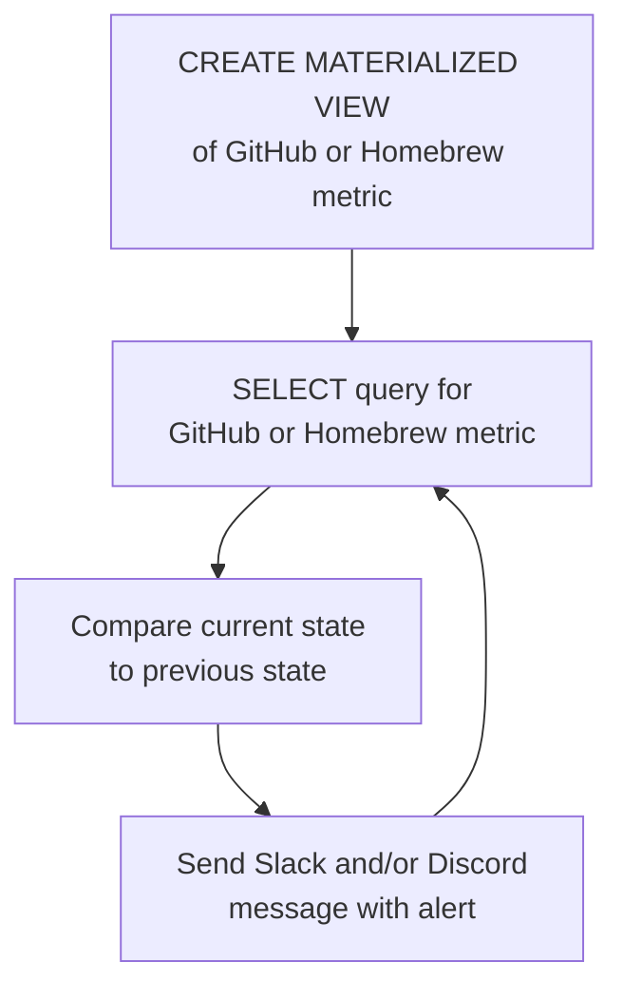

# Монитор активности проекта с открытым исходным кодом на базе StackQL

В этом руководстве мы покажем, как самостоятельно разместить систему мониторинга и оповещения в реальном времени для сопровождающих проектов с открытым исходным кодом на GitHub.  

> [__stackql__](https://github.com/stackql/stackql) - инструмент с открытым исходным кодом, который позволяет пользователям выполнять запросы к облачным ресурсам и ресурсам SaaS и взаимодействовать с ними с помощью языка SQL, а также библиотек и инструментов визуализации и анализа данных. Поставьте нам [⭐](https://github.com/stackql/stackql), если вам это нравится!

Получайте такие оповещения в Slack и Discord в реальном времени:


Проверено с <span class="tutorial_tested_on">встроенный SQL-бэкенд</span> <span class="tutorial_tested_on">docker</span> <span class="tutorial_tested_on">linux</span> 

## Обзор {#overview}

Когда я искал инструменты для мониторинга нашего проекта с открытым исходным кодом, оказалось, что большинство из них работают не так, как заявлено, или не работают вовсе (как сторонние приложения в GitHub), поэтому я создал собственный инструмент, который вы можете запустить и использовать для своего проекта с открытым исходным кодом на GitHub...  

Проект [__oss-activity-monitor__](https://github.com/stackql/oss-activity-monitor) использует [__stackql__](https://github.com/stackql/stackql) для мониторинга активности проекта с открытым исходным кодом в реальном времени, в том числе для уведомлений в реальном времени о следующих событиях:

- ⭐ новые stargazers репозитория GitHub
- 👀 новые watchers репозитория GitHub
- 🍴 новые форки репозитория GitHub
- 📊 новые issues репозитория GitHub
- 🙋 новые подписчики организации GitHub
- 📦 новые скачивания файлов выпусков GitHub
- 🍺 новые скачивания homebrew

## Как это работает {#how-it-works}

Проект развертывается в контейнере (с помощью `docker` или другой платформы развертывания контейнеров) и написан на `python` с использованием пакета [`pystackql`](https://pystackql.readthedocs.io/en/latest/intro.html) и провайдеров [`github`](https://github-provider.stackql.io/) и [`homebrew`](https://homebrew-provider.stackql.io/) для `stackql`.  Материализованные представления и инструкции `SELECT` используются для фиксации и сравнения состояния между текущими и предыдущими метриками отслеживаемых конечных точек GitHub и Homebrew, как показано на этой диаграмме:  


например, для такого материализованного представления, созданного и заполненного с помощью `stackql`:  

```sql
CREATE OR REPLACE MATERIALIZED VIEW mvw_github_repo_stargazers AS 
SELECT login FROM github.activity.repo_stargazers
WHERE owner = 'your-org' and repo = 'your-repo'
```

следующий запрос `stackql` периодически проверяет GitHub на наличие новых stargazers...

```sql
SELECT c.login
FROM github.activity.repo_stargazers c
LEFT JOIN mvw_github_repo_stargazers mvw
ON c.login = mvw.login
WHERE mvw.login IS NULL
AND c.owner = 'your-org' AND c.repo = 'your-repo'
```

затем состояние обновляется с помощью...

```sql
REFRESH MATERIALIZED VIEW mvw_github_repo_stargazers
```

аналогичная схема используется для watchers репозитория, issues, подписчиков организации, скачиваний файлов выпусков и скачиваний homebrew.

## Запуск проекта {#running-the-project}

Выполните следующие шаги, чтобы запустить проект локально или на предпочитаемой облачной платформе.  

### 1. Клонирование репозитория {#1-clone-the-repo}

```bash
git clone https://github.com/stackql/oss-activity-monitor.git
# or 
git clone git@github.com:stackql/oss-activity-monitor.git
```

### 2. Настройка переменных среды {#2-configure-environment-variables}

Для настройки проекта требуются следующие переменные среды (они передаются как переменные среды, в примере ниже - через файл `.env`):  

| Переменная                 | Описание                                                                          | Пример значения                                  |
|----------------------------|-----------------------------------------------------------------------------------|--------------------------------------------------|
| `LOG_LEVEL`                | Уровень журналирования (INFO для общих журналов; DEBUG для подробного журналирования) | INFO                                         |
| `SLEEP_INTERVAL`           | Задержка в секундах между циклами запросов                                        | 5                                                |
| `GITHUB_REPO`              | Имя репозитория GitHub                                                            | stackql                                          |
| `GITHUB_REPO_OWNER`        | Имя организации или владельца в GitHub                                            | stackql                                          |
| `HOMEBREW_FORMULA_NAME`    | Имя формулы Homebrew, если есть                                                   | stackql                                          |
| `STACKQL_GITHUB_USERNAME`  | Ваше имя пользователя GitHub                                                      | jeffreyaven                                      |
| `STACKQL_GITHUB_PASSWORD`  | Ваш персональный токен доступа GitHub                                             | ghp_yourpersonalaccesstoken                      |
| `SLACK_WEBHOOK_URL`        | URL-адрес веб-хука Slack для отправки уведомлений                                 | https://hooks.slack.com/services/...             |
| `DISCORD_WEBHOOK_URL`      | URL-адрес веб-хука Discord для отправки уведомлений                               | https://discord.com/api/webhooks/...             |

### 3. Сборка контейнера {#3-build-the-container}

```bash
docker build --no-cache -t oss-activity-monitor .
```

### 4. Запуск контейнера {#4-run-the-container}

```bash
docker run --env-file .env oss-activity-monitor
```

Готово!  Теперь вы будете получать оповещения в реальном времени при любой активности в вашем проекте с открытым исходным кодом.  Чтобы остановить контейнер, выполните:  

```bash
docker stop $(docker ps -a -q --filter ancestor=oss-activity-monitor)
```

Поставьте нам ⭐ на [__GitHub__](https://github.com/stackql/stackql)
