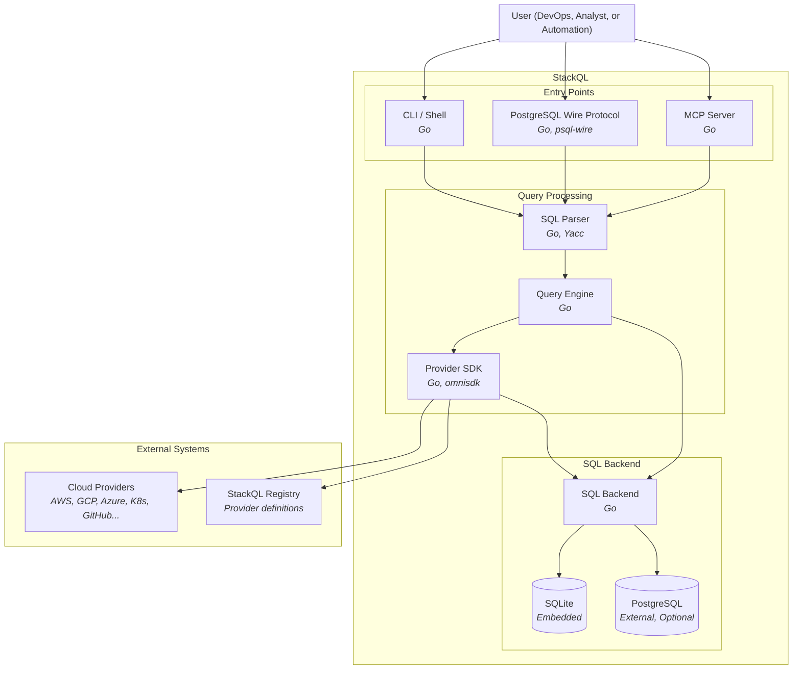

Див. також:
[[ Використання StackQL ]](/getting-started/using-stackql) [[ Використання змінних ]](/getting-started/variables) [[ Шаблонізація ]](/getting-started/templating)

## Огляд {#overview}

StackQL - це уніфікований інтерфейс SQL для виконання запитів до хмарної інфраструктури різних провайдерів і керування нею. Наведена нижче діаграма контейнерів показує основні компоненти системи StackQL та їхню взаємодію.

## Основні компоненти {#core-components}

### Точки входу {#entry-points}

StackQL підтримує кілька точок входу для виконання запитів SQL:

- **CLI / оболонка**: інтерактивна оболонка та інтерфейс командного рядка для виконання запитів SQL безпосередньо з термінала. Користувачі можуть виконувати разові запити, скрипти або використовувати інтерактивну оболонку для дослідження.

- **Мережевий протокол PostgreSQL**: дає змогу підключатися зі стандартних клієнтів PostgreSQL, таких як `psql`, DBeaver або будь-який інший інструмент, сумісний із PostgreSQL. Це забезпечує безпроблемну інтеграцію з наявними робочими процесами баз даних та інструментами BI.

- **Сервер MCP**: сервер Model Context Protocol, що забезпечує інтеграцію з асистентами ШІ і дає змогу великим мовним моделям виконувати запити до інфраструктури та керувати нею природною мовою.

### Конвеєр обробки запитів {#query-processing-pipeline}

1. **Синтаксичний аналізатор SQL**: аналізує вхідні дані SQL і перетворює їх на абстрактне синтаксичне дерево (AST) за допомогою власної граматики на основі Yacc. Синтаксичний аналізатор (його реалізовано як `stackql-parser`) перевіряє синтаксис SQL і готує запит до планування.

2. **Рушій запитів**: центральний рівень оркестрації, що планує та виконує запити. Він визначає, які операції можна передати на рівень API, а які потребують локальної обробки SQL. До завдань рушія запитів належать:
   - Планування й оптимізація запитів
   - Координація між викликами API та локальним виконанням SQL
   - Агрегування й перетворення результатів

### SDK провайдерів (omnisdk) {#provider-sdk-omnisdk}

SDK провайдерів, [omnisdk](https://github.com/stackql-labs/omnisdk), керує всією взаємодією з постачальниками хмарних послуг. Він замінив `any-sdk` у StackQL `v1.0`. До основних завдань належать:

- **Виявлення провайдерів**: отримує специфікації провайдерів зі StackQL Registry, що містить визначення на основі OpenAPI для кожного підтримуваного постачальника хмарних послуг, і за потреби перевіряє підпис ML-DSA-65 кожного документа перед його використанням.

- **Автентифікація**: виконує автентифікацію для кожного провайдера та підтримує різні способи автентифікації, зокрема ключі API, токени OAuth, облікові дані облікових записів служб тощо. Кожне визначення провайдера описує власні вимоги до автентифікації; сеанс може прив'язати той самий провайдер під кількома псевдонімами з окремими обліковими даними (див. [Сеанси провайдерів](/getting-started/provider-sessions)).

- **Планування графа**: планує кожну інструкцію як граф обмінів із провайдерами, з'єднаних ребрами даних і ребрами керування. З'єднання, підзапити, CTE та подання проходять через той самий планувальник, а запити до API, на які розгалужується план, виконуються одночасно в межах лімітів на кожен провайдер і на кожен хост.

- **Побудова запитів до API**: перетворює запити SQL на відповідні виклики REST API для кожного провайдера, зокрема формує кінцеві точки, зіставляє параметри та форматує запити.

- **Розбиття на сторінки**: автоматично обробляє відповіді API, розбиті на сторінки, і приховує складність різних схем розбиття на сторінки, які використовують різні провайдери (токени наступної сторінки, номери сторінок, посилання на наступну сторінку, заголовки `Link` і курсори GraphQL).

- **Передавання предикатів (predicate pushdown)**: передає умови, що відповідають параметрам запиту до API, а також `LIMIT`, коли впорядкування не потрібне, у запити до провайдера, щоб зменшити кількість запитів і обсяг переданих даних.

- **Перетворення відповідей**: перетворює відповіді API на рядки в міру їх надходження для проміжного зберігання в бекенді SQL або потокової передачі клієнтові.

Підключення SQL, проміжне зберігання та виконання в бекенді залишаються в StackQL. omnisdk не містить проміжного зберігання SQL і ніколи не отримує підключення до бази даних; StackQL передає йому дескриптори відношень і отримує курсори рядків.

### Бекенд SQL {#sql-backend}

Бекенд SQL виконує реляційні операції над матеріалізованими даними API:

- **SQLite**: вбудована база даних для тимчасового зберігання таблиць і реляційної обробки. Ідеально підходить для разових запитів і менших наборів даних.

- **PostgreSQL**: необов'язкова зовнішня база даних для постійного зберігання, більших наборів даних і складних аналітичних навантажень.

Бекенд SQL виконує такі операції:
- Операції JOIN між кількома провайдерами або ресурсами
- Агрегатні функції (COUNT, SUM, AVG тощо)
- Сортування й фільтрування матеріалізованих даних
- Складні вирази SQL і підзапити

## Зовнішні системи {#external-systems}

### Постачальники хмарних послуг {#cloud-providers}

StackQL підключається до постачальників хмарних послуг (AWS, GCP, Azure, Kubernetes, GitHub та багатьох інших) через їхні REST API. Увесь обмін даними відбувається через HTTPS, а SDK провайдерів враховує особливості угод API кожного постачальника.

### StackQL Registry {#stackql-registry}

StackQL Registry містить визначення провайдерів - специфікації на основі OpenAPI, що описують доступні ресурси, методи та їх зіставлення. Провайдери мають версії, і їх можна завантажити на вимогу за допомогою інструкції `REGISTRY PULL`.

## Процес виконання запиту {#query-execution-flow}

1. Користувач надсилає запит SQL через одну з точок входу (CLI, протокол PostgreSQL або MCP)
2. Синтаксичний аналізатор SQL перевіряє запит і перетворює його на AST
3. Рушій запитів аналізує AST і створює план виконання
4. Для операцій із провайдерами SDK провайдерів:
   - Отримує відповідну специфікацію провайдера з реєстру (якщо її немає в кеші)
   - Проходить автентифікацію в постачальника хмарних послуг
   - Формує та виконує запити до API, автоматично обробляючи розбиття на сторінки
   - Передає предикати в API, де це можливо
   - Матеріалізує результати в бекенді SQL
5. Бекенд SQL виконує решту реляційних операцій
6. Результати повертаються користувачеві в запитаному форматі
