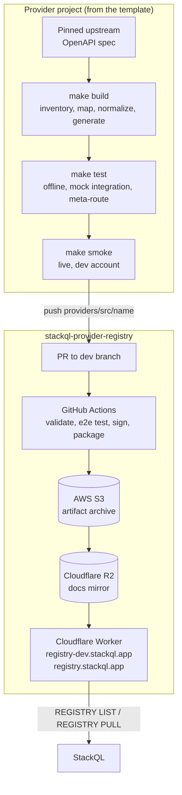

Див. також:
[[ StackQL Provider Registry ]](/providers) [[ Використання провайдера ]](/getting-started/using-a-provider) [[ REGISTRY ]](/language-spec/registry) [[ Архітектура ]](/developers/architecture)

## Огляд {#overview}

Провайдер StackQL - це версійований набір документів OpenAPI з розширеннями `x-stackQL-*`, які рушій [omnisdk](https://github.com/stackql-labs/omnisdk) перетворює на таблиці SQL: `SELECT` для читання, `INSERT`, `UPDATE`, `REPLACE` і `DELETE` для операцій життєвого циклу та `EXEC` для дій. Документи провайдера повідомляють StackQL, що вміє робити API провайдера і як викликати його із семантикою SQL. Це звичайний YAML, тож провайдер можна збирати, тестувати й версіонувати, як будь-який інший код.

Екосистему провайдерів становлять три репозиторії та один рівень розповсюдження:

| Компонент | Роль |
| --- | --- |
| [__`stackql-provider-TEMPLATE`__](https://github.com/stackql-registry/stackql-provider-TEMPLATE) | Відправна точка для нового проєкту провайдера: детермінований конвеєр `make` від закріпленої специфікації upstream до згенерованого провайдера, рівні тестів без облікових даних, набір smoke test із реальним API, мікросайт документації та CI. Містить skill Claude Code для розробки провайдерів. |
| [__`omnisdk`__](https://github.com/stackql-labs/omnisdk) | Рушій, що читає документи провайдерів і виконує запити до API, починаючи з StackQL `v1.0`. Його попередник, [`any-sdk`](https://github.com/stackql/any-sdk), досі містить довідку щодо контракту документа провайдера, розширень `x-stackQL-*`, автентифікації, розбиття на сторінки, перетворень і передавання предикатів, а також схеми JSON, посилання на які наведено нижче. |
| [__`stackql-provider-registry`__](https://github.com/stackql/stackql-provider-registry) | Джерело істини для опублікованих провайдерів. Документи зберігаються з версіями в `providers/src/<provider>/<version>/`, після чого GitHub Actions підписує, пакує та публікує їх. |
| __Рівень розповсюдження Cloudflare__ | Cloudflare Worker роздає запаковані артефакти провайдерів із Cloudflare R2 на периферії мережі за адресами `registry.stackql.app` (робоче середовище) і `registry-dev.stackql.app` (середовище розробки). Саме до нього звертаються `REGISTRY LIST` і `REGISTRY PULL`. |
<br/>
Наведена нижче діаграма показує шлях від проєкту провайдера до встановленого екземпляра StackQL:



## Структура документів провайдера {#provider-document-structure}

Об'єкти StackQL дотримуються ієрархії `provider.service.resource.method`, наприклад `google.compute.instances.list`. Документи відображають цю ієрархію:

```
provider.yaml                          # provider metadata, providerServices, provider-level config
services/
  <service>.yaml                       # an OpenAPI 3 document per service, plus
    components.x-stackQL-resources
      <resource>                       # id, name, methods, sqlVerbs, optional config
        methods.<method>               # operation $ref, response, request, optional config
```

- __Документ провайдера__ (`provider.yaml`): `id`, `name`, `title`, `version`, `providerServices` (кожен із `service.$ref` на свій документ сервісу та необов'язковим прапорцем `preferred`), необов'язкові `description`, `protocolType` (за замовчуванням `http`) і `config`.
- __Документ сервісу__: стандартний документ OpenAPI 3. Єдине обов'язкове доповнення - `components.x-stackQL-resources`, що оголошує ресурси, доступні як таблиці.
- __Ресурс__: `id`, `name`, `methods` і `sqlVerbs`. Кожен ресурс - це таблиця; її стовпці беруться зі схеми відповіді основного методу `select`.
- __Метод__: `operation`, що є вказівником JSON на `paths` (наприклад, `$ref: '#/paths/~1orgs~1{org}~1repos/get'`), блок `response` (`mediaType`, `openAPIDocKey`, `objectKey`), що повідомляє рушію, де розташовано рядки, а також необов'язкові блок `request` і `config`.
- __Зіставлення дієслів SQL__: `sqlVerbs.select`, `insert`, `update`, `replace` і `delete` - це впорядковані списки посилань на методи. StackQL розглядає методи зі списку, усі обов'язкові параметри яких надає речення `WHERE`, і вибирає той, що має найбільше обов'язкових параметрів, незалежно від порядку в списку: запит, що надає ідентифікатор, потрібний методу `get`, спрямовується до `get`, запит без нього - до `list`, а якщо два методи рівноцінні, StackQL повідомляє про помилку, а не вибирає між ними. Будь-який метод, на який немає посилання в жодному списку дієслів, можна викликати через `EXEC`.

Мінімальний ресурс має такий вигляд:

```yaml
components:
  x-stackQL-resources:
    repos:
      id: github.repos.repos
      name: repos
      title: Repos
      methods:
        list_for_org:
          operation:
            $ref: '#/paths/~1orgs~1{org}~1repos/get'
          response:
            mediaType: application/json
            openAPIDocKey: '200'
        create_in_org:
          operation:
            $ref: '#/paths/~1orgs~1{org}~1repos/post'
          response:
            mediaType: application/json
            openAPIDocKey: '201'
          config:
            requestBodyTranslate:
              algorithm: naive
      sqlVerbs:
        select:
          - $ref: '#/components/x-stackQL-resources/repos/methods/list_for_org'
        insert:
          - $ref: '#/components/x-stackQL-resources/repos/methods/create_in_org'
```

Повний контракт, зокрема кожен ключ і його призначення, описано в [специфікації провайдера](https://github.com/stackql/any-sdk/blob/main/docs/provider_spec.md) в any-sdk. Схеми JSON для `provider.yaml`, документів сервісів і блоку конфігурації розташовано в [`any-sdk/cicd/schema-definitions`](https://github.com/stackql/any-sdk/tree/main/cicd/schema-definitions); схема конфігурації відхиляє невідомі ключі, тож ключ з помилкою в назві не проходить перевірку, а не ігнорується мовчки.

### Розширення OpenAPI {#openapi-extensions}

| Розширення | Де | Призначення |
| --- | --- | --- |
| `x-stackQL-resources` | `components` | Словник ресурсів документа сервісу (обов'язковий) |
| `x-stackQL-config` | сервіс, ресурс, метод або операція | Блок конфігурації (див. нижче), що застосовується на цьому рівні |
| `x-stackQL-envVar` | змінна сервера | Вказує змінну середовища, що надає значення змінної сервера, коли його не вказано в реченні `WHERE`. Використовується, щоб обмежити область API тенантом, організацією, проєктом або розгортанням |
| `x-stackQL-alias` | параметр або властивість схеми | Альтернативне ім'я, яке SQL приймає замість імені на рівні протоколу |
| `x-stackQL-stringOnly` | властивість схеми | Серіалізує властивість як рядкове значення незалежно від її оголошеного типу |
| `x-stackQL-graphQL` | операція | Реалізує метод через запит GraphQL, коли в REST API немає потрібних даних |
| `x-alwaysRequired` | параметр | Позначає параметр як завжди обов'язковий |
| `x-protocol` | `info` | Підказка щодо мережевого протоколу (`query`, `ec2`, `rest-xml`) для обробки відповідей XML на основі схеми |

### Блок конфігурації {#the-config-block}

Ключ `config` у файлі `provider.yaml` і розширення `x-stackQL-config` у документах сервісів мають спільну схему. Допустимі ключі: `auth`, `pagination`, `queryParamPushdown`, `queryParamTranspose`, `requestTranslate`, `requestBodyTranslate`, `variations`, `views`, `sqlExternalTables`, `retry`, `minStackQLVersion` і `snake_case_aliases`. Конфігурація визначається від найконкретнішого рівня назовні, метод -> ресурс -> сервіс -> сервіс провайдера -> провайдер, тож значення за замовчуванням для всього провайдера можна перевизначити для окремого ресурсу або методу.

## Що забезпечують провайдери {#what-providers-handle}

Провайдери беруть на себе завдання, які приховують складність API, тож користувачі отримують узгоджений інтерфейс SQL і не мусять керувати обміном HTTP на нижньому рівні.

### Автентифікація {#authentication}

Кожен провайдер містить блок `auth` за замовчуванням, що вказує змінні середовища з його обліковими даними, тож у заповненому середовищі конфігурація автентифікації під час виконання не потрібна. У документі провайдера допускаються лише непрямі посилання (імена змінних середовища, шляхи до файлів); буквальні значення облікових даних можна передавати виключно в контексті `--auth` під час виконання. Імена змінних середовища мають відповідати провайдеру Terraform від постачальника, якщо такий існує.

| `auth.type` | Типові поля |
| --- | --- |
| `bearer` | `credentialsenvvar` |
| `api_key` | `credentialsenvvar`, `valuePrefix`, необов'язкові `location` (`header` або `query`) і `name` |
| `basic` | `username_var`, `password_var` |
| `custom` | `location`, `name`, `credentialsenvvar`, необов'язковий `valuePrefix`; другі облікові дані додаються ланцюжком через `successor` |
| `oauth2` | `client_id_env_var`, `client_secret_env_var`, `grant_type: client_credentials`, `token_url`, `scopes` |
| `service_account` | `credentialsenvvar` або `credentialsfilepathenvvar`, `scopes` |
| `aws_signing_v4`, `aws_assume_role` | `keyIDenvvar`, `credentialsenvvar` |
| `azure_default` | немає |
| `oci_signing_v1` | `tenancy_ocid_envvar`, `user_ocid_envvar`, `oci_fingerprint_envvar`, `oci_private_key_envvar`, `oci_region_envvar` |
| `interactive` | немає |
| `null_auth` | немає (явно без автентифікації) |
<br/>
Наприклад:

```yaml
config:
  auth:
    type: api_key
    credentialsenvvar: OKTA_API_TOKEN
    valuePrefix: 'SSWS '
```

Користувачі можуть перевизначити автентифікацію провайдера під час виконання за допомогою `--auth='{"<provider>": {...}}'`.

### Розбиття на сторінки {#pagination}

Провайдери оголошують схему розбиття на сторінки, яку використовує постачальник, а рушій проходить усі сторінки, тож користувачі отримують повні набори результатів. Підтримувані схеми:

- __Токен або курсор у тілі__: `requestToken: {key: cursor, location: query}`, `responseToken: {key: $.cursor, location: body}`; обхід зупиняється, коли токен відсутній або порожній.
- __URL наступної сторінки в тілі__: `requestToken: {key: '', location: request}`, `responseToken: {key: $.next, location: body}`; `algorithm: odata_next_link` для OData `@odata.nextLink`.
- __Заголовок `Link` за RFC 5988__: `responseToken: {key: Link, location: header}`.
- __Номер сторінки з кількістю сторінок__: `algorithm: page_number` з `responseToken` (поточна сторінка) і `responseTerminator` (загальна кількість сторінок).

API зі зсувом і лімітом без маркера наступної сторінки не є схемою розбиття на сторінки; натомість надайте `offset` і `limit` як параметри `WHERE`. Глобальний прапорець `--http.response.pageLimit` обмежує обхід сторінок.

### Передавання предикатів {#predicate-pushdown}

Ключі `WHERE` зіставляються з оголошеними параметрами операції за іменем (спочатку параметри шляху, потім параметри запиту, заголовка й cookie) і надсилаються в API, тож фільтрування відбувається на джерелі. Будь-який ключ `WHERE`, що залишився без відповідного параметра, додається як параметр запиту.

Крім звичайних параметрів, `queryParamPushdown` перетворює стовпці `SELECT`, `WHERE`, `ORDER BY`, `LIMIT`, `OFFSET` і `COUNT` на параметри API. `dialect: odata` заповнює значення за замовчуванням `$select`, `$filter`, `$orderby`, `$top`, `$skip` і `$count`, які використовують Microsoft Graph та API у стилі Azure; `dialect: custom` використовує `paramName` дослівно, найчастіше `top: {paramName: limit, maxValue: 1000}`, щоб `LIMIT n` перетворювався на `?limit=n`. Предикати, які неможливо передати, однаково обчислюються на боці клієнта.

### Перетворення відповідей і запитів {#response-and-request-transformation}

- `response.objectKey` - це вираз JSONPath (або XPath для API на XML), що вибирає з конверта відповіді елементи, які містять рядки, наприклад `$.data[*]` або `$.value`.
- `response.transform` застосовує текстовий шаблон Go до тіла відповіді, перш ніж його буде збережено як рядки; типи перетворень охоплюють JSON, XML і звичайний текст, і саме так API AWS на XML і вивід CLI стають таблицями.
- `requestBodyTranslate: {algorithm: naive}` дає змогу інструкції `INSERT` приймати поля тіла запиту як звичайні імена стовпців, а не у формі з префіксом `data__`.
- `snake_case_aliases: true` на рівні провайдера надає імена протоколу в camelCase як стовпці й параметри в snake_case.
- `retry` встановлює політику повторних спроб з експоненційною затримкою (`max_attempts`, `initial_delay_ms`, `max_delay_ms`, `multiplier`, `jitter_fraction`, `retryable_methods`, `retryable_conditions.status_codes`). Діє перший рівень, на якому її оголошено; див. [політику повторних спроб](https://github.com/stackql/any-sdk/blob/main/docs/retry_policy.md) в any-sdk.

Типи стовпців відповідають схемі OpenAPI: `string` -> text, `integer` -> integer, `number` -> numeric, `boolean` -> boolean. Властивості `object` і `array` зберігаються як текст JSON, тому вкладені поля в запитах читають за допомогою `json_extract`, і тому провайдери часто постачають подання (`config.views` з `ddl` для кожного діалекту та `fallback`) для поширених вкладених проєкцій.

### Провайдери без HTTP {#non-http-providers}

`protocolType: local_templated` у файлі `provider.yaml` реалізує провайдер на основі локальних команд замість HTTP: методи містять масив `inline` із фрагментами argv у вигляді шаблонів Go, параметри використовують `in: inline`, а `response.transform` перетворює вивід команди на рядки. Еталонний провайдер [`local_openssl`](https://github.com/stackql/any-sdk/tree/main/test/registry/src/local_openssl/v0.1.0) в any-sdk демонструє цю структуру. Конвеєр шаблону, призначений для API HTTP, цього не охоплює.

## Створення проєкту провайдера {#starting-a-provider-project}

Починайте кожен новий провайдер із [__`stackql-provider-TEMPLATE`__](https://github.com/stackql-registry/stackql-provider-TEMPLATE). Це шаблонний репозиторій GitHub, що втілює поточний стандарт провайдера: закріплену специфікацію upstream, детермінований конвеєр збірки, у якому кожне ручне рішення є правилом у скрипті, а не ручним редагуванням згенерованого YAML, три рівні тестів без облікових даних, набір smoke test із реальним API з обмеженим бюджетом, сайт документації на Docusaurus та CI. Опубліковані провайдери, зібрані в такий спосіб, розміщено в організації GitHub [stackql-registry](https://github.com/orgs/stackql-registry/repositories); вони є корисним довідковим матеріалом поряд із шаблоном.

Передумови: Node.js 20 або новіший, GNU make і bash (Linux, macOS або WSL), Python 3 для набору smoke test і двійковий файл `stackql` (`bin/start-server.sh` завантажує його, якщо його не знайдено).

1. Створіть репозиторій із шаблону (GitHub "Use this template") і виконайте `npm install`.
2. Виконайте `bin/init-provider.sh <name> "<Title>" [https://api.vendor.com]`, щоб замінити заповнювачі в усьому репозиторії.
3. Заповніть константи у файлі `provider-dev/scripts/lib/spec_helpers.mjs` (URL специфікації, префікс версії в шляху, префікс області для API з областю тенанта або проєкту) і конфігурацію в `provider-dev/config/` (`servers.json`, `provider_config.json`, `service_names.json`).
4. Пройдіть конвеєр вручну через цілі `make` або відкрийте сеанс Claude Code у репозиторії (див. нижче).
5. `grep -rn "TODO(template)"` виводить список того, що ще не зроблено.

Конвеєром керує `make` (`make help` виводить список усіх цілей):

```bash
make fetch-spec        # verify the upstream spec against the recorded pin (fails on drift)
make inventory         # one CSV row per operation with the proposed service, resource, method and verb
make split             # write provider-dev/source/<service>.yaml from the ordered path rules
make mappings-report   # print every derived operation -> resource.method mapping without writing
make mappings          # regenerate provider-dev/config/all_services.csv and validate it
make normalize         # flatten allOf, lower oneOf/anyOf, wrap bare arrays
make generate          # generate provider.yaml + services/*.yaml, then post-process and merge GraphQL/views
make test              # offline SHOW/DESCRIBE, mock API integration tests, meta-route walk (no credentials)
make smoke             # live smoke suite against a dedicated dev account (sources .env)
make docs              # generate the provider documentation site content
make all               # everything above except the live suites
```

Усередині конвеєр використовує [__`@stackql/provider-utils`__](https://github.com/stackql-registry/stackql-provider-utils) (`split`, `normalize`, `analyze`, `generate` і `docgen`) із правилами для конкретного провайдера в `provider-dev/scripts/`. Згенерований провайдер потрапляє до `provider-dev/openapi/src/<name>/v00.00.00000/` - саме цей каталог зрештою публікується в реєстрі.

Файл `provider-dev/config/all_services.csv` - це зафіксований у коміті контракт зіставлення кожної операції з ресурсом і методом. Різниця після повторної генерації - це привід для перевірки на несумісні зміни, а не шум. CI завершується помилкою в разі дрейфу генерації, не зафіксованого в коміті, тож повторна генерація має відтворювати зафіксовані артефакти байт у байт.

Для наявного репозиторію провайдера, створеного до появи шаблону, скопіюйте в нього каталог `.claude/skills` і почніть із файлу `references/uplift-checklist.md` цього skill.

### Використання Claude Code для розробки провайдерів {#using-claude-code-for-provider-development}

Шаблон містить [__skill StackQL Provider Development__](https://github.com/stackql-registry/stackql-provider-TEMPLATE/blob/main/.claude/skills/stackql-provider-development/SKILL.md) для [Claude Code](https://docs.anthropic.com/en/docs/claude-code). Відкрийте сеанс Claude Code у репозиторії, створеному із шаблону, і попросіть його зібрати провайдер; Claude Code підхоплює `CLAUDE.md` і skill та виконує кроки послідовно. Skill також є письмовою процедурою для виконання цієї роботи вручну.

Skill охоплює такі теми:

- Вибір архетипу: документ OpenAPI, Swagger або discovery, опублікований постачальником (direct), чи специфікація, похідна від SDK постачальника, коли SDK є джерелом істини (derived)
- Отримання, виправлення, перевірка коректності й закріплення специфікації upstream, щоб кожне оновлення було різницею, яку можна переглянути
- Інвентаризація кінцевих точок, розподіл на сервіси та правила зіставлення, з яких утворюється `all_services.csv`
- Кожен примітив документа провайдера і коли його використовувати: обмеження області через `x-stackQL-envVar`, `objectKey`, перетворення запитів і відповідей, розбиття на сторінки, передавання параметрів запиту (pushdown), методи `EXEC` для життєвого циклу, злиття GraphQL і подання провайдера
- Три рівні тестів без облікових даних і набір smoke test із реальним API
- Сайт документації, робочі процеси CI та нотатки для передавання проєкту

Каталог `references/` цього skill містить подробиці щодо кожного кроку, а `scripts/find_extension_examples.sh` виводить YAML, що вже постачається у провайдерах, для будь-якого ключа розширення з клону реєстру провайдерів, тож примітив можна побачити в дії, перш ніж його писати.

## Локальне тестування провайдера {#testing-a-provider-locally}

StackQL читає провайдери з реєстру, описаного глобальним прапорцем `--registry`. Під час розробки вкажіть йому каталог згенерованого провайдера в локальній файловій системі з вимкненою перевіркою підписів (документи підписуються лише під час публікації):

```bash
export LOCAL_REG='{ "url": "file:///path/to/provider-dev/openapi", "localDocRoot": "/path/to/provider-dev/openapi", "verifyConfig": { "nopVerify": true } }'
stackql --registry="${LOCAL_REG}" shell
```

Каталог, указаний у `localDocRoot`, має містити `src/<provider>/<version>/provider.yaml` і `src/<provider>/<version>/services/*.yaml` - саме це й генерує шаблон. В оболонці інструкції `SHOW SERVICES IN <provider>`, `SHOW RESOURCES IN <provider>.<service>`, `SHOW METHODS IN <provider>.<service>.<resource>` і `DESCRIBE EXTENDED <provider>.<service>.<resource>` дають змогу перевірити поверхню провайдера до виконання будь-якого запиту. Файл шаблону `tests/offline_validation.mjs` автоматизує ці перевірки, а `npm run probe -- "SELECT ..."` виконує разовий SQL до імітаційного API і виводить виклики на рівні протоколу.

Провайдери, завантажені з віддаленого реєстру, за замовчуванням кешуються в `<cwd>/.stackql`; щоб змінити розташування, використовуйте прапорець `--approot`.

[CLI any-sdk](https://github.com/stackql/any-sdk/blob/main/docs/cli.md) зручний для перевірки документа без участі StackQL: `anysdk aot <registry> <provider.yaml>` виконує статичний аналіз провайдера (`objectKey`, для якого неможливо визначити маршрут, відсутні схеми відповідей, неповне розбиття на сторінки, суміжні параметри шляху тощо), а `anysdk query` виконує окремий метод безпосередньо з документів провайдера й сервісу. [Тестування Automock](https://github.com/stackql/any-sdk/blob/main/docs/automock_testing.md) генерує імітаційний API та очікувані результати зі схем провайдера для повного циклу без звернення до реального API.

### Тестування провайдера за допомогою реєстру `dev` {#testing-your-provider-using-the-dev-registry}

Після злиття провайдера в гілку `dev` реєстру він стає доступним у реєстрі розробки. Вкажіть StackQL цей реєстр, щоб перевірити опублікований артефакт:

```bash
export DEV_REG='{ "url": "https://registry-dev.stackql.app/providers" }'
stackql --registry="${DEV_REG}" shell
```

```sql
REGISTRY PULL myprovider;
```

Ціль шаблону `make smoke-live` запускає набір smoke test для опублікованого провайдера, щоб перевірити його після публікації.

## Публікація провайдера {#publishing-a-provider}

Публікація - це окремий крок за участю людини, який не входить до конвеєра шаблону.

1. Створіть форк [stackql-provider-registry](https://github.com/stackql/stackql-provider-registry) і скопіюйте згенерований каталог `provider-dev/openapi/src/<name>` до `providers/src/<name>` в окремій робочій гілці (feature branch).
2. Створіть pull request до гілки `dev` з описом провайдера та змін (див. [посібник для учасників](https://github.com/stackql/stackql-provider-registry/blob/main/.github/CONTRIBUTING.md) реєстру).
3. GitHub Actions перевіряє коректність і тестує провайдер за допомогою [stackql-provider-tests](https://github.com/stackql/stackql-provider-tests). Перевіряються такі правила: документ має бути допустимою специфікацією OpenAPI, для всіх сервісів має бути можливо перелічити ресурси, для всіх ресурсів - методи, методи, які можна викликати через `SELECT`, повинні мати допустиму схему відповіді, а методи, які можна викликати через `INSERT`, - допустиму схему запиту.
4. Після злиття робочий процес виділяє версію, підписує документи (ML-DSA-65), пакує їх і публікує артефакт в архіві AWS S3. Потім дерево документів віддзеркалюється в Cloudflare R2, і розгортається Cloudflare Worker, що обслуговує `registry-dev.stackql.app`. Провайдер одразу стає доступним для екземплярів StackQL, налаштованих на використання реєстру `dev`.
5. Після періоду моніторингу гілку `dev` просувають до `main`, і публікація повторюється для `registry.stackql.app`. Це публікація для екземплярів StackQL з конфігурацією за замовчуванням.

Той самий harness `stackql-provider-tests` можна запустити локально для каталогу реєстру, перш ніж створювати PR:

```bash
test-provider.sh <provider_name> false /path/to/provider-dev/openapi
```

Докладний опис робочого процесу, зокрема запобіжника від видалення провайдерів, що захищає `providers/src`, див. у документі [збірка та розгортання](https://github.com/stackql/stackql-provider-registry/blob/main/docs/build-and-deployment.md) в репозиторії реєстру.
