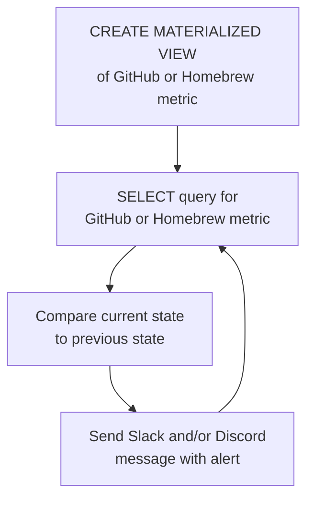

# Монітор активності проєкту з відкритим кодом на базі StackQL

У цьому посібнику ми покажемо, як самостійно розмістити систему моніторингу та оповіщень у реальному часі для супровідників програмного забезпечення з відкритим кодом на GitHub.  

> [__stackql__](https://github.com/stackql/stackql) - це інструмент із відкритим кодом, що дає змогу користувачам виконувати запити до хмарних ресурсів і ресурсів SaaS та взаємодіяти з ними за допомогою мови SQL, а також бібліотек та інструментів візуалізації й аналізу даних. Поставте нам [⭐](https://github.com/stackql/stackql), якщо вам це подобається!

Отримуйте такі оповіщення в Slack і Discord у реальному часі:


Перевірено з <span class="tutorial_tested_on">вбудований бекенд SQL</span> <span class="tutorial_tested_on">docker</span> <span class="tutorial_tested_on">linux</span> 

## Огляд {#overview}

Коли я шукав інструменти для моніторингу нашого проєкту з відкритим кодом, то виявив, що більшість із них працює не так, як заявлено, або не працює взагалі (як у випадку зі сторонніми застосунками в GitHub), тож я створив власний, який ви можете запустити й використовувати для свого проєкту з відкритим кодом на GitHub...  

Проєкт [__oss-activity-monitor__](https://github.com/stackql/oss-activity-monitor) використовує [__stackql__](https://github.com/stackql/stackql) для моніторингу активності проєкту з відкритим кодом у реальному часі, зокрема для сповіщень у реальному часі про:

- ⭐ нових stargazers репозиторію GitHub
- 👀 нових watchers репозиторію GitHub
- 🍴 нові форки репозиторію GitHub
- 📊 нові issues репозиторію GitHub
- 🙋 нових підписників організації GitHub
- 📦 нові завантаження файлів випусків GitHub
- 🍺 нові завантаження з homebrew

## Як це працює {#how-it-works}

Проєкт розгортається в контейнері (за допомогою `docker` або іншої платформи розгортання контейнерів), його створено мовою `python` з використанням пакета [`pystackql`](https://pystackql.readthedocs.io/en/latest/intro.html) і провайдерів [`github`](https://github-provider.stackql.io/) та [`homebrew`](https://homebrew-provider.stackql.io/) для `stackql`.  Матеріалізовані подання й інструкції `SELECT` використано для фіксації та порівняння стану між поточними й попередніми метриками для відстежуваних кінцевих точок GitHub і Homebrew; це показано на діаграмі:  


наприклад, маючи таке матеріалізоване подання, створене й заповнене за допомогою `stackql`:  

```sql
CREATE OR REPLACE MATERIALIZED VIEW mvw_github_repo_stargazers AS 
SELECT login FROM github.activity.repo_stargazers
WHERE owner = 'your-org' and repo = 'your-repo'
```

наступний запит `stackql` опитує GitHub щодо нових stargazers...

```sql
SELECT c.login
FROM github.activity.repo_stargazers c
LEFT JOIN mvw_github_repo_stargazers mvw
ON c.login = mvw.login
WHERE mvw.login IS NULL
AND c.owner = 'your-org' AND c.repo = 'your-repo'
```

потім стан оновлюють за допомогою...

```sql
REFRESH MATERIALIZED VIEW mvw_github_repo_stargazers
```

аналогічні схеми застосовано для watchers репозиторію, issues, підписників організації, завантажень файлів випусків і завантажень з homebrew.

## Запуск проєкту {#running-the-project}

Виконайте наведені нижче кроки, щоб запустити проєкт локально або на вибраній вами хмарній платформі.  

### 1. Клонування репозиторію {#1-clone-the-repo}

```bash
git clone https://github.com/stackql/oss-activity-monitor.git
# or 
git clone git@github.com:stackql/oss-activity-monitor.git
```

### 2. Налаштування змінних середовища {#2-configure-environment-variables}

Для налаштування проєкту потрібні такі змінні середовища (їх передають як змінні середовища, у прикладі нижче - через файл `.env`):  

| Змінна                     | Опис                                                                              | Приклад значення                                 |
|----------------------------|-----------------------------------------------------------------------------------|--------------------------------------------------|
| `LOG_LEVEL`                | Рівень журналювання (INFO для загальних журналів; DEBUG для докладного журналювання) | INFO                                          |
| `SLEEP_INTERVAL`           | Затримка в секундах між циклами запитів                                           | 5                                                |
| `GITHUB_REPO`              | Назва репозиторію GitHub                                                          | stackql                                          |
| `GITHUB_REPO_OWNER`        | Назва організації або ім'я власника в GitHub                                      | stackql                                          |
| `HOMEBREW_FORMULA_NAME`    | Назва формули Homebrew, якщо є                                                    | stackql                                          |
| `STACKQL_GITHUB_USERNAME`  | Ваше ім'я користувача GitHub                                                      | jeffreyaven                                      |
| `STACKQL_GITHUB_PASSWORD`  | Ваш персональний токен доступу GitHub                                             | ghp_yourpersonalaccesstoken                      |
| `SLACK_WEBHOOK_URL`        | URL вебхука Slack для надсилання сповіщень                                        | https://hooks.slack.com/services/...             |
| `DISCORD_WEBHOOK_URL`      | URL вебхука Discord для надсилання сповіщень                                      | https://discord.com/api/webhooks/...             |

### 3. Збирання контейнера {#3-build-the-container}

```bash
docker build --no-cache -t oss-activity-monitor .
```

### 4. Запуск контейнера {#4-run-the-container}

```bash
docker run --env-file .env oss-activity-monitor
```

От і все!  Тепер ви отримуватимете оповіщення в реальному часі, коли у вашому проєкті з відкритим кодом з'являтиметься активність.  Щоб зупинити контейнер, скористайтеся командою:  

```bash
docker stop $(docker ps -a -q --filter ancestor=oss-activity-monitor)
```

Поставте нам ⭐ на [__GitHub__](https://github.com/stackql/stackql)
