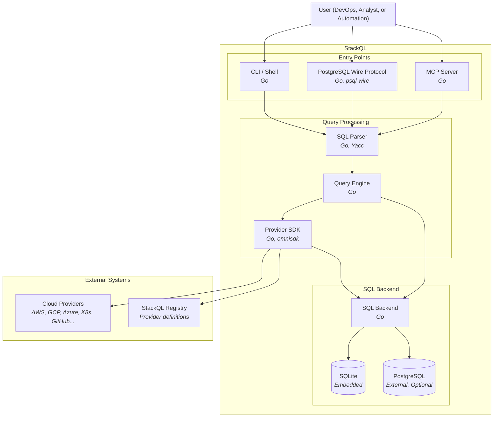

Xem thêm:
[[ Sử dụng StackQL ]](/getting-started/using-stackql) [[ Sử dụng biến ]](/getting-started/variables) [[ Sử dụng template ]](/getting-started/templating)

## Tổng quan {#overview}

StackQL là một giao diện SQL hợp nhất để truy vấn và quản lý hạ tầng đám mây trên nhiều provider. Sơ đồ container sau minh họa các thành phần chính của hệ thống StackQL và cách chúng tương tác với nhau.

## Thành phần cốt lõi {#core-components}

### Điểm vào {#entry-points}

StackQL hỗ trợ nhiều điểm vào để thực thi truy vấn SQL:

- **CLI / Shell**: Shell tương tác và giao diện dòng lệnh để thực thi truy vấn SQL trực tiếp từ terminal. Người dùng có thể chạy truy vấn ad-hoc, tập lệnh hoặc dùng shell tương tác để khám phá.

- **Giao thức wire của PostgreSQL**: Cho phép kết nối từ các ứng dụng khách PostgreSQL tiêu chuẩn như `psql`, DBeaver hoặc bất kỳ công cụ nào khác tương thích với PostgreSQL. Điều này giúp tích hợp liền mạch với các workflow cơ sở dữ liệu và công cụ BI hiện có.

- **Máy chủ MCP**: Một máy chủ Model Context Protocol cho phép tích hợp trợ lý AI, giúp các mô hình ngôn ngữ lớn truy vấn và quản lý hạ tầng bằng ngôn ngữ tự nhiên.

### Pipeline xử lý truy vấn {#query-processing-pipeline}

1. **Trình phân tích cú pháp SQL**: Phân tích cú pháp đầu vào SQL thành cây cú pháp trừu tượng (AST) bằng một ngữ pháp tùy chỉnh dựa trên Yacc. Trình phân tích cú pháp (được hiện thực trong `stackql-parser`) kiểm tra tính hợp lệ của cú pháp SQL và chuẩn bị cho việc lập kế hoạch truy vấn.

2. **Công cụ truy vấn**: Lớp điều phối trung tâm, lập kế hoạch và thực thi truy vấn. Công cụ này xác định những thao tác nào có thể được đẩy xuống lớp API và những thao tác nào cần xử lý SQL cục bộ. Công cụ truy vấn xử lý:
   - Lập kế hoạch và tối ưu hóa truy vấn
   - Điều phối giữa các lệnh gọi API và việc thực thi SQL cục bộ
   - Tổng hợp và biến đổi kết quả

### SDK provider (omnisdk) {#provider-sdk-omnisdk}

SDK provider, [omnisdk](https://github.com/stackql-labs/omnisdk), quản lý mọi tương tác với các nhà cung cấp đám mây. SDK này đã thay thế `any-sdk` trong StackQL `v1.0`. Các trách nhiệm chính gồm:

- **Khám phá provider**: Lấy đặc tả provider từ StackQL Registry, nơi chứa các định nghĩa dựa trên OpenAPI cho từng nhà cung cấp đám mây được hỗ trợ, và có thể xác minh chữ ký ML-DSA-65 trên từng tài liệu trước khi sử dụng.

- **Xác thực**: Xử lý xác thực cho từng provider, hỗ trợ nhiều phương thức xác thực bao gồm khóa API, token OAuth, thông tin xác thực tài khoản dịch vụ và nhiều phương thức khác. Mỗi định nghĩa provider chỉ định các yêu cầu xác thực của nó; một phiên có thể liên kết cùng một provider dưới nhiều bí danh với thông tin xác thực riêng biệt (xem [Phiên provider](/getting-started/provider-sessions)).

- **Lập kế hoạch đồ thị**: Lập kế hoạch cho mỗi câu lệnh dưới dạng một đồ thị gồm các trao đổi với provider, được nối với nhau bằng các cạnh dữ liệu và cạnh điều khiển. Các phép nối, truy vấn con, CTE và dạng xem đều đi qua cùng một trình lập kế hoạch, và các yêu cầu fan-out từ một kế hoạch chạy đồng thời trong giới hạn theo từng provider và từng host.

- **Tạo yêu cầu API**: Chuyển đổi truy vấn SQL thành các lệnh gọi REST API phù hợp cho từng provider, xử lý việc tạo điểm cuối, ánh xạ tham số và định dạng yêu cầu.

- **Phân trang**: Tự động xử lý các phản hồi API được phân trang, ẩn đi sự phức tạp của các cơ chế phân trang khác nhau mà các provider sử dụng (dựa trên con trỏ, dựa trên độ lệch, dựa trên token, v.v.).

- **Đẩy vị từ xuống (predicate pushdown)**: Đẩy các điều kiện ánh xạ tới tham số yêu cầu, cùng với `LIMIT` khi không cần sắp xếp, vào các yêu cầu gửi tới provider để giảm số lượng yêu cầu và lượng dữ liệu được truyền.

- **Biến đổi phản hồi**: Chuyển đổi phản hồi API thành các hàng ngay khi chúng đến, để đưa vào staging trong backend SQL hoặc truyền trực tuyến tới ứng dụng khách.

Các kết nối SQL, staging và việc thực thi trên backend vẫn nằm trong StackQL. omnisdk không chứa staging SQL và không bao giờ nhận kết nối cơ sở dữ liệu; StackQL truyền cho nó các handle quan hệ và nhận lại các con trỏ hàng.

### Backend SQL {#sql-backend}

Backend SQL thực thi các thao tác quan hệ trên dữ liệu API đã được vật chất hóa:

- **SQLite**: Cơ sở dữ liệu nhúng dùng để lưu trữ bảng tạm thời và xử lý quan hệ. Phù hợp cho truy vấn ad-hoc và các tập dữ liệu nhỏ hơn.

- **PostgreSQL**: Cơ sở dữ liệu bên ngoài, không bắt buộc, dùng cho lưu trữ lâu dài, tập dữ liệu lớn hơn và khối lượng công việc phân tích nâng cao.

Backend SQL xử lý các thao tác như:
- Thao tác JOIN trên nhiều provider hoặc tài nguyên
- Hàm tổng hợp (COUNT, SUM, AVG, v.v.)
- Sắp xếp và lọc trên dữ liệu đã được vật chất hóa
- Biểu thức SQL phức tạp và truy vấn con

## Hệ thống bên ngoài {#external-systems}

### Nhà cung cấp đám mây {#cloud-providers}

StackQL kết nối với các nhà cung cấp đám mây (AWS, GCP, Azure, Kubernetes, GitHub và nhiều nhà cung cấp khác) thông qua REST API của họ. Mọi giao tiếp đều qua HTTPS, và SDK provider xử lý các đặc thù trong quy ước API của từng nhà cung cấp.

### StackQL Registry {#stackql-registry}

StackQL Registry lưu trữ các định nghĩa provider - các đặc tả dựa trên OpenAPI mô tả các tài nguyên, phương thức hiện có và cách ánh xạ của chúng. Các provider được quản lý phiên bản và có thể được tải xuống theo nhu cầu bằng lệnh `REGISTRY PULL`.

## Luồng thực thi truy vấn {#query-execution-flow}

1. Người dùng gửi một truy vấn SQL thông qua một trong các điểm vào (CLI, giao thức PostgreSQL hoặc MCP)
2. Trình phân tích cú pháp SQL kiểm tra tính hợp lệ và chuyển đổi truy vấn thành AST
3. Công cụ truy vấn phân tích AST và tạo kế hoạch thực thi
4. Đối với các thao tác provider, SDK provider:
   - Lấy đặc tả provider liên quan từ Registry (nếu chưa có trong cache)
   - Xác thực với nhà cung cấp đám mây
   - Tạo và thực thi các yêu cầu API, tự động xử lý phân trang
   - Đẩy vị từ xuống API khi có thể
   - Vật chất hóa kết quả vào backend SQL
5. Backend SQL thực thi mọi thao tác quan hệ còn lại
6. Kết quả được trả về cho người dùng theo định dạng được yêu cầu
