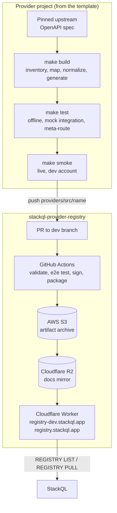

Xem thêm:
[[ StackQL Provider Registry ]](/providers) [[ Sử dụng provider ]](/getting-started/using-a-provider) [[ REGISTRY ]](/language-spec/registry) [[ Kiến trúc ]](/developers/architecture)

## Tổng quan {#overview}

Một provider StackQL là một tập hợp tài liệu OpenAPI có phiên bản, cùng với các phần mở rộng `x-stackQL-*`, mà công cụ [omnisdk](https://github.com/stackql-labs/omnisdk) chuyển thành bảng SQL: `SELECT` cho thao tác đọc, `INSERT`, `UPDATE`, `REPLACE` và `DELETE` cho thao tác vòng đời, và `EXEC` cho các hành động. Tài liệu provider cho StackQL biết API của provider có thể làm gì và cách gọi API đó với ngữ nghĩa SQL. Đây là YAML thuần, vì vậy một provider có thể được dựng, kiểm thử và quản lý phiên bản như mọi mã nguồn khác.

Hệ sinh thái provider gồm ba kho lưu trữ và một lớp phân phối:

| Thành phần | Vai trò |
| --- | --- |
| [__`stackql-provider-TEMPLATE`__](https://github.com/stackql-registry/stackql-provider-TEMPLATE) | Điểm khởi đầu cho một dự án provider mới: một pipeline `make` tất định từ một đặc tả upstream được ghim đến một provider được tạo, các lớp kiểm thử không cần thông tin xác thực, một bộ smoke test trực tiếp, một microsite tài liệu và CI. Đi kèm skill phát triển provider dành cho Claude Code. |
| [__`omnisdk`__](https://github.com/stackql-labs/omnisdk) | Công cụ đọc tài liệu provider và thực thi yêu cầu, kể từ StackQL `v1.0`. Tiền thân của nó, [`any-sdk`](https://github.com/stackql/any-sdk), vẫn lưu trữ tài liệu tham khảo về hợp đồng tài liệu provider, các phần mở rộng `x-stackQL-*`, xác thực, phân trang, biến đổi và đẩy xuống, cùng các JSON Schema được liên kết bên dưới. |
| [__`stackql-provider-registry`__](https://github.com/stackql/stackql-provider-registry) | Nguồn dữ liệu gốc cho các provider đã phát hành. Tài liệu được quản lý phiên bản trong `providers/src/<provider>/<version>/`, sau đó được GitHub Actions ký, đóng gói và phát hành. |
| __Lớp phân phối Cloudflare__ | Các artifact provider đã đóng gói được một Cloudflare Worker phục vụ tại biên mạng từ Cloudflare R2, tại `registry.stackql.app` (môi trường sản xuất) và `registry-dev.stackql.app` (môi trường phát triển). Đây là nơi mà `REGISTRY LIST` và `REGISTRY PULL` giao tiếp. |
<br/>
Sơ đồ sau cho thấy đường đi từ một dự án provider đến một bản cài đặt StackQL:



## Cấu trúc tài liệu provider {#provider-document-structure}

Các đối tượng StackQL tuân theo phân cấp `provider.service.resource.method`, ví dụ `google.compute.instances.list`. Các tài liệu phản ánh đúng phân cấp đó:

```
provider.yaml                          # provider metadata, providerServices, provider-level config
services/
  <service>.yaml                       # an OpenAPI 3 document per service, plus
    components.x-stackQL-resources
      <resource>                       # id, name, methods, sqlVerbs, optional config
        methods.<method>               # operation $ref, response, request, optional config
```

- __Tài liệu provider__ (`provider.yaml`): `id`, `name`, `title`, `version`, `providerServices` (mỗi mục có một `service.$ref` trỏ tới tài liệu dịch vụ của nó và một cờ `preferred` không bắt buộc), cùng các trường không bắt buộc `description`, `protocolType` (mặc định là `http`) và `config`.
- __Tài liệu dịch vụ__: một tài liệu OpenAPI 3 tiêu chuẩn. Phần bổ sung bắt buộc duy nhất là `components.x-stackQL-resources`, nơi khai báo các tài nguyên được cung cấp dưới dạng bảng.
- __Tài nguyên__: `id`, `name`, `methods` và `sqlVerbs`. Mỗi tài nguyên là một bảng; các cột của nó lấy từ lược đồ phản hồi của phương thức `select` chính.
- __Phương thức__: một `operation` là con trỏ JSON trỏ vào `paths` (ví dụ `$ref: '#/paths/~1orgs~1{org}~1repos/get'`), một khối `response` (`mediaType`, `openAPIDocKey`, `objectKey`) cho công cụ biết các hàng nằm ở đâu, cùng một khối `request` và `config` không bắt buộc.
- __Ánh xạ động từ SQL__: `sqlVerbs.select`, `insert`, `update`, `replace` và `delete` là các danh sách có thứ tự gồm các tham chiếu phương thức. StackQL xem xét những phương thức được tham chiếu có toàn bộ tham số bắt buộc được mệnh đề `WHERE` cung cấp và chọn phương thức có nhiều tham số bắt buộc nhất, bất kể thứ tự trong danh sách: một truy vấn cung cấp định danh mà `get` yêu cầu sẽ được định tuyến tới `get`, truy vấn không cung cấp định danh đó sẽ được định tuyến tới `list` và hai phương thức ngang nhau sẽ được báo là lỗi thay vì được chọn một trong hai. Mọi phương thức không được tham chiếu trong danh sách động từ nào đều có thể được gọi qua `EXEC`.

Một tài nguyên tối giản trông như sau:

```yaml
components:
  x-stackQL-resources:
    repos:
      id: github.repos.repos
      name: repos
      title: Repos
      methods:
        list_for_org:
          operation:
            $ref: '#/paths/~1orgs~1{org}~1repos/get'
          response:
            mediaType: application/json
            openAPIDocKey: '200'
        create_in_org:
          operation:
            $ref: '#/paths/~1orgs~1{org}~1repos/post'
          response:
            mediaType: application/json
            openAPIDocKey: '201'
          config:
            requestBodyTranslate:
              algorithm: naive
      sqlVerbs:
        select:
          - $ref: '#/components/x-stackQL-resources/repos/methods/list_for_org'
        insert:
          - $ref: '#/components/x-stackQL-resources/repos/methods/create_in_org'
```

Hợp đồng đầy đủ, bao gồm mọi khóa và ý nghĩa của chúng, nằm trong [Đặc tả provider](https://github.com/stackql/any-sdk/blob/main/docs/provider_spec.md) của any-sdk. Các JSON Schema cho `provider.yaml`, tài liệu dịch vụ và khối cấu hình nằm trong [`any-sdk/cicd/schema-definitions`](https://github.com/stackql/any-sdk/tree/main/cicd/schema-definitions); lược đồ cấu hình từ chối các khóa không xác định, vì vậy một khóa bị gõ sai sẽ không vượt qua bước kiểm tra tính hợp lệ thay vì bị âm thầm bỏ qua.

### Phần mở rộng OpenAPI {#openapi-extensions}

| Phần mở rộng | Vị trí | Mục đích |
| --- | --- | --- |
| `x-stackQL-resources` | `components` | Từ điển tài nguyên của một tài liệu dịch vụ (bắt buộc) |
| `x-stackQL-config` | dịch vụ, tài nguyên, phương thức hoặc thao tác | Một khối cấu hình (xem bên dưới) được áp dụng ở cấp đó |
| `x-stackQL-envVar` | biến máy chủ | Chỉ định một biến môi trường cung cấp giá trị cho biến máy chủ khi biến này không được đưa ra trong mệnh đề `WHERE`. Dùng để giới hạn phạm vi của một API theo tenant, tổ chức, dự án hoặc triển khai |
| `x-stackQL-alias` | tham số hoặc thuộc tính lược đồ | Một tên thay thế được chấp nhận trong SQL cho một tên ở cấp wire |
| `x-stackQL-stringOnly` | thuộc tính lược đồ | Tuần tự hóa thuộc tính dưới dạng chuỗi bất kể kiểu đã khai báo |
| `x-stackQL-graphQL` | thao tác | Dùng một truy vấn GraphQL làm nền cho phương thức khi REST API thiếu dữ liệu |
| `x-alwaysRequired` | tham số | Đánh dấu một tham số là luôn bắt buộc |
| `x-protocol` | `info` | Gợi ý giao thức wire (`query`, `ec2`, `rest-xml`) để xử lý phản hồi XML dựa trên lược đồ |

### Khối cấu hình {#the-config-block}

`config` trong `provider.yaml` và `x-stackQL-config` trong các tài liệu dịch vụ dùng chung một lược đồ. Các khóa được phép là `auth`, `pagination`, `queryParamPushdown`, `queryParamTranspose`, `requestTranslate`, `requestBodyTranslate`, `variations`, `views`, `sqlExternalTables`, `retry`, `minStackQLVersion` và `snake_case_aliases`. Cấu hình được phân giải từ cấp cụ thể nhất ra ngoài, phương thức -> tài nguyên -> dịch vụ -> dịch vụ provider -> provider, vì vậy một giá trị mặc định trên toàn provider có thể được ghi đè cho một tài nguyên hoặc phương thức.

## Những việc provider đảm nhận {#what-providers-handle}

Provider đảm nhận những nhiệm vụ giúp ẩn đi sự phức tạp của API, để người dùng có được một giao diện SQL nhất quán mà không phải quản lý cuộc trao đổi HTTP bên dưới.

### Xác thực {#authentication}

Mỗi provider đi kèm một khối `auth` mặc định chỉ định các biến môi trường chứa thông tin xác thực của nó, vì vậy khi môi trường đã có sẵn các biến này thì không cần cấu hình xác thực tại runtime. Tài liệu provider chỉ chấp nhận các tham chiếu gián tiếp (tên biến môi trường, đường dẫn tệp); giá trị thông tin xác thực dạng literal chỉ được đặt trong ngữ cảnh `--auth` tại runtime. Tên biến môi trường nên theo provider Terraform của nhà cung cấp nếu có.

| `auth.type` | Các trường thường gặp |
| --- | --- |
| `bearer` | `credentialsenvvar` |
| `api_key` | `credentialsenvvar`, `valuePrefix`, các trường không bắt buộc `location` (`header` hoặc `query`) và `name` |
| `basic` | `username_var`, `password_var` |
| `custom` | `location`, `name`, `credentialsenvvar`, `valuePrefix` không bắt buộc; nối thêm thông tin xác thực thứ hai bằng `successor` |
| `oauth2` | `client_id_env_var`, `client_secret_env_var`, `grant_type: client_credentials`, `token_url`, `scopes` |
| `service_account` | `credentialsenvvar` hoặc `credentialsfilepathenvvar`, `scopes` |
| `aws_signing_v4`, `aws_assume_role` | `keyIDenvvar`, `credentialsenvvar` |
| `azure_default` | không có |
| `oci_signing_v1` | `tenancy_ocid_envvar`, `user_ocid_envvar`, `oci_fingerprint_envvar`, `oci_private_key_envvar`, `oci_region_envvar` |
| `interactive` | không có |
| `null_auth` | không có (khai báo rõ ràng là không xác thực) |
<br/>
Ví dụ:

```yaml
config:
  auth:
    type: api_key
    credentialsenvvar: OKTA_API_TOKEN
    valuePrefix: 'SSWS '
```

Người dùng có thể ghi đè cấu hình xác thực của provider tại runtime bằng `--auth='{"<provider>": {...}}'`.

### Phân trang {#pagination}

Provider khai báo cơ chế phân trang của nhà cung cấp và công cụ duyệt qua mọi trang, vì vậy người dùng nhận được tập kết quả đầy đủ. Các cơ chế được hỗ trợ:

- __Token hoặc con trỏ trong phần thân phản hồi__: `requestToken: {key: cursor, location: query}`, `responseToken: {key: $.cursor, location: body}`; dừng khi token không có hoặc rỗng.
- __URL trang tiếp theo trong phần thân phản hồi__: `requestToken: {key: '', location: request}`, `responseToken: {key: $.next, location: body}`; `algorithm: odata_next_link` cho `@odata.nextLink` của OData.
- __Header `Link` theo RFC 5988__: `responseToken: {key: Link, location: header}`.
- __Số trang kèm tổng số trang__: `algorithm: page_number` với `responseToken` (trang hiện tại) và `responseTerminator` (tổng số trang).

Các API dùng độ lệch và giới hạn mà không có dấu hiệu trang tiếp theo không phải là một cơ chế phân trang; thay vào đó, hãy cung cấp `offset` và `limit` dưới dạng tham số `WHERE`. Cờ toàn cục `--http.response.pageLimit` giới hạn việc duyệt trang.

### Đẩy vị từ xuống (predicate pushdown) {#predicate-pushdown}

Các khóa trong `WHERE` được so khớp theo tên với các tham số đã khai báo của thao tác (đường dẫn, sau đó là truy vấn, header và cookie) và được gửi tới API, vì vậy việc lọc diễn ra tại nguồn. Mọi khóa `WHERE` còn lại không có tham số tương ứng sẽ được nối thêm dưới dạng tham số truy vấn.

Ngoài các tham số thông thường, `queryParamPushdown` viết lại các cột `SELECT`, `WHERE`, `ORDER BY`, `LIMIT`, `OFFSET` và `COUNT` thành tham số API. `dialect: odata` điền các giá trị mặc định `$select`, `$filter`, `$orderby`, `$top`, `$skip` và `$count` mà Microsoft Graph và các API kiểu Azure sử dụng; `dialect: custom` dùng nguyên văn `paramName`, phổ biến nhất là `top: {paramName: limit, maxValue: 1000}` để `LIMIT n` trở thành `?limit=n`. Các vị từ không thể đẩy xuống vẫn được đánh giá ở phía ứng dụng khách.

### Biến đổi phản hồi và yêu cầu {#response-and-request-transformation}

- `response.objectKey` là một JSONPath (hoặc XPath đối với API XML) chọn các mục chứa hàng từ lớp bao của phản hồi, ví dụ `$.data[*]` hoặc `$.value`.
- `response.transform` áp dụng một template văn bản Go cho phần thân trước khi phần thân đó được đưa vào staging dưới dạng hàng; các loại biến đổi bao gồm JSON, XML và văn bản thuần, đây là cách các API XML của AWS và đầu ra CLI trở thành bảng.
- `requestBodyTranslate: {algorithm: naive}` cho phép `INSERT` nhận các trường của phần thân yêu cầu dưới dạng tên cột thông thường thay vì dạng có tiền tố `data__`.
- `snake_case_aliases: true` ở cấp provider cung cấp các tên wire dạng camelCase dưới dạng cột và tham số snake_case.
- `retry` đặt chính sách backoff theo cấp số nhân (`max_attempts`, `initial_delay_ms`, `max_delay_ms`, `multiplier`, `jitter_fraction`, `retryable_methods`, `retryable_conditions.status_codes`). Cấp đầu tiên khai báo chính sách này sẽ được ưu tiên; xem [chính sách thử lại](https://github.com/stackql/any-sdk/blob/main/docs/retry_policy.md) của any-sdk.

Kiểu cột tuân theo lược đồ OpenAPI: `string` -> text, `integer` -> integer, `number` -> numeric, `boolean` -> boolean. Các thuộc tính `object` và `array` được lưu dưới dạng văn bản JSON, đó là lý do các trường lồng nhau được đọc bằng `json_extract` trong truy vấn và lý do các provider thường đi kèm dạng xem (`config.views`, với `ddl` theo từng phương ngữ và một `fallback`) cho các phép chiếu lồng nhau phổ biến.

### Provider không dùng HTTP {#non-http-providers}

`protocolType: local_templated` trong `provider.yaml` dùng các lệnh cục bộ thay vì HTTP làm nền cho provider: các phương thức mang một mảng `inline` gồm các đoạn argv dạng template Go, tham số dùng `in: inline` và một `response.transform` chuyển đầu ra của lệnh thành các hàng. Provider tham khảo [`local_openssl`](https://github.com/stackql/any-sdk/tree/main/test/registry/src/local_openssl/v0.1.0) trong any-sdk minh họa cấu trúc này. Nội dung này nằm ngoài phạm vi của pipeline template, vốn nhắm tới các API HTTP.

## Bắt đầu một dự án provider {#starting-a-provider-project}

Bắt đầu mọi provider mới từ [__`stackql-provider-TEMPLATE`__](https://github.com/stackql-registry/stackql-provider-TEMPLATE). Đây là một kho lưu trữ template của GitHub thể hiện tiêu chuẩn hiện tại cho một provider: một đặc tả upstream được ghim, một pipeline dựng tất định trong đó mọi quyết định thủ công là một quy tắc trong tập lệnh thay vì một chỉnh sửa thủ công trên YAML được tạo, ba lớp kiểm thử không cần thông tin xác thực, một bộ smoke test trực tiếp có giới hạn ngân sách, một trang tài liệu Docusaurus và CI. Các provider đã phát hành được dựng theo cách này nằm trong tổ chức GitHub [stackql-registry](https://github.com/orgs/stackql-registry/repositories) và là tài liệu tham khảo hữu ích bên cạnh template.

Điều kiện tiên quyết: Node.js 20 trở lên, GNU make và bash (Linux, macOS hoặc WSL), Python 3 cho bộ smoke test và một tệp nhị phân `stackql` (`bin/start-server.sh` sẽ tải xuống một tệp nếu không tìm thấy).

1. Tạo kho lưu trữ từ template (GitHub "Use this template") và chạy `npm install`.
2. Chạy `bin/init-provider.sh <name> "<Title>" [https://api.vendor.com]` để thay thế các placeholder trong toàn bộ kho lưu trữ.
3. Điền các hằng số trong `provider-dev/scripts/lib/spec_helpers.mjs` (URL đặc tả, tiền tố phiên bản trong đường dẫn, tiền tố phạm vi cho API có phạm vi theo tenant hoặc dự án) và cấu hình trong `provider-dev/config/` (`servers.json`, `provider_config.json`, `service_names.json`).
4. Thực hiện pipeline, thủ công qua các target `make` hoặc bằng cách mở một phiên Claude Code trong kho lưu trữ (xem bên dưới).
5. `grep -rn "TODO(template)"` liệt kê những việc còn dang dở.

Pipeline được điều khiển bằng `make` (`make help` liệt kê mọi target):

```bash
make fetch-spec        # verify the upstream spec against the recorded pin (fails on drift)
make inventory         # one CSV row per operation with the proposed service, resource, method and verb
make split             # write provider-dev/source/<service>.yaml from the ordered path rules
make mappings-report   # print every derived operation -> resource.method mapping without writing
make mappings          # regenerate provider-dev/config/all_services.csv and validate it
make normalize         # flatten allOf, lower oneOf/anyOf, wrap bare arrays
make generate          # generate provider.yaml + services/*.yaml, then post-process and merge GraphQL/views
make test              # offline SHOW/DESCRIBE, mock API integration tests, meta-route walk (no credentials)
make smoke             # live smoke suite against a dedicated dev account (sources .env)
make docs              # generate the provider documentation site content
make all               # everything above except the live suites
```

Bên dưới, pipeline sử dụng [__`@stackql/provider-utils`__](https://github.com/stackql-registry/stackql-provider-utils) (`split`, `normalize`, `analyze`, `generate` và `docgen`) cùng các quy tắc riêng cho từng provider trong `provider-dev/scripts/`. Provider được tạo nằm trong `provider-dev/openapi/src/<name>/v00.00.00000/`, đây là thư mục cuối cùng sẽ được phát hành lên registry.

`provider-dev/config/all_services.csv` là hợp đồng đã commit của mọi ánh xạ từ thao tác sang tài nguyên và phương thức. Một diff khi tạo lại là một lần xem xét thay đổi không tương thích ngược, không phải nhiễu. CI sẽ thất bại khi có sai lệch do tạo lại chưa được commit, vì vậy một lần tạo lại phải tái tạo chính xác từng byte các artifact đã commit.

Đối với một kho lưu trữ provider hiện có được tạo trước khi có template, hãy sao chép thư mục `.claude/skills` vào đó và bắt đầu từ `references/uplift-checklist.md` của skill.

### Sử dụng Claude Code để phát triển provider {#using-claude-code-for-provider-development}

Template đi kèm [__skill phát triển provider StackQL__](https://github.com/stackql-registry/stackql-provider-TEMPLATE/blob/main/.claude/skills/stackql-provider-development/SKILL.md) dành cho [Claude Code](https://docs.anthropic.com/en/docs/claude-code). Mở một phiên Claude Code trong kho lưu trữ được tạo từ template và yêu cầu nó dựng provider; nó sẽ đọc `CLAUDE.md` và skill rồi thực hiện các bước theo thứ tự. Skill này cũng là quy trình bằng văn bản để thực hiện công việc thủ công.

Skill này bao gồm:

- Chọn loại hình: tài liệu OpenAPI, Swagger hoặc discovery do nhà cung cấp phát hành (trực tiếp), hoặc đặc tả được suy ra từ SDK của nhà cung cấp khi SDK là nguồn dữ liệu gốc (suy ra)
- Lấy, sửa, kiểm tra tính hợp lệ và ghim đặc tả upstream để mọi lần làm mới đều là một diff có thể xem xét
- Kiểm kê điểm cuối, việc chia tách dịch vụ và các quy tắc ánh xạ tạo ra `all_services.csv`
- Mọi thành phần cơ bản của tài liệu provider và khi nào nên dùng: giới hạn phạm vi bằng `x-stackQL-envVar`, `objectKey`, biến đổi yêu cầu và phản hồi, phân trang, đẩy tham số truy vấn xuống, các phương thức `EXEC` vòng đời, việc hợp nhất GraphQL và dạng xem provider
- Ba lớp kiểm thử không cần thông tin xác thực và bộ smoke test trực tiếp
- Trang tài liệu, các workflow CI và ghi chú bàn giao

Thư mục `references/` của skill chứa chi tiết cho từng bước, và `scripts/find_extension_examples.sh` in ra YAML đã phát hành cho bất kỳ khóa phần mở rộng nào từ một bản sao của registry provider, vì vậy bạn có thể xem một thành phần cơ bản được sử dụng thực tế trước khi tự viết nó.

## Kiểm thử provider cục bộ {#testing-a-provider-locally}

StackQL đọc provider từ một registry được mô tả bằng cờ toàn cục `--registry`. Trong quá trình phát triển, hãy trỏ nó tới thư mục provider được tạo trên hệ thống tệp cục bộ và tắt xác minh chữ ký (tài liệu chỉ được ký khi được phát hành):

```bash
export LOCAL_REG='{ "url": "file:///path/to/provider-dev/openapi", "localDocRoot": "/path/to/provider-dev/openapi", "verifyConfig": { "nopVerify": true } }'
stackql --registry="${LOCAL_REG}" shell
```

Thư mục tại `localDocRoot` phải chứa `src/<provider>/<version>/provider.yaml` và `src/<provider>/<version>/services/*.yaml`, đúng như những gì template tạo ra. Từ shell, `SHOW SERVICES IN <provider>`, `SHOW RESOURCES IN <provider>.<service>`, `SHOW METHODS IN <provider>.<service>.<resource>` và `DESCRIBE EXTENDED <provider>.<service>.<resource>` xác nhận bề mặt API trước khi chạy bất kỳ truy vấn nào. `tests/offline_validation.mjs` của template tự động hóa các phép kiểm tra này, và `npm run probe -- "SELECT ..."` chạy SQL ad-hoc đối với API giả lập và in ra các lệnh gọi wire.

Các provider được tải xuống từ một registry từ xa được lưu vào cache trong `<cwd>/.stackql` theo mặc định; dùng `--approot` để thay đổi vị trí này.

[CLI của any-sdk](https://github.com/stackql/any-sdk/blob/main/docs/cli.md) hữu ích để kiểm tra một tài liệu mà không cần StackQL tham gia: `anysdk aot <registry> <provider.yaml>` chạy phân tích tĩnh trên một provider (`objectKey` không thể định tuyến, thiếu lược đồ phản hồi, phân trang không đầy đủ, các tham số đường dẫn liền kề, v.v.), và `anysdk query` thực thi trực tiếp một phương thức từ tài liệu provider và tài liệu dịch vụ. [Kiểm thử automock](https://github.com/stackql/any-sdk/blob/main/docs/automock_testing.md) tạo một API giả lập và kết quả mong đợi từ các lược đồ trong provider để chạy trọn một vòng mà không chạm tới API thực.

### Kiểm thử provider của bạn bằng registry `dev` {#testing-your-provider-using-the-dev-registry}

Sau khi một provider được hợp nhất vào nhánh `dev` của registry, provider đó khả dụng từ registry phát triển. Trỏ StackQL tới registry này để xác minh artifact đã phát hành:

```bash
export DEV_REG='{ "url": "https://registry-dev.stackql.app/providers" }'
stackql --registry="${DEV_REG}" shell
```

```sql
REGISTRY PULL myprovider;
```

Target `make smoke-live` của template chạy bộ smoke test đối với provider đã phát hành để xác minh sau khi phát hành.

## Phát hành provider {#publishing-a-provider}

Phát hành là một bước riêng biệt, có con người tham gia, và không thuộc pipeline template.

1. Fork [stackql-provider-registry](https://github.com/stackql/stackql-provider-registry) và sao chép thư mục `provider-dev/openapi/src/<name>` đã được tạo sang `providers/src/<name>` trong một nhánh tính năng.
2. Tạo một pull request vào nhánh `dev` kèm mô tả về provider và các thay đổi (xem [hướng dẫn đóng góp](https://github.com/stackql/stackql-provider-registry/blob/main/.github/CONTRIBUTING.md) của registry).
3. GitHub Actions kiểm tra tính hợp lệ và kiểm thử provider bằng [stackql-provider-tests](https://github.com/stackql/stackql-provider-tests). Các quy tắc được đánh giá là: tài liệu phải là một đặc tả OpenAPI hợp lệ, mọi dịch vụ phải liệt kê được tài nguyên, mọi tài nguyên phải liệt kê được phương thức, các phương thức có thể gọi qua `SELECT` phải có lược đồ phản hồi hợp lệ và các phương thức có thể gọi qua `INSERT` phải có lược đồ yêu cầu hợp lệ.
4. Khi được hợp nhất, workflow cấp một phiên bản, ký các tài liệu (ML-DSA-65), đóng gói chúng và phát hành artifact lên bộ lưu trữ AWS S3. Sau đó, cây tài liệu được sao chép đồng bộ sang Cloudflare R2 và Cloudflare Worker phục vụ `registry-dev.stackql.app` được triển khai. Provider khả dụng ngay lập tức cho các bản cài đặt được cấu hình để dùng registry `dev`.
5. Sau một thời gian giám sát, `dev` được đưa lên `main`, thao tác này lặp lại việc phát hành cho `registry.stackql.app`. Đây là bước phát hành cho các instance StackQL dùng cấu hình mặc định.

Có thể chạy cùng harness `stackql-provider-tests` đó cục bộ đối với một thư mục registry trước khi tạo PR:

```bash
test-provider.sh <provider_name> false /path/to/provider-dev/openapi
```

Xem [dựng và triển khai](https://github.com/stackql/stackql-provider-registry/blob/main/docs/build-and-deployment.md) trong kho lưu trữ registry để biết chi tiết về workflow, bao gồm cơ chế chặn xóa provider giúp bảo vệ `providers/src`.
