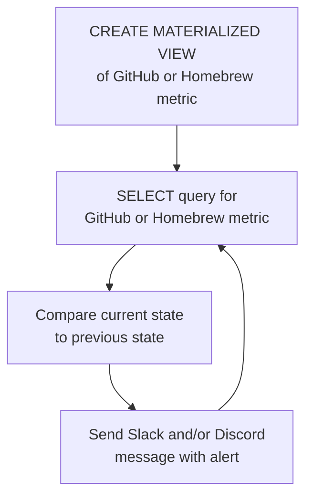

# Trình giám sát hoạt động dự án mã nguồn mở chạy bằng StackQL

Trong hướng dẫn này, chúng tôi sẽ minh họa cách tự lưu trữ một hệ thống giám sát và cảnh báo theo thời gian thực dành cho người bảo trì phần mềm mã nguồn mở trên GitHub.

> [__stackql__](https://github.com/stackql/stackql) là một công cụ mã nguồn mở cho phép người dùng truy vấn và tương tác với tài nguyên đám mây và SaaS bằng ngôn ngữ SQL cùng các thư viện và công cụ trực quan hóa và phân tích dữ liệu. Hãy tặng chúng tôi một [⭐](https://github.com/stackql/stackql) nếu bạn thấy dự án này hữu ích!

Nhận cảnh báo như thế này trong Slack và Discord theo thời gian thực:


Đã kiểm thử với <span class="tutorial_tested_on">backend SQL nhúng</span> <span class="tutorial_tested_on">docker</span> <span class="tutorial_tested_on">linux</span>

## Tổng quan {#overview}

Khi tìm công cụ để giám sát dự án mã nguồn mở của chúng tôi, tôi nhận thấy hầu hết chúng không hoạt động như được giới thiệu hoặc hoàn toàn không hoạt động (trong trường hợp các ứng dụng bên thứ ba trên GitHub), vì vậy tôi đã tự tạo công cụ của riêng chúng tôi mà bạn có thể khởi chạy và sử dụng cho dự án GitHub mã nguồn mở của mình...

Dự án [__oss-activity-monitor__](https://github.com/stackql/oss-activity-monitor) sử dụng [__stackql__](https://github.com/stackql/stackql) để giám sát hoạt động của dự án mã nguồn mở theo thời gian thực, bao gồm thông báo theo thời gian thực về:

- ⭐ stargazer mới của kho lưu trữ GitHub
- 👀 watcher mới của kho lưu trữ GitHub
- 🍴 fork mới của kho lưu trữ GitHub
- 📊 issue mới của kho lưu trữ GitHub
- 🙋 follower mới của tổ chức GitHub
- 📦 lượt tải xuống mới của asset trong bản phát hành GitHub
- 🍺 lượt tải xuống mới trên homebrew

## Cách hoạt động {#how-it-works}

Dự án được triển khai trong một container (dùng `docker` hoặc nền tảng triển khai container khác), được viết bằng `python` và gói [`pystackql`](https://pystackql.readthedocs.io/en/latest/intro.html), sử dụng provider [`github`](https://github-provider.stackql.io/) và [`homebrew`](https://homebrew-provider.stackql.io/) cho `stackql`.  Dạng xem vật chất hóa và câu lệnh `SELECT` được dùng để ghi nhận và so sánh trạng thái giữa số liệu hiện tại và số liệu trước đó của các điểm cuối GitHub và Homebrew được giám sát, như mô tả trong sơ đồ dưới đây:


ví dụ, với dạng xem vật chất hóa sau được tạo và nạp dữ liệu bằng `stackql`:

```sql
CREATE OR REPLACE MATERIALIZED VIEW mvw_github_repo_stargazers AS 
SELECT login FROM github.activity.repo_stargazers
WHERE owner = 'your-org' and repo = 'your-repo'
```

truy vấn `stackql` sau sẽ thăm dò GitHub để tìm stargazer mới...

```sql
SELECT c.login
FROM github.activity.repo_stargazers c
LEFT JOIN mvw_github_repo_stargazers mvw
ON c.login = mvw.login
WHERE mvw.login IS NULL
AND c.owner = 'your-org' AND c.repo = 'your-repo'
```

sau đó trạng thái được làm mới bằng...

```sql
REFRESH MATERIALIZED VIEW mvw_github_repo_stargazers
```

cách làm tương tự được lặp lại cho watcher của kho lưu trữ, issue, follower của tổ chức, lượt tải xuống asset trong bản phát hành và lượt tải xuống homebrew.

## Chạy dự án {#running-the-project}

Làm theo các bước dưới đây để chạy dự án trên máy cục bộ hoặc trên nền tảng đám mây bạn chọn.

### 1. Clone kho lưu trữ {#1-clone-the-repo}

```bash
git clone https://github.com/stackql/oss-activity-monitor.git
# or 
git clone git@github.com:stackql/oss-activity-monitor.git
```

### 2. Cấu hình biến môi trường {#2-configure-environment-variables}

Dự án cần các biến môi trường sau để cấu hình (được cung cấp bằng biến môi trường, trong ví dụ dưới đây là tệp `.env`):

| Biến                       | Mô tả                                                                             | Giá trị ví dụ                                    |
|----------------------------|-----------------------------------------------------------------------------------|--------------------------------------------------|
| `LOG_LEVEL`                | Mức nhật ký (INFO cho nhật ký chung; DEBUG cho nhật ký chi tiết)                  | INFO                                             |
| `SLEEP_INTERVAL`           | Thời gian chờ tính bằng giây giữa các vòng lặp yêu cầu                            | 5                                                |
| `GITHUB_REPO`              | Tên kho lưu trữ GitHub                                                            | stackql                                          |
| `GITHUB_REPO_OWNER`        | Tên tổ chức hoặc chủ sở hữu GitHub                                                | stackql                                          |
| `HOMEBREW_FORMULA_NAME`    | Tên formula Homebrew, nếu có                                                      | stackql                                          |
| `STACKQL_GITHUB_USERNAME`  | Tên người dùng GitHub của bạn                                                     | jeffreyaven                                      |
| `STACKQL_GITHUB_PASSWORD`  | Token truy cập cá nhân GitHub của bạn                                             | ghp_yourpersonalaccesstoken                      |
| `SLACK_WEBHOOK_URL`        | URL webhook Slack để gửi thông báo                                                | https://hooks.slack.com/services/...             |
| `DISCORD_WEBHOOK_URL`      | URL webhook Discord để gửi thông báo                                              | https://discord.com/api/webhooks/...             |

### 3. Dựng container {#3-build-the-container}

```bash
docker build --no-cache -t oss-activity-monitor .
```

### 4. Chạy container {#4-run-the-container}

```bash
docker run --env-file .env oss-activity-monitor
```

Vậy là xong!  Giờ đây bạn sẽ nhận được cảnh báo theo thời gian thực khi có hoạt động trên dự án mã nguồn mở của mình.  Để dừng container, hãy dùng:

```bash
docker stop $(docker ps -a -q --filter ancestor=oss-activity-monitor)
```

Hãy tặng chúng tôi một ⭐ trên [__GitHub__](https://github.com/stackql/stackql)
