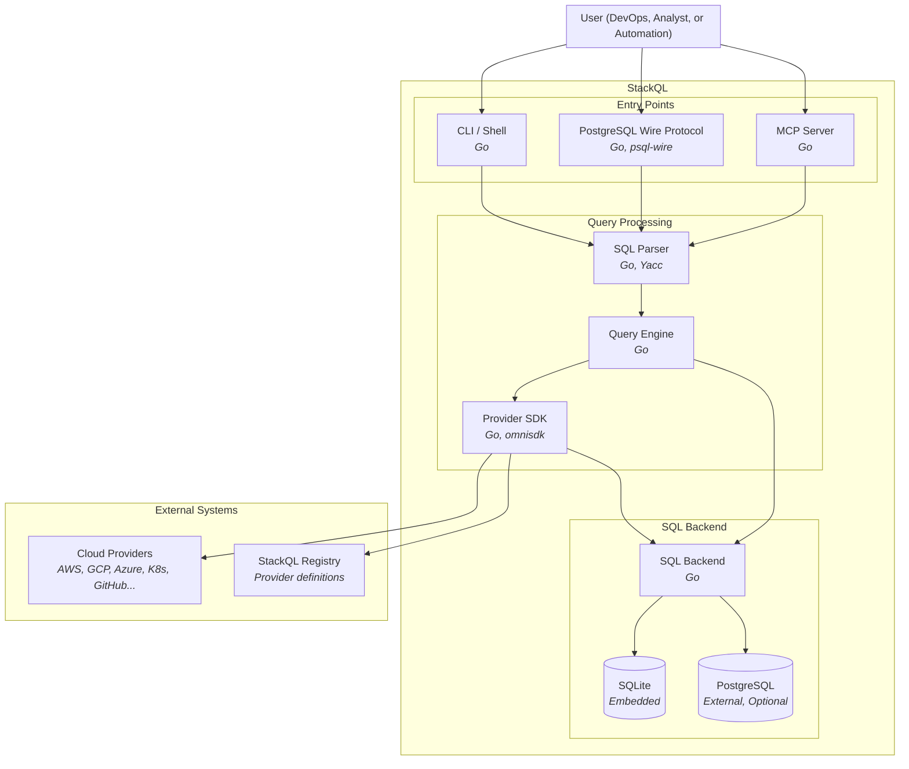

另请参阅：
[[ 使用 StackQL ]](/getting-started/using-stackql) [[ 使用变量 ]](/getting-started/variables) [[ 模板化 ]](/getting-started/templating)

## 概述 {#overview}

StackQL 是一个统一的 SQL 接口，用于跨多个 Provider 查询和管理云基础设施。下面的容器图展示了 StackQL 系统的主要组件及其交互。

## 核心组件 {#core-components}

### 入口点 {#entry-points}

StackQL 支持通过多个入口点执行 SQL 查询：

- **CLI / Shell**：交互式 shell 和命令行界面，用于直接从终端执行 SQL 查询。用户可以运行即席查询、脚本，或使用交互式 shell 进行探索。

- **PostgreSQL 线协议**：支持从 `psql`、DBeaver 等标准 PostgreSQL 客户端或任何其他兼容 PostgreSQL 的工具进行连接。这样可以与现有的数据库工作流和 BI 工具无缝集成。

- **MCP 服务器**：一个 Model Context Protocol 服务器，用于集成 AI 助手，使大语言模型能够通过自然语言查询和管理基础设施。

### 查询处理管道 {#query-processing-pipeline}

1. **SQL 解析器**：使用基于 Yacc 的自定义语法，将 SQL 输入解析为抽象语法树（AST）。解析器（实现为 `stackql-parser`）验证 SQL 语法，并为查询规划做好准备。

2. **查询引擎**：负责规划和执行查询的中央编排层。它确定哪些操作可以下推到 API 层，哪些需要在本地进行 SQL 处理。查询引擎负责：
   - 查询规划和优化
   - API 调用与本地 SQL 执行之间的协调
   - 结果聚合和转换

### Provider SDK (omnisdk) {#provider-sdk-omnisdk}

Provider SDK [omnisdk](https://github.com/stackql-labs/omnisdk) 管理与云服务商的所有交互。它在 StackQL `v1.0` 中取代了 `any-sdk`。主要职责包括：

- **Provider 发现**：从 StackQL Registry 获取 Provider 规范（StackQL Registry 包含每个受支持云服务商的基于 OpenAPI 的定义），并可选择在使用每个文档之前验证其 ML-DSA-65 签名。

- **身份验证**：处理每个 Provider 的身份验证，支持多种身份验证方式，包括 API 密钥、OAuth 令牌、服务账号凭据等。每个 Provider 定义都指定其身份验证要求；一个会话可以用多个别名绑定同一个 Provider，各自使用独立的凭据（见 [Provider 会话](/getting-started/provider-sessions)）。

- **图规划**：将每条语句规划为一张由 Provider 交换组成的图，这些交换通过数据边和控制边相连。连接、子查询、CTE 和视图都经过同一个规划器，从一个计划扇出的请求在每个 Provider 和每个主机的限制内并发运行。

- **API 请求构建**：将 SQL 查询转换为适用于每个 Provider 的 REST API 调用，处理端点构造、参数映射和请求格式化。

- **分页**：自动处理分页的 API 响应，屏蔽各个 Provider 所用的不同分页方案（基于游标、基于偏移量、基于令牌等）的复杂性。

- **谓词下推**：将映射到请求参数的条件，以及在不需要排序时的 `LIMIT`，下推到 Provider 请求中，以减少发出的请求数量和传输的数据量。

- **响应转换**：在 API 响应到达时将其转换为行，以便暂存到 SQL 后端或流式传输到客户端。

SQL 连接、暂存和后端执行都保留在 StackQL 中。omnisdk 不包含 SQL 暂存，也从不接收数据库连接；StackQL 向它传递关系句柄，并接收行游标。

### SQL 后端 {#sql-backend}

SQL 后端对物化后的 API 数据执行关系操作：

- **SQLite**：嵌入式数据库，用于临时表存储和关系处理。非常适合即席查询和较小的数据集。

- **PostgreSQL**：可选的外部数据库，用于持久化存储、较大的数据集和高级分析工作负载。

SQL 后端处理的操作包括：
- 跨多个 Provider 或资源的 JOIN 操作
- 聚合函数（COUNT、SUM、AVG 等）
- 对物化数据进行排序和过滤
- 复杂的 SQL 表达式和子查询

## 外部系统 {#external-systems}

### 云服务商 {#cloud-providers}

StackQL 通过云服务商（AWS、GCP、Azure、Kubernetes、GitHub 以及更多）的 REST API 与其连接。所有通信都通过 HTTPS 进行，Provider SDK 负责处理每个 Provider 的 API 约定的具体细节。

### StackQL Registry {#stackql-registry}

StackQL Registry 托管 Provider 定义，即基于 OpenAPI 的规范，描述可用的资源、方法及其映射。Provider 带有版本，可使用 `REGISTRY PULL` 命令按需拉取。

## 查询执行流程 {#query-execution-flow}

1. 用户通过某个入口点（CLI、PostgreSQL 协议或 MCP）提交 SQL 查询
2. SQL 解析器验证查询并将其转换为 AST
3. 查询引擎分析 AST 并创建执行计划
4. 对于 Provider 操作，Provider SDK 会：
   - 从 Registry 获取相关的 Provider 规范（如果尚未缓存）
   - 向云服务商进行身份验证
   - 构建并执行 API 请求，自动处理分页
   - 尽可能将谓词下推到 API
   - 将结果物化到 SQL 后端
5. SQL 后端执行其余的关系操作
6. 结果以请求的格式返回给用户
