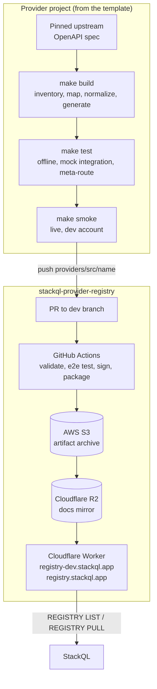

另请参阅：
[[ StackQL Provider Registry ]](/providers) [[ 使用 Provider ]](/getting-started/using-a-provider) [[ REGISTRY ]](/language-spec/registry) [[ 架构 ]](/developers/architecture)

## 概述 {#overview}

StackQL Provider 是一组带版本的 OpenAPI 文档加上 `x-stackQL-*` 扩展，[omnisdk](https://github.com/stackql-labs/omnisdk) 引擎将其转换为 SQL 表：`SELECT` 用于读取，`INSERT`、`UPDATE`、`REPLACE` 和 `DELETE` 用于生命周期操作，`EXEC` 用于动作。Provider 文档告诉 StackQL 某个 Provider 的 API 能做什么，以及如何用 SQL 语义调用它。它们是纯 YAML，因此 Provider 可以像其他任何代码一样构建、测试和进行版本管理。

Provider 生态系统由 3 个仓库和 1 个分发层组成：

| 组件 | 作用 |
| --- | --- |
| [__`stackql-provider-TEMPLATE`__](https://github.com/stackql-registry/stackql-provider-TEMPLATE) | 新 Provider 项目的起点：从固定版本的上游规范到生成的 Provider 的确定性 `make` 管道、无需凭据的测试层、真实环境冒烟测试套件、文档微站点和 CI。捆绑了 Claude Code 的 Provider 开发技能。 |
| [__`omnisdk`__](https://github.com/stackql-labs/omnisdk) | 读取 Provider 文档并执行请求的引擎，从 StackQL `v1.0` 起使用。其前身 [`any-sdk`](https://github.com/stackql/any-sdk) 仍然托管 Provider 文档契约、`x-stackQL-*` 扩展、身份验证、分页、转换和下推的参考资料，以及下文链接的 JSON Schema。 |
| [__`stackql-provider-registry`__](https://github.com/stackql/stackql-provider-registry) | 已发布 Provider 的事实来源。文档在 `providers/src/<provider>/<version>/` 下按版本管理，然后由 GitHub Actions 签名、打包和发布。 |
| __Cloudflare 分发层__ | 打包后的 Provider 制品由 Cloudflare Worker 从 Cloudflare R2 在边缘提供服务，地址为 `registry.stackql.app`（生产）和 `registry-dev.stackql.app`（开发）。`REGISTRY LIST` 和 `REGISTRY PULL` 访问的就是它。 |
<br/>
下图展示了从 Provider 项目到 StackQL 安装的路径：



## Provider 文档结构 {#provider-document-structure}

StackQL 对象遵循 `provider.service.resource.method` 层次结构，例如 `google.compute.instances.list`。文档与该层次结构相对应：

```
provider.yaml                          # provider metadata, providerServices, provider-level config
services/
  <service>.yaml                       # an OpenAPI 3 document per service, plus
    components.x-stackQL-resources
      <resource>                       # id, name, methods, sqlVerbs, optional config
        methods.<method>               # operation $ref, response, request, optional config
```

- __Provider 文档__（`provider.yaml`）：`id`、`name`、`title`、`version`、`providerServices`（每项带有指向其服务文档的 `service.$ref` 和可选的 `preferred` 标志）、可选的 `description`、`protocolType`（默认为 `http`）和 `config`。
- __服务文档__：标准的 OpenAPI 3 文档。唯一必需的补充是 `components.x-stackQL-resources`，它声明作为表公开的资源。
- __资源__：`id`、`name`、`methods` 和 `sqlVerbs`。每个资源是一张表；它的列来自其主 `select` 方法的响应 schema。
- __方法__：一个 `operation`，它是指向 `paths` 的 JSON 指针（例如 `$ref: '#/paths/~1orgs~1{org}~1repos/get'`）；一个 `response` 块（`mediaType`、`openAPIDocKey`、`objectKey`），告诉引擎行在哪里；以及可选的 `request` 块和 `config`。
- __SQL 动词映射__：`sqlVerbs.select`、`insert`、`update`、`replace` 和 `delete` 是方法引用的有序列表。引用按书写顺序依次尝试，第一个其必需参数被 `WHERE` 子句满足的引用胜出，因此应把 `list` 列在 `get` 之前。任何未被动词列表引用的方法都可以通过 `EXEC` 调用。

一个最小的资源如下所示：

```yaml
components:
  x-stackQL-resources:
    repos:
      id: github.repos.repos
      name: repos
      title: Repos
      methods:
        list_for_org:
          operation:
            $ref: '#/paths/~1orgs~1{org}~1repos/get'
          response:
            mediaType: application/json
            openAPIDocKey: '200'
        create_in_org:
          operation:
            $ref: '#/paths/~1orgs~1{org}~1repos/post'
          response:
            mediaType: application/json
            openAPIDocKey: '201'
          config:
            requestBodyTranslate:
              algorithm: naive
      sqlVerbs:
        select:
          - $ref: '#/components/x-stackQL-resources/repos/methods/list_for_org'
        insert:
          - $ref: '#/components/x-stackQL-resources/repos/methods/create_in_org'
```

完整的契约（包括每个键及其含义）见 any-sdk 的 [Provider 规范](https://github.com/stackql/any-sdk/blob/main/docs/provider_spec.md)。`provider.yaml`、服务文档和 config 块的 JSON Schema 位于 [`any-sdk/cicd/schema-definitions`](https://github.com/stackql/any-sdk/tree/main/cicd/schema-definitions)；config schema 会拒绝未知的键，因此拼写错误的键会导致验证失败，而不是被静默忽略。

### OpenAPI 扩展 {#openapi-extensions}

| 扩展 | 位置 | 用途 |
| --- | --- | --- |
| `x-stackQL-resources` | `components` | 服务文档的资源字典（必需） |
| `x-stackQL-config` | 服务、资源、方法或操作 | 应用于该级别的 config 块（见下文） |
| `x-stackQL-envVar` | 服务器变量 | 指定一个环境变量，当 `WHERE` 子句中未给出服务器变量时由它提供该变量的值。用于按租户、组织、项目或部署限定 API 的范围 |
| `x-stackQL-alias` | 参数或 schema 属性 | 线路级名称在 SQL 中可接受的替代名称 |
| `x-stackQL-stringOnly` | schema 属性 | 无论声明的类型是什么，都将该属性序列化为字符串 |
| `x-stackQL-graphQL` | 操作 | 在 REST API 缺少数据时，用 GraphQL 查询支撑某个方法 |
| `x-alwaysRequired` | 参数 | 将参数标记为始终必需 |
| `x-protocol` | `info` | 线协议提示（`query`、`ec2`、`rest-xml`），用于 schema 驱动的 XML 响应处理 |

### config 块 {#the-config-block}

`provider.yaml` 中的 `config` 和服务文档中的 `x-stackQL-config` 共用一个 schema。允许的键有 `auth`、`pagination`、`queryParamPushdown`、`queryParamTranspose`、`requestTranslate`、`requestBodyTranslate`、`variations`、`views`、`sqlExternalTables`、`retry`、`minStackQLVersion` 和 `snake_case_aliases`。config 从最具体的级别向外解析，即方法 -> 资源 -> 服务 -> Provider 服务 -> Provider，因此 Provider 范围的默认值可以针对某个资源或方法被覆盖。

## Provider 负责处理的内容 {#what-providers-handle}

Provider 负责那些屏蔽 API 复杂性的功能，因此用户无需管理底层的 HTTP 交互，就能获得一致的 SQL 接口。

### 身份验证 {#authentication}

每个 Provider 都自带一个默认的 `auth` 块，指明保存其凭据的环境变量，因此已设置好这些变量的环境无需在运行时配置身份验证。Provider 文档中只接受间接引用（环境变量名、文件路径）；凭据的字面值只属于运行时的 `--auth` 上下文。如果厂商有 Terraform provider，环境变量名应沿用其命名。

| `auth.type` | 典型字段 |
| --- | --- |
| `bearer` | `credentialsenvvar` |
| `api_key` | `credentialsenvvar`、`valuePrefix`，可选的 `location`（`header` 或 `query`）和 `name` |
| `basic` | `username_var`, `password_var` |
| `custom` | `location`、`name`、`credentialsenvvar`，可选的 `valuePrefix`；使用 `successor` 串联第二个凭据 |
| `oauth2` | `client_id_env_var`, `client_secret_env_var`, `grant_type: client_credentials`, `token_url`, `scopes` |
| `service_account` | `credentialsenvvar` 或 `credentialsfilepathenvvar`、`scopes` |
| `aws_signing_v4`, `aws_assume_role` | `keyIDenvvar`, `credentialsenvvar` |
| `azure_default` | 无 |
| `oci_signing_v1` | `tenancy_ocid_envvar`, `user_ocid_envvar`, `oci_fingerprint_envvar`, `oci_private_key_envvar`, `oci_region_envvar` |
| `interactive` | 无 |
| `null_auth` | 无（明确不进行身份验证） |
<br/>
例如：

```yaml
config:
  auth:
    type: api_key
    credentialsenvvar: OKTA_API_TOKEN
    valuePrefix: 'SSWS '
```

用户可以在运行时使用 `--auth='{"<provider>": {...}}'` 覆盖 Provider 的身份验证配置。

### 分页 {#pagination}

Provider 声明厂商的分页方案，引擎会遍历每一页，因此用户收到的是完整的结果集。支持的方案：

- __响应体中的令牌或游标__：`requestToken: {key: cursor, location: query}`、`responseToken: {key: $.cursor, location: body}`；令牌不存在或为空时停止。
- __响应体中的下一页 URL__：`requestToken: {key: '', location: request}`、`responseToken: {key: $.next, location: body}`；对于 OData 的 `@odata.nextLink`，使用 `algorithm: odata_next_link`。
- __RFC 5988 `Link` 标头__：`responseToken: {key: Link, location: header}`。
- __页码加总页数__：`algorithm: page_number`，配合 `responseToken`（当前页）和 `responseTerminator`（总页数）。

使用偏移量和限制数但没有下一页标记的 API 不属于分页方案；应改为将 `offset` 和 `limit` 作为 `WHERE` 参数公开。全局标志 `--http.response.pageLimit` 为遍历设定上限。

### 谓词下推 {#predicate-pushdown}

`WHERE` 键按名称与操作声明的参数进行匹配（先是路径，然后是查询、标头和 cookie），并发送给 API，因此过滤在数据源端完成。任何没有匹配参数的剩余 `WHERE` 键都会作为查询参数追加。

除普通参数外，`queryParamPushdown` 还会将 `SELECT` 列、`WHERE`、`ORDER BY`、`LIMIT`、`OFFSET` 和 `COUNT` 改写为 API 参数。`dialect: odata` 填入 Microsoft Graph 和 Azure 风格 API 使用的 `$select`、`$filter`、`$orderby`、`$top`、`$skip` 和 `$count` 默认值；`dialect: custom` 原样使用 `paramName`，最常见的是 `top: {paramName: limit, maxValue: 1000}`，这样 `LIMIT n` 就变成 `?limit=n`。无法下推的谓词仍会在客户端求值。

### 响应和请求转换 {#response-and-request-transformation}

- `response.objectKey` 是一个 JSONPath（对于 XML API 则是 XPath），用于从信封中选出承载行的条目，例如 `$.data[*]` 或 `$.value`。
- `response.transform` 在响应体被暂存为行之前，对其应用 Go 文本模板；转换类型涵盖 JSON、XML 和纯文本，AWS XML API 和 CLI 输出就是这样变成表的。
- `requestBodyTranslate: {algorithm: naive}` 让 `INSERT` 以普通列名的形式接受请求体字段，而不是带 `data__` 前缀的形式。
- Provider 级别的 `snake_case_aliases: true` 将 camelCase 线路级名称公开为 snake_case 的列和参数。
- `retry` 设置指数退避策略（`max_attempts`、`initial_delay_ms`、`max_delay_ms`、`multiplier`、`jitter_fraction`、`retryable_methods`、`retryable_conditions.status_codes`）。第一个声明了该策略的级别胜出；见 any-sdk 的[重试策略](https://github.com/stackql/any-sdk/blob/main/docs/retry_policy.md)。

列类型遵循 OpenAPI schema：`string` -> text，`integer` -> integer，`number` -> numeric，`boolean` -> boolean。`object` 和 `array` 属性以 JSON 文本存储，这就是在查询中用 `json_extract` 读取嵌套字段的原因，也是 Provider 常常为常见的嵌套投影提供视图（`config.views`，带有按方言区分的 `ddl` 和一个 `fallback`）的原因。

### 非 HTTP Provider {#non-http-providers}

`provider.yaml` 中的 `protocolType: local_templated` 用本地命令而不是 HTTP 来支撑 Provider：方法带有一个由 Go 模板 argv 片段组成的 `inline` 数组，参数使用 `in: inline`，并由 `response.transform` 将命令输出转换为行。any-sdk 中的 [`local_openssl`](https://github.com/stackql/any-sdk/tree/main/test/registry/src/local_openssl/v0.1.0) 参考 Provider 展示了其形态。这超出了模板管道的范围，模板管道针对的是 HTTP API。

## 启动 Provider 项目 {#starting-a-provider-project}

每个新 Provider 都从 [__`stackql-provider-TEMPLATE`__](https://github.com/stackql-registry/stackql-provider-TEMPLATE) 开始。它是一个 GitHub 模板仓库，体现了 Provider 的当前标准：固定版本的上游规范；确定性的构建管道，其中每个人工决策都是脚本中的一条规则，而不是对生成的 YAML 的手工编辑；3 个无需凭据的测试层；有预算上限的真实环境冒烟测试套件；Docusaurus 文档站点和 CI。以这种方式构建并已发布的 Provider 位于 GitHub 组织 [stackql-registry](https://github.com/orgs/stackql-registry/repositories) 中，可与模板一起作为有用的参考资料。

前提条件：Node.js 20 或更高版本、GNU make 和 bash（Linux、macOS 或 WSL）、用于冒烟测试套件的 Python 3，以及 `stackql` 二进制文件（如果未找到，`bin/start-server.sh` 会下载一个）。

1. 从模板创建仓库（GitHub 的“Use this template”），然后运行 `npm install`。
2. 运行 `bin/init-provider.sh <name> "<Title>" [https://api.vendor.com]`，替换整个仓库中的占位符。
3. 填写 `provider-dev/scripts/lib/spec_helpers.mjs` 中的常量（规范 URL、路径版本前缀、按租户或项目限定范围的 API 的范围前缀）以及 `provider-dev/config/` 下的配置（`servers.json`、`provider_config.json`、`service_names.json`）。
4. 执行管道：通过 `make` 目标手动执行，或在仓库中打开一个 Claude Code 会话（见下文）。
5. `grep -rn "TODO(template)"` 列出尚未完成的事项。

管道由 `make` 驱动（`make help` 列出所有目标）：

```bash
make fetch-spec        # verify the upstream spec against the recorded pin (fails on drift)
make inventory         # one CSV row per operation with the proposed service, resource, method and verb
make split             # write provider-dev/source/<service>.yaml from the ordered path rules
make mappings-report   # print every derived operation -> resource.method mapping without writing
make mappings          # regenerate provider-dev/config/all_services.csv and validate it
make normalize         # flatten allOf, lower oneOf/anyOf, wrap bare arrays
make generate          # generate provider.yaml + services/*.yaml, then post-process and merge GraphQL/views
make test              # offline SHOW/DESCRIBE, mock API integration tests, meta-route walk (no credentials)
make smoke             # live smoke suite against a dedicated dev account (sources .env)
make docs              # generate the provider documentation site content
make all               # everything above except the live suites
```

在底层，管道使用 [__`@stackql/provider-utils`__](https://github.com/stackql-registry/stackql-provider-utils)（`split`、`normalize`、`analyze`、`generate` 和 `docgen`），并配合 `provider-dev/scripts/` 中特定于 Provider 的规则。生成的 Provider 位于 `provider-dev/openapi/src/<name>/v00.00.00000/`，该目录最终会发布到注册表。

`provider-dev/config/all_services.csv` 是已提交的契约，记录每个操作到资源和方法的映射。重新生成时出现的 diff 意味着破坏性变更评审，而不是噪音。CI 在出现未提交的生成漂移时会失败，因此重新生成必须逐字节地重现已提交的制品。

对于早于模板的现有 Provider 仓库，将 `.claude/skills` 目录复制到其中，并从该技能的 `references/uplift-checklist.md` 开始。

### 使用 Claude Code 开发 Provider {#using-claude-code-for-provider-development}

模板捆绑了适用于 [Claude Code](https://docs.anthropic.com/en/docs/claude-code) 的 [__StackQL Provider 开发技能__](https://github.com/stackql-registry/stackql-provider-TEMPLATE/blob/main/.claude/skills/stackql-provider-development/SKILL.md)。在基于模板创建的仓库中打开一个 Claude Code 会话，并要求它构建 Provider；它会读取 `CLAUDE.md` 和该技能，并按顺序执行各个步骤。该技能也是手动完成这项工作的书面流程。

该技能涵盖：

- 选择原型：厂商发布的 OpenAPI、Swagger 或发现文档（直接型），或者在以 SDK 为事实来源的情况下从厂商 SDK 派生的规范（派生型）
- 获取、修正、验证并固定上游规范，使每次刷新都成为可评审的 diff
- 端点清单、服务拆分以及生成 `all_services.csv` 的映射规则
- 每个 Provider 文档原语及其使用时机：`x-stackQL-envVar` 范围限定、`objectKey`、请求和响应转换、分页、查询参数下推、生命周期 `EXEC` 方法、GraphQL 合并和 Provider 视图
- 3 个无需凭据的测试层和真实环境冒烟测试套件
- 文档站点、CI 工作流和交接说明

该技能的 `references/` 目录包含每个步骤的详细信息，`scripts/find_extension_examples.sh` 可以从 Provider 注册表的克隆中打印出任意扩展键的已发布 YAML，这样在编写某个原语之前就能看到它的实际用法。

## 在本地测试 Provider {#testing-a-provider-locally}

StackQL 从全局标志 `--registry` 所描述的注册表中读取 Provider。在开发期间，将它指向本地文件系统上生成的 Provider 目录，并禁用签名验证（文档只在发布时才签名）：

```bash
export LOCAL_REG='{ "url": "file:///path/to/provider-dev/openapi", "localDocRoot": "/path/to/provider-dev/openapi", "verifyConfig": { "nopVerify": true } }'
stackql --registry="${LOCAL_REG}" shell
```

`localDocRoot` 下的目录必须包含 `src/<provider>/<version>/provider.yaml` 和 `src/<provider>/<version>/services/*.yaml`，这正是模板生成的内容。在 shell 中，`SHOW SERVICES IN <provider>`、`SHOW RESOURCES IN <provider>.<service>`、`SHOW METHODS IN <provider>.<service>.<resource>` 和 `DESCRIBE EXTENDED <provider>.<service>.<resource>` 可在运行任何查询之前确认 Provider 公开的内容。模板的 `tests/offline_validation.mjs` 会自动执行这些断言，`npm run probe -- "SELECT ..."` 针对模拟 API 运行即席 SQL 并打印线路级调用。

从远程注册表拉取的 Provider 默认缓存在 `<cwd>/.stackql` 下；使用 `--approot` 可更改该位置。

[any-sdk CLI](https://github.com/stackql/any-sdk/blob/main/docs/cli.md) 适合在不经过 StackQL 的情况下检查文档：`anysdk aot <registry> <provider.yaml>` 对 Provider 运行静态分析（无法路由的 `objectKey`、缺失的响应 schema、不完整的分页、相邻的路径参数等），`anysdk query` 直接根据 Provider 文档和服务文档执行单个方法。[Automock 测试](https://github.com/stackql/any-sdk/blob/main/docs/automock_testing.md)根据 Provider 中的 schema 生成模拟 API 和预期结果，无需访问真实 API 即可完成一次完整的往返。

### 使用 `dev` 注册表测试你的 Provider {#testing-your-provider-using-the-dev-registry}

Provider 合并到注册表的 `dev` 分支后，即可从开发注册表获取。将 StackQL 指向该注册表，以验证已发布的制品：

```bash
export DEV_REG='{ "url": "https://registry-dev.stackql.app/providers" }'
stackql --registry="${DEV_REG}" shell
```

```sql
REGISTRY PULL myprovider;
```

模板的 `make smoke-live` 目标针对已发布的 Provider 运行冒烟测试套件，用于发布后验证。

## 发布 Provider {#publishing-a-provider}

发布是一个单独的、需要人工参与的步骤，不属于模板管道。

1. Fork [stackql-provider-registry](https://github.com/stackql/stackql-provider-registry)，并在一个功能分支中将生成的 `provider-dev/openapi/src/<name>` 目录复制到 `providers/src/<name>`。
2. 针对 `dev` 分支发起 pull request，并附上对 Provider 和所做更改的说明（见注册表的[贡献指南](https://github.com/stackql/stackql-provider-registry/blob/main/.github/CONTRIBUTING.md)）。
3. GitHub Actions 使用 [stackql-provider-tests](https://github.com/stackql/stackql-provider-tests) 验证和测试 Provider。检查的规则是：文档必须是有效的 OpenAPI 规范，所有服务都必须能够枚举出资源，所有资源都必须能够枚举出方法，可通过 `SELECT` 调用的方法必须有有效的响应 schema，可通过 `INSERT` 调用的方法必须有有效的请求 schema。
4. 合并时，工作流分配一个版本，对文档签名（Ed25519），将其打包，并将制品发布到 AWS S3 归档。随后文档树被镜像到 Cloudflare R2，并部署为 `registry-dev.stackql.app` 提供服务的 Cloudflare Worker。配置为使用 `dev` 注册表的安装可立即使用该 Provider。
5. 经过一段时间的监控后，`dev` 被提升到 `main`，这会针对 `registry.stackql.app` 重复发布过程。这就是面向采用默认配置的 StackQL 实例的发布。

在发起 PR 之前，可以在本地针对某个注册表目录运行同一个 `stackql-provider-tests` 测试工具：

```bash
test-provider.sh <provider_name> false /path/to/provider-dev/openapi
```

工作流的详细信息（包括保护 `providers/src` 的 Provider 删除防护）见注册表仓库中的[构建和部署](https://github.com/stackql/stackql-provider-registry/blob/main/docs/build-and-deployment.md)。
