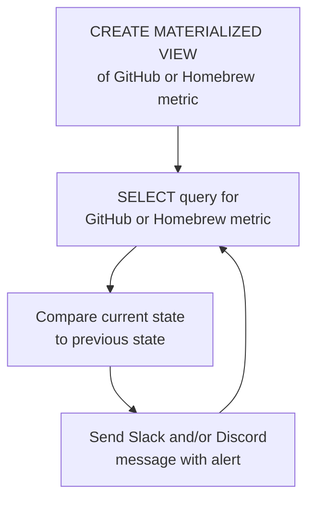

# 由 StackQL 驱动的开源项目活动监控器

本指南演示如何自托管一套面向 GitHub 开源软件维护者的实时监控与告警系统。  

> [__stackql__](https://github.com/stackql/stackql) 是一款开源工具，用户可以通过 SQL 语言以及数据可视化和分析库与工具来查询云和 SaaS 资源并与之交互。如果喜欢，请给我们点个 [⭐](https://github.com/stackql/stackql)！

在 Slack 和 Discord 中实时收到这样的告警：


测试环境：<span class="tutorial_tested_on">嵌入式 SQL 后端</span> <span class="tutorial_tested_on">docker</span> <span class="tutorial_tested_on">linux</span> 

## 概述 {#overview}

我在寻找用于监控我们开源项目的工具时，发现其中大多数并不像宣传的那样好用，或者根本无法使用（GitHub 中的第三方应用就是如此），于是我自己构建了一个，你也可以在自己的 GitHub 开源项目上启动并使用它……  

[__oss-activity-monitor__](https://github.com/stackql/oss-activity-monitor) 项目使用 [__stackql__](https://github.com/stackql/stackql) 对开源项目活动进行实时监控，包括以下内容的实时通知：

- ⭐ GitHub 仓库的新 stargazer
- 👀 GitHub 仓库的新 watcher
- 🍴 GitHub 仓库的新 fork
- 📊 GitHub 仓库的新 issue
- 🙋 GitHub 组织的新 follower
- 📦 GitHub 发布版本资产的新下载
- 🍺 新的 homebrew 下载

## 工作原理 {#how-it-works}

该项目部署在容器中（使用 `docker` 或其他容器部署平台），使用 `python` 和 [`pystackql`](https://pystackql.readthedocs.io/en/latest/intro.html) 包构建，并使用 `stackql` 的 [`github`](https://github.stackql.io/providers/github/) 和 [`homebrew`](https://homebrew.stackql.io/providers/homebrew) Provider。物化视图和 `SELECT` 语句用于捕获并比较 GitHub 和 Homebrew 受监控端点的当前指标与先前指标之间的状态，如下图所示：  


例如，给定下面这个使用 `stackql` 创建并填充的物化视图：  

```sql
CREATE OR REPLACE MATERIALIZED VIEW mvw_github_repo_stargazers AS 
SELECT login FROM github.activity.repo_stargazers
WHERE owner = 'your-org' and repo = 'your-repo'
```

下面的 `stackql` 查询会轮询 GitHub 以获取新的 stargazer……

```sql
SELECT c.login
FROM github.activity.repo_stargazers c
LEFT JOIN mvw_github_repo_stargazers mvw
ON c.login = mvw.login
WHERE mvw.login IS NULL
AND c.owner = 'your-org' AND c.repo = 'your-repo'
```

然后使用以下语句刷新状态……

```sql
REFRESH MATERIALIZED VIEW mvw_github_repo_stargazers
```

仓库 watcher、issue、组织 follower、发布版本资产下载和 homebrew 下载都重复类似的模式。

## 运行项目 {#running-the-project}

按照以下步骤，在本地或你首选的云平台上启动并运行该项目。  

### 1. 克隆仓库 {#1-clone-the-repo}

```bash
git clone https://github.com/stackql/oss-activity-monitor.git
# or 
git clone git@github.com:stackql/oss-activity-monitor.git
```

### 2. 配置环境变量 {#2-configure-environment-variables}

配置该项目需要以下环境变量（通过环境变量提供，下面的示例中使用 `.env` 文件）：  

| 变量                       | 说明                                                                              | 示例值                                           |
|----------------------------|-----------------------------------------------------------------------------------|--------------------------------------------------|
| `LOG_LEVEL`                | 日志级别（INFO 为常规日志；DEBUG 为详细日志）                                     | INFO                                             |
| `SLEEP_INTERVAL`           | 请求循环之间的延迟时间（秒）                                                      | 5                                                |
| `GITHUB_REPO`              | GitHub 仓库名称                                                                   | stackql                                          |
| `GITHUB_REPO_OWNER`        | GitHub 组织或所有者名称                                                           | stackql                                          |
| `HOMEBREW_FORMULA_NAME`    | Homebrew formula 名称（如有）                                                     | stackql                                          |
| `STACKQL_GITHUB_USERNAME`  | 你的 GitHub 用户名                                                                | jeffreyaven                                      |
| `STACKQL_GITHUB_PASSWORD`  | 你的 GitHub 个人访问令牌                                                          | ghp_yourpersonalaccesstoken                      |
| `SLACK_WEBHOOK_URL`        | 用于发送通知的 Slack webhook URL                                                  | https://hooks.slack.com/services/...             |
| `DISCORD_WEBHOOK_URL`      | 用于发送通知的 Discord webhook URL                                                | https://discord.com/api/webhooks/...             |

### 3. 构建容器 {#3-build-the-container}

```bash
docker build --no-cache -t oss-activity-monitor .
```

### 4. 运行容器 {#4-run-the-container}

```bash
docker run --env-file .env oss-activity-monitor
```

就这样！现在，当你的开源项目有活动时，你会收到实时告警。要停止容器，请使用：  

```bash
docker stop $(docker ps -a -q --filter ancestor=oss-activity-monitor)
```

在 [__GitHub__](https://github.com/stackql/stackql) 上给我们点个 ⭐
