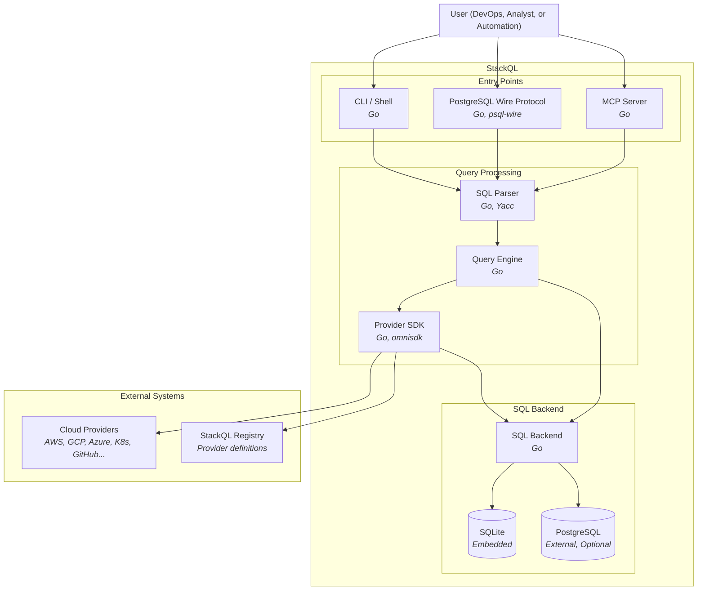

另請參閱：
[[ 使用 StackQL ]](/getting-started/using-stackql) [[ 使用變數 ]](/getting-started/variables) [[ 範本化 ]](/getting-started/templating)

## 概觀 {#overview}

StackQL 是一個統一的 SQL 介面，用於跨多個 Provider 查詢和管理雲端基礎架構。下列容器圖說明 StackQL 系統的主要元件及其互動方式。

## 核心元件 {#core-components}

### 進入點 {#entry-points}

StackQL 支援多個用於執行 SQL 查詢的進入點：

- **CLI / Shell**：互動式 shell 與命令列介面，可直接從終端機執行 SQL 查詢。使用者可以執行即席查詢、指令碼，或使用互動式 shell 進行探索。

- **PostgreSQL 線路協定**：允許來自標準 PostgreSQL 用戶端的連線，例如 `psql`、DBeaver 或任何其他與 PostgreSQL 相容的工具。這可與現有的資料庫工作流程和 BI 工具無縫整合。

- **MCP 伺服器**：可整合 AI 助理的 Model Context Protocol 伺服器，讓大型語言模型能透過自然語言查詢和管理基礎架構。

### 查詢處理管線 {#query-processing-pipeline}

1. **SQL 剖析器**：使用以 Yacc 為基礎的自訂文法，將 SQL 輸入剖析為抽象語法樹（AST）。剖析器（實作為 `stackql-parser`）會驗證 SQL 語法，並為查詢規劃做好準備。

2. **查詢引擎**：規劃並執行查詢的核心協調層。它會判斷哪些作業可以下推至 API 層，哪些需要在本機進行 SQL 處理。查詢引擎負責：
   - 查詢規劃與最佳化
   - 協調 API 呼叫與本機 SQL 執行
   - 結果彙總與轉換

### Provider SDK (omnisdk) {#provider-sdk-omnisdk}

Provider SDK [omnisdk](https://github.com/stackql-labs/omnisdk) 負責管理與雲端供應商的所有互動。它在 StackQL `v1.0` 中取代了 `any-sdk`。主要職責包括：

- **Provider 探索**：從 StackQL Registry（其中包含每個受支援雲端供應商以 OpenAPI 為基礎的定義）擷取 Provider 規格，並可選擇在使用每份文件之前驗證其 ML-DSA-65 簽章。

- **驗證**：處理每個 Provider 的驗證，支援多種驗證方法，包括 API 金鑰、OAuth 權杖、服務帳戶憑證等。每個 Provider 定義都會指定其驗證需求；一個工作階段可以用多個別名繫結同一個 Provider，各自使用不同的憑證（請參閱 [Provider 工作階段](/getting-started/provider-sessions)）。

- **圖形規劃**：將每個陳述式規劃為以資料邊和控制邊相連的 Provider 交換圖。聯結、子查詢、CTE 與檢視都透過同一個規劃器執行，而從計畫扇出的要求會在每個 Provider 和每個主機的限制內並行執行。

- **API 要求建置**：將 SQL 查詢轉換為各 Provider 適當的 REST API 呼叫，處理端點建構、參數對應和要求格式化。

- **分頁**：自動處理分頁的 API 回應，將各 Provider 使用的不同分頁機制（以資料指標為基礎、以位移為基礎、以權杖為基礎等）的複雜性抽象化。

- **述詞下推**：將對應到要求參數的條件，以及不需要排序時的 `LIMIT`，下推到 Provider 要求中，以減少發出的要求數量和傳輸的資料量。

- **回應轉換**：在 API 回應抵達時將其轉換為資料列，以暫存於 SQL 後端或串流傳送至用戶端。

SQL 連線、暫存與後端執行都保留在 StackQL 中。omnisdk 不包含任何 SQL 暫存，也從不接收資料庫連線；StackQL 會將關聯控制代碼傳給它，並接收資料列的資料指標。

### SQL 後端 {#sql-backend}

SQL 後端會對具體化的 API 資料執行關聯式作業：

- **SQLite**：內嵌的資料庫，用於暫存資料表儲存與關聯式處理。適合即席查詢和較小的資料集。

- **PostgreSQL**：選用的外部資料庫，用於持續性儲存、較大的資料集以及進階分析工作。

SQL 後端處理的作業包括：
- 跨多個 Provider 或資源的 JOIN 作業
- 彙總函式（COUNT、SUM、AVG 等）
- 對具體化資料進行排序與篩選
- 複雜的 SQL 運算式與子查詢

## 外部系統 {#external-systems}

### 雲端供應商 {#cloud-providers}

StackQL 透過 REST API 連線到雲端供應商（AWS、GCP、Azure、Kubernetes、GitHub 等等）。所有通訊都透過 HTTPS 進行，而 Provider SDK 會處理每個供應商 API 慣例的細節。

### StackQL Registry {#stackql-registry}

StackQL Registry 託管 Provider 定義：以 OpenAPI 為基礎、描述可用資源、方法及其對應關係的規格。Provider 具有版本控制，並可使用 `REGISTRY PULL` 命令隨需提取。

## 查詢執行流程 {#query-execution-flow}

1. 使用者透過其中一個進入點（CLI、PostgreSQL 協定或 MCP）提交 SQL 查詢
2. SQL 剖析器驗證查詢並將其轉換為 AST
3. 查詢引擎分析 AST 並建立執行計畫
4. 對於 Provider 作業，Provider SDK 會：
   - 從登錄庫擷取相關的 Provider 規格（若尚未快取）
   - 向雲端供應商進行驗證
   - 建置並執行 API 要求，並自動處理分頁
   - 盡可能將述詞下推至 API
   - 將結果具體化至 SQL 後端
5. SQL 後端執行任何剩餘的關聯式作業
6. 結果以要求的格式傳回給使用者
