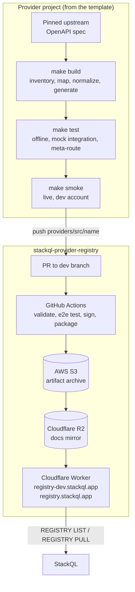

另請參閱：
[[ StackQL Provider 登錄庫 ]](/providers) [[ 使用 Provider ]](/getting-started/using-a-provider) [[ REGISTRY ]](/language-spec/registry) [[ 架構 ]](/developers/architecture)

## 概觀 {#overview}

StackQL Provider 是一組具有版本的 OpenAPI 文件加上 `x-stackQL-*` 擴充，[omnisdk](https://github.com/stackql-labs/omnisdk) 引擎會將其轉換為 SQL 資料表：`SELECT` 用於讀取，`INSERT`、`UPDATE`、`REPLACE` 和 `DELETE` 用於生命週期作業，`EXEC` 用於動作。Provider 文件告訴 StackQL 某個 Provider 的 API 能做什麼，以及如何以 SQL 語意叫用它。這些文件是純 YAML，因此 Provider 可以像任何其他程式碼一樣建置、測試和進行版本控制。

Provider 生態系統由三個存放庫和一個散發層組成：

| 元件 | 角色 |
| --- | --- |
| [__`stackql-provider-TEMPLATE`__](https://github.com/stackql-registry/stackql-provider-TEMPLATE) | 新 Provider 專案的起點：從固定版本的上游規格到產生的 Provider 的確定性 `make` 管線、無需憑證的測試層、即時冒煙測試套件、文件微型網站以及 CI。內附 Claude Code Provider 開發技能。 |
| [__`omnisdk`__](https://github.com/stackql-labs/omnisdk) | 讀取 Provider 文件並執行要求的引擎，自 StackQL `v1.0` 起採用。其前身 [`any-sdk`](https://github.com/stackql/any-sdk) 仍託管 Provider 文件契約、`x-stackQL-*` 擴充、驗證、分頁、轉換與下推的參考資料，以及下方連結的 JSON Schema。 |
| [__`stackql-provider-registry`__](https://github.com/stackql/stackql-provider-registry) | 已發佈 Provider 的事實來源。文件依版本存放於 `providers/src/<provider>/<version>/` 下，接著由 GitHub Actions 簽署、封裝並發佈。 |
| **Cloudflare 散發層** | 封裝後的 Provider 成品由位於 `registry.stackql.app`（生產環境）和 `registry-dev.stackql.app`（開發環境）的 Cloudflare Worker 從 Cloudflare R2 在邊緣提供。`REGISTRY LIST` 和 `REGISTRY PULL` 就是與此通訊。 |
<br/>
下圖顯示從 Provider 專案到 StackQL 安裝的路徑：



## Provider 文件結構 {#provider-document-structure}

StackQL 物件遵循 `provider.service.resource.method` 階層，例如 `google.compute.instances.list`。這些文件會對應該階層：

```
provider.yaml                          # provider metadata, providerServices, provider-level config
services/
  <service>.yaml                       # an OpenAPI 3 document per service, plus
    components.x-stackQL-resources
      <resource>                       # id, name, methods, sqlVerbs, optional config
        methods.<method>               # operation $ref, response, request, optional config
```

- **Provider 文件**（`provider.yaml`）：`id`、`name`、`title`、`version`、`providerServices`（每個都有指向其服務文件的 `service.$ref`，以及選用的 `preferred` 旗標）、選用的 `description`、`protocolType`（預設為 `http`）和 `config`。
- **服務文件**：標準的 OpenAPI 3 文件。唯一必要的新增項目是 `components.x-stackQL-resources`，用於宣告以資料表形式公開的資源。
- **資源**：`id`、`name`、`methods` 和 `sqlVerbs`。每個資源都是一個資料表；其資料行來自其主要 `select` 方法的回應 schema。
- **方法**：一個 `operation`，是指向 `paths` 的 JSON 指標（例如 `$ref: '#/paths/~1orgs~1{org}~1repos/get'`）；一個 `response` 區塊（`mediaType`、`openAPIDocKey`、`objectKey`），告訴引擎資料列所在的位置；以及選用的 `request` 區塊和 `config`。
- **SQL 動詞對應**：`sqlVerbs.select`、`insert`、`update`、`replace` 和 `delete` 是方法參考的有序清單。StackQL 會考慮所有必要參數都由 `WHERE` 子句提供的參考方法，並選擇必要參數最多的那一個，與清單順序無關：提供了 `get` 所需識別碼的查詢會路由至 `get`，未提供的查詢會路由至 `list`，而兩個不分高下的方法會回報為錯誤，而不是從中擇一。任何未被動詞清單參考的方法都可以透過 `EXEC` 呼叫。

最精簡的資源如下所示：

```yaml
components:
  x-stackQL-resources:
    repos:
      id: github.repos.repos
      name: repos
      title: Repos
      methods:
        list_for_org:
          operation:
            $ref: '#/paths/~1orgs~1{org}~1repos/get'
          response:
            mediaType: application/json
            openAPIDocKey: '200'
        create_in_org:
          operation:
            $ref: '#/paths/~1orgs~1{org}~1repos/post'
          response:
            mediaType: application/json
            openAPIDocKey: '201'
          config:
            requestBodyTranslate:
              algorithm: naive
      sqlVerbs:
        select:
          - $ref: '#/components/x-stackQL-resources/repos/methods/list_for_org'
        insert:
          - $ref: '#/components/x-stackQL-resources/repos/methods/create_in_org'
```

完整的契約（包括每個鍵及其意義）位於 any-sdk 的 [Provider 規格](https://github.com/stackql/any-sdk/blob/main/docs/provider_spec.md)。`provider.yaml`、服務文件和 config 區塊的 JSON Schema 位於 [`any-sdk/cicd/schema-definitions`](https://github.com/stackql/any-sdk/tree/main/cicd/schema-definitions)；config schema 會拒絕未知的鍵，因此拼錯的鍵會導致驗證失敗，而不會被默默忽略。

### OpenAPI 擴充 {#openapi-extensions}

| 擴充 | 位置 | 用途 |
| --- | --- | --- |
| `x-stackQL-resources` | `components` | 服務文件的資源字典（必要） |
| `x-stackQL-config` | 服務、資源、方法或作業 | 套用於該層級的 config 區塊（請參閱下文） |
| `x-stackQL-envVar` | 伺服器變數 | 指定一個環境變數，在 `WHERE` 子句中未提供伺服器變數時由它提供。用於依租用戶、組織、專案或部署界定 API 的範圍 |
| `x-stackQL-alias` | 參數或 schema 屬性 | SQL 中可接受、用來代替線路層級名稱的替代名稱 |
| `x-stackQL-stringOnly` | schema 屬性 | 無論宣告的型別為何，都將該屬性序列化為字串 |
| `x-stackQL-graphQL` | 作業 | 在 REST API 缺少資料時，以 GraphQL 查詢作為方法的後端 |
| `x-alwaysRequired` | 參數 | 將參數標記為一律必要 |
| `x-protocol` | `info` | 線路協定提示（`query`、`ec2`、`rest-xml`），用於由 schema 驅動的 XML 回應處理 |

### config 區塊 {#the-config-block}

`provider.yaml` 中的 `config` 與服務文件中的 `x-stackQL-config` 共用同一個 schema。允許的鍵為 `auth`、`pagination`、`queryParamPushdown`、`queryParamTranspose`、`requestTranslate`、`requestBodyTranslate`、`variations`、`views`、`sqlExternalTables`、`retry`、`minStackQLVersion` 和 `snake_case_aliases`。config 會從最具體的層級向外解析：方法 -> 資源 -> 服務 -> Provider 服務 -> Provider，因此 Provider 層級的預設值可以針對單一資源或方法覆寫。

## Provider 負責的工作 {#what-providers-handle}

Provider 負責將 API 複雜性抽象化的各項功能，讓使用者無需管理底層的 HTTP 交談，就能獲得一致的 SQL 介面。

### 驗證 {#authentication}

每個 Provider 都附帶預設的 `auth` 區塊，指定存放其憑證的環境變數，因此已設定好這些變數的環境不需要任何執行階段驗證設定。Provider 文件中只接受間接參照（環境變數名稱、檔案路徑）；實際的憑證值只能放在執行階段的 `--auth` 內容中。若供應商有 Terraform provider，環境變數名稱應遵循該 Terraform provider 的命名。

| `auth.type` | 常見欄位 |
| --- | --- |
| `bearer` | `credentialsenvvar` |
| `api_key` | `credentialsenvvar`、`valuePrefix`，選用的 `location`（`header` 或 `query`）和 `name` |
| `basic` | `username_var`, `password_var` |
| `custom` | `location`、`name`、`credentialsenvvar`、選用的 `valuePrefix`；以 `successor` 串接第二個憑證 |
| `oauth2` | `client_id_env_var`, `client_secret_env_var`, `grant_type: client_credentials`, `token_url`, `scopes` |
| `service_account` | `credentialsenvvar` 或 `credentialsfilepathenvvar`、`scopes` |
| `aws_signing_v4`, `aws_assume_role` | `keyIDenvvar`, `credentialsenvvar` |
| `azure_default` | 無 |
| `oci_signing_v1` | `tenancy_ocid_envvar`, `user_ocid_envvar`, `oci_fingerprint_envvar`, `oci_private_key_envvar`, `oci_region_envvar` |
| `interactive` | 無 |
| `null_auth` | 無（明確不驗證） |
<br/>
例如：

```yaml
config:
  auth:
    type: api_key
    credentialsenvvar: OKTA_API_TOKEN
    valuePrefix: 'SSWS '
```

使用者可以在執行階段使用 `--auth='{"<provider>": {...}}'` 覆寫 Provider 的驗證設定。

### 分頁 {#pagination}

Provider 會宣告供應商的分頁機制，引擎則逐一走訪每一頁，因此使用者會收到完整的結果集。支援的機制：

- **本文中的權杖或資料指標**：`requestToken: {key: cursor, location: query}`、`responseToken: {key: $.cursor, location: body}`；在權杖不存在或為空時停止。
- **本文中的下一頁 URL**：`requestToken: {key: '', location: request}`、`responseToken: {key: $.next, location: body}`；OData `@odata.nextLink` 使用 `algorithm: odata_next_link`。
- **RFC 5988 `Link` 標頭**：`responseToken: {key: Link, location: header}`。
- **頁碼加上頁數**：`algorithm: page_number`，搭配 `responseToken`（目前頁碼）和 `responseTerminator`（總頁數）。

沒有下一頁標記的 offset 與 limit 型 API 不屬於分頁機制；請改為將 `offset` 和 `limit` 公開為 `WHERE` 參數。`--http.response.pageLimit` 全域旗標會限制走訪的範圍。

### 述詞下推 {#predicate-pushdown}

`WHERE` 中的鍵會依名稱與作業宣告的參數進行比對（依序為路徑，接著是查詢、標頭和 Cookie），並傳送至 API，因此篩選會在來源端進行。任何沒有相符參數的剩餘 `WHERE` 鍵都會附加為查詢參數。

除了一般參數之外，`queryParamPushdown` 還會將 `SELECT` 資料行、`WHERE`、`ORDER BY`、`LIMIT`、`OFFSET` 和 `COUNT` 改寫為 API 參數。`dialect: odata` 會填入 Microsoft Graph 與 Azure 風格 API 所使用的 `$select`、`$filter`、`$orderby`、`$top`、`$skip` 和 `$count` 預設值；`dialect: custom` 則原封不動地使用 `paramName`，最常見的是 `top: {paramName: limit, maxValue: 1000}`，讓 `LIMIT n` 變成 `?limit=n`。無法下推的述詞仍會在用戶端評估。

### 回應與要求轉換 {#response-and-request-transformation}

- `response.objectKey` 是一個 JSONPath（XML API 則為 XPath），用於從外層封套中選取包含資料列的項目，例如 `$.data[*]` 或 `$.value`。
- `response.transform` 會在本文暫存為資料列之前，對其套用 Go 文字範本；轉換類型涵蓋 JSON、XML 和純文字，AWS XML API 和 CLI 輸出就是藉此成為資料表。
- `requestBodyTranslate: {algorithm: naive}` 讓 `INSERT` 能以一般資料行名稱接收要求本文欄位，而不必使用加上 `data__` 前置詞的形式。
- 在 Provider 層級設定 `snake_case_aliases: true`，會將 camelCase 線路名稱公開為 snake_case 資料行和參數。
- `retry` 會設定指數退避政策（`max_attempts`、`initial_delay_ms`、`max_delay_ms`、`multiplier`、`jitter_fraction`、`retryable_methods`、`retryable_conditions.status_codes`）。以第一個宣告此設定的層級為準；請參閱 any-sdk 的[重試政策](https://github.com/stackql/any-sdk/blob/main/docs/retry_policy.md)。

資料行型別遵循 OpenAPI schema：`string` -> text、`integer` -> integer、`number` -> numeric、`boolean` -> boolean。`object` 和 `array` 屬性會儲存為 JSON 文字，這就是為什麼查詢中要使用 `json_extract` 讀取巢狀欄位，也是 Provider 常為常見的巢狀投影提供檢視（`config.views`，具有各方言的 `ddl` 和 `fallback`）的原因。

### 非 HTTP Provider {#non-http-providers}

`provider.yaml` 中的 `protocolType: local_templated` 會以本機命令而非 HTTP 作為 Provider 的後端：方法帶有由 Go 範本 argv 片段組成的 `inline` 陣列，參數使用 `in: inline`，並由 `response.transform` 將命令輸出轉換為資料列。any-sdk 中的 [`local_openssl`](https://github.com/stackql/any-sdk/tree/main/test/registry/src/local_openssl/v0.1.0) 參考 Provider 展示了其結構。這不在範本管線的範圍內，該管線以 HTTP API 為目標。

## 開始 Provider 專案 {#starting-a-provider-project}

每個新 Provider 都從 [__`stackql-provider-TEMPLATE`__](https://github.com/stackql-registry/stackql-provider-TEMPLATE) 開始。這是一個 GitHub 範本存放庫，體現了目前 Provider 的標準：固定版本的上游規格；確定性的建置管線，其中每個人工決策都是指令碼中的規則，而不是對產生的 YAML 的手動編輯；三個無需憑證的測試層；有預算限制的即時冒煙測試套件；Docusaurus 文件網站以及 CI。以此方式建置的已發佈 Provider 位於 [stackql-registry](https://github.com/orgs/stackql-registry/repositories) GitHub 組織中，可與範本搭配作為實用的參考資料。

必要條件：Node.js 20 或更新版本、GNU make 和 bash（Linux、macOS 或 WSL）、用於冒煙測試套件的 Python 3，以及 `stackql` 二進位檔（若找不到，`bin/start-server.sh` 會下載一個）。

1. 從範本建立存放庫（GitHub 的「Use this template」），並執行 `npm install`。
2. 執行 `bin/init-provider.sh <name> "<Title>" [https://api.vendor.com]`，以取代整個存放庫中的預留位置。
3. 填入 `provider-dev/scripts/lib/spec_helpers.mjs` 中的常數（規格 URL、路徑版本前置詞、以租用戶或專案為範圍之 API 的範圍前置詞），以及 `provider-dev/config/` 下的設定（`servers.json`、`provider_config.json`、`service_names.json`）。
4. 執行管線，可以透過 `make` 目標手動進行，也可以在存放庫中開啟 Claude Code 工作階段（請參閱下文）。
5. `grep -rn "TODO(template)"` 會列出仍待處理的項目。

管線由 `make` 驅動（`make help` 會列出每個目標）：

```bash
make fetch-spec        # verify the upstream spec against the recorded pin (fails on drift)
make inventory         # one CSV row per operation with the proposed service, resource, method and verb
make split             # write provider-dev/source/<service>.yaml from the ordered path rules
make mappings-report   # print every derived operation -> resource.method mapping without writing
make mappings          # regenerate provider-dev/config/all_services.csv and validate it
make normalize         # flatten allOf, lower oneOf/anyOf, wrap bare arrays
make generate          # generate provider.yaml + services/*.yaml, then post-process and merge GraphQL/views
make test              # offline SHOW/DESCRIBE, mock API integration tests, meta-route walk (no credentials)
make smoke             # live smoke suite against a dedicated dev account (sources .env)
make docs              # generate the provider documentation site content
make all               # everything above except the live suites
```

在底層，管線使用 [__`@stackql/provider-utils`__](https://github.com/stackql-registry/stackql-provider-utils)（`split`、`normalize`、`analyze`、`generate` 和 `docgen`），並搭配 `provider-dev/scripts/` 中的 Provider 專屬規則。產生的 Provider 會放在 `provider-dev/openapi/src/<name>/v00.00.00000/`，這就是最終發佈至登錄庫的目錄。

`provider-dev/config/all_services.csv` 是已提交的契約，記錄每個作業到資源與方法的對應。重新產生時出現的差異應視為重大變更審查，而不是雜訊。若有尚未提交的產生漂移，CI 就會失敗，因此重新產生必須逐位元組重現已提交的成品。

對於早於範本建立的現有 Provider 存放庫，請將 `.claude/skills` 目錄複製到其中，並從該技能的 `references/uplift-checklist.md` 開始。

### 使用 Claude Code 進行 Provider 開發 {#using-claude-code-for-provider-development}

範本內附 [**StackQL Provider 開發技能**](https://github.com/stackql-registry/stackql-provider-TEMPLATE/blob/main/.claude/skills/stackql-provider-development/SKILL.md)，適用於 [Claude Code](https://docs.anthropic.com/en/docs/claude-code)。在從範本建立的存放庫中開啟 Claude Code 工作階段，並要求它建置 Provider；它會讀取 `CLAUDE.md` 和該技能，並依序執行各步驟。此技能也是手動完成這些工作時的書面步驟。

此技能涵蓋：

- 選擇原型：供應商發佈的 OpenAPI、Swagger 或探索文件（直接），或從供應商 SDK 衍生的規格，此時 SDK 是事實來源（衍生）
- 擷取、修正、驗證並固定上游規格，讓每次重新整理都是可審查的差異
- 端點清單、服務分割，以及產生 `all_services.csv` 的對應規則
- 每個 Provider 文件基本元素及其使用時機：`x-stackQL-envVar` 範圍界定、`objectKey`、要求與回應轉換、分頁、查詢參數下推、生命週期 `EXEC` 方法、GraphQL 合併以及 Provider 檢視
- 三個無需憑證的測試層和即時冒煙測試套件
- 文件網站、CI 工作流程和交接說明

此技能的 `references/` 目錄包含每個步驟的詳細資料，而 `scripts/find_extension_examples.sh` 會從 Provider 登錄庫的複本中，輸出任何擴充鍵的已發行 YAML，因此在撰寫某個基本元素之前，可以先看到它的實際用法。

## 在本機測試 Provider {#testing-a-provider-locally}

StackQL 會從 `--registry` 全域旗標所描述的登錄庫讀取 Provider。開發期間，請將其指向本機檔案系統上產生的 Provider 目錄，並停用簽章驗證（文件只有在發佈時才會簽署）：

```bash
export LOCAL_REG='{ "url": "file:///path/to/provider-dev/openapi", "localDocRoot": "/path/to/provider-dev/openapi", "verifyConfig": { "nopVerify": true } }'
stackql --registry="${LOCAL_REG}" shell
```

`localDocRoot` 下的目錄必須包含 `src/<provider>/<version>/provider.yaml` 和 `src/<provider>/<version>/services/*.yaml`，這正是範本所產生的內容。在 shell 中，可先使用 `SHOW SERVICES IN <provider>`、`SHOW RESOURCES IN <provider>.<service>`、`SHOW METHODS IN <provider>.<service>.<resource>` 和 `DESCRIBE EXTENDED <provider>.<service>.<resource>` 確認公開的介面，再執行任何查詢。範本的 `tests/offline_validation.mjs` 會自動執行這些斷言，而 `npm run probe -- "SELECT ..."` 會對模擬 API 執行即席 SQL，並輸出線路呼叫。

從遠端登錄庫提取的 Provider 預設會快取在 `<cwd>/.stackql` 下；請使用 `--approot` 變更位置。

[any-sdk CLI](https://github.com/stackql/any-sdk/blob/main/docs/cli.md) 適合在不經過 StackQL 的情況下檢查文件：`anysdk aot <registry> <provider.yaml>` 會對 Provider 執行靜態分析（無法路由的 `objectKey`、缺少的回應 schema、不完整的分頁、相鄰的路徑參數等），而 `anysdk query` 會直接從 Provider 和服務文件執行單一方法。[Automock 測試](https://github.com/stackql/any-sdk/blob/main/docs/automock_testing.md) 會根據 Provider 中的 schema 產生模擬 API 和預期結果，在不接觸線上 API 的情況下完成完整的往返測試。

### 使用 `dev` 登錄庫測試您的 Provider {#testing-your-provider-using-the-dev-registry}

Provider 合併到登錄庫的 `dev` 分支後，即可從開發登錄庫取得。將 StackQL 指向它，以驗證已發佈的成品：

```bash
export DEV_REG='{ "url": "https://registry-dev.stackql.app/providers" }'
stackql --registry="${DEV_REG}" shell
```

```sql
REGISTRY PULL myprovider;
```

範本的 `make smoke-live` 目標會針對已發佈的 Provider 執行冒煙測試套件，以進行發佈後驗證。

## 發佈 Provider {#publishing-a-provider}

發佈是一個獨立且需要人工參與的步驟，不屬於範本管線的一部分。

1. Fork [stackql-provider-registry](https://github.com/stackql/stackql-provider-registry)，並在功能分支中將產生的 `provider-dev/openapi/src/<name>` 目錄複製到 `providers/src/<name>`。
2. 對 `dev` 分支提出 pull request，並附上 Provider 和變更的描述（請參閱登錄庫的[貢獻指南](https://github.com/stackql/stackql-provider-registry/blob/main/.github/CONTRIBUTING.md)）。
3. GitHub Actions 會使用 [stackql-provider-tests](https://github.com/stackql/stackql-provider-tests) 驗證並測試 Provider。評估的規則如下：文件必須是有效的 OpenAPI 規格、所有服務都必須能列舉資源、所有資源都必須能列舉方法、可透過 `SELECT` 呼叫的方法必須具有有效的回應 schema，而可透過 `INSERT` 呼叫的方法必須具有有效的要求 schema。
4. 合併時，工作流程會配置版本、簽署文件（ML-DSA-65）、加以封裝，並將成品發佈至 AWS S3 封存。接著文件樹會複寫至 Cloudflare R2，並部署提供 `registry-dev.stackql.app` 服務的 Cloudflare Worker。設定為使用 `dev` 登錄庫的安裝會立即取得該 Provider。
5. 經過一段監控期後，`dev` 會升級為 `main`，並針對 `registry.stackql.app` 重複發佈流程。這才是針對預設設定之 StackQL 執行個體的發佈。

在提出 PR 之前，也可以在本機針對登錄庫目錄執行相同的 `stackql-provider-tests` 測試框架：

```bash
test-provider.sh <provider_name> false /path/to/provider-dev/openapi
```

如需工作流程的詳細資訊，包括保護 `providers/src` 的 Provider 刪除防護機制，請參閱登錄庫存放庫中的[建置與部署](https://github.com/stackql/stackql-provider-registry/blob/main/docs/build-and-deployment.md)。
