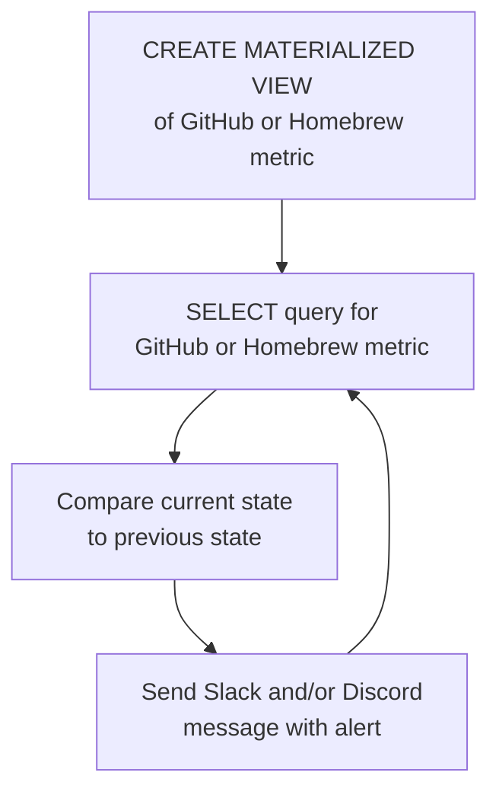

# 由 StackQL 驅動的開源專案活動監控器

在本指南中，我們將示範如何為 GitHub 開源軟體維護者自行託管即時監控與警示系統。

> [__stackql__](https://github.com/stackql/stackql) 是一款開源工具，可讓使用者透過 SQL 語言以及資料視覺化與分析程式庫和工具，查詢雲端與 SaaS 資源並與之互動。如果您喜歡，請給我們一顆 [⭐](https://github.com/stackql/stackql)！

在 Slack 與 Discord 中即時收到像這樣的警示：


測試環境：<span class="tutorial_tested_on">內嵌式 SQL 後端</span> <span class="tutorial_tested_on">docker</span> <span class="tutorial_tested_on">linux</span>

## 概觀 {#overview}

當我在尋找監控我們開源專案的工具時，發現大多數工具不是無法如宣傳般運作，就是根本無法運作（GitHub 中的第三方應用程式就是如此），因此我自己打造了一套，您可以在自己的 GitHub 開源專案上啟動並使用。

[__oss-activity-monitor__](https://github.com/stackql/oss-activity-monitor) 專案使用 [__stackql__](https://github.com/stackql/stackql) 執行即時的開源專案活動監控，包括下列項目的即時通知：

- ⭐ GitHub 存放庫的新 stargazer
- 👀 GitHub 存放庫的新 watcher
- 🍴 GitHub 存放庫的新 fork
- 📊 GitHub 存放庫的新 issue
- 🙋 GitHub 組織的新追蹤者
- 📦 GitHub 發行版本資產的新下載
- 🍺 homebrew 的新下載

## 運作方式 {#how-it-works}

此專案部署在容器中（使用 `docker` 或其他容器部署平台），以 `python` 和 [`pystackql`](https://pystackql.readthedocs.io/en/latest/intro.html) 套件建置，並使用 `stackql` 的 [`github`](https://github-provider.stackql.io/) 與 [`homebrew`](https://homebrew-provider.stackql.io/) Provider。具體化檢視與 `SELECT` 陳述式用於擷取並比較 GitHub 與 Homebrew 受監控端點目前與先前指標之間的狀態，如下圖所示：


例如，假設已使用 `stackql` 建立並填入下列具體化檢視：

```sql
CREATE OR REPLACE MATERIALIZED VIEW mvw_github_repo_stargazers AS 
SELECT login FROM github.activity.repo_stargazers
WHERE owner = 'your-org' and repo = 'your-repo'
```

下列 `stackql` 查詢會輪詢 GitHub 以取得新的 stargazer：

```sql
SELECT c.login
FROM github.activity.repo_stargazers c
LEFT JOIN mvw_github_repo_stargazers mvw
ON c.login = mvw.login
WHERE mvw.login IS NULL
AND c.owner = 'your-org' AND c.repo = 'your-repo'
```

接著使用下列陳述式重新整理狀態：

```sql
REFRESH MATERIALIZED VIEW mvw_github_repo_stargazers
```

存放庫 watcher、issue、組織追蹤者、發行版本資產下載與 homebrew 下載也重複採用類似的模式。

## 執行專案 {#running-the-project}

依照下列步驟，在本機或您偏好的雲端平台上啟動並執行此專案。

### 1. 複製存放庫 {#1-clone-the-repo}

```bash
git clone https://github.com/stackql/oss-activity-monitor.git
# or 
git clone git@github.com:stackql/oss-activity-monitor.git
```

### 2. 設定環境變數 {#2-configure-environment-variables}

設定此專案需要下列環境變數（以環境變數提供，下方範例中使用 `.env` 檔案）：

| 變數                       | 描述                                                                              | 範例值                                           |
|----------------------------|-----------------------------------------------------------------------------------|--------------------------------------------------|
| `LOG_LEVEL`                | 記錄層級（INFO 用於一般記錄；DEBUG 用於詳細記錄）                                 | INFO                                             |
| `SLEEP_INTERVAL`           | 每次要求迴圈之間的延遲時間（秒）                                                  | 5                                                |
| `GITHUB_REPO`              | GitHub 存放庫名稱                                                                 | stackql                                          |
| `GITHUB_REPO_OWNER`        | GitHub 組織或擁有者名稱                                                           | stackql                                          |
| `HOMEBREW_FORMULA_NAME`    | Homebrew formula 名稱（如果有的話）                                               | stackql                                          |
| `STACKQL_GITHUB_USERNAME`  | 您的 GitHub 使用者名稱                                                            | jeffreyaven                                      |
| `STACKQL_GITHUB_PASSWORD`  | 您的 GitHub 個人存取權杖                                                          | ghp_yourpersonalaccesstoken                      |
| `SLACK_WEBHOOK_URL`        | 用於傳送通知的 Slack webhook URL                                                  | https://hooks.slack.com/services/...             |
| `DISCORD_WEBHOOK_URL`      | 用於傳送通知的 Discord webhook URL                                                | https://discord.com/api/webhooks/...             |

### 3. 建置容器 {#3-build-the-container}

```bash
docker build --no-cache -t oss-activity-monitor .
```

### 4. 執行容器 {#4-run-the-container}

```bash
docker run --env-file .env oss-activity-monitor
```

就這樣！現在，當您的開源專案有任何活動時，您都會收到即時警示。若要停止容器，請使用：

```bash
docker stop $(docker ps -a -q --filter ancestor=oss-activity-monitor)
```

在 [__GitHub__](https://github.com/stackql/stackql) 上給我們一顆 ⭐
